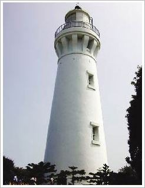
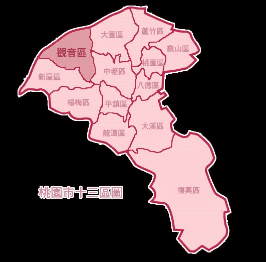

:::觀音區介紹- [認識本區](cl.aspx?n=6872)
- [觀光旅遊資訊](cl.aspx?n=6875)
- [本所組織介紹](cl.aspx?n=6879)
- [本所沿革](cp.aspx?n=6884)
- [未來展望](cp.aspx?n=6885)

:::## 本所沿革

跳過此子選單列請按[Enter]，繼續則按[Tab]網頁功能- [列印內容](javascript:CCMS_Print(78);)

$(function () { $('[tab-cp]').each(function () { $(this).click(function (event) { event.preventDefault(); $('[tab-cp]').removeClass('is-active'); $('[tab-cp] a[role="tab"]').attr({ 'aria-selected': 'false', tabindex: '-1' }); $.each($('[tab-cp]'), function (i,item) { var $aTag = $(item).find('a'); var title = $aTag.html(); $aTag.attr('role', 'tab'); if (!$(item).hasClass('is-active') && !$aTag.attr('title')?.startsWith('選取後將')) { $aTag.attr('title', '選取後將變更主要內容為 ' + title); } }) $(this).addClass('is-active'); $(this).find('a[role="tab"]').attr({ 'aria-selected': 'true', tabindex: '0' }); var title = $(this).find('a').html(); $(this).find('a').attr('title','當前頁面 ' +title); $('[tab-cp-target]').attr('hidden', true).removeAttr('style'); $('[tab-cp-target="' + $(this).attr('tab-cp') + '"]').removeAttr('hidden').removeAttr('style'); }) }).eq(0).click(); if (getParameterByName('s') != '') { $('[tab-cp="' + getParameterByName('s') + '"]').click(); } $('[tab-show="false"]').each(function () { $(this).hide(); }) var elements = document.querySelectorAll("[id^='ContentPlaceHolder1']"); elements.forEach(function (element) { var h3Element = element.querySelector('h3'); if (h3Element) { var h3Text = h3Element.textContent.trim(); var links = element.querySelectorAll('a[class="div"]'); links.forEach(function (link) { if (link.hasAttribute('title')) { var originalTitle = link.querySelector('.caption').innerText; if (!originalTitle.includes(h3Text)) { var newTitle = h3Text + ' ' + originalTitle; link.setAttribute('title', newTitle); } } }); } }); // 無障礙修正 WCAG 2.4.4 HM1240404E： // 工單32030、32032、32049：附件連結需在 title 帶出檔名，讓 NVDA 能分辨不同檔案的連結目的 // 做法：已有 title 的連結不動（避免覆蓋後台相關檔案的設定），沒有 title 的才依檔案類型補上 document.querySelectorAll('a[target="_blank"]').forEach(function (a) { a.setAttribute('rel', 'noopener noreferrer'); if (a.title) return; // 優先取 data-name（後台上傳時帶的原始檔名），其次用連結文字 let fileName = a.getAttribute("data-name") || a.innerText.trim() || ""; const ext = fileName.split('.').pop().toLowerCase(); // Office、壓縮檔、音檔等需另存才能開，用「下載」 if (["doc", "docx", "ppt", "pptx", "xls", "xlsx", "odf", "odt", "ods", "odp", "txt", "csv", "rar", "zip", "mp3"].includes(ext)) { a.title = `${fileName} 下載`; } // 其餘（含 pdf、圖檔、未知類型）統一用「另開新視窗」 // ext 有值代表 fileName 一定有值；沒有才需判斷 fileName 是否為空 else { a.title = fileName ? `${fileName} 另開新視窗` : "另開新視窗"; } }); // 將分頁連結標記為 WAI-ARIA Tab。 // 只針對 .list-text.classify 裡的 a（分頁） document.querySelectorAll('.list-text.classify a').forEach(function (anchor) { anchor.setAttribute('role', 'tab'); }); // 無障礙 : 頁籤容器 tablist $('.list-text.classify').attr('role', 'tablist'); // 初始化每個分頁的對應屬性（id / href / aria-controls / 目前選取狀態） $('.list-text.classify li[tab-cp] a').each(function () { const $a = $(this); const $li = $a.closest('li[tab-cp]'); const id = $li.attr('tab-cp'); const active = $li.hasClass('is-active'); $a.attr({ id: 'tab-' + id, href: '#Group_' + id, 'aria-controls': 'panel-' + id, 'aria-selected': active ? 'true' : 'false', tabindex: active ? '0' : '-1' }); }); // 初始化每個面板語意與對應分頁 $('[tab-cp-target]').each(function () { const id = $(this).attr('tab-cp-target'); $(this).attr({ role: 'tabpanel', id: 'panel-' + id, 'aria-labelledby': 'tab-' + id }); // 依目前可見性同步 hidden if ($(this).is(':visible')) $(this).removeAttr('hidden'); else $(this).attr('hidden', true); }); // 鍵盤導覽 : 左右/Home/End // 移動焦點 : Enter / Space 啟用 var $tablist = $('.list-text.classify'); $tablist.on('keydown', 'a[role="tab"]', function (e) { const $tabs = $tablist.find('a[role="tab"]'); const i = $tabs.index(this); let j = i; if (e.key === 'ArrowRight') j = (i + 1) % $tabs.length; else if (e.key === 'ArrowLeft') j = (i - 1 + $tabs.length) % $tabs.length; else if (e.key === 'Home') j = 0; else if (e.key === 'End') j = $tabs.length - 1; else if (e.key === 'Enter' || e.key === ' ') { e.preventDefault(); $(this).closest('li[tab-cp]').click(); return; } else return; e.preventDefault(); $tabs.eq(j).focus(); }); }) function DeptSearch() { var ddlTitle = $("#jDeptSearch").find(":selected").text(); var cpHtml = $(".group.base-article.taoyuan-link"); if ($(cpHtml).find($("a[data-name='" + ddlTitle + "']")).length == 0) { alert('查無相關資訊'); } else { var ddlUrl = $(cpHtml).find($("a[data-name='" + ddlTitle + "']")).attr("href"); if (ddlUrl.indexOf('http') >= 0) { window.open(ddlUrl, '_blank'); } else { location.href = (ddlUrl); } } }- 本所沿革

### 歷史沿革

清朝咸豐10年（1860）農曆 4月22日，竹北二堡石牌嶺庄（今新屋區境或本區部分地區隸屬之庄名）有一農家傭工黃等成，於耕作反舍時路經一小溪（觀音溪），忽見溪流中有一天然石塊酷似彿像，頗為好奇，於是下水拾取後放置路旁，當時觀音街市附近僅九戶人家，居民將該天然石像供為觀音彿祖，稱之為「石觀音」，並築草奄祀奉。該地區自此被稱為石觀音為觀音鄉名稱由來，為因應103年12月25日桃園縣改制直轄市，成為觀音區。

### 地理位置

觀音區為桃園市沿海四區之ㄧ，海岸線長約十五公里、面積達 87.79 平方公里，劃分24村、402 鄰，人口數五萬九千餘人，因地理環境與拓植時期種種因素，自然形成三大發展區域------觀音、草漯與新坡區。閩、客族群在這三大區域中各自形成不同的文化呈現。

### 桃園市十三區圖

- [回上一頁](javascript:window.location =document.referrer;)
- [回最上面](#Accesskey_U)
