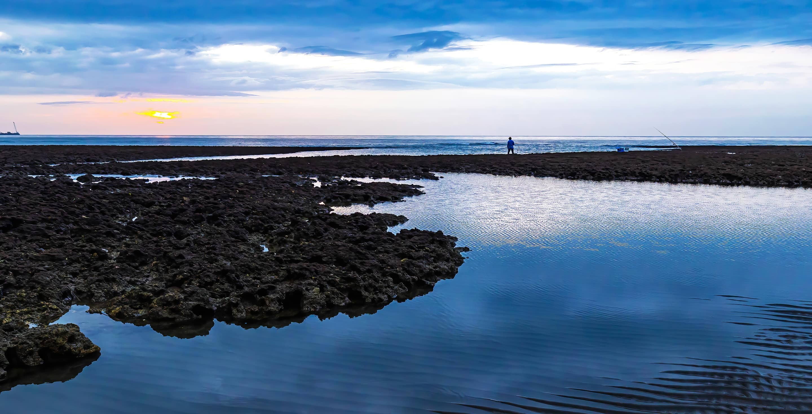# 小桃帶路認識珍珠海岸

## 跟著小桃出發展開珍珠海岸之旅

珍珠海岸位在桃園市西側海岸線，北起蘆竹區南崁溪口，南至新屋區社子溪口，全長約五十一公里，橫跨四個行政區；**蘆竹**有山有茶園，**大園**有全台最壯觀的海岸沙丘，**觀音**的蓮花田和藻礁別處看不到，**新屋**的石滬和牽罟更是百年海洋文化的活化石；同一條海岸線，四種完全不同的風景。

準備好了嗎？跟小桃一起出發，走訪這片美麗海岸。

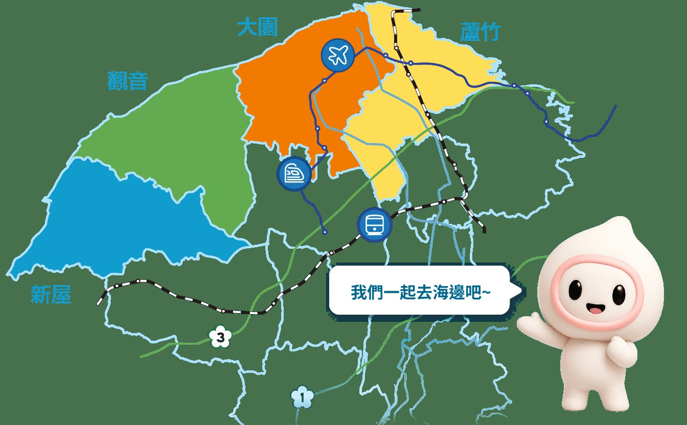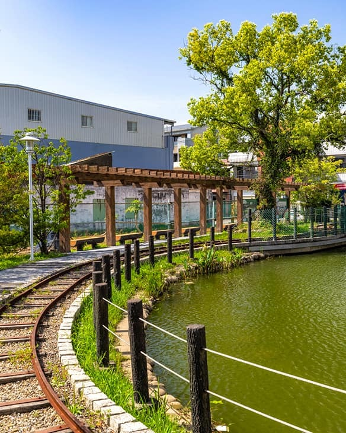傍晚上大古山看飛機配夕陽，下山再去坑子溪喝杯茶，超chill！

## 蘆竹

在桃園近郊漫步自然步道與農場

蘆竹是珍珠海岸的北端起點，也是離桃園市區最近的山海交會之地。沿著五酒桶山步道可遠眺台灣海峽，大古山觀景台更是追飛機、賞夕陽與夜景的人氣地標，每年春季老鷹過境，是北台灣難得的賞鷹熱點。山腳下的坑子溪休閒農業區保有閩南農村聚落風貌，以蘆峰烏龍茶與綠竹筍聞名，從品茶到採筍，是最適合半日輕旅行的濱海近郊。

### 遊玩攻略

- 走訪三條登山步道，白天健行眺望風景，晚上坐擁萬家燈火，享受生活。
- 多種主題休閒農場，品嘗在地食材，體驗農家樂趣
- 坑子溪農業區體驗採筍、品茶，走訪百年土埆厝聚落
- 南崁溪人工溼地綠化園區有著桃園最美的河川步道

### 美食及伴手禮

綠竹筍風味餐、蘆峰烏龍茶

更多區域介紹### 必遊景點

- 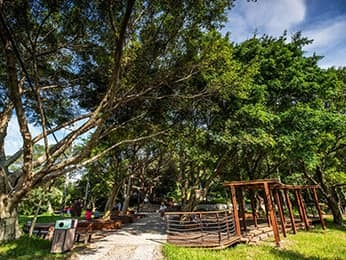[五酒桶山步道](/pearl-coast/zh-tw/attractions/478)
- 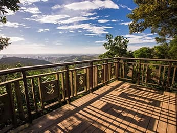[羊稠森林步道](/pearl-coast/zh-tw/attractions/652)
- 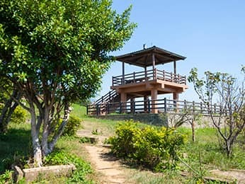[大古山步道](/pearl-coast/zh-tw/attractions/651)
- 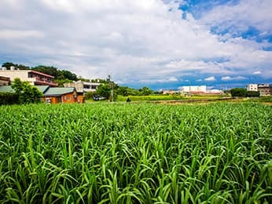[大古山休閒農業區](/pearl-coast/zh-tw/attractions/1533)

看更多景點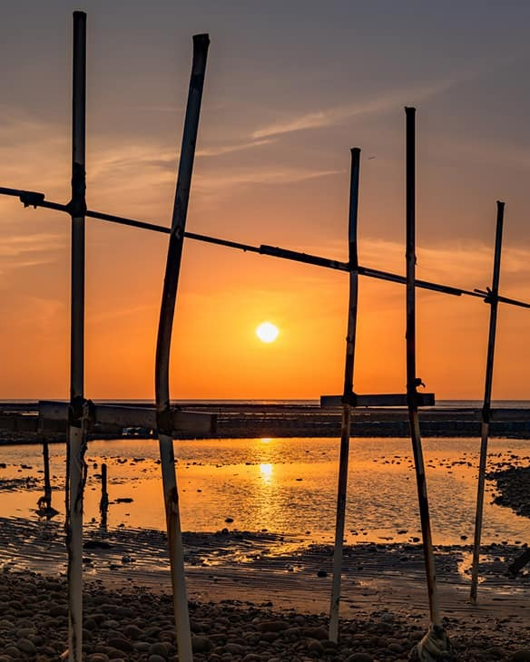走進草漯沙丘那一刻，風紋、風車、夕陽全到齊，根本不用出國！

## 大園

擁有國際機場及沙丘奇景的臨海視野

大園坐擁桃園國際機場，也是台版撒哈拉-「草漯沙丘地質公園」的北段入口；踏入綿延八公里的海岸沙丘，風蝕沙紋在日出與夕陽時分格外壯觀，一整排白色風力發電機隨風轉動，構成珍珠海岸最具辨識度的風景。許厝港濕地為國家級重要濕地，鳥種紀錄多達兩百餘種，是北台灣首屈一指的賞鳥聖地。竹圍漁港距機場僅三公里，是旅客落地後最近的海鮮市場。

### 遊玩攻略

- 穿越龍貓隧道後，踏入草漯沙丘拍出異國沙漠大片
- 秋冬到許厝港濕地賞鳥，黑面琵鷺與唐白鷺是亮點
- 竹圍漁港一樓買現撈、二樓代客料理，彩虹橋看漁港全景
- 3 - 4月到溪海花卉農業區追彩色海芋季，暢遊花海

### 美食及伴手禮

西瓜、香瓜、地瓜、蕎麥、漁獲海鮮

更多區域介紹### 必遊景點

- 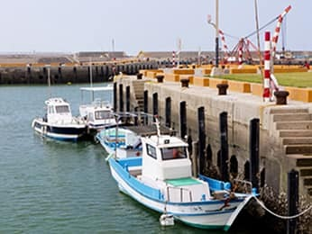[竹圍漁港](/pearl-coast/zh-tw/attractions/188)
- 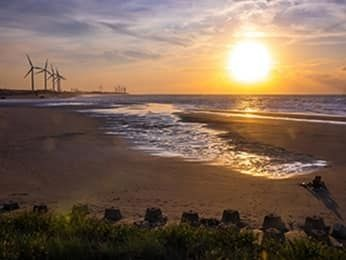[許厝港濕地](/pearl-coast/zh-tw/attractions/961)
- [草漯沙丘地質公園](/pearl-coast/zh-tw/attractions/1442)
- 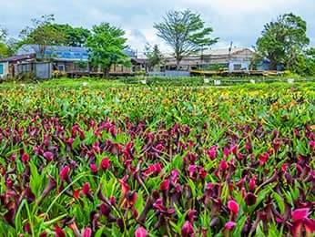[溪海休閒農業區](/pearl-coast/zh-tw/attractions/248)

看更多景點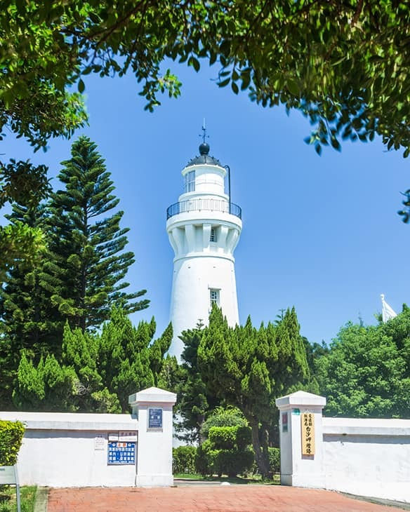夏天吃蓮花特色餐、散步白沙岬燈塔，蓮花跟海景一天就能全收。

## 觀音

千年沙丘與蓮花盛開的客家田園風光

沿海的觀新藻礁保護區從觀音保生里向南延伸至新屋，全長4.3公里的千年藻礁，退潮時拜訪，就能觀賞到生態豐富的藻礁地形。海岸線上的白沙岬燈塔，是本島唯一以紅磚與石頭砌成，守望海岸超過百年。草漯沙丘地質公園的觀音白沙屯段擁有最壯闊的沙丘地形，步道沿線可見濱海林帶與原生沙地植物生態。觀音也是北台灣最大的蓮花種植區，每到夏季化身粉色花海，大王蓮乘坐體驗更是全台獨有。

### 遊玩攻略

- 觀新藻礁潮間帶探索，觀察千年藻礁與豐富底棲生態
- 探索草漯沙丘最壯闊的觀音段地景之美。
- 騎上鐵馬，穿梭在埤塘、白千層、蓮池之間。
- 夏季時蓮花盛開，享用蓮花大餐及預約DIY體驗。

### 美食及伴手禮

蓮花風味餐、客家料理、美濃瓜

更多區域介紹### 必遊景點

- 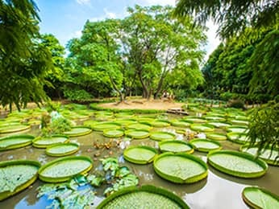[蓮荷園休閒農場](/pearl-coast/zh-tw/attractions/483)
- 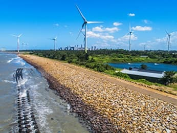[觀新藻礁生態系野生動物保護區](/pearl-coast/zh-tw/attractions/1454)
- 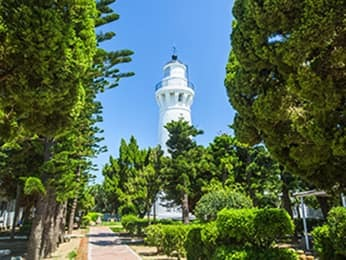[白沙岬燈塔](/pearl-coast/zh-tw/attractions/276)
- 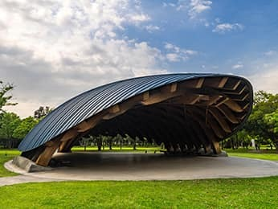[崙坪文化地景園區](/pearl-coast/zh-tw/attractions/1599)

看更多景點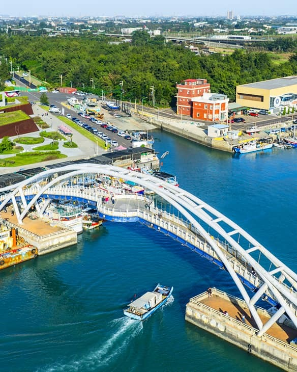石滬、牽罟、綠色隧道，每一樣都是別處玩不到的海客限定！

## 新屋

客家族群百年經營，打造獨特海洋文化

新屋是珍珠海岸的南端核心，也是重要的海洋客家聚落。永安漁港是以客家庄為主體的觀光漁港，黃昏時分的漁港夕照是桃園最經典的海岸畫面。沿海分布的百年石滬群可追溯至清朝，是先民以卵石手工堆疊、利用潮汐捕魚的智慧結晶。在地特色的牽罟，是傳承數百年的集體拉網捕魚傳統，是少數仍在活態傳承的漁業文化。藻礁生態環境教室也坐落於此，千年藻礁的生物密度高居全台之冠，也是珍珠海岸最珍貴的自然寶藏。

### 遊玩攻略

- 永安海螺文化體驗園區的純白建築是熱門打卡景點，可預約多種海洋導覽及體驗。
- 在永安漁港大啖新鮮海產，欣賞落日時刻的海景。
- 騎自行車是熱門的旅遊方式，沿自行車專用道飽覽海岸風光。
- 造訪百年石滬群，透過導覽接觸潮間帶豐富生態，體驗推砌石滬的樂趣。

### 美食及伴手禮

客家料理、鵝肉、漁獲海鮮

更多區域介紹### 必遊景點

- 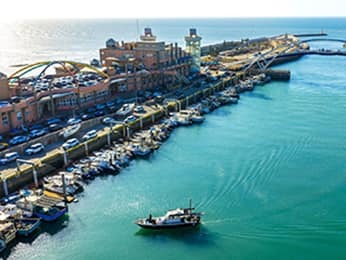[永安漁港](/pearl-coast/zh-tw/attractions/314)
- 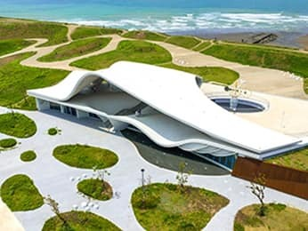[永安海螺文化體驗園區](/pearl-coast/zh-tw/attractions/1637)
- 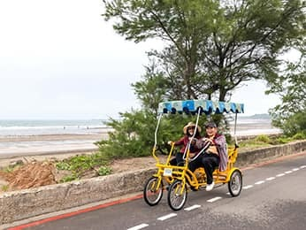[新屋綠色走廊](/pearl-coast/zh-tw/attractions/311)
- 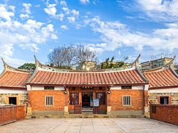[范姜老屋群](/pearl-coast/zh-tw/attractions/308)

看更多景點風的軌跡

### 單車追風

與鳥共生

### 濕地生態

海的子民

### 海客文化

沙丘浪語

### 蔚藍海岸

### 推薦行程

### 海岸景點

食 · 在地料理

海客餐廳・海港海鮮

購 · 必買伴手禮

在地農特產・文創商品

宿 · 風情旅宿

國際飯店・民宿

## 你的珍珠海岸之旅，就差一步！

立即下載「遊桃園 APP」，讓「小桃」成為你的專屬嚮導。

立即下載APP### 珍珠海岸進化論

想知道珍珠海岸正在發生什麼改變？

四大建設工程與在地產業輔導同步升級，看見珍珠海岸線進化正在發生。
