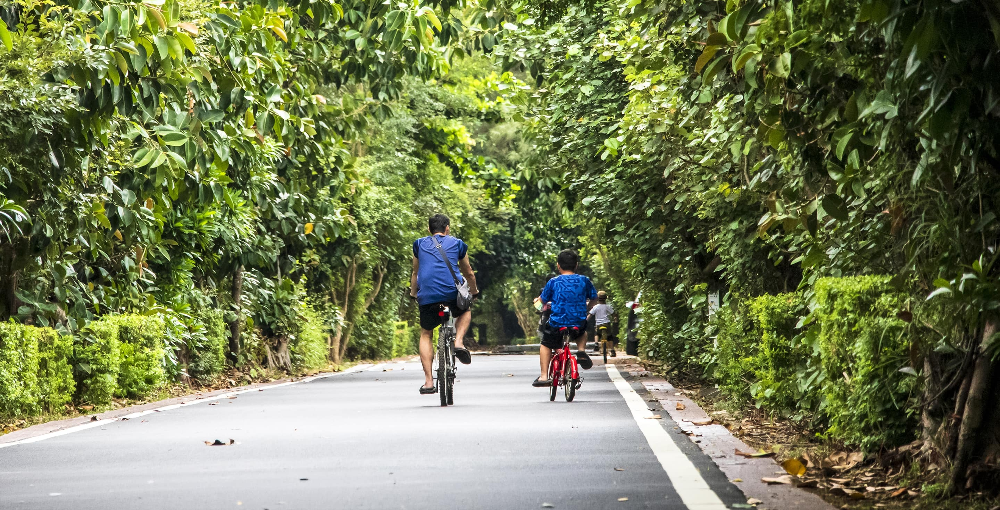# 單車追風

## 踩動踏板，來一場海岸追風！

探索桃園珍珠海岸三大主題自行車道，每段路，都有不同的故事和任務等你解鎖。

感受海風的吹拂、聆聽浪濤的節拍，從綠色隧道到壯麗沙丘，桃園的濱海自行車道，讓你在悠閒騎行中，串起獨特的生態與人文風景，每一次踩踏都是難忘的回憶。

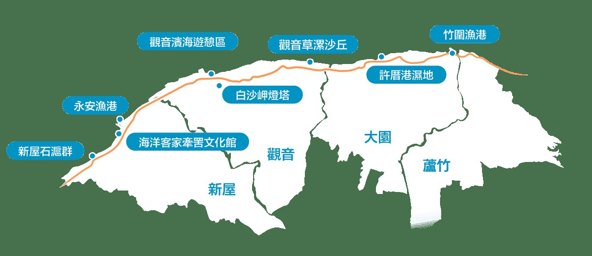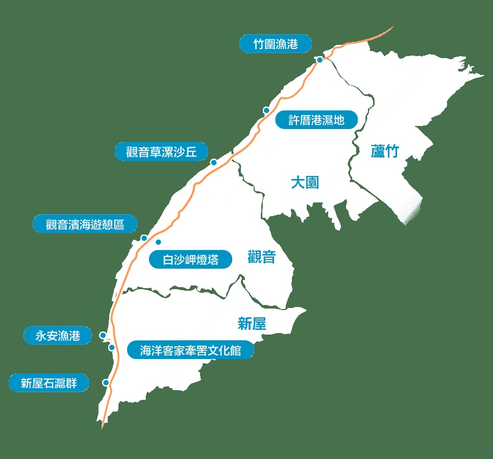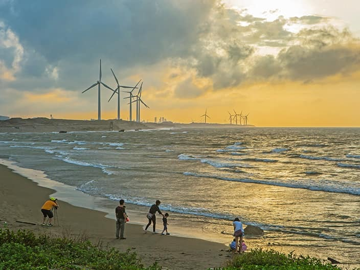在 Google 地圖查看路線濕地賞鳥・鐵馬御風

### 竹圍許厝港段

拜訪候鳥的家，與飛機一同翱翔

路線長度約 6 km騎乘時間40–50 min路線難度這是一條充滿動感與生命力的生態廊道。從熱鬧喧囂的竹圍漁港出發，感受魚市的滿滿活力，再沿著海岸線騎行，心境隨之開闊。你將進入國際級的許厝港濕地，這裡是數百種候鳥長途遷徙的重要驛站，秋冬季節鳥況尤其壯觀。因為鄰近國門，看著飛機從頭頂低空呼嘯而過，更是此路段獨有的震撼體驗。

必玩特色體驗許厝港濕地賞鳥機場跑道旁追飛機必吃美食或伴手竹圍漁港魚丸／魚酥航空港旋轉餐廳#### 沿途景點

- 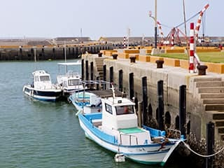[竹圍漁港](/pearl-coast/zh-tw/attractions/188)
- 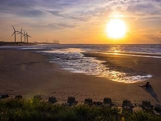[許厝港濕地](/pearl-coast/zh-tw/attractions/961)
- [觀音草漯沙丘](/pearl-coast/zh-tw/attractions/1442)
- 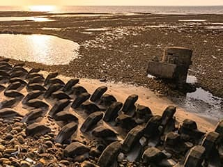[大園古亭海岸碉堡](/pearl-coast/zh-tw/attractions/2210)

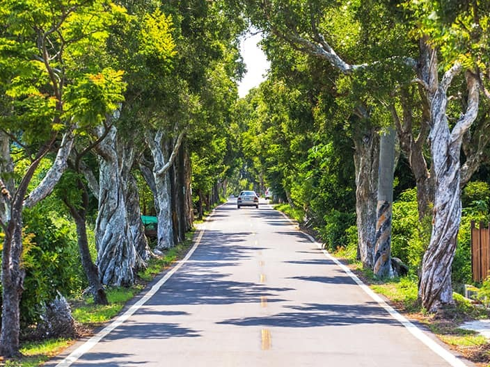在 Google 地圖查看路線沙丘燈塔・網美必拍

### 觀音白沙岬段

騎向純白燈塔，漫遊台版撒哈拉

路線長度約 5 km騎乘時間30–40 min路線難度此路段擁有最夢幻、最遼闊的海岸景色。從百年歷史的白沙岬燈塔出發，純白塔身在藍天映襯下，是旅程中最經典的打卡點。沿著平坦的濱海路徑騎乘，巨大的白色風車群在身旁緩緩轉動，遠方連綿的草漯沙丘，呈現出宛如台版撒哈拉的荒漠美感，每一幕都像電影場景般令人屏息。

必玩特色體驗觀音蓮花季草漯沙丘攝影必吃美食或伴手蓮子風味餐觀音西瓜#### 沿途景點

- 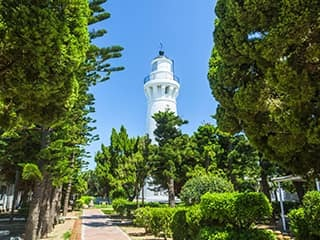[白沙岬燈塔](/pearl-coast/zh-tw/attractions/276)
- 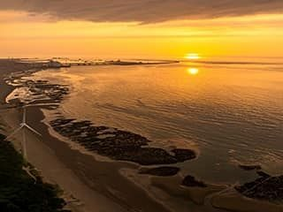[觀音白玉海堤](/pearl-coast/zh-tw/attractions/2213)
- 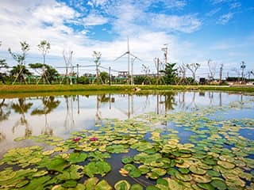[觀音濱海遊憩區](/pearl-coast/zh-tw/attractions/591)
- 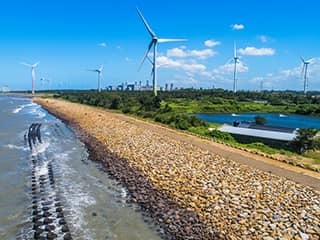[觀新藻礁生態保護區](/pearl-coast/zh-tw/attractions/1454)

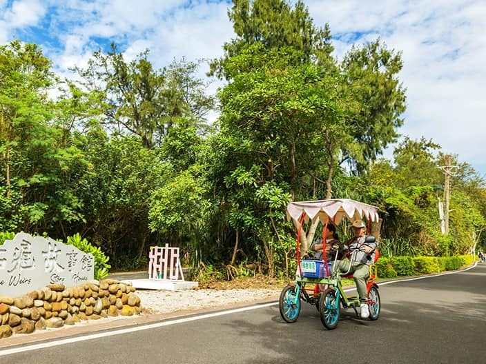在 Google 地圖查看路線親子共遊・海客文化

### 新屋綠色隧道

七公里海岸綠帶，串起綠色隧道中的珍珠節點

路線長度約 7 km騎乘時間40–60 min路線難度綿延約 7 公里的海岸，散布多處遊憩節點，如珍珠般鑲嵌於綠色隧道之中。以「綠波白浪舞珍情」為規劃主軸，串連照明全段升級的笨鯊橋至海洋客家段、整合地景與夕景的全新觀海亭、以及林下空間重塑後的漂流木公園，形塑整體觀光氛圍與區域意象。預計 116 年 2 月全新登場，敬請期待。

必玩特色體驗觀海亭眺望夕景海洋客家牽罟文化必吃美食或伴手永安漁港現撈海鮮新屋在地鵝肉#### 沿途景點

- 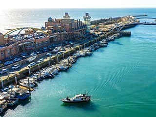[永安漁港](/pearl-coast/zh-tw/attractions/314)
- 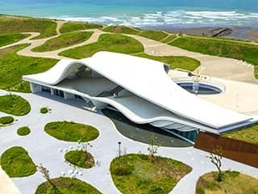[永安海螺文化體驗園區](/pearl-coast/zh-tw/attractions/1637)
- 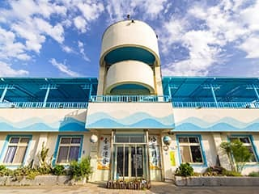[海洋客家牽罟文化館](/pearl-coast/zh-tw/attractions/1617)
- 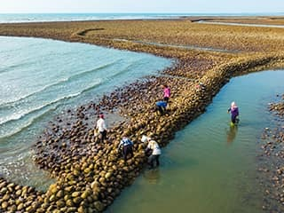[新屋百年石滬群](/pearl-coast/zh-tw/attractions/1187)

## 旅伴私藏推薦行程

不知道怎麼玩？讓『小桃』為你打包主題遊程！

### 珍珠海岸山海雙響炮遊程

山海雙響炮：五酒桶山秘境步道×許厝港濕地巡禮 ▋擁抱桃園最美的一條山海小旅行，從步道平緩好走的五酒桶山出發，平緩好走的稜線，遠眺桃園海天一線；中午到竹圍漁港大啖現撈鮮味；午後前進北台灣重要的野鳥棲息地，漫步國寶級許厝港濕地，近距離觀察候鳥遷徙與豐富的灘地生物見證生機蓬勃的海岸生態。最後在台版「撒哈拉沙漠」草漯沙丘拍攝絕美夕陽，留下唯美剪影！這是一趟讓身心重新開機的自然之旅，帶上相機，一網打盡桃園最美山海地景！ ▋台版撒哈拉－草漯沙丘：探索綿延數公里的壯麗沙丘地形，在海風與巨型風車的映襯下，感受異國沙漠般的遼闊美景。

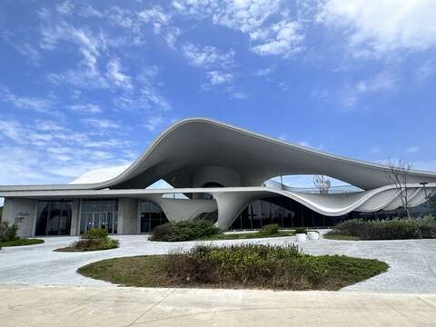### 珍珠海岸風之律動遊程

風之律動：綠色走廊單車輕旅行×觀新藻礁生態祕境 ▋來到桃園最美的濱海綠線，騎上單車，讓海風帶走都市塵囂！悠遊新屋綠色隧道，打卡純白浪漫的「海螺文化館」；深入世界級觀新藻礁探尋千萬年的生命奇蹟，再到草漯沙丘見證獨特地質壯闊美景，快來山海間找回自在節奏！ ▋新屋綠色走廊：穿梭綠色隧道悠遊蔚藍海景，單車漫遊防風林，享受夏日愜意時光。 ▋觀新藻礁－千年國寶地質傳奇：民眾可自行前往永續利用區，見證大自然的鬼斧神工，認識這千萬年才形成的石灰質生物礁。

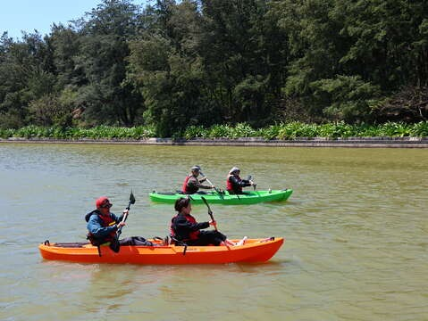### 珍珠海岸療癒小旅行

療癒小旅行：蓮荷園大王蓮體驗×後湖溪獨木舟秘境 ▋夏日舒壓首選！這是一場集結了「兒時童趣」與「現代慢活」的舒壓之旅。來桃園觀音體驗大王蓮「輕功水上漂」與剝蓮子DIY，拍下超吸睛網美照。再到後湖溪秘境划獨木舟，穿梭紅樹林綠色隧道，享受微風與水波的溫柔對話。 ▋不趕路，只慢活，水面上遇見最平靜的自己！您可以感受站上大王蓮的輕盈奇蹟，或是在平靜的後湖溪划動槳葉，穿梭在後湖溪水道上。不趕路、不忙碌，只有微風與水波的溫柔對話。 ▋蓮荷園大王蓮：站上直徑近2公尺的巨大蓮葉，體驗如武俠小說般的水上漂奇景，留下令人驚豔的夏日身影。 ▋後湖溪平台獨木舟：後湖溪是一處不受海浪干擾的平靜水域。適合獨木舟初學者，坐上穩定度高的獨木舟，滑入紅樹林環繞的生態秘境。

更多珍珠海岸遊程## 旅程規劃小叮嚀

讓你的追風之旅更完整、更好玩！

### 自行車租賃站

- 遠雄自貿港區加值園區
- 海湖農會
- 濱海市民活動中心
- 桃林鐵馬道（海湖東路）

### 認證補給站（裝水點）／維修樁

- 新屋福興宮
- 新屋石滬故事館
- 7-11 永安港門市
- 白沙岬燈塔
- 潮音派出所
- 竹圍漁港漁會

### 交通指南

自行開車

沿台 61 線西濱快速道路，可分別從永安、觀音、竹圍交流道下，前往各路線起點。漁港及燈塔周邊均設有停車場。

大眾運輸

可搭乘臺鐵至「中壢站」，轉乘桃園客運 5027、5039 等路線前往濱海地區。建議出發前查詢公車動態。

### 四季限定・節慶活動

夏季｜觀音蓮花季

騎行之餘，別錯過夏日限定的蓮田風光與特色蓮子餐。

秋冬｜許厝港賞鳥季

候鳥來訪的季節，是竹圍許厝港段最熱鬧的生態饗宴。

全年｜漁港假日市集

竹圍與永安漁港每逢假日皆有熱鬧漁市，可體驗在地活力。

### 小桃的溫馨提醒

注意潮汐

前往石滬或沙灘區，請先查詢中央氣象署的潮汐預報，注意自身安全。

留意天氣

濱海天氣多變，出發前別忘了看天氣預報，並做好防曬與水分補充。

環境關懷

秋冬賞鳥季節，請勿大聲喧嘩或使用閃光。請愛護環境，將垃圾帶走。

## 你的單車冒險，就差一步！

立即下載「遊桃園 APP」，讓『小桃』成為你的專屬領航員，陪你收集沿途的風景與寶物，創造獨一無二的追風故事！

立即下載APP與鳥共生

### 濕地生態

海的子民

### 海客文化

沙丘浪語

### 蔚藍海岸
