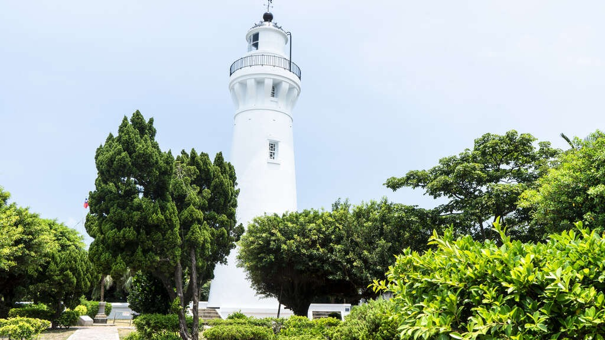
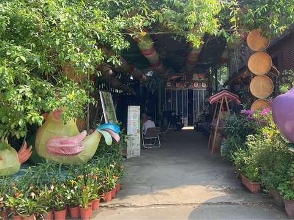
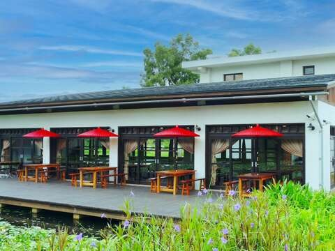

定位點## 珍珠海岸療癒慢時光

發佈：2026-05-19

人氣：369

下載PDF旅遊天數1日遊旅遊季節春、夏、秋交通工具駕車行程類型珍珠海岸遊程焦點一級棒農場鼎好-好客食堂旗艦店甘泉寺草漯沙丘地質公園療癒慢時光：手作盆栽DIY×崙坪好客盛宴×沙丘海景放空之旅

▋帶走一盆綠意，留下滿心平靜。想給自己一天慢下來的權利嗎？不趕路、不揮汗，走入桃園觀音與新屋的質樸日常。到一級棒農場親手栽種專屬盆栽，親製草本防蚊液與盆栽，在崙坪好客食堂品嚐職人料理，再走訪傳奇甘泉寺。傍晚漫步草漯沙丘步道，在海風夕陽中放空自我。這是一趟結合手作、美食與夕陽美景的舒壓之旅，適合想好好犒賞自己的您。

▋一級棒農場體驗：在專業小農指導下，親手植栽一本專屬的盆栽，讓自然氣息延續到您的居家空間。

▋草漯沙丘：看著夕陽漸漸染紅，在海風中放空自我，享受這片廣闊的靜謐。旅遊排程行程地圖1日遊- [1](#day01)

- 定位點-第1天第1天[一級棒農場337 桃園市大園區聖德北路651巷23弄15號0955100951](/zh-tw/consume/detail/3237)[交通查詢](https://maps.google.com/maps?f=d&saddr=25.03697,121.19669&daddr=25.00148,121.16367)[鼎好-好客食堂旗艦店328 桃園市觀音區學府路350巷120號03-4985208](/zh-tw/consume/detail/3243)[交通查詢](https://maps.google.com/maps?f=d&saddr=25.00148,121.16367&daddr=25.03709,121.08164)[甘泉寺328 桃園市觀音區甘泉街一號03-4732622](/zh-tw/travel/attraction/292)[交通查詢](https://maps.google.com/maps?f=d&saddr=25.03709,121.08164&daddr=25.08023,121.16669)[草漯沙丘地質公園337 桃園市大園區老街溪口南岸至觀音區大堀溪口北岸03-3386021](/zh-tw/travel/attraction/1442)

- 1

上一則回列表下一則
