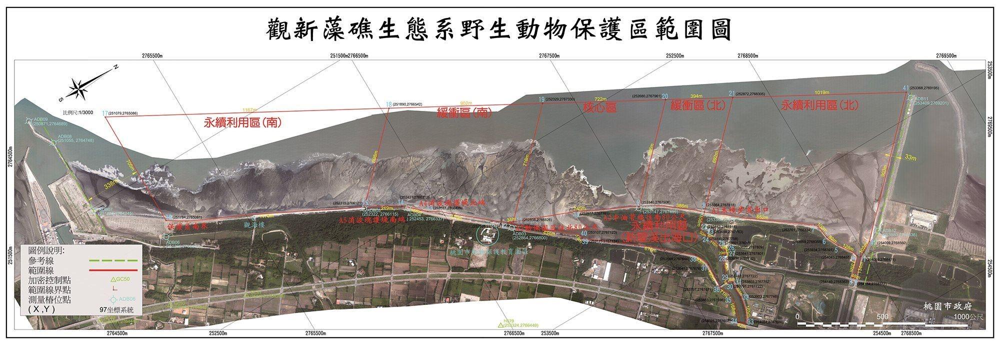

:::## 觀新藻礁

跳過此子選單列請按[Enter]，繼續則按[Tab]網頁功能- [列印內容](javascript:CCMS_Print(193);)

$(function () { $('[tab-cp]').each(function () { $(this).click(function (event) { event.preventDefault(); $('[tab-cp]').removeClass('is-active'); $('[tab-cp] a[role="tab"]').attr({ 'aria-selected': 'false', tabindex: '-1' }); $.each($('[tab-cp]'), function (i,item) { var $aTag = $(item).find('a'); var title = $aTag.html(); $aTag.attr('role', 'tab'); if (!$(item).hasClass('is-active') && !$aTag.attr('title')?.startsWith('選取後將')) { $aTag.attr('title', '選取後將變更主要內容為 ' + title); } }) $(this).addClass('is-active'); $(this).find('a[role="tab"]').attr({ 'aria-selected': 'true', tabindex: '0' }); var title = $(this).find('a').html(); $(this).find('a').attr('title','當前頁面 ' +title); $('[tab-cp-target]').attr('hidden', true).removeAttr('style'); $('[tab-cp-target="' + $(this).attr('tab-cp') + '"]').removeAttr('hidden').removeAttr('style'); }) }).eq(0).click(); if (getParameterByName('s') != '') { $('[tab-cp="' + getParameterByName('s') + '"]').click(); } $('[tab-show="false"]').each(function () { $(this).hide(); }) var elements = document.querySelectorAll("[id^='ContentPlaceHolder1']"); elements.forEach(function (element) { var h3Element = element.querySelector('h3'); if (h3Element) { var h3Text = h3Element.textContent.trim(); var links = element.querySelectorAll('a[class="div"]'); links.forEach(function (link) { if (link.hasAttribute('title')) { var originalTitle = link.querySelector('.caption').innerText; if (!originalTitle.includes(h3Text)) { var newTitle = h3Text + ' ' + originalTitle; link.setAttribute('title', newTitle); } } }); } }); // 無障礙修正 WCAG 2.4.4 HM1240404E： // 工單32030、32032、32049：附件連結需在 title 帶出檔名，讓 NVDA 能分辨不同檔案的連結目的 // 做法：已有 title 的連結不動（避免覆蓋後台相關檔案的設定），沒有 title 的才依檔案類型補上 document.querySelectorAll('a[target="_blank"]').forEach(function (a) { a.setAttribute('rel', 'noopener noreferrer'); if (a.title) return; // 優先取 data-name（後台上傳時帶的原始檔名），其次用連結文字 let fileName = a.getAttribute("data-name") || a.innerText.trim() || ""; const ext = fileName.split('.').pop().toLowerCase(); // Office、壓縮檔、音檔等需另存才能開，用「下載」 if (["doc", "docx", "ppt", "pptx", "xls", "xlsx", "odf", "odt", "ods", "odp", "txt", "csv", "rar", "zip", "mp3"].includes(ext)) { a.title = `${fileName} 下載`; } // 其餘（含 pdf、圖檔、未知類型）統一用「另開新視窗」 // ext 有值代表 fileName 一定有值；沒有才需判斷 fileName 是否為空 else { a.title = fileName ? `${fileName} 另開新視窗` : "另開新視窗"; } }); // 將分頁連結標記為 WAI-ARIA Tab。 // 只針對 .list-text.classify 裡的 a（分頁） document.querySelectorAll('.list-text.classify a').forEach(function (anchor) { anchor.setAttribute('role', 'tab'); }); // 無障礙 : 頁籤容器 tablist $('.list-text.classify').attr('role', 'tablist'); // 初始化每個分頁的對應屬性（id / href / aria-controls / 目前選取狀態） $('.list-text.classify li[tab-cp] a').each(function () { const $a = $(this); const $li = $a.closest('li[tab-cp]'); const id = $li.attr('tab-cp'); const active = $li.hasClass('is-active'); $a.attr({ id: 'tab-' + id, href: '#Group_' + id, 'aria-controls': 'panel-' + id, 'aria-selected': active ? 'true' : 'false', tabindex: active ? '0' : '-1' }); }); // 初始化每個面板語意與對應分頁 $('[tab-cp-target]').each(function () { const id = $(this).attr('tab-cp-target'); $(this).attr({ role: 'tabpanel', id: 'panel-' + id, 'aria-labelledby': 'tab-' + id }); // 依目前可見性同步 hidden if ($(this).is(':visible')) $(this).removeAttr('hidden'); else $(this).attr('hidden', true); }); // 鍵盤導覽 : 左右/Home/End // 移動焦點 : Enter / Space 啟用 var $tablist = $('.list-text.classify'); $tablist.on('keydown', 'a[role="tab"]', function (e) { const $tabs = $tablist.find('a[role="tab"]'); const i = $tabs.index(this); let j = i; if (e.key === 'ArrowRight') j = (i + 1) % $tabs.length; else if (e.key === 'ArrowLeft') j = (i - 1 + $tabs.length) % $tabs.length; else if (e.key === 'Home') j = 0; else if (e.key === 'End') j = $tabs.length - 1; else if (e.key === 'Enter' || e.key === ' ') { e.preventDefault(); $(this).closest('li[tab-cp]').click(); return; } else return; e.preventDefault(); $tabs.eq(j).focus(); }); }) function DeptSearch() { var ddlTitle = $("#jDeptSearch").find(":selected").text(); var cpHtml = $(".group.base-article.taoyuan-link"); if ($(cpHtml).find($("a[data-name='" + ddlTitle + "']")).length == 0) { alert('查無相關資訊'); } else { var ddlUrl = $(cpHtml).find($("a[data-name='" + ddlTitle + "']")).attr("href"); if (ddlUrl.indexOf('http') >= 0) { window.open(ddlUrl, '_blank'); } else { location.href = (ddlUrl); } } }- 觀新藻礁

本府於103年7月7日依《野生動物保育法》公告劃定為「桃園觀新藻礁生態系野生動物保護區」，保護對象為河口藻礁海岸生態系及棲息鳥類、野生動植物，保護區範圍以觀音區保生里大潭電廠進水口南堤以南至新屋區永興里、永安里藻礁海岸，含小飯壢溪河口、新屋溪河口；保護區範圍界線係緊連各堤岸構造物，各堤岸構造物不納入保護區範圍，面積達315公頃，分為核心區(47公頃)、緩衝區(81公頃)、永續利用區(187公頃)，經本府調查報告指出觀新藻礁具有高度物種生物多樣性，動物密度為高美濕地的5倍，香山濕地8倍。

保護區管制事項：

永續利用區：於漲潮前後2小時、每逢大潮前後2小時及每天下午5時至次日上午7時禁止進入，其餘時間開放供民眾進行體驗活動；本區無人數總量管制。 緩衝區：於漲潮前後2小時、每逢大潮前後2小時及每天下午5時至次日上午7時禁止進入；其餘時間請依申請須知規定向本局申請，經同意後始得進入該區從事淨灘、生態攝影、生態旅遊或體驗等活動；本區設有總量管制，遊客應團進團出，北區每日人數上限200人，南區每日人數上限500人。 核心區：非經主管機關許可，不得進入。

有關藻礁保護區參觀最佳月份與最多生物

Q：幾月最適合去藻礁生態？最多生物？

A： 一、最適合觀察藻礁生態的季節是春夏兩季，此時藻類茂盛，風平浪靜，貝類活動頻繁，秋冬季節因東北季風增強，常形成大浪較不利參觀，所以建議前往參觀之月份為每年4~9月。

二、前往觀察藻礁生態前，須先了解潮汐狀況，最好於每日退潮前後2個小時前往觀察，桃園海岸潮汐時間的口訣為：「初一、十五早晚乾，初八、二三早晚滿。」，意即初一、十五前後退潮時間約落在早晨及傍晚，而初八、二三前後退潮時間則落在中午，有關潮汐預報詳細資料請上[中央氣象署網站](https://www.cwa.gov.tw/V8/C/M/tide.html?NSeaID=NSea03)查詢。

連結[觀新藻礁保護區網站FAQ常見問答](https://algal-reef.tycg.gov.tw/Answers)

相關檔案- 行政院農業委員會公告[pdf(898.19 KB)](https://ws.tycg.gov.tw/Download.ashx?u=LzAwMS9VcGxvYWQvMTkzL3JlbGZpbGUvMTkyODgvNzIyNy8zMzhkMzMzOS02YTc0LTQwMGQtODQxNi1mYTQ3NWVjNzg3ZGEucGRm&n=6KGM5pS%2f6Zmi6L6y5qWt5aeU5ZOh5pyD5YWs5ZGKLnBkZg%3d%3d)[odt(833.90 KB)](https://ws.tycg.gov.tw/Download.ashx?u=LzAwMS9VcGxvYWQvMTkzL3JlbGZpbGUvMTkyODgvNzIyNy80ODRhMDI5NS0yZWY4LTQwOTYtOGM4Yi00NjUwODIwNWMzYzYub2R0&n=6KGM5pS%2f6Zmi6L6y5qWt5aeU5ZOh5pyD5YWs5ZGKLm9kdA%3d%3d)
- 桃園市政府公告[pdf(1.53 MB)](https://ws.tycg.gov.tw/Download.ashx?u=LzAwMS9VcGxvYWQvMTkzL3JlbGZpbGUvMTkyODgvNzIyNy81YWNjOTQ5Mi1hMWVjLTRiMDAtODdlOC1lNTZiZDMyMzgxZjcucGRm&n=5qGD5ZyS5biC5pS%2f5bqc5YWs5ZGKLnBkZg%3d%3d)[odt(1.83 MB)](https://ws.tycg.gov.tw/Download.ashx?u=LzAwMS9VcGxvYWQvMTkzL3JlbGZpbGUvMTkyODgvNzIyNy9lMTFmODkxOS1hODcyLTQxYWQtOTEyNS1jOGE2MzI2NjU0OTIub2R0&n=5qGD5ZyS5biC5pS%2f5bqc5YWs5ZGKLm9kdA%3d%3d)

- [回上一頁](javascript:window.location =document.referrer;)
- [回最上面](#Accesskey_U)
