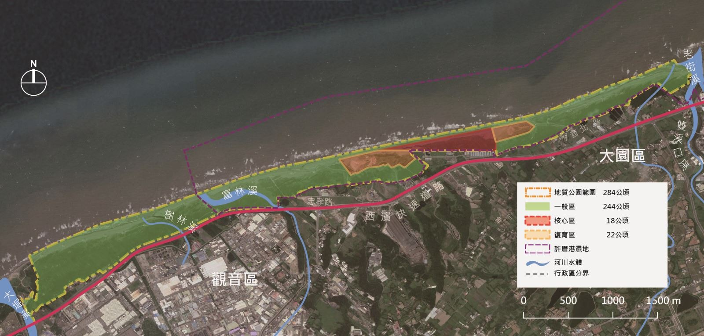
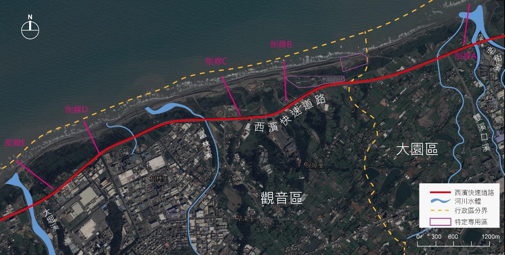

基本資料| 成立時間 | 109年6月11日 |
| --- | --- |
| 面積(公頃) | 284 |
| 地理位置(範圍) | 桃園市大園區老街溪出海口至觀音區大堀溪出海口間之沿海地帶 |
| 主管機關 | 桃園市政府 |
| 類型 | 直轄市定自然地景 |
| 符合之指定基準 | 以特殊地形、地質現象之地質遺跡為核心主體。 特殊科學重要性、稀少性及美學價值。 能充分代表某地區之地質歷史、地質事件及地質作用。 |
| 管理維護者 | 桃園市政府環境保護局(113年1月1日起) 農業部林業及自然保育署 財政部國有財產署 桃園市政府農業局 桃園市政府環境清潔稽查大隊 |

指定地質公園之緣由及理由一、具有代表性的地質景觀草漯沙丘為國內少見大規模的濱海沙丘地形，其地形因所處區位海岸與季風形成特定之夾角，使季風搬運的砂粒堆積於草漯沿岸，並且整體沙丘地形仍隨時間及周邊地形、人工設施產生多樣的動態變化，使得此區在地質條件、地形特徵的變化及景觀的保存上極具學術及教育意義。

二、海岸保護效益草漯沙丘部分沙丘與保安林地相結合，降低冬季強烈東北季風對內側私有土地的影響，屬於低維護管理且兼顧生態環境之防風措施，另外地質公園的指定可限制不必要的開發與不當使用，並有助於建立沙丘及海岸線監測，可檢視濱海海岸線增長或退縮之情況，並提早擬定對應策略及計畫，對於國土保安的意義重大。

三、提升在地經濟及生活品質藉由劃設地質公園，強化沿海沙丘及沙灘環境復育及清潔，使該地區環境品質獲得改善，並提升草漯沙丘之知名度，有助於在地居民的認同感。

四、教育及學術價值可連結國內外學術單位及教育機構資源及合作機會，增加草漯沙丘在教育學術圈的知名度，教育的過程也能讓更多人理解地質公園如何永續經營自然資源，並獲得更多支持和協助。

地理位置草漯沙丘群分布於桃園市大園區老街溪西側到觀音區大堀溪東側沿海地帶，此海岸沙丘因東北季風與海岸呈現特定夾角，加上河川沙源堆積而成，是一處動態的地質景觀。

指定劃設範圍北起老街溪往南至大堀溪，西界以海岸最外側之的地籍線邊界為界，東界則以保安林地之地界為主要邊界，邊界以公有地地籍界線為原則劃設。草漯沙丘地質公園全區範圍約284 公頃，部分區域與許厝港重要濕地區重疊。

草漯沙丘群分布位置環境特質及資源現況草漯沙丘擁有規模壯闊且人工化程度低的沙丘景緻，分佈長約8.1 公里，寬可達150公尺，其中除靠海岸側地形變動較為頻繁的濱海沙丘外，也包含內陸側受防風林框固之沙丘。草漯保有多種沙丘形態，包含條狀丘、櫛齒狀丘、複合丘及臺狀沙丘，加上東北季風及波浪的侵蝕及堆積，各季節形態各略有不同。

一、沙丘的形成及演育在沙漠或海岸等風力強大，地表裸露或缺乏植被的地區，風經常是搬運沉積物最重要的營力，若地表有豐富的沙粒來源，風經常用滾動、跳動（跳躍）或懸浮（沙塵暴）等方式搬運沙粒，迨風力減弱或遭遇障礙物阻擋，就地堆積成沙丘 (許民陽, 2015)。

桃園市西北海岸有南崁溪、埔心溪、新街溪、老街溪、富林溪、大堀溪等河川注入，帶來豐富的漂沙，漂沙注入臺灣海峽後，隨海岸沿岸流及潮汐帶來的漲退潮移動漂送，在海岸海底地勢較平緩地區堆積成沙灘。退潮時廣闊的沙灘受強風吹襲及日曬後逐漸脫水，表層變得乾鬆，被沿海空曠地區強大的風力吹送即成為在地表懸浮吹送的風吹沙。桃園市西北海岸的走向為東北東，與秋冬季及春季盛行的東北風斜交，夾角約22.5 度左右。每年九月至隔年五月間東北風呈向陸吹送的風，這些風吹沙即受到風力的吹送，在海灘內側，因地勢較高，遇到植物或地物等障礙物，風力即削減，沙粒即堆積成平行海岸的縱沙丘。 (許民陽, 2015)

依據行政院農業部林業及自然保育署-航測及遙測分署提供之1994 年及2004 年相片基本圖進行套疊，先期研究計畫針對老街溪口、草漯海、富林溪口三處沙丘演育之分析如下:

(一)老街溪口在老街溪口部份，因其河口兩岸整段海岸線走向與東北季風夾角平均約為19 至22 度，較草漯海濱為小，因此該處所形成之海岸沙丘寬度亦較草漯海濱小。本處海岸沙丘主要變化為面積之減小與前緣之後退(約25m 至65m)，而此主要為海岸沙丘前緣受波浪及東北季風雙重影響所造成。受侵蝕而移動之灘沙除隨沿岸流移動外，另一部分則受東北季風影響往下風處堆積，而形成沙丘入侵防風林的情況 (張智原, 2000)，也因此該處之防風林在10 年間在前緣有明顯之後退。

(二)草漯海濱草漯海濱之濱線走向與東北季風夾角平均約為30-35 度，遠大於計畫區內其他海岸部份，也因此該處灘沙受風吹襲入侵內陸之情況最為明顯，因而形成規模廣大之草漯沙丘群。本處不論前側或後側沙丘均有向內移動之情況，沙丘前緣10 年來後退達25m 至102m，沙丘後緣向內延伸則達33m 至87m，故證實沙丘入侵量與東北季風及海岸線走向夾角有顯著關聯。而在人為開發方面，由於該處於1994 年已有道路與農耕地屯墾，而開發強度10年來變化不大，故在內側沙丘方面除形狀之改變外，面積之減少情況有限，整體而言較濱海沙丘穩定。

(三)富林溪口(海湖底)在觀音工業區外緣富林溪口之海岸，其濱線走向與東北季風夾角較淺，故外側沙丘前緣向內入侵之情況並不若草漯海濱嚴重。10 年來後退約12m 至63m，而沙丘後緣向內移動約28m 至129m 左右，由此可發現本處沙丘面積與寬度有增長情況，而該處位於沙灘上之河口均偏向西北、西與西南側，顯示沙灘多沿著海灘延展方向移動堆積為沙丘。整體而言沙丘分布與沙源狀態尚穩定。

二、沙丘現況先期研究共調查5條垂直海岸線且具代表性的剖線，進行沙丘地形剖面測量及植生覆蓋率的調查：剖線A 位於老街溪西岸；剖線B、C 位於草漯海岸；剖線D 位於樹林溪口西岸，鄰近觀音工業區；剖線E、在大堀溪東岸。

沙丘現況剖線A 剖線位於老街溪口西南側，剖線所設位置於沙丘域的破口處，較無植生覆蓋，僅有些許馬鞍藤匍匐，沙粒的搬運作用強烈，故此地設有沙籬以攔截風沙。根據實地觀測，沙丘崖面傾斜角度頗大，約55°，崖腳附近堆有許多樹枝、垃圾等較重漂流物，推測當波浪能量大時可能會直接影響沙丘。

B 剖線沙丘高度超過10m，後灘寬度約60m，沙丘崖面傾斜角度65°，地形起伏極大。此區附近一連串沙丘走向大致與海岸平行，但表面幾乎無任何植生覆蓋。剖線附近海岸設有大量沙籬以促使飛沙積聚，但是大部分的沙籬皆已被風沙掩埋、倒塌而失去聚沙能力。

C 剖線此區沙丘高度將近10m，而灘面寬度短，地形起伏大。沙丘頂部較為平緩，上方亦架設有沙籬，沙籬的方向皆為垂直海岸，可見飛沙主要來源並非來自灘面。緊鄰沙丘後方為一道路，附近設有風力發電機組。

D 剖線此區海岸起伏較為平緩，沙丘高度不到4m，崖面傾斜角度45°，灘面寬度極短。沙丘上設有格子狀圍籬，中間植有定沙植物。沙丘頂部植生覆蓋率較高，約有33.8%，而沙丘前側則無植生覆蓋，主要的種類為蔓荊。

從剖面圖中可發現沙丘前側有一平行海岸的人工結構物。此結構物攔截了部分飛沙，對後方沙丘形成保護。緊鄰沙丘後方有一架風力發電機組，距離水線僅約100m。

E 剖線此區主要的沙丘形態為胚胎丘，為自然的沙丘地形。沙丘前側闢有一條施工用臨時道路，造成地形的破壞。此段海岸灘面寬度亦不長，外側有大片藻礁分布，因此來自灘面上的沙源少，沙丘高度較為低矮。植生覆蓋率為20%，植生種類主要為濱刺蓌，其次為馬鞍藤。其中濱刺蓌有明顯枯死倒伏的現象，生長情形並不良好。

三、生物資源海岸沙丘區長期處於缺水、強風、多鹽及日夜溫差大的氣候下，生態環境異於內陸環境，僅有少數耐旱抗鹽的海濱植物如馬鞍藤、天人菊、臺灣佛甲草、蔓荊（海埔姜）、林投、草海桐、木麻黃、黃槿、番杏等，能夠在此生長。這些沙丘植物為適應惡劣的生存環境，發展出特有的生存機制 (林宗儀, 2002)：

- 匍匐生長：將本身的莖與葉儘量貼近地面，以避免強風及鹽害。
- 不定根的延伸：在芽的節上長出不定根，除可固定植物本身，亦可增加根部水份及養份的吸收。
- 莖葉特化：莖葉肥厚，葉被蠟質、絨毛，或特化成細針狀，可避免水份的過過度蒸散。
- 隱莖藏根：除了根深植於地下外，將莖也埋藏於沙層之下，以避免強風及鹽害。

沙丘亦是許多動物的棲息地，如鳥類、爬蟲類及昆蟲等。這些動植物構成了沙丘生態系。活動沙丘內側的防風林及草本植物生長區就是呈現最佳沙丘生態系的戶外教室，可供戶外教學及生態旅遊活動之使用。
