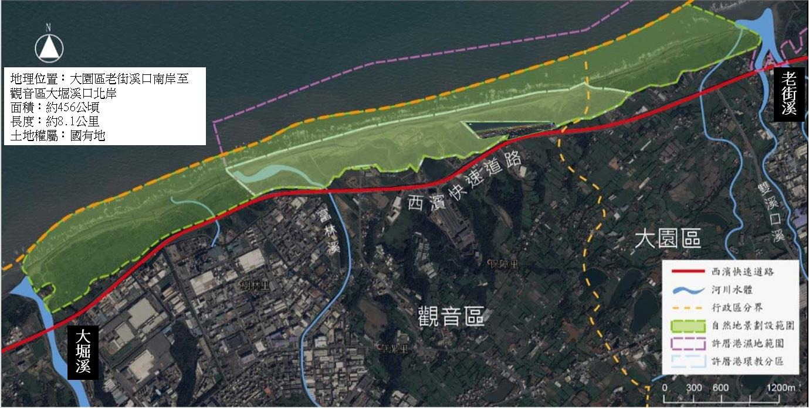
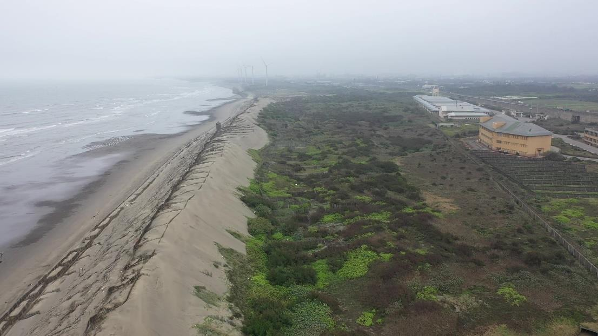
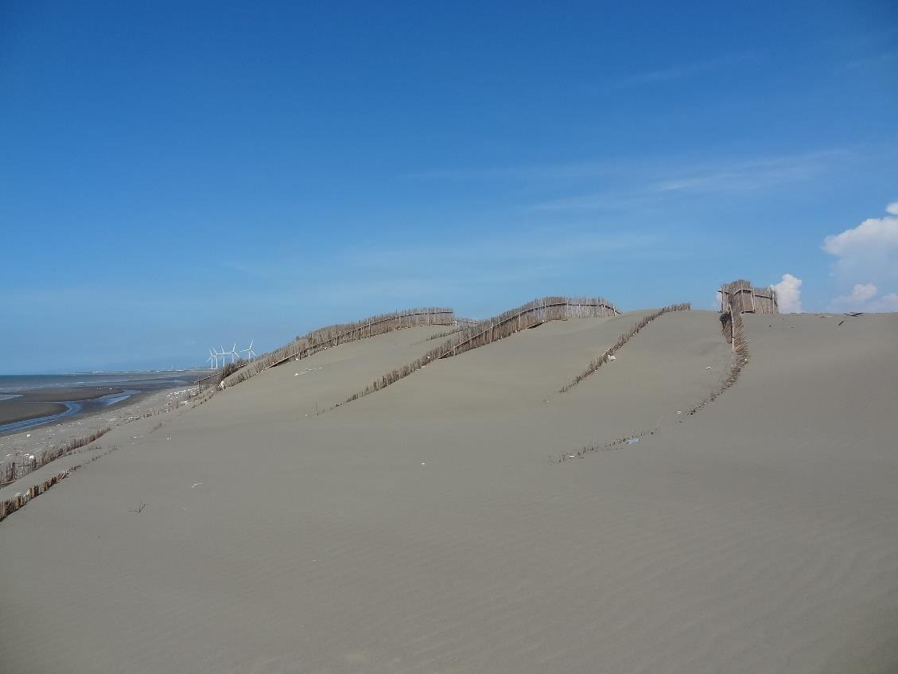

一、列冊追蹤日期：中華民國107年12月28日起。

二、 列冊追蹤範圍：- (一) 地理位置：桃園市大園區老街溪口南岸至觀音區大堀溪口北岸。
- (二) 面積：約456公頃。
- (三) 長度：約8.1公里。
- (四) 土地權屬：國有地。
- (五) 位置圖：

位置圖三、 目前狀態：草漯沙丘位於桃園市西北海岸，高度可達10至15公尺，北起老街溪，南至大堀溪，總長約8.1公里，面積約4平方公里，為台灣海岸沙丘保持最寬廣而完整者，是非常珍貴的自然地景。因其宛如撒哈拉沙漠，景緻優美，故於102年被「台灣環境資訊協會」遴選為台灣9處最值得守護且最美麗的海岸之一，其中老街溪口至富林溪口約5公里長沙丘位於許厝港國家級重要濕地內。

四、 資源特色：- (一)地景教育價值：沙丘發育過程與沈積物(沙粒)的供應的多寡，地面的裸露狀態、風力的大小和風向的持續性或變化性有密切的關係，可說是涉及岩圈、水圈和氣圈交互作用的產物。草漯沙丘可做為地形學或地質學風成作用的最佳教學地點，教導學生觀察形成沙丘的營力、堆積物質與形態變化間的動態關係。
- (二)地景欣賞及保育價值：草漯沙丘為台灣海岸的沙丘中形態及保存較完整者，其柔和的沙脊，多變化的形態，表面常有的沙漣，複雜的交錯層理，瞬時變化的造形，具有地景欣賞中的造形美、線條美、動態美及稀有美等特性，值得欣賞及保育。
- (三) 保護海岸功能：草漯沙丘為海岸的第一道防線，與海岸平行，有時數列分布，可以阻擋海岸快速被侵蝕，加上沙丘地形的凸起，可以保護海岸內側的陸地不致被飽含氯離子及鈉離子的海風直接吹襲及侵蝕，保護沿海的農作物及房舍。
- (四)生態教育價值：海岸沙丘區長期處於缺水、強風、多鹽及日夜溫差大的氣候下，生態環境異於內陸環境，僅有少數耐旱抗鹽的海濱植物如馬鞍藤、蔓荊（海埔姜）、林投、草海桐、木麻黄、黄槿、番杏等，能夠在此生長。這些沙丘植物為適應惡劣的生存環境， 發展出特有的生存機制，這些功能獨特的植物構成了沙丘生態系，活動沙丘內側的防風林及草本植物生長區是呈現沙丘生態系的天然教室，可供戶外教學使用。

圖1、草漯沙丘空拍圖圖2、草漯沙丘
