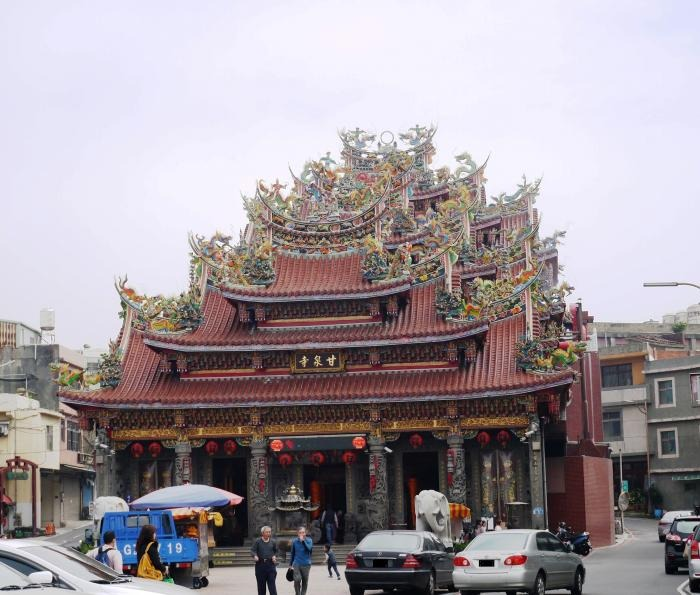

編輯器內容資料來源[客家委員會客家文化發展中心](https://hch.hakka.gov.tw/archivedetailshare.asp?ID=2&SID=98&XML_ID=23395)

內容文化資源名稱：觀音甘泉寺詮釋資料識別碼：2015-328-1-A-a-g0020踏查日期：42458文化資源種類：寺廟文化資源別稱：福龍山觀音寺；福龍山寺；石觀音；觀音廟；石觀音甘泉寺文化資源客語拼音：海陸 gon‵rhim‵ gam‵ cansii+篩選理由：各時代表現地方營造技術流派特色者。具歷史、文化、藝術價值。經度：121.081665緯度：25.036864歷史沿革：觀音區甘泉寺，為當地極富盛名之廟宇，香火鼎盛，主奉觀世音菩薩。據當地耆老口述，甘泉寺自清朝年間即砌立至今，其歷史傳說年代略有不同，但共通點為，甘泉寺原為「福龍山寺」，後因石觀音佛祖，因而命為石觀音寺，石觀音地名也由此而來，而後又因觀音佛祖救苦救難所賜甘泉，治癒病疾，而改名為甘泉寺。 依甘泉寺所記載： 沿自清乾隆45年(1780)前，當時於寺廟右前海岸(即現今白玉里一帶海岸)，純白海沙堆積如山丘，奇峰聳立，高數十公尺，雖然季節狂風催殘，其沙仍不增不減；據說每當風和日麗之晨曦，隱約可見一位騎白馬之神在沙丘奔跑，當地居民曾出現幾位文武秀才貢生舉人等。 而寺廟左前海岸燈塔邊一帶形成半土墩，墩前有一水池，乾旱不竭，滂沱大雨而不溢，其形如金鵝戲水，該地也曾出現幾位貌相奇特之將才。 兩地，一為白馬龍穴，一為金鵝孵蛋龍穴，寺廟座向為巳山兼巽，位於兩龍穴之中，形如金龍舞爪，由當時地理師點出，此穴為建廟好地點，能福佑百姓，因此命名為「福龍山」。 清乾隆45年(1780)農曆二月十九日，於寺廟右方一陂塘，名為貴母坡塘(即：貴麻埤塘)，該日晴空萬里，卻突然一霹靂聲響，天降下大雨，陂塘湧出一石像，載浮載沉，牧童擲石不中，而後為一農夫黃等成撈起，因見其石如神像，便於陂塘邊築一草寮奉祀之。 幾日後，一神靈降乩曰：石像即為石觀音佛祖，為救苦救難而降臨凡間，?信示若有疑難雜症，有求必應，無不靈驗。當時恰逢瘟疫肆虐，佛祖並降示，草寮傍有一泉水(即甘泉井)可治疫，水質清澈，飲之甘甜如飴。果不其然，患症者飲之皆痊癒，泉水治疾不逕而走，求飲者絡繹不絕，治癒者也不計其數。 清咸豐8年(1858)四月間，當地仕紳募款建造簡樸廟宇，至次年十一月竣工。因甘泉水顯跡著稱，遂命名「甘泉寺」，主奉「石觀音佛祖」。石觀音地名也由此而來。至清光緒20年(1894)，地方士紳募款增建後殿和兩廊，於次年竣工，廟宇新成。 民國44年，因廟貌年久失修，舊陋不堪，由管理人黃景祥先生召集信徒大會，推選廖團景先生為修建主任委員，梁乾旺先生、黃金水先生為副主任委員。同年12月4日興工改建，至民國47年12月3日完竣，成為一座富麗堂皇之廟宇。 神靈顯赫，善士有求必應，地方繁榮，安居樂業，香客與日俱增，以致廟堂不敷容納香客，且廟後方路基柏油路面填高，始廟形顯得矮小。 於民國75年信徒大會推選曾獻奉為主任委員，謝廷漢先生為常務監事，曾獻斌先生為總幹事，經委員代表地方仕紳相商決議，以自由樂捐方式重新改建。 自民國78年農曆4月23日動工，至民國86年農曆11月30日，歷經8載完成一座五山三山，三層三進，宮殿式建築，巍峨壯觀精雕細琢，巧奪天工，富麗堂皇之廟宇。 而於寺廟後方牆面，為台灣首創觀世音佛祖銅雕像，其上「福龍山」即為甘泉寺最早之命名。歷史沿革資料來源：其他(甘泉寺沿革冊本)維修紀錄：1.清乾隆45年以前，由當時地理師點此龍穴建廟，並命名「福龍山」。 2.清乾隆45年(1780)農曆二月十九日，於寺廟右水塘湧出形如伸尊之石像，農夫撈起於陂傍供奉之，並於傍邊清泉湧出，因醫人無數，是為「甘泉井」之由來。 3.清咸豐8年(1858)四月間，建造簡樸廟宇，至隔年十一月竣工，因甘泉井顯著，而將廟宇命名「甘泉寺」。 4.清光緒20年(1894)，增建後殿和兩廊，次年竣工。 5.民國44年，因廟貌年久失修，舊陋不堪，經信徒大會後，募集改建善款，同年十二月四日興工改建，至民國47年十二月三日完成一座歇山翹鵝式廟宇建築，四柱三開間。 6.民國66年，於甘泉井處增建觀音亭，其內設有觀音神像。 7.民國75年，經委員代表地方仕紳相商決議，以自由樂捐方式重建廟宇。 8.自民國78年農曆四月二十三日動工，至民國86年農曆十一月三十日，歷經八年，完成一座三殿兩廊三樓式，面開五門之宮殿建築，而屋面為多重歇山假四垂之樣式。建築狀況：良好□尚可□不佳□殘破荒廢棄置建築特色描述：甘泉寺座落於觀音市區中心，座東南向西北。因位處路間，廟埕為三角地形。 以鋼筋混凝土砌建三樓建築，三殿兩院呈日字型，六柱五門，多重歇山假四垂廡殿式寺廟，二樓左廊處為鐘樓，右廊則為鼓樓。筒板瓦屋面，西施脊上、脊堵間和垂脊、牌頭，佈滿各式各樣泥塑人偶、坐騎、水族類、祥雲、捲草等，並有剪黏祥龍、飛鳳裝飾，充其教意、勸善、祈福等圖飾，正殿脊上施以福祿壽三仙。 正殿門前書以楹聯： 「甘露浥紅塵觀音淨土蓮花地、泉通三昧水菩薩慈悲救?生」 「福海湧甘泉民承德若青天周世界、龍山騰佛聖眾沾恩如白日化大同」 殿內四點金柱楹聯則有：「大慈大悲隰巘千山施妙法、救苦救難重巖壑顯靈光」；「明鏡非台不滅柳生無影地、菩提無樹不生蓮種海中天」等等。 於寺廟後方置以觀音佛祖與金童、玉女之銅雕牆面，兩側楹聯:福海湧祥雲浩蕩十方涵聖地、甘泉騰瑞氣天然靈石化觀音，上橫披:福龍山。於橫披下並施作雙龍護珠。 其各殿祀奉神祉為： 一樓正殿主奉石觀音佛祖，左殿：註生娘娘，右殿：福德正神和五路財神。 二樓前正殿則奉：彌勒尊佛、哪吒三太子、文昌帝君、關聖帝君，而左殿為天上聖母娘娘，右殿為玄天上帝；後殿奉玉皇大帝、三官大帝，左側：南斗星君，右側：北斗星君。 三樓前殿祀奉：無極大天尊、日月星君及二十八宿星君、關聖帝君、純陽祖師，左有瑤池金母娘娘，右為西王母娘娘，神靈顯赫多年，?信士同沐神恩，共沾聖德。 甘泉寺與其他廟宇不同，寺廟右側甘泉井另設一香爐，民國66年增建甘泉亭，以鋼筋混泥土建造，屋頂仿歇山九脊式筒板瓦屋面，亭前翹鵝剪黏雙龍搶珠，兩側為蟠龍柱。其內設觀世音菩薩手持寶瓶立像，瓶內引流甘泉井之泉水涓涓而出。 亭內楹柱上書：石像顯靈浮聖蹟、觀音濟世勇甘泉，於觀世音壁龕上有「甘露滋榮」。關鍵字：觀音；甘泉寺；福龍山寺；石觀音；甘泉井；佛祖銅雕像；清乾隆45年

摘要建築類圖像及後設等資料-觀音甘泉寺

更新日期112 年 5 月 4 日

你可能有興趣的相關推薦
