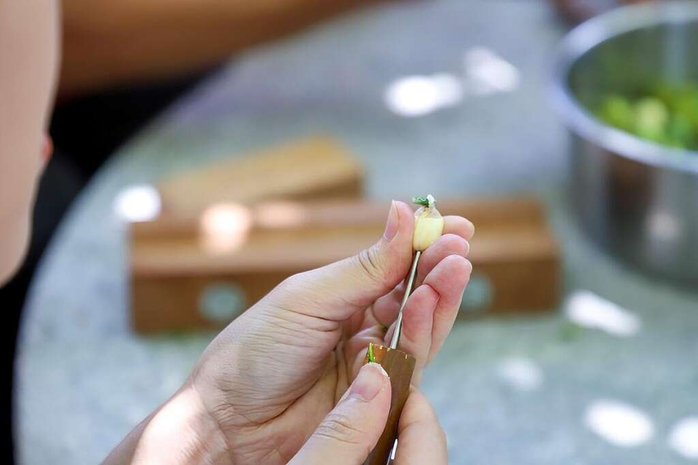
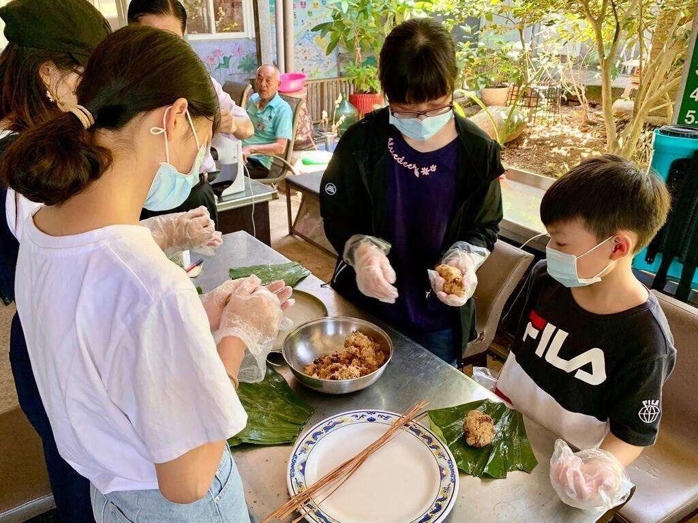
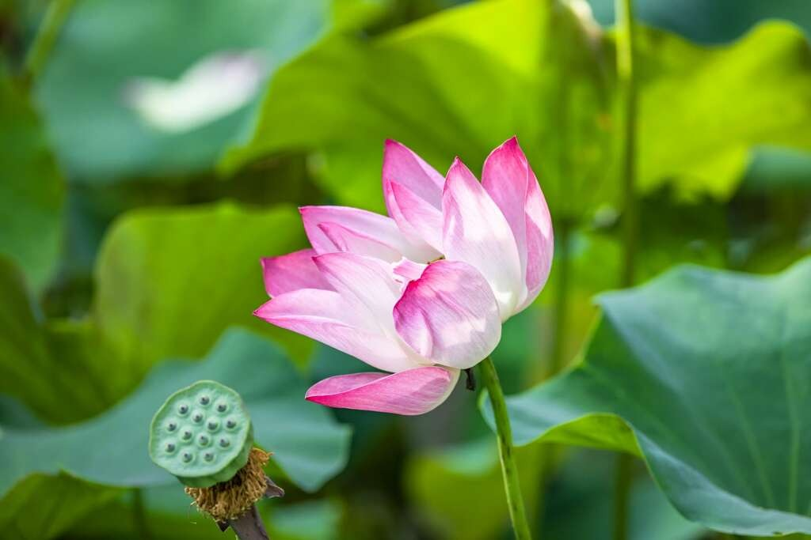

:::- [首頁](/zh-tw/)
- 農遊熱搜
- [農遊行事曆](/zh-tw/events/)

# 2026桃園蓮花季【百蓮好荷】

桃園市2026-07-04~2026-08-30發佈日期:2026-01-13更新日期:2026-09-22人氣33591加入收藏活動日期2026-07-04~2026-08-30活動地點- [桃園市觀音區新華路一段跟金華路交叉口](https://www.google.com/maps/place/24.9962828,121.1157297)

主辦單位桃園市政府農業局休閒農業科相關單位桃園市觀音區公所、觀音區農會、觀音區蓮花園休閒農業發展協會相關連結- [觀音區蓮花園休閒農業區 FB](https://www.facebook.com/lotus.guanyin)

加入Google行事曆親子農遊賞蓮花
桃園蓮花季為桃園市歷史悠久活動，至113年舉辦已第26届，有「北觀音、南白河」美稱。蓮花季於107年起，蓮花園休閒農業區造訪遊客數每年破百萬，活動結合周邊休閒農場、觀光蓮園推出各項農事體驗及一日遊套裝行程，在地蓮花相關農特產品、風味餐及衍生商品豐富，提供前來的民眾選擇。
－－－－－－－－－－桃園蓮花季活動，在每年7月至8月蓮花盛開時節舉行。在觀音蓮花園休閒農業區，
以蓮花為主要亮點，有蓮花音樂饗宴、親子劇團演出、食農教育、農遊小旅行、特色農事體驗等活動。
五感體驗活動，認識在地飲食文化與傳承
各農場推出豐富的體驗活動，從農事手作、生態探索到特色美食DIY，10種體驗輪番登場，讓親子家庭玩得開心、情侶約會更有趣，每個週末都能收穫不同的夏日回憶

• 半日遊體驗｜深入蓮田，感受農村生活的樂趣
蓮花園遊客服務中心-拍打棒草編DIY、植物生態導覽、乘坐大王蓮｜報名連結
蓮花園遊客服務中心-蓮花盆栽DIY、蓮花生態與埤塘導、乘坐大王蓮｜報名連結
蓮花園遊客服務中心-剝蓮子體驗DIY、蓮花生態與埤塘導、乘坐大王蓮｜報名連結

• 生態體驗｜大小朋友都愛的人氣活動
水蓮之鄉農場-天才小釣手 (釣螯蝦)｜報名連結

• 農事體驗｜動手做、現場吃，感受最道地的土地風味
康莊蓮園民宿-乘坐大王蓮+蓮香囊+蓮蓬茶+蓮藕甜不辣｜報名連結
林家古厝休閒農場-手作糖葫蘆DIY｜報名連結
丫昌伯美食屋-搗客家麻糬體驗DIY｜報名連結
向陽休閒農場-冷壓鮮榨葵花油 DIY｜報名連結
青林農場-食農體驗-香水蓮花下午茶 (採香水蓮花泡茶+小蛋糕)｜報名連結

歡迎大家來到蓮的世界，在這裡找到屬於自己的夏日玩法
各項體驗活動皆採事前報名制，報名連結如上，亦可聯繫各個活動農場喔~~

特色蓮花風味餐
有百人蓮花宴活動，享受特製蓮花特色料理，年年更有不同菜色供遊客大啖蓮花美食。

文化表演
由桃園市各局處包含文化局、客家事務局、原住民族行政局辦理假日的表演活動，推廣本市藝文、客家文化、原民特色表演之美。

在地人推薦必去景點
新屋海洋客家文化休閒農業區、新屋緑色隧道、崙坪文化地景園區、永安漁港、草漯沙丘地質公園、青塘園、桃園市兒童美術館、白沙岬燈塔、桃園觀新藻礁野生動物保護區、永安海螺文化館
推薦必賞⇢百人蓮花宴、北觀音名荷大賞

在地人推薦必吃美食
大田蓮花園、林家古厝休閒農場、蓮荷園休閒農場、水蓮之鄉農場、荷竹農場、丫昌伯美食屋、莫内的花園、好客食堂、水來青舍、牽罟文化館

交通攻略
1.辦理地點：桃園市觀音區蓮花園休閒農業區
2.自行開車：可通過Google地圖搜尋地點前往活動區域
3.活動區域：蓮花園休閒農業區遊客服務中心

活動資訊取自觀音區蓮花園休閒農業區FB※活動細節請洽主辦單位，農業易遊網僅供資料蒐集與整理；活動可能因颱風、豪雨特報等臨時狀況延期或取消。- [賞花](/zh-tw/tag/9/)
- [熱門必遊](/zh-tw/tag/17/)

相關連結- [觀音區蓮花園休閒農業區 FB](https://www.facebook.com/lotus.guanyin)

相關照片我要分享- [分享到 facebook](https://www.facebook.com/sharer/sharer.php?u=)
- [分享到 twitter](https://twitter.com/home/?status=2026桃園蓮花季【百蓮好荷】%20)
- [分享到 line](http://line.naver.jp/R/msg/text/?2026桃園蓮花季【百蓮好荷】%20)
- 複製網址
