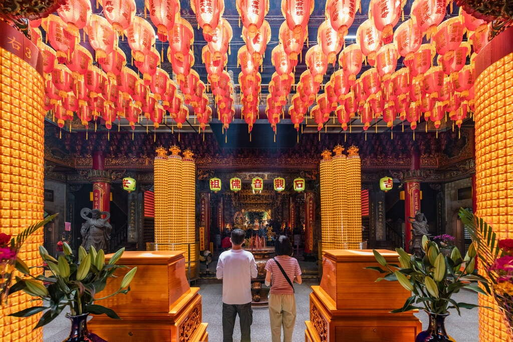
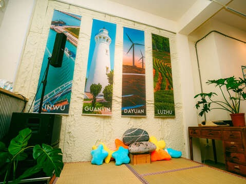
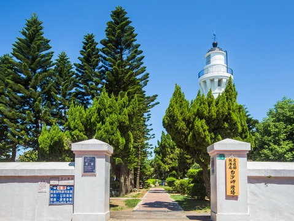
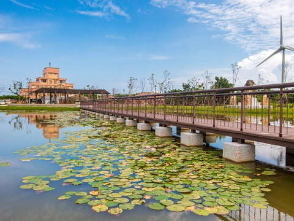
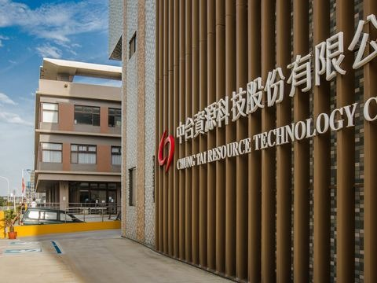

## 甘泉寺

4.6更新日期2025-09-09人氣118741- 濱海追風
- 歷史人文

想了解觀音地名由來必須造訪的百年宮廟，廟內供奉石觀音佛祖，而享有盛名的觀音聖水，長年來已有不計其數的信徒前來朝聖。- 探訪甘泉井，親嘗傳說中清甜可口的神奇泉水
- 欣賞三層宮殿式廟宇，探索精美絢麗的建築細節
- 參加觀世音佛誕、石觀音文化節，感受濃厚地方傳統文化
- 觀賞全台唯一三層高的銅雕觀世音圖像，莊嚴且震撼

位於桃園市觀音區的甘泉寺，不僅是當地最具傳奇色彩的信仰中心之一，更是結合儒、釋、道三教信仰的宗教建築奇蹟。這座歷經百年修繕而成的宏偉廟宇，以其瑰麗的建築風格與豐富的文化內涵，吸引著信徒與旅人。

建廟起源與甘泉井的神蹟
甘泉寺前身為福龍寺，起源於清乾隆年間（1780年），一名農夫拾得酷似觀音菩薩的石塊，並在地供奉為「石觀音」。後因泉水湧現治癒百病的神蹟，寺名遂改為甘泉寺，旁邊的甘泉井則至今清澈不絕，成為信徒朝聖的亮點。

多元神祇與三層建築特色
甘泉寺樓層分明，每層供奉不同的神明，包括石觀音佛祖、玉皇大帝與瑤池金母等，共計18尊神像。廟宇建築採用傳統宮殿式結構，剪黏脊飾上的神獸與人物雕刻細緻傳神，12根盤繞龍柱雄偉壯觀，背後銅雕觀世音圖像更是全台稀有的三層樓高巨幅作品。

三大祭典：信仰與生活的交融
甘泉寺一年一度的三大祭典，包括觀世音佛誕日、石觀音浮出紀念日以及中元普渡慶讚活動，充分展現信仰與地方文化的緊密聯繫。祭典融合傳統與現代，例如千人淨灘到客庄藝文表演，讓古老的宗教活動煥發新意。

豐富的裝飾藝術
廟宇內外裝飾藝術無處不在，從嘴含石珠的石獅、風調雨順的四大天王石雕，到富有歷史意義的百年匾額與彩繪壁畫，皆訴說著甘泉寺與地方信仰的深厚連結。
前來甘泉寺，不僅是一次對傳統文化的探訪，更是一次洗滌心靈的旅程。在這裡，歷史、建築與信仰三者完美交融，等待著旅人的探索。- 照片照片
- 街景街景

景點資訊電話/03-4732622傳真/03-4732062地址/桃園市觀音區甘泉街一號開放時間/- 星期日：06:00 - 21:00
- 星期一：06:00 - 21:00
- 星期二：06:00 - 21:00
- 星期三：06:00 - 21:00
- 星期四：06:00 - 21:00
- 星期五：06:00 - 21:00
- 星期六：06:00 - 21:00

門票資訊/免費相關連結/FB粉絲團服務資訊- 公車站
- 廁所

如何到達依您的出發地，選擇適合的交通方式停車資訊路邊停車周圍停車場- 觀音鄉中興停車場(00:00-24:00 每 30 分鐘 15 元)[導航](https://www.google.com.tw/maps/place/25.038056486697986,121.08066006554226)
- 台灣中油觀音站[導航](https://www.google.com.tw/maps/place/25.0349019,121.0854735)
- 江華玉林停車場(全時段每小時 100 元)[導航](https://www.google.com.tw/maps/place/25.045887,121.091171)
- 台灣中油觀音三和站[導航](https://www.google.com.tw/maps/place/25.0239559,121.086201)

查看更多停車優惠下一則網友推推關閉上一則回列表下一則## 周邊景點

- [沿海生活實驗室(珍珠海岸改造共創基地)開館日 週四至週一 10:30 -17:30 (中午12:30-13:30不開放) 假日及國定假日:09:30-17:30 (中午12:30-13:30不開放) 公休日 週二及週三休館人氣872](/zh-tw/travel/attraction/2394)
- [白沙岬燈塔夏令時間(4月~10月)：09:00~18:00、冬令時間(11月~隔年3月)：09:00~17:00 週一公休，遇國定假日或連續假期則調整為收假次日不開放人氣174548](/zh-tw/travel/attraction/276)
- [4.4觀音濱海遊憩區星期日：24 小時營業人氣128620](/zh-tw/travel/attraction/591)
- [2.6中台環境資源教育中心星期日：休息人氣40773](/zh-tw/travel/attraction/1167)

看更多
