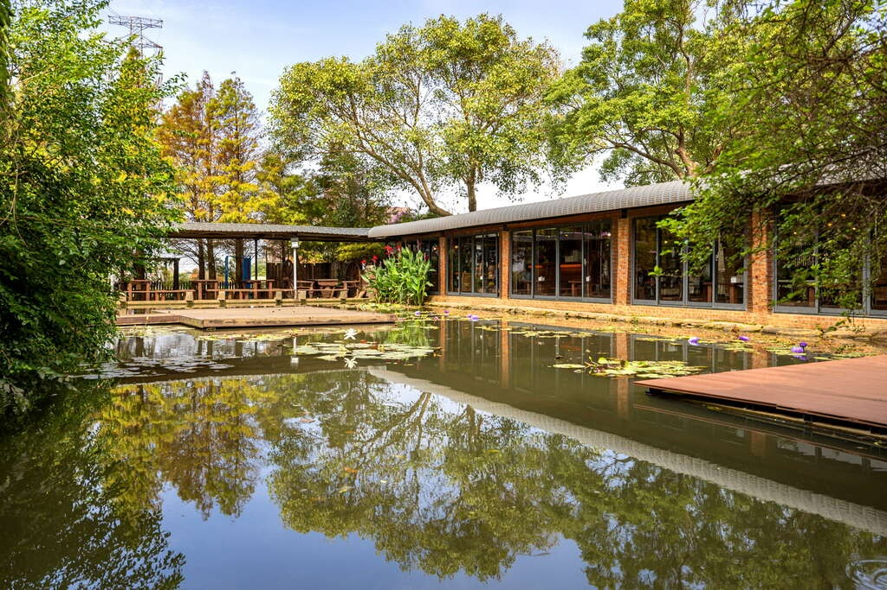
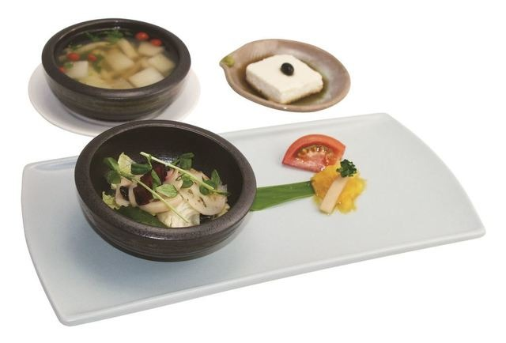
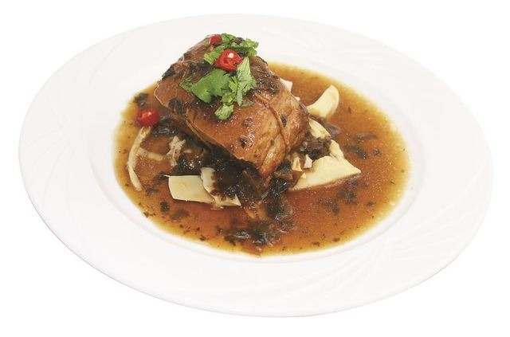
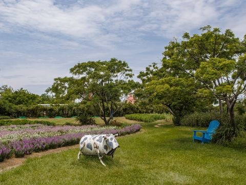
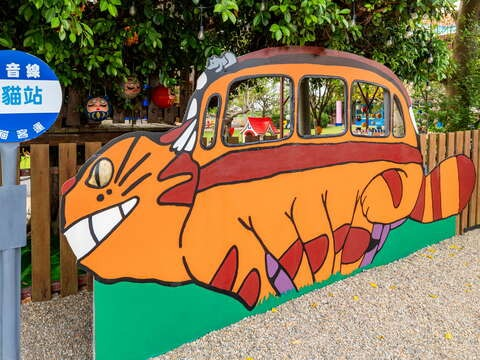
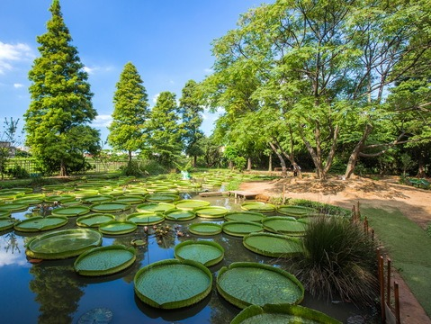
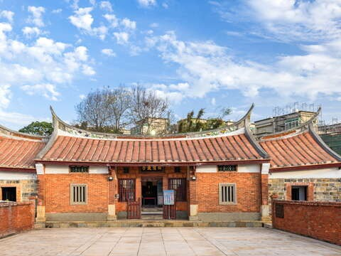

## 林家古厝休閒農場

更新日期2026-01-27人氣107623- 草花農場

百年三合院古厝加上大型網室無毒採果，讓你一邊體驗最接地氣的農村風土之餘，還能一邊享用蓮花特色料理、IG照拍好拍滿，樂當鄉土系吃播採果網美。- 百年古厝剝蓮子、挖蓮藕、古式婚禮，復古經典重現
- 採果拍美照、開箱蓮花餐，體驗最潮鄉村農村樂！

百年古厝，古韻今情
園區內最吸睛的莫過於擁有超過百年歷史的閩南式三合院古厝，一進四護龍的格局，訴說著一段段農家的歲月故事。紅磚拱門、酒甕步道、搖曳蓮海，營造出彷彿民初時代的純樸氛圍。林家後代用心守護祖厝，並將其轉型為鄉土文物館，透過導覽介紹歷史文物與農耕智慧，寓教於樂，讓人流連忘返。

午後悠閒時光，細品蓮香佳餚
休憩區設有涼亭與池塘，睡蓮輕舞，鴨群戲水，坐下來喝個下午茶和點心或享用蓮子剉冰、草莓冰淇淋，看著自然風景悠悠展開，簡直是都市人夢寐以求的慢活時刻。農場還販售各式蓮花相關產品，如蓮藕粉、蓮花香草茶等，送禮自用皆宜。

親子同遊，深度體驗樂無窮
林家古厝休閒農場不只是賞景勝地，更是親子旅遊與文化探索的絕佳場域。園區提供焢窯、烤肉與多樣互動預約體驗，包括剝蓮子、挖蓮藕、手做糖葫蘆、蓮子或草莓冰淇淋DIY、地瓜圓DIY 等，既有趣又富教育意義。秋天可採香甜哈密瓜，冬天則能體驗草莓樂園，四季各有驚喜。此外還有抓週儀式與中式婚禮可預約，讓傳統文化在現代旅程中活絡延續。這裡是一座結合自然、歷史與人情味的秘境，不論是家庭出遊、文青漫遊，還是渴望返樸歸真的旅人，都能在此找到屬於自己的節奏與感動。臨走前，不妨帶些新鮮蓮子、蓮藕粉或香水蓮花茶回家，讓這趟農村之旅的美好記憶，延續在生活的每一口香氣中。- 照片照片
- 街景街景

景點特色- 荷鮮蔬沙拉+蓮子手工豆腐+蓮子湯美味又養生的蓮花料理。
- 梅香東坡肉「梅香東坡肉」讓人味蕾大開。

景點資訊電話/03-4980753傳真/03-4982274地址/桃園市觀音區大富路221號開放時間/-9月至隔年6月 (週一至週四09:30～17:30，僅接受團體預約活動；週五至週日正常營業)
-7、8月09:30～17:30 (不定期休，依Facebook公告)門票資訊/入園低消為100元(可折抵園內消費)，110公分以下孩童免門票官方網站/官方網站相關連結/FB粉絲團服務資訊- 廁所
- 停車場
- 網路
- 販賣部

旅遊叮嚀-園內推出有米食DIY、童玩DIY、焢窯、古厝導覽等一日遊活動，需事先預約報名。如何到達依您的出發地，選擇適合的交通方式停車資訊備有停車場周圍停車場- 中油加盟明泓站[導航](https://www.google.com.tw/maps/place/25.0102124,121.1386482)
- 台灣中油新坡站[導航](https://www.google.com.tw/maps/place/25.010649,121.139544)
- 桃園市觀音區新坡多功能場館停車場(08:00-21:00 費率未知)[導航](https://www.google.com.tw/maps/place/25.014199,121.136842)
- 中油亞柏新屋加油站[導航](https://www.google.com.tw/maps/place/24.9723119,121.1289904)

查看更多停車優惠上一則回列表下一則## 周邊景點

- [4.0青林農場星期日：09:00 – 17:30人氣184636](/zh-tw/travel/attraction/1178)
- [4.0龍貓公車站星期日：00:00 - 23:59人氣12054](/zh-tw/travel/attraction/2212)
- [3.9蓮荷園休閒農場星期日：08:30 - 17:30人氣250891](/zh-tw/travel/attraction/483)
- [4.2范姜老屋群星期日：08:00 - 17:00人氣106385](/zh-tw/travel/attraction/308)

看更多
