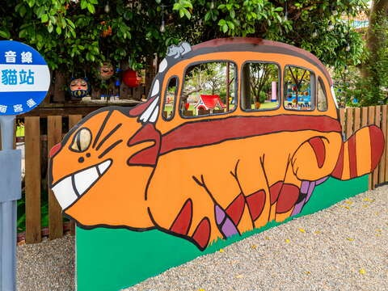
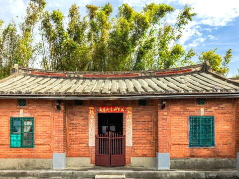
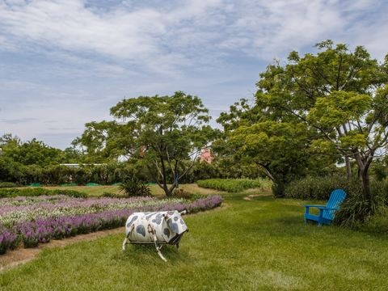
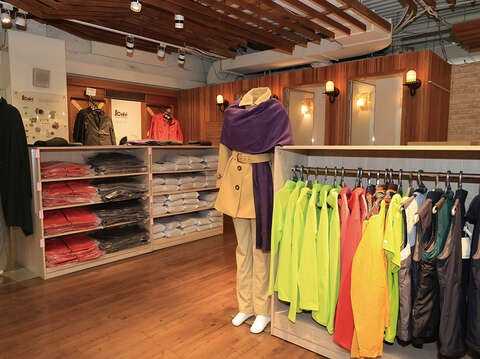

## 蓮荷園休閒農場

3.9更新日期2026-10-15人氣250891- 自然生態
- 草花農場

夏日限定的大王蓮水上漂、唯美蓮池盪鞦韆，另類玩法不能錯過！園內還有販售蓮子剉冰、荷葉炒米粉等特色料理，鹹甜都對你的味！- 來坐大王蓮，一秒練會水上漂
- 洛神花臭豆腐、荷葉麻糬、香水蓮咖啡，料理好好味
- 草編、陶版畫、荷葉湯圓，動動手指玩創意
- Surprise！窯烤歡樂派對，美味樂無限

**■蓮荷園休閒農場公告：參觀及乘坐大王蓮活動將於115年11月1日起休園整理，並於明年5月1日重新開放參觀，期間進入冬天模式：只接30人以上團體預約，不便之處敬請見諒。詳如連結:****[https://www.facebook.com/share/p/14tu5qkcaFA/](https://www.facebook.com/share/p/14tu5qkcaFA/)**粉嫩蓮花、澄黃落羽松、小巧萍蓬草…，被自然綠意圍繞，心花也跟著綻放！蓮荷園休閒農場位於以蓮花著稱的觀音區，占地2公頃的園區除了有大面積的蓮花池，還有稻草博物館、五行八卦迷宮等景點，以及DIY活動開放體驗，讓你開心樂活一整天！通過古樸感十足的園區入口即是用餐區，在欣賞蓮花之美前，不如先來一份蓮荷全餐﹔暑氣退散的冰涼蓮子豆花、用料給好給滿的蓮子剉冰、酸甜清爽的洛神花臭豆腐、竹香四溢的蓮子竹筒飯。把味蕾甦醒後接著至一旁的蓮花池遊逛﹔不管是含苞待放或是盛開綻放的蓮花，都美得令人忍不住打卡拍下美照！園內栽種大賀蓮、睡蓮、牡丹蓮、泰國蓮等品種，不只如此，還有不能錯過的｢大王蓮水上漂｣體驗，站上蓮葉大擺pose，化身拇指姑娘、武林高手，樂趣滿分！園區內的稻草博物館，收藏園主父親巧手編織出來的草編十二生肖、農具等近百件作品。喜歡手作的人可以試試手藝，大玩毛筆稻草、草劍、結草繩、草鞋、稻草人等草編DIY。除此之外，吃貨系旅客還能加碼親手料理荷葉擂茶、荷葉麻糬、荷葉湯圓，好玩好吃好新奇！想要重溫古早味農村風光，來場鄉村限定的焢窯是一定要的，從燒窯、悶窯，每一步驟都讓人更加期待開窯後的美味！經過窯燒的食物香氣格外誘人，令人感到無比滿足。

- 照片照片
- 街景街景

景點資訊電話/03-4776972地址/桃園市觀音區藍埔里11鄰金華路690號開放時間/- 星期日：08:30 - 17:30
- 星期一：09:00 - 17:00
- 星期二：休息
- 星期三：09:00 - 17:00
- 星期四：09:00 - 17:00
- 星期五：09:00 - 17:00
- 星期六：08:30 - 17:30

門票資訊/￭門票以現場公告為準相關連結/FB粉絲團服務資訊- 停車場
- 販賣部

旅遊叮嚀￭蓮花特餐、烤肉、焢窯需提前預約
￭大王蓮乘坐限重90公斤如何到達依您的出發地，選擇適合的交通方式停車資訊農場內提供停車位周圍停車場- 桃園市觀音區新坡多功能場館停車場(08:00-21:00 費率未知)[導航](https://www.google.com.tw/maps/place/25.014199,121.136842)
- 中油加盟明泓站[導航](https://www.google.com.tw/maps/place/25.0102124,121.1386482)
- 台灣中油新坡站[導航](https://www.google.com.tw/maps/place/25.010649,121.139544)

查看更多停車優惠下一則網友推推關閉上一則回列表下一則## 周邊景點

- [4.0龍貓公車站星期日：00:00 - 23:59人氣12054](/zh-tw/travel/attraction/2212)
- [林家古厝休閒農場-9月至隔年6月 (週一至週四09:30～17:30，僅接受團體預約活動；週五至週日正常營業) -7、8月09:30～17:30 (不定期休，依Facebook公告)人氣107623](/zh-tw/travel/attraction/481)
- [4.0青林農場星期日：09:00 – 17:30人氣184636](/zh-tw/travel/attraction/1178)
- [4.7GFun機能生活館星期日：休息人氣58440](/zh-tw/travel/attraction/983)

看更多
