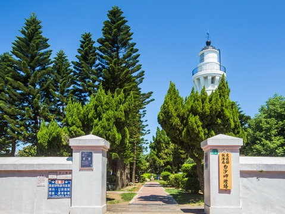
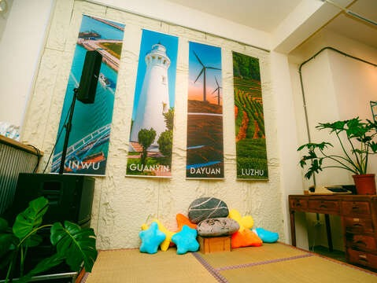

## 觀音濱海遊憩區

4.4更新日期2024-06-19人氣128620- 濱海追風

踏浪堆沙、發現寄居蟹、小螃蟹的沙灘蹤跡，伴著海潮之聲看大風車轉啊轉、欣賞夕陽西下的動容美景…為身心靈再次充飽元氣。- MV取景都來這~告白風車搭超唯美夕陽
- 濱海系澄紅Pantone ~天人菊夏日亮相
- 找找看！觀景步道隱藏的觀音密碼

追夕陽、賞紅花，百年燈塔輕鬆Get！原為觀音海水浴場的觀音濱海遊憩區，沙灘邊迎著海風而轉動的大型風車，與藍白相間的地中海風格觀海亭，向來是旅人打卡以及戲劇取景熱點。近來隨著觀音溪畔的環狀步道及景觀廣場新登場，不只是好拍程度再升級，更拓展出不一樣的旅行體驗。

沿著台61線至觀音區中興路即可抵濱海遊憩公園，雖然承載著在地人記憶的觀音聖像已於2015年因風災毀損而不復見，遊逛公園內的楊柳淨瓶廣場和觀龍步道倒是體驗在地文化的另一種選擇。廣場以觀音佛祖手上所持法器﹣｢楊柳淨瓶｣為造型，延伸的波浪狀鋼橋象徵楊柳枝條，巧妙融入在地觀音信仰文化。開闊的公園依觀音溪而建，極簡風格的格柵，點綴出休閒氛圍。廣場右側為跨橋出入口，拾階而上可欣賞觀音溪、武威溝水岸風景，以及百年古蹟﹣白沙岬燈塔。

緊鄰楊柳淨瓶廣場的觀龍步道，以金屬流線混搭竹編鏤空，帶出龍首生動之姿。步道舖面綴以彩色磁磚打造龍鱗花紋，打造觀音乘龍意象。廣場對面為一蓮花池，池中橋引人走入嬌豔花姿與周邊紅磚古厝交錯出的淡淡鄉村氣息。持續朝著巨大風力發電風車佇立的海岸線前行，沿途除了迎風觀海，夏季限定的橘紅色天人菊花海綻放，小巧玲瓏的花朵隨著海風搖曳很是動人，旅程的回憶也多了道鮮豔色彩。- 照片照片
- 全景全景
- 街景街景

景點資訊地址/桃園市觀音區中興路469號開放時間/- 星期日：24 小時營業
- 星期一：24 小時營業
- 星期二：24 小時營業
- 星期三：24 小時營業
- 星期四：24 小時營業
- 星期五：24 小時營業
- 星期六：24 小時營業

門票資訊/免費服務資訊- 觀景台
- 停車場
- 步道

旅遊叮嚀￭可搭配「桃園觀音蓮花季」進行主題旅遊。如何到達依您的出發地，選擇適合的交通方式停車資訊路邊停車周圍停車場- 觀音鄉中興停車場(00:00-24:00 每 30 分鐘 15 元)[導航](https://www.google.com.tw/maps/place/25.038056486697986,121.08066006554226)
- 江華玉林停車場(全時段每小時 100 元)[導航](https://www.google.com.tw/maps/place/25.045887,121.091171)
- 台灣中油觀音站[導航](https://www.google.com.tw/maps/place/25.0349019,121.0854735)
- 台灣中油觀音三和站[導航](https://www.google.com.tw/maps/place/25.0239559,121.086201)

查看更多停車優惠下一則網友推推關閉上一則回列表下一則## 周邊景點

- [白沙岬燈塔夏令時間(4月~10月)：09:00~18:00、冬令時間(11月~隔年3月)：09:00~17:00 週一公休，遇國定假日或連續假期則調整為收假次日不開放人氣174548](/zh-tw/travel/attraction/276)
- [4.6甘泉寺星期日：06:00 - 21:00人氣118741](/zh-tw/travel/attraction/292)
- [沿海生活實驗室(珍珠海岸改造共創基地)開館日 週四至週一 10:30 -17:30 (中午12:30-13:30不開放) 假日及國定假日:09:30-17:30 (中午12:30-13:30不開放) 公休日 週二及週三休館人氣872](/zh-tw/travel/attraction/2394)
- [2.6中台環境資源教育中心星期日：休息人氣40773](/zh-tw/travel/attraction/1167)

看更多
