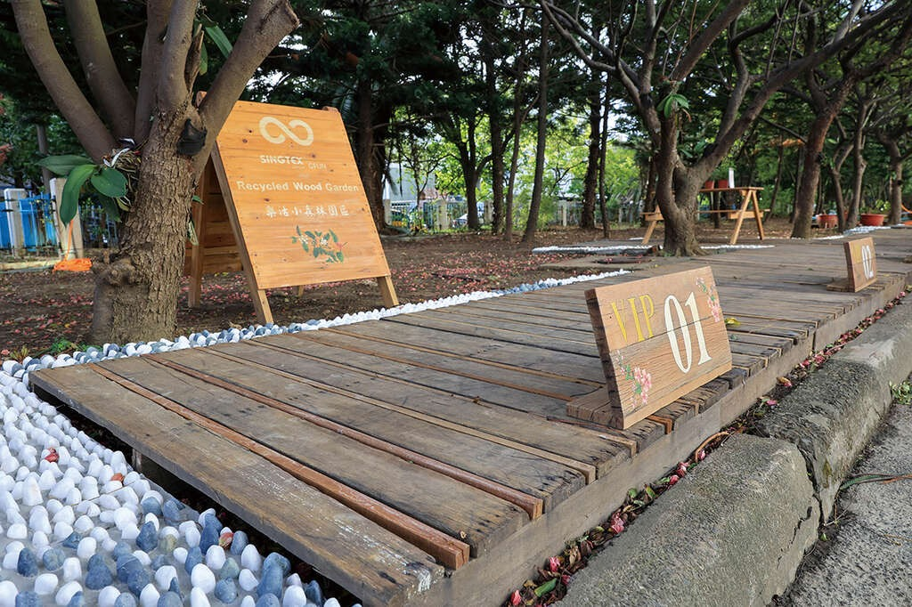
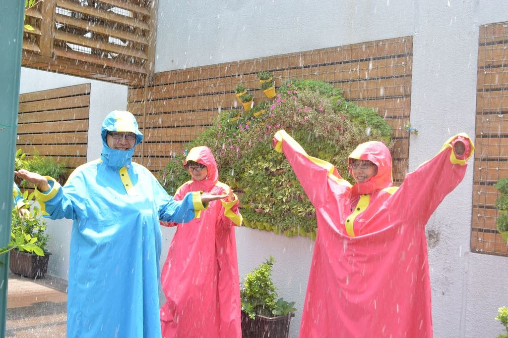

## GFun機能生活館

4.7更新日期2025-03-25人氣58440- 觀光工廠

機能布料可不是噱頭，歡迎來館內｢風雨體驗走廊｣、｢伸展體驗活動區｣、｢機能體驗DIY｣，就能明白NIKE、愛迪達為何如此愛用。
來到GFun機能生活館前，可以看到使用回收木棧板所舖設的樂活小森林園區，有鵝卵石健康步道和休憩用的木桌椅，為工廠環境增添了些許溫暖氣息。進到生活館中，從牆上生動活潑的看版解說，先對聚紡的發展有初步的認識。

在參觀觀光工廠的過程中，依序看到了生產區布料加工的流程，從入庫驗布、落布接合、壓光整理、塗佈貼合、熟成放置、撥水加工、印花貼網、物性評估、驗布包裝，原來布料的產出要經過這麼多道關卡；接著隔著玻璃，可以看到品保測試區，有潑水度、耐水壓、酸鹼值、透濕度、透氣度、剝離強度、撕裂強度、防止車縫線滲水，以及各種強度的洗滌測試，經過這麼多道的檢測才能確保品質，生產出優良機能布。

有了專業的品管，遊客最有興趣的莫過於穿戴上GFun的防水透濕雨衣，親身走一回風雨體驗走廊，感受各種強度雨水的潑打，見證防水透濕產品完全防護及不悶熱、舒適的品質。平常在市面常看到生活上所需的涼感衣、發熱衣，或是吸濕快乾、防風、透氣、保暖、防潑水、抗UV、抗菌等各式機能服飾，已經讓穿著從舒適度的需求，提升到兼顧對身體的照護，也更講求原料的取得和製造過程中降低對環境的污染，因此在GFun可以認識如何用3杯咖啡＋5支回收保特瓶做出一件衣服，這些萃取技術的認識及守護環境的堅持，都能在參觀中獲得啟發，並了解如何在衣著中節能減碳。- 照片照片
- 影片影片
- 街景街景

景點資訊電話/03-4389538#399傳真/03-4833987地址/桃園市觀音區觀音工業區工業六路3號開放時間/- 星期日：休息
- 星期一：10:00 - 17:00
- 星期二：10:00 - 17:00
- 星期三：10:00 - 17:00
- 星期四：10:00 - 17:00
- 星期五：10:00 - 17:00
- 星期六：休息

門票資訊/免費參觀，DIY另計官方網站/官方網站服務資訊- 解說簡報
- 廁所
- 停車場
- 網路
- 販賣部

旅遊叮嚀◎ 預約參觀規則：

☆一般團體、學校團體參觀（40人以上）：請於七天前完成預約手續

※ 預約時段若人數已額滿，將另行通知安排其他參訪時段。

※ 請務必於約定時間到達，如超過預約時間15分鐘仍未到達本館，且事前未通知者，
本館將保留取消該團體參訪之權利。

※ 若需取消預約導覽或變更參觀日期者，請於活動前二天以電話通知本館。

◎ 開館時間：週一至週五10:30-17:00 (週六、日休)

◎ 入館預約：

為維護參觀品質，建議您於一週前電話預約參觀（現場將視情況管控入館人數，造成不便敬請見諒！）

◎ 預約專線 : 03-4389538#399，林經理如何到達依您的出發地，選擇適合的交通方式停車資訊本館提供免費停車場地
