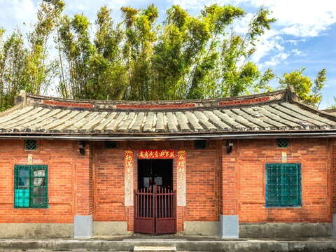
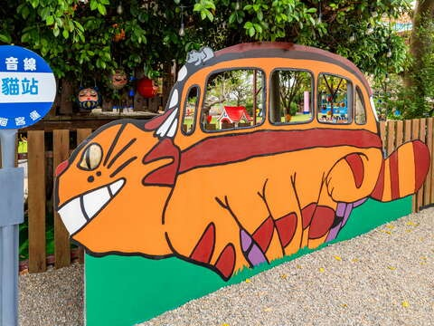
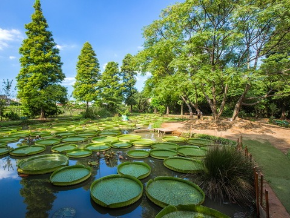
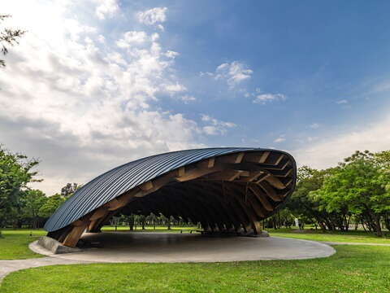

## 青林農場

4.0更新日期2025-03-15人氣184636- 自然生態
- 草花農場
- 休閒健走

吃過燒烤店沒什麼好說嘴，動手焢窯、露天烤肉才夠威，酒足飯飽後超大草皮等你來動動筋骨，最後做個麥桿菊乾燥花，把這份野趣帶回家。- 乾燥花創意DIY，讓旅行自帶療癒感
- 古早味焢窯vs南洋風味餐，享受美味不需抉擇

觀音嬉遊趣，來青林農場就對了！園區種有麥桿菊、野薑花、薰衣草、紫色馬鞭草及各式香草植物，萬紫千紅的綺麗花海，與療癒感十足的大片綠地，令人一入園就倍感舒暢。小巧豐富的農場也常受到各大節目的青睞，不時就有名人來訪錄影，可說是當區數一數二的人氣農場。

來「全國第一家乾燥花主題農場」，可別錯過乾燥花DIY體驗課程！首先須先下田採集麥桿菊花苞，並將花苞插在完成繪製的盆器上，便大功告成！除了感受赤腳踩在田埂上的鄉村野趣，更可隨心所欲玩花弄草，不只為自己製作一份獨一無二的專屬紀念品，更讓美好的旅行回憶常保鮮度，大人小孩都適合。

農場中央的大草坪提供孩子可以盡情奔跑、玩球的場地，還有沙坑、小火車、小型越野車等多樣的遊樂設施，讓孩子一眼就愛上！草皮四周還有運用廢容器製作而成的乳牛、貓頭鷹、小羊造景，相當俏皮逗趣。

農場遊的重頭戲，當然非野炊料理莫屬！只需提前3日預約，省去大費周章準備食材的麻煩，輕輕鬆鬆享受戶外焢窯的快樂時光，與滿有窯燒香氣的美味料理。一旁還有南洋風格餐廳，點綴著椰子樹、芭蕉、雞蛋花、天堂鳥，同時享用椰奶火鍋、比薩、咖哩椰香雞等風味美食，亦有另種度假風情。- 照片照片
- 全景全景
- 街景街景

景點資訊電話/03-4987747地址/桃園市觀音區大堀里大湖路二段131-1號開放時間/- 星期日：09:00 – 17:30
- 星期一：09:30 – 17:00
- 星期二：09:30 – 17:00
- 星期三：09:30 – 17:00
- 星期四：09:30 – 17:00
- 星期五：09:30 – 17:00
- 星期六：09:00 – 17:30

門票資訊/■100元(可抵消費)
■120cm以下兒童/ 70歲以上長者/ 身心障礙者/觀音區民 享免費入園，入園時請出示相關證件
■以上票價以官網和現場公告為主相關連結/FB粉絲團服務資訊- 廁所
- 停車場
- 販賣部

如何到達依您的出發地，選擇適合的交通方式停車資訊路邊停車，亦有停車場(可停40-50台)周圍停車場- 中油加盟明泓站[導航](https://www.google.com.tw/maps/place/25.0102124,121.1386482)
- 台灣中油新坡站[導航](https://www.google.com.tw/maps/place/25.010649,121.139544)
- 桃園市觀音區新坡多功能場館停車場(08:00-21:00 費率未知)[導航](https://www.google.com.tw/maps/place/25.014199,121.136842)
- 中油亞柏新屋加油站[導航](https://www.google.com.tw/maps/place/24.9723119,121.1289904)

查看更多停車優惠下一則網友推推關閉上一則回列表下一則## 周邊景點

- [林家古厝休閒農場-9月至隔年6月 (週一至週四09:30～17:30，僅接受團體預約活動；週五至週日正常營業) -7、8月09:30～17:30 (不定期休，依Facebook公告)人氣107623](/zh-tw/travel/attraction/481)
- [4.0龍貓公車站星期日：00:00 - 23:59人氣12054](/zh-tw/travel/attraction/2212)
- [3.9蓮荷園休閒農場星期日：08:30 - 17:30人氣250891](/zh-tw/travel/attraction/483)
- [4.4崙坪文化地景園區星期日：09:00 - 17:00人氣149799](/zh-tw/travel/attraction/1599)

看更多
