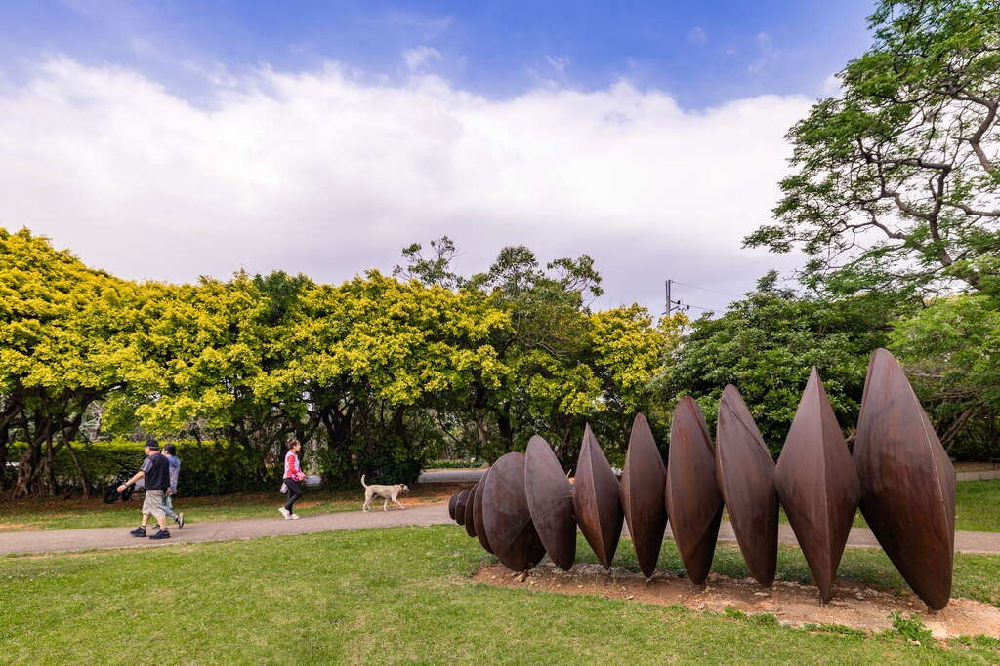
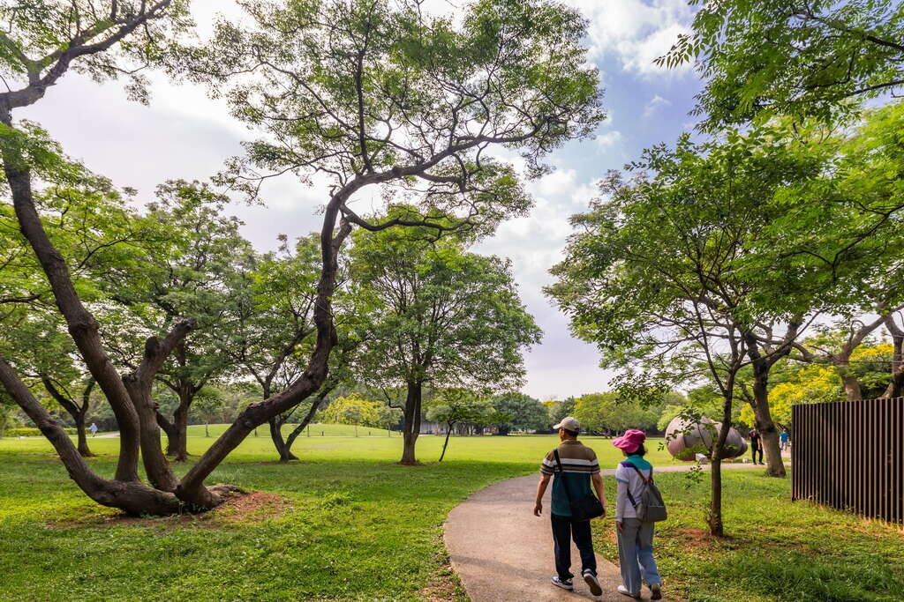

## 崙坪文化地景園區

4.4更新日期2025-09-09人氣149799小松鼠正邀你一同在這座6.3公頃的綠地盡情跑跳，然後在竹編龜殼劇場做白日夢、最後嚐個梅干扣肉、逛逛客家文創好物，不跟上太可惜！- 動手體驗藍染、竹編，感受客家工藝匠心
- 悠坐古色古香的食堂裡，品嚐客家小炒與茶點
- 開闊草原上野餐、放風箏，隨風而行，享受無憂自在時光
- 漫遊歷史遺址，走讀無線電發展歷程

位於桃園的崙坪文化地景園區，是一個結合客家傳統工藝、歷史遺跡和自然景觀的迷人場所。這裡不僅能讓你深入了解客家文化，還能讓你在綠意盎然的環境中，享受美食、藝術與悠閒時光！

客家工藝聚落：品味傳統與創新
在崙坪文化地景園區，客家工藝聚落是每個遊客必到的景點，這裡擁有客家工藝館，展示了傳統的客家工藝技藝，如木工、藍染、竹編等，並提供各種手作課程，讓旅客親自體驗這些美麗的手工藝。
在這裡，你還能品嚐到桃園客家獨特的美食。好客食堂提供一系列道地的客家料理和茶點。從香氣四溢的客家小炒到經典的茶點，無不讓人垂涎欲滴。食堂的設計充滿古色古香的氛圍，坐在窗邊，品嚐美食，窗外綠意盎然的生態池景觀，讓每一餐都變得格外美味。

龜殼劇場：藝術與自然的完美融合
龜殼劇場的造型設計靈感來自森林中的落葉，其獨特的木結構和拱形曲線，營造出一個既開放又具有秩序感的空間，讓人沉浸在藝術設計的氛圍中。
這裡不定期舉辦音樂會、舞蹈表演等藝文活動，使來訪的旅客在大自然中享受與藝術共融的美好片刻。

風神草原：與自然親密接觸
綠意盎然的風神草原，是放鬆身心的最佳場所，草原上不時可以看到飛機掠過，這樣的景象讓人不禁放慢腳步，享受那份寧靜。草原四周還保存著桃園國際雕塑創作展留下的地景藝術作品，讓遊客在探索大自然的同時，也能領略到藝術的魅力。

歷史足跡：走進電信與地磁發展的時光隧道
除了自然景觀與客家工藝文化，崙坪文化地景園區還擁有豐富的歷史遺產。園區過去曾是日治時期至二戰後，臺灣接收世界訊號的重要基地，因此在園區內可看到地磁觀測站和授信所設施群，如今，這些歷史遺跡成為了文化資產，讓遊客可以更深入了解台灣的電信歷史發展。- 照片照片
- 街景街景

景點資訊電話/03-498-5208地址/桃園市觀音區崙坪里16鄰學府路350巷120號開放時間/- 星期日：09:00 - 17:00
- 星期一：休息
- 星期二：09:00 - 17:00
- 星期三：09:00 - 17:00
- 星期四：09:00 - 17:00
- 星期五：09:00 - 17:00
- 星期六：09:00 - 17:00

門票資訊/免費官方網站/官方網站相關連結/FB粉絲團服務資訊- 廁所
- 停車場
- 販賣部
- 單車驛站
- 步道

旅遊叮嚀￭館內禁止寵物進入
￭每週一及選舉日休館（如週一遇國定假日則順延至週二休館）如何到達依您的出發地，選擇適合的交通方式停車資訊停車資訊(免收費)：
森林停車場：汽車停車格共88格，身心障礙車位3格，親子車位3格。
汽車停車格(含身心障礙車位1格)共45格。
機車停車格16格
大客車停車格 6格
