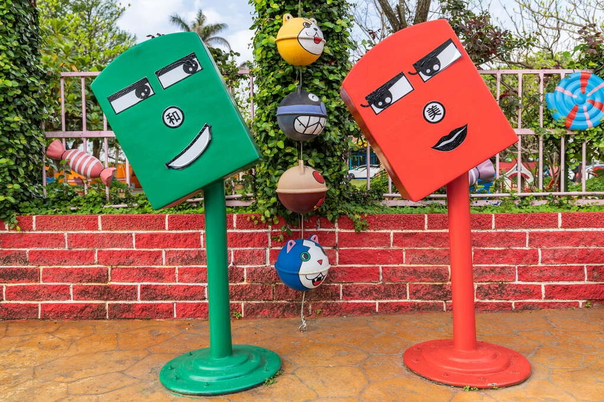
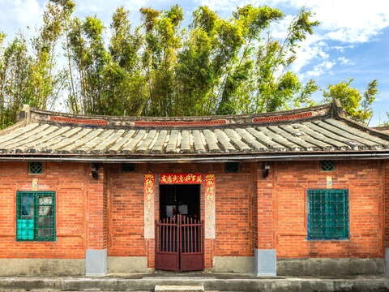
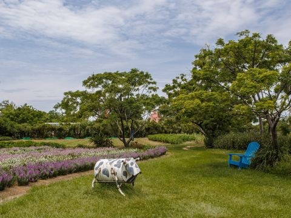

## 龍貓公車站

4.0更新日期2025-07-30人氣12054- 歷史人文

經典動畫傳送門！與龍貓傘下等公車、與貓巴士展開奇幻之旅，與歪腰郵筒互尬擺拍姿勢，喚醒沉睡已久的童心。- 撐著雨傘與龍貓合影，走進宮崎駿動畫中的夢幻場景
- 笑到歪腰！捕獲喜劇感爆棚的趣味郵筒

在桃園市觀音區，有個地方讓人彷彿穿越到宮崎駿的奇幻世界——「龍貓公車站」，這個由幼兒園園長精心打造的裝置藝術，多年來吸引了無數大小朋友前來探秘。這裡不僅是一個網紅打卡點，更是一個充滿童趣與回憶的地方，想必能讓你找回赤子之心，展開一段療癒的旅程！

栩栩如生的龍貓和貓巴士
龍貓公車站宛如電影中的場景，造型細緻栩栩如生。那憨厚的圓滾滾身形、大大的無辜眼睛，加上撐著傘的可愛模樣，還有貓巴士在一旁預備好要載著旅客前往夢想園地，無一不令人驚呼「好可愛」！隨著傍晚時分，公車站點上溫暖的燈光，也增添了故事感，昏黃燈光下的龍貓更增添了一份守護的感覺，有如是在等待著每一位旅人的到訪。別忘了撐把雨傘與龍貓來張俏皮合影，重現宮崎駿動畫裡的經典場景。

歪腰郵筒逗趣十足
不僅如此，龍貓公車站周邊還藏有其他精彩亮點！幼兒園的正門彷彿童話中的糖果屋，彩色繽紛的設計同樣也讓人愛不釋手。而卡通版的「歪腰郵筒」，則是超萌又童趣，絕對會讓每個來訪者忍不住想要擺出各種搞怪姿勢，呼應郵筒的趣味氛圍！

林蔭大道順遊
想要玩得更盡興？不妨至鄰近的白千層綠色隧道散步。全長約2.8公里白千層綠色隧道，是當地居民散步和騎自行車的好去處。當微風輕拂，陽光透過樹葉灑下斑駁的光影，讓人感到心情放鬆。這裡人車稀少，相當適合拍照感受小鎮寧靜時光。- 照片照片
- 街景街景

景點資訊地址/桃園市觀音區中山路二段239號開放時間/- 星期日：00:00 - 23:59
- 星期一：00:00 - 23:59
- 星期二：00:00 - 23:59
- 星期三：00:00 - 23:59
- 星期四：00:00 - 23:59
- 星期五：00:00 - 23:59
- 星期六：00:00 - 23:59

門票資訊/免費服務資訊- 公車站

旅遊叮嚀請勿擅自進入幼兒園如何到達依您的出發地，選擇適合的交通方式停車資訊路邊停車周圍停車場- 桃園市觀音區新坡多功能場館停車場(08:00-21:00 費率未知)[導航](https://www.google.com.tw/maps/place/25.014199,121.136842)
- 中油加盟明泓站[導航](https://www.google.com.tw/maps/place/25.0102124,121.1386482)
- 台灣中油新坡站[導航](https://www.google.com.tw/maps/place/25.010649,121.139544)

查看更多停車優惠下一則網友推推關閉上一則回列表下一則## 周邊景點

- [3.9蓮荷園休閒農場星期日：08:30 - 17:30人氣250891](/zh-tw/travel/attraction/483)
- [林家古厝休閒農場-9月至隔年6月 (週一至週四09:30～17:30，僅接受團體預約活動；週五至週日正常營業) -7、8月09:30～17:30 (不定期休，依Facebook公告)人氣107623](/zh-tw/travel/attraction/481)
- [4.0青林農場星期日：09:00 – 17:30人氣184636](/zh-tw/travel/attraction/1178)
- [觀音區多功能場館【桃園市立圖書館 草漯分館開放資訊】 -週二至週六 08：30-21：00 ，週日及週一 08：30-17：00 -每逢國定假日及每月最後一個星期四休館 -聯絡電話：03-4837650 【觀音草漯親子館開放時間】 -09:00~12:00，14:00~17:00 -每週一公休 -聯絡電話：03-4831823人氣6270](/zh-tw/travel/attraction/2214)

看更多
