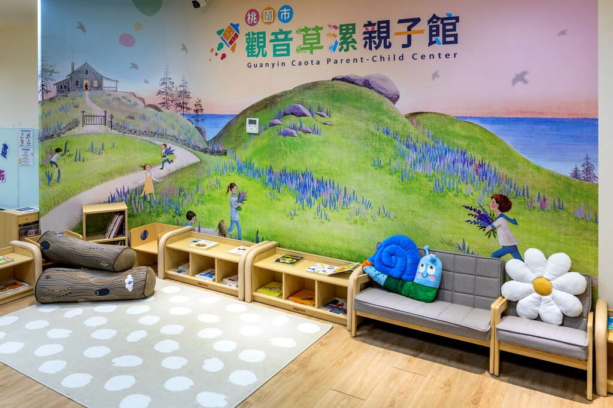
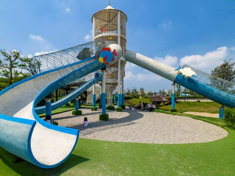
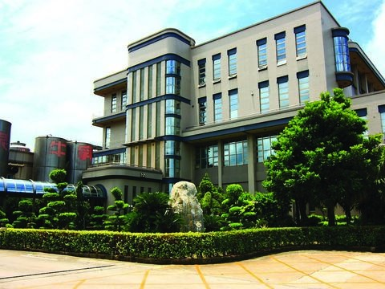
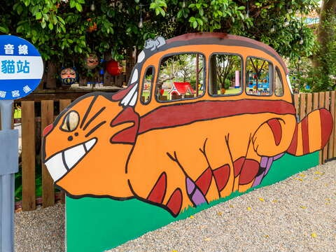

## 觀音區多功能場館

更新日期2025-07-30人氣6270- 歷史人文

以全齡友善服務為亮點，涵蓋親子互動、藝文活動、購物休閒，是結合文化、生活的在地地標。- 閱讀繪本、互動體驗、積木課程，打造親子歡樂基地
- 除了徜徉書海，還有多樣藝文活動，滿足你的求知欲

坐落於草漯二期重劃區的觀音區多功能場館，不僅是在地地標，更是居民幸福生活的代名詞。地下2層、地上6層的多功能空間，涵蓋親子館、公托中心、日照中心、家庭服務中心、圖書館、市民活動中心以及購物商場，提供便利且多元化的服務，成為草漯地區的新亮點。

建築藝術與綠意的完美融合
這座場館以獨具設計感的建築風格融入環境綠帶，展現了現代建築與自然的和諧之美。它榮獲第16屆優良工程金安獎佳作及第8屆桃園市政府公共工程金品獎優等，並通過綠建築標章評定，是多功能場館的標竿代表。無論是外觀的驚艷還是內在的功能性，都讓這座建築成為觀音地區的耀眼地標。

全齡服務，滿足多元需求
觀音多功能場館以貼近居民需求為核心，創造出適合各年齡層的空間。一樓的購物商場滿足地方居民的日常採買需求，帶來便利的生活體驗；二樓設有親子館與公托中心，為家長提供一站式的幼兒照護服務，從托育到親子活動一應俱全。三樓的家庭服務中心與日照中心進一步延伸社會福利的觸角，關懷每個需要支持的家庭與長者。而四至五樓的圖書館則成為推廣知識與文化的據點，結合閱讀與藝文活動，營造豐富的文化氛圍。至於六樓的市民活動中心則是社區居民的聚會點，讓草漯地區的居民擁有專屬於自己的共享空間。

社區向心力的凝聚點
草漯地區的人口近年來有顯著增長，觀音多功能場館從規劃設計到落成啟用，以居民的需求為首要考量。這座以全齡化服務為基礎的場館，不僅提升生活便利，更成為草漯地區不可或缺的社區核心。- 照片照片

景點資訊地址/桃園市觀音區莊敬路186號開放時間/【桃園市立圖書館 草漯分館開放資訊】
-週二至週六 08：30-21：00 ，週日及週一 08：30-17：00
-每逢國定假日及每月最後一個星期四休館
-聯絡電話：03-4837650

【觀音草漯親子館開放時間】
-09:00~12:00，14:00~17:00
-每週一公休
-聯絡電話：03-4831823門票資訊/入館免費服務資訊- 廁所
- 停車場
- 網路

如何到達依您的出發地，選擇適合的交通方式停車資訊備有停車場周圍停車場- 正好停觀音站(全時段每 30 分鐘 10 元（進場 30 分鐘內出場免費）)[導航](https://www.google.com.tw/maps/place/25.0449204,121.1354452)
- 城市車旅億客成草漯旗艦店(全時段每 30 分鐘 20 元)[導航](https://www.google.com.tw/maps/place/25.0444296,121.1378847)
- 城市車旅草漯農會(全時段每 30 分鐘 20 元，當日最高收費 180 元)[導航](https://www.google.com.tw/maps/place/25.0477254,121.1431828)
- 保障宮免費停車場(全時段免費)[導航](https://www.google.com.tw/maps/place/25.0486882,121.1442908)
- 大義全聯觀音成功(全時段前 1 小時 40 元，之後每 30 分鐘 20 元)[導航](https://www.google.com.tw/maps/place/25.0506212,121.1486296)
- 汎揚觀音建國(全時段每 30 分鐘 20 元，當日最高收費 100 元)[導航](https://www.google.com.tw/maps/place/25.05012,121.120218)
- 觀音建國停車場(全時段每小時 100 元)[導航](https://www.google.com.tw/maps/place/25.049852,121.119745)

查看更多停車優惠上一則回列表下一則## 周邊景點

- [4.2水之丘主題公園星期日：09:00 - 19:00人氣8979](/zh-tw/travel/attraction/2231)
- [4.7GFun機能生活館星期日：休息人氣58440](/zh-tw/travel/attraction/983)
- [4.1光泉牛奶園地（大園廠）星期日：休息人氣129854](/zh-tw/travel/attraction/502)
- [4.0龍貓公車站星期日：00:00 - 23:59人氣12054](/zh-tw/travel/attraction/2212)

看更多
