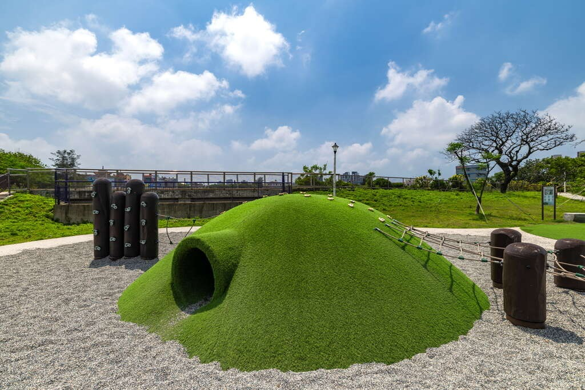
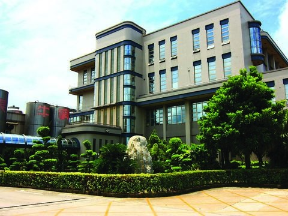
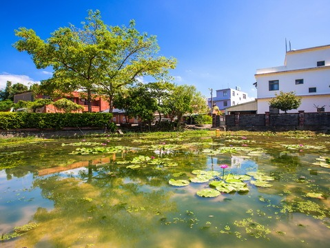

## 水之丘主題公園

4.2更新日期2026-07-01人氣8979- 休閒健走

挑戰超刺激飼料桶滑梯、征服攀爬架、還能在湖畔步道放空悠閒，結合桃園埤塘文化的水之丘主題公園，孩子玩到不想回家！- 誰能征服最高的滑道？站上三層樓高滑梯，炫耀你的勇氣 、
- 小山丘、攀爬架、池底迷宮，孩子們開啟冒險模式吧、
- 埤塘畔的環景步道，享受最chill的午後時光、

融合了桃園埤塘文化，水之丘公園以有趣且富有特色的設計概念，打造出這片充滿活力的親子樂園。不論是挑戰刺激的滑梯，還是享受悠閒的湖畔步道，保證讓你收穫滿滿！

挑戰三層樓溜滑梯，玩出大冒險
公園最吸睛的設施，非三層樓高的飼料桶溜滑梯莫屬！這座滑梯以桃園埤塘常見的飼料桶作為設計概念，不僅具有地方特色，還賦予設施獨特的意義，巧妙結合當地文化，為孩子和大人們打造出一個既有趣又充滿在地情感的遊玩體驗。這裡有三種滑道，分別為不同的高度和刺激程度，完全滿足想要挑戰自我的孩子的衝勁。從滑梯高處滑下的那瞬間，保證是驚喜與成就感雙重爆發！

小朋友的遊戲樂園，探索無止境
水之丘公園是一個親子必訪的遊玩樂園，充滿多樣化的設施，讓孩子們可以盡情探索與玩樂！除了有趣的草魚遊戲場和池底迷宮外，公園還設置了小山丘、攀爬網、波浪木頭攀爬架及盪鞦韆等多種設施，為孩子提供了鍛鍊體能與挑戰自我的機會。小山丘和攀爬網能讓孩子挑戰攀爬技巧；波浪木頭攀爬架則能提升孩子的平衡感。公園內還專門設置大人使用的體健設施，讓家長在孩子玩樂時也能抽空鍛鍊身體。

親近自然，漫步湖畔步道
如果你喜歡悠閒的散步，那環湖景觀步道絕對是你的好去處。這條步道不僅融合了自然美景，還採用了無障礙設計，對於推嬰兒車或輪椅的旅客相當友善。散步途中，微風輕撫臉頰，鳥鳴低語於耳旁，感受生活中難得的舒心時刻。- 照片照片
- 街景街景

景點資訊地址/桃園市觀音區大觀路一段360號旁開放時間/- 星期日：09:00 - 19:00
- 星期一：09:00 - 19:00
- 星期二：09:00 - 19:00
- 星期三：09:00 - 19:00
- 星期四：09:00 - 19:00
- 星期五：09:00 - 19:00
- 星期六：09:00 - 19:00

門票資訊/免費服務資訊- 公車站
- 廁所

旅遊叮嚀-溜滑梯僅限6~12歲孩童遊玩
-公園內遮陽設施較少，請攜帶防曬用品如何到達依您的出發地，選擇適合的交通方式周圍停車場- 大義全聯觀音成功(全時段前 1 小時 40 元，之後每 30 分鐘 20 元)[導航](https://www.google.com.tw/maps/place/25.0506212,121.1486296)
- 保障宮免費停車場(全時段免費)[導航](https://www.google.com.tw/maps/place/25.0486882,121.1442908)
- 城市車旅草漯農會(全時段每 30 分鐘 20 元，當日最高收費 180 元)[導航](https://www.google.com.tw/maps/place/25.0477254,121.1431828)
- 城市車旅億客成草漯旗艦店(全時段每 30 分鐘 20 元)[導航](https://www.google.com.tw/maps/place/25.0444296,121.1378847)
- 正好停觀音站(全時段每 30 分鐘 10 元（進場 30 分鐘內出場免費）)[導航](https://www.google.com.tw/maps/place/25.0449204,121.1354452)
- 居善醫院停車場(全時段免費)[導航](https://www.google.com.tw/maps/place/25.0582298,121.1662973)
- 汎揚觀音建國(全時段每 30 分鐘 20 元，當日最高收費 100 元)[導航](https://www.google.com.tw/maps/place/25.05012,121.120218)
- 觀音建國停車場(全時段每小時 100 元)[導航](https://www.google.com.tw/maps/place/25.049852,121.119745)

查看更多停車優惠下一則網友推推關閉上一則回列表下一則## 周邊景點

- [4.1光泉牛奶園地（大園廠）星期日：休息人氣129854](/zh-tw/travel/attraction/502)
- [觀音區多功能場館【桃園市立圖書館 草漯分館開放資訊】 -週二至週六 08：30-21：00 ，週日及週一 08：30-17：00 -每逢國定假日及每月最後一個星期四休館 -聯絡電話：03-4837650 【觀音草漯親子館開放時間】 -09:00~12:00，14:00~17:00 -每週一公休 -聯絡電話：03-4831823人氣6270](/zh-tw/travel/attraction/2214)
- [4.7GFun機能生活館星期日：休息人氣58440](/zh-tw/travel/attraction/983)
- [4.3觀音自行車道星期日：24 小時營業人氣48016](/zh-tw/travel/attraction/283)

看更多
