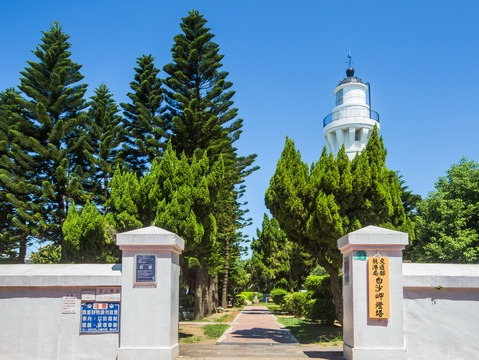
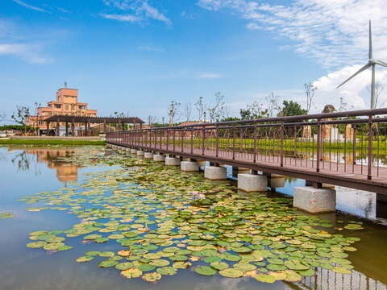
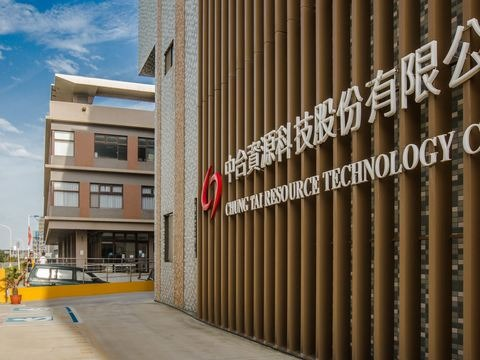

## 沿海生活實驗室(珍珠海岸改造共創基地)

更新日期2026-09-09人氣873- 濱海追風

沿海生活實驗室位於觀音甘泉寺後方，是一處認識珍珠海岸的旅遊入口。從地方故事、沿海生活到周邊景點資訊，在這裡稍作停留，認識觀音與新屋的海岸風景，也找到下一站值得走訪的地方。- 串連珍珠海岸多元景點路線 從沿海生活實驗室出發，可延伸走訪草漯沙丘地質公園、白玉海堤、永安漁港、新屋綠色走廊等珍珠海岸代表性景點，從沙丘地景、海岸夕照到漁港風情，一次感受桃園西海岸的自然與人文風貌。
- 認識珍貴的藻礁生態 從基地出發走向觀新藻礁，發現海岸潮間帶的自然生命。
- 散步到海邊看風景 串連觀音海水浴場、白玉海堤，感受西部海岸遼闊景色。
- 走進觀音老街與甘泉寺 從百年信仰與街區日常，認識觀音聚落累積至今的生活風景。
- 走進在地農場與田園體驗 串連林家古厝休閒農場、青林農場等周邊農業體驗據點，走入花田、草地與農事活動空間，感受觀音沿海四季更迭的田園風景與親子友善的自然體驗。

「沿海生活實驗室」走進珍珠海岸的第一站。

沿海生活實驗室位於桃園觀音甘泉寺後方，座落在觀音聚落與海岸之間。從這裡出發，不遠處便能抵達觀音海水浴場、白玉海堤與觀新藻礁；往街區裡走，則能遇見甘泉寺、老街、傳統店家與地方居民的日常。這裡像是一個認識珍珠海岸的入口，讓旅人抵達海邊之前，先知道眼前這片海岸有哪些值得慢慢探索的地方。

珍珠海岸橫跨桃園大園、觀音、新屋與楊梅，沿線有漁港、藻礁、沙丘、埤塘與農村，也有許多藏在聚落裡的店家、職人與地方故事，希望把這些散落在海岸線上的線索重新串連起來，透過地方資訊、主題展示與不定期企劃，提供不同的旅行方式。

來到這裡，可以先停下來看看近期推薦的景點與活動，認識周邊值得拜訪的地方，再決定今天想往哪裡走。也許是沿著海岸吹風散步，到白玉海堤看夕陽；也許前往觀新藻礁，認識桃園沿海特殊的生態環境；也可以留在觀音街區，從廟宇、市場與店家之間，看見一座沿海聚落真正的生活樣貌。

除了作為旅遊資訊與地方展示的據點，沿海生活實驗室也會隨著季節推出展覽、飲食、交流、講座、體驗等不同企劃，邀請在地居民、創作者與旅人一起參與。每一次來訪，都可能遇見不同的沿海故事。

因此，不妨把這裡當成珍珠海岸旅程的起點。先走進來坐一會兒、看看地圖、認識幾個地方，再從觀音出發，把旅行延伸到更遠的海岸。珍珠海岸值得看的，不只有海，更有海岸與聚落之間，持續發生的生活。

- 照片照片

景點資訊電話/03-4732269地址/桃園市觀音區中山路69號開放時間/開館日
週四至週一 10:30 -17:30 (中午12:30-13:30不開放)
假日及國定假日:09:30-17:30 (中午12:30-13:30不開放)

公休日 週二及週三休館相關連結/FB粉絲團如何到達依您的出發地，選擇適合的交通方式停車資訊路邊停車位亦可利用甘泉寺周邊停車區域再步行3分鐘可抵達周圍停車場- 台灣中油觀音站[導航](https://www.google.com.tw/maps/place/25.0349019,121.0854735)
- 觀音鄉中興停車場(00:00-24:00 每 30 分鐘 15 元)[導航](https://www.google.com.tw/maps/place/25.038056486697986,121.08066006554226)
- 江華玉林停車場(全時段每小時 100 元)[導航](https://www.google.com.tw/maps/place/25.045887,121.091171)
- 台灣中油觀音三和站[導航](https://www.google.com.tw/maps/place/25.0239559,121.086201)

查看更多停車優惠上一則回列表下一則## 周邊景點

- [4.6甘泉寺星期日：06:00 - 21:00人氣118748](/zh-tw/travel/attraction/292)
- [白沙岬燈塔夏令時間(4月~10月)：09:00~18:00、冬令時間(11月~隔年3月)：09:00~17:00 週一公休，遇國定假日或連續假期則調整為收假次日不開放人氣174555](/zh-tw/travel/attraction/276)
- [4.4觀音濱海遊憩區星期日：24 小時營業人氣128623](/zh-tw/travel/attraction/591)
- [2.6中台環境資源教育中心星期日：休息人氣40776](/zh-tw/travel/attraction/1167)

看更多
