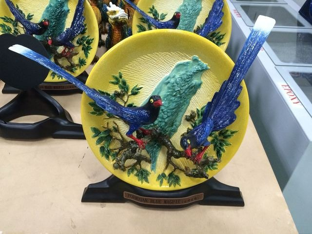

定位點## 綠品坊(佳龍科技工程股份有限公司)

更新：2026-03-27發佈：2015-12-10

人氣：1.1萬加入背包

電話03-4736566地址桃園市觀音區大潭里環科路323號營業時間星期日：休息
星期一：08:00 - 12:00、13:00 - 17:00
星期二：08:00 - 12:00、13:00 - 17:00
星期三：08:00 - 12:00、13:00 - 17:00
星期四：08:00 - 12:00、13:00 - 17:00
星期五：08:00 - 12:00、13:00 - 17:00
星期六：休息
相關連結官方網站星期日：休息- 桃金好禮

定位點2015桃園市第八屆伴手禮─台灣藍鵲

萬物皆應有始末，進而生生不息的交替。
佳龍由 3R 的思惟－「源頭減量 (Reduce)、再使用 (Reuse)、回收再利用 (Recycle)」出發，重新檢視企業的商業活動、產品設計、材料使用、製成技術，乃至回收技術的開發等，為環境朝向永續發展的目標邁進，以再生資源為您呈現「台灣藍鵲」。
把台灣藍鵲為台灣特有種鳥類中特別吸引人的朱紅的嘴喙、碧藍身軀和雙翼，末端白色長如綬帶的尾巴，夾構在台灣島上，並以台灣當背景來表現這是台灣特有「藍色的羽毛」鳥類。

佳龍科技－綠品坊：「不僅為藝術品，更是衷心為地球療傷的先鋒。」
規格說明：
品名：台灣藍鵲
尺寸：長58cm ＊ 寬26cm ＊ 高52cm
重量：5.8 Kg
顏色：彩色
材質：回收材玻纖粉 / 回收材玻璃 / 環保塗料
綠品坊ID：No.G404051001
繼續閱讀### 交通資訊

進入後可依您的出發地，選擇適合的交通方式### 周遭停車場

查看更多停車優惠上一則回列表下一則
