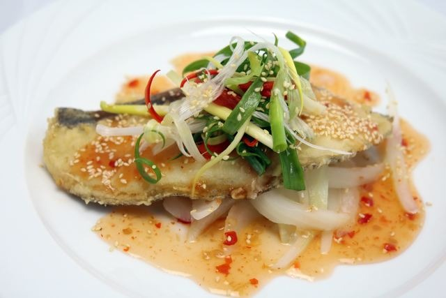
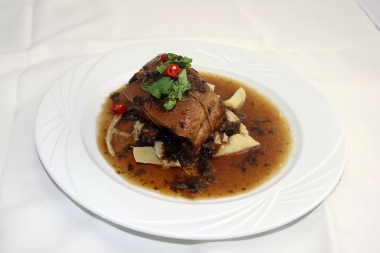
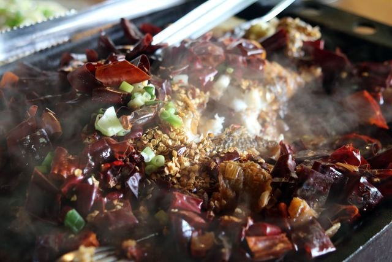
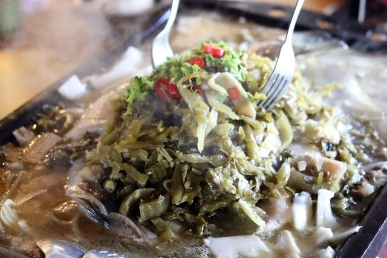
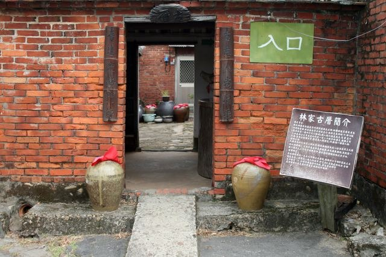
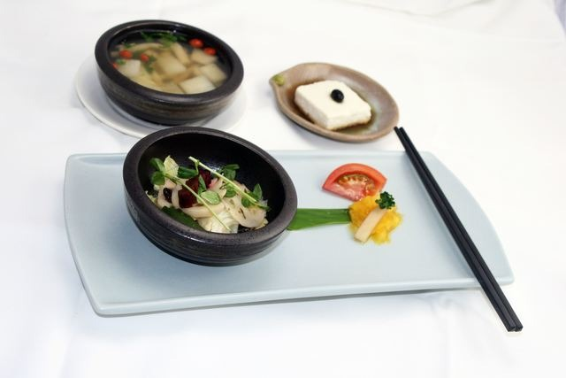
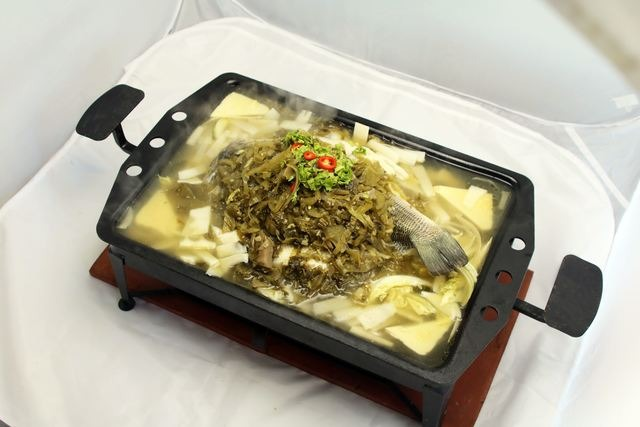
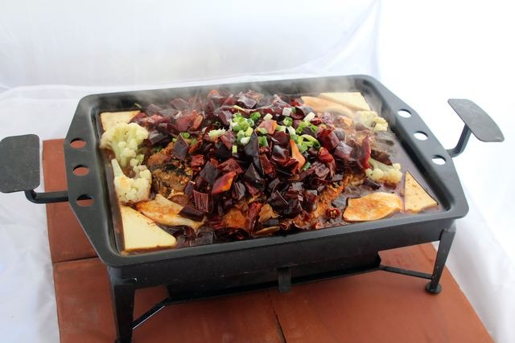

定位點## 西荷食堂

更新：2026-06-09發佈：2017-02-06

人氣：6668加入背包

電話03-4980753地址桃園市觀音區大富路221號營業時間星期日：09:30 - 17:30
星期一：休息
星期二：休息
星期三：休息
星期四：休息
星期五：09:30 - 17:30
星期六：09:30 - 17:30
星期日：09:30 - 17:30定位點2016海客之都認證餐廳

推薦菜色：蓮花套餐、客式挑魚、辣味挑魚

「遠離都市的塵囂，假日不妨來一趟林家古厝休閒農場，」身為第五代子孫的經營者林老闆如是介紹。原本從事貿易的他，在偶然的機緣下回到故里，因為喜好大自然和美食，於是將三甲地重新打造成休閒農場。平時和假日都有不同的動靜態活動，有烤肉、焢土窯、蓮園解說、古蹟導覽等。

因應季節佈局經典料理
林老闆特別研發新式的料理套餐，名為「挑魚」，魚種會隨季節調整，主要以肥美、大小約一斤四兩至一斤半為最，原因在於好吃外，最大的特點是盛盤器皿是特製鐵器，使用富有膠質的魚種可達到久煮不爛，越煮越入味的效果。林老闆說，挑魚有兩種吃法，一種客式挑魚，一種是辣味挑魚，常讓顧客不知道挑哪一道，只好兩道都買單，大快朵頤一番啊！

料理安全是給顧客的保障
在農場裡有個開宗明義的理念—餐點均現作新鮮食材，老闆只賣自己敢吃無亂添加的食物。「食安問題很重要，也因現作，所以難免準備時間會比較久，這點要請客人海涵！」林老闆鄭重說明，未來將繼續朝研發新料理之路前進。
繼續閱讀### 特色介紹

- 蓮花套餐蓮花套餐從茶品、前菜、主菜，到甜點，都與蓮花相關。還制定七次服務流程，讓每個顧客都感到賓至如歸。在夏天可以吃到五種以上的套餐料理，有鱈魚、椒麻雞、獅子頭、東坡肉，針對素食者也有貼心準備。客式挑魚客式挑魚鐵盤須事先擺放洋蔥、豆芽菜等，接著魚微下油鍋後再翻烤，再把自家醃製的酸菜炒香置入，加入高湯。鐵盤上桌前會先點上炭火，一場賞心悅目的料理秀令人拿起手機猛拍。「這道挑魚會隨著時間產生許多有趣的變化，選用酸菜、洋蔥和豆芽菜在於會出水，使鐵盤不因熱度而乾鍋，反而可揉合魚的精華，讓湯汁變得更鮮美。」這道料理亦可像火鍋一樣，將麵食、蓮子、蓮藕、馬鈴薯置入烤盤，別有風味。辣味挑魚辣味挑魚是另一種挑魚吃法，是針對喜愛吃辣的族群，做法與客式挑魚大致雷同，僅是酸菜改用大量的辣椒，打造麻而不辣的鮮美味道。

### 交通資訊

進入後可依您的出發地，選擇適合的交通方式### 周遭停車場

查看更多停車優惠### 服務設施

- 冷氣空調餐飲網路停車位

上一則回列表下一則
