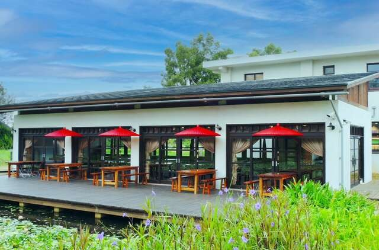
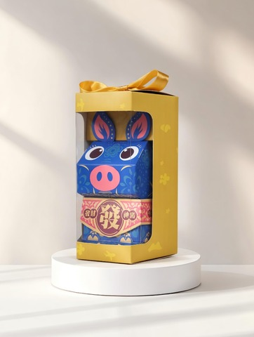
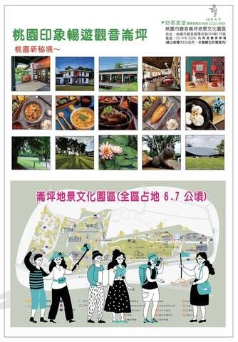
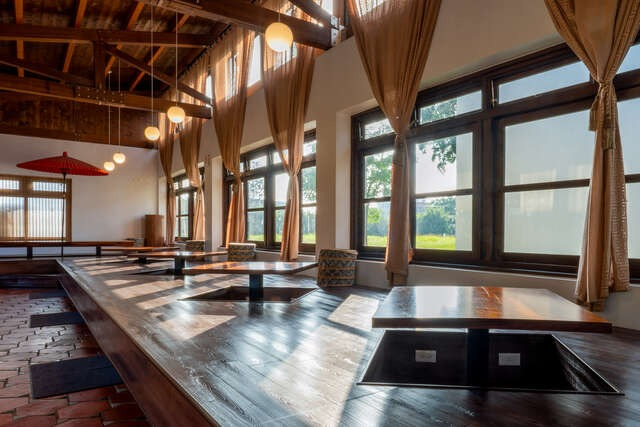
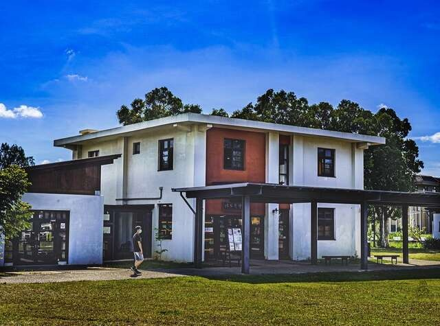

定位點## 鼎好-好客食堂旗艦店

更新：2026-07-31發佈：2026-04-29

人氣：1440加入背包

電話03-4985208地址桃園市觀音區學府路350巷120號營業時間星期日：11:00 - 21:00
星期一：11:00 - 20:00
星期二：11:00 - 20:00
星期三：11:00 - 20:00
星期四：11:00 - 20:00
星期五：11:00 - 20:00
星期六：11:00 - 21:00
相關連結官方網站FB粉絲團星期日：11:00 - 21:00- 桃金好店寵物友善

定位點位於桃園市觀音區的「崙坪 好客食堂旗艦店」，是一處融合在地客家文化、美食與人情味的特色場域。這裡不僅是一間食堂，更是連結社區、傳承文化的溫暖據點。好客食堂以「吃在地、食當季」為理念，選用當地新鮮食材，推出經典客家風味料理，如梅干扣肉、客家鹹豬肉、客家迎賓甜點牛汶水…等，讓每一口都能吃出客家情懷的故事與人情的溫度。餐廳環境優雅寬敞溫馨，保留傳統日式建築特色，園區內也設有客家百工百業的「工藝館」展覽空間、寬敞的大草原、日據時代遺址、原生種荷花池、裝置藝術打卡，全園區占地6.7公頃，讓每位遊客可以在此認識客家文化、享用客家美食、享受大自然，不論是家人聚餐、學校參訪、還是旅途歇腳，「崙坪 好客食堂」都是品味客家風情、感受在地好客精神的最佳選擇。

繼續閱讀### 小叮嚀

寵物友善(需至寵物籃)### 交通資訊

進入後可依您的出發地，選擇適合的交通方式### 停車資訊

備有停車場### 周遭停車場

查看更多停車優惠### 預約/注意事項

預約電話03-4985208### 服務設施

- 冷氣空調餐飲停車位信用卡可攜寵物無障礙設施

### 關鍵字標籤

珍珠輔導店家上一則回列表下一則
