定位點## 黃金海岸商務旅館(2星)

更新：2026-02-13發佈：2008-10-21

人氣：2.6萬加入背包

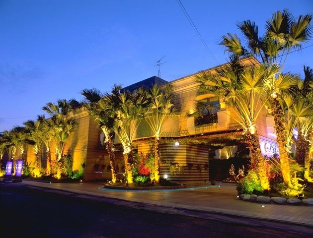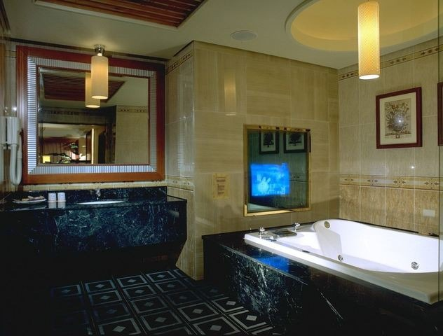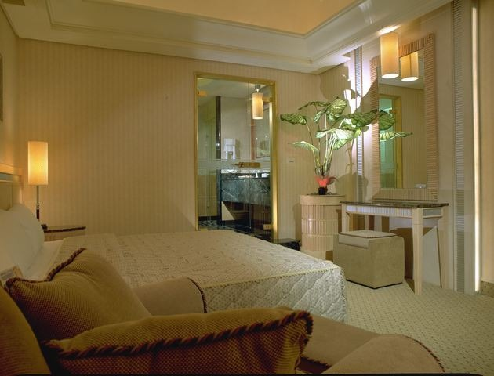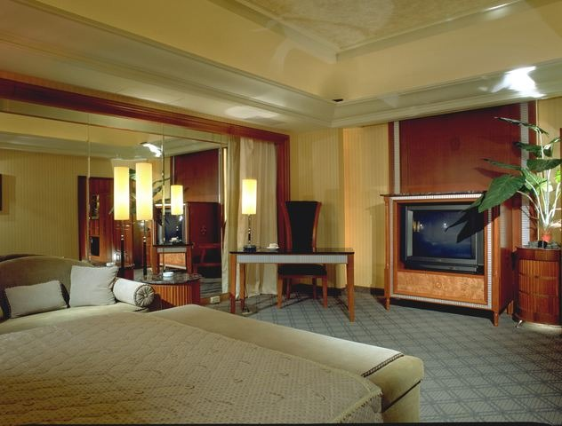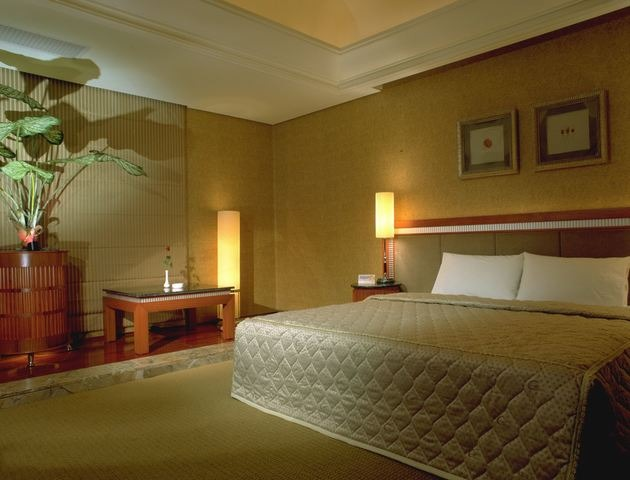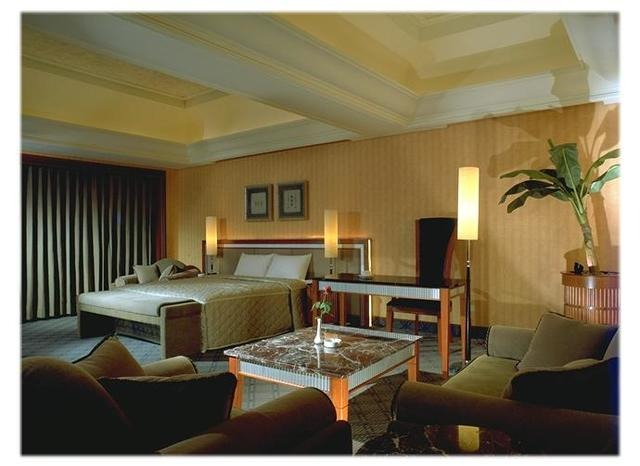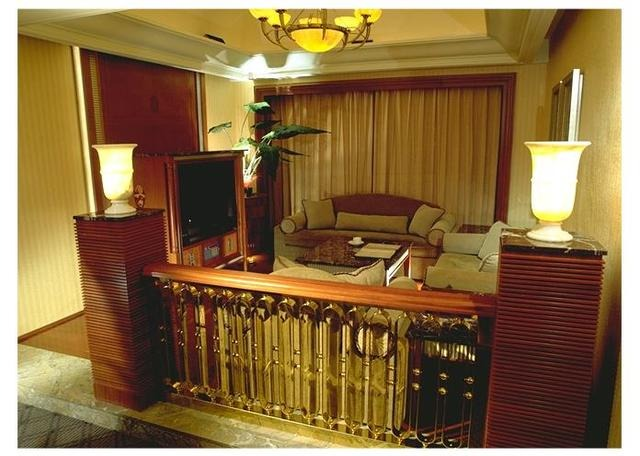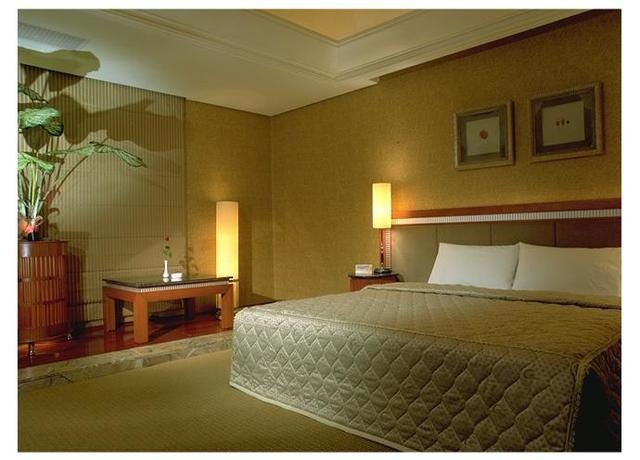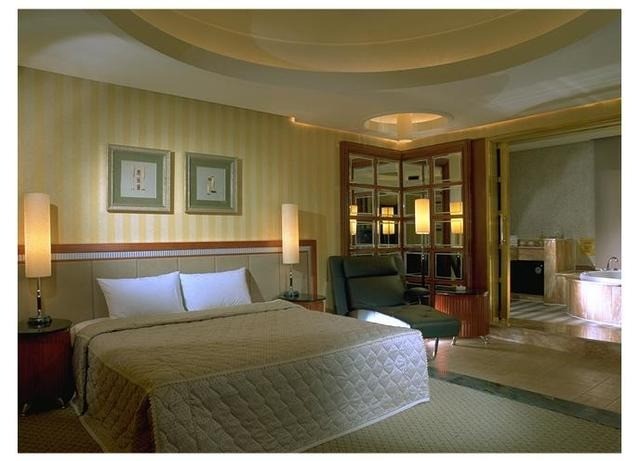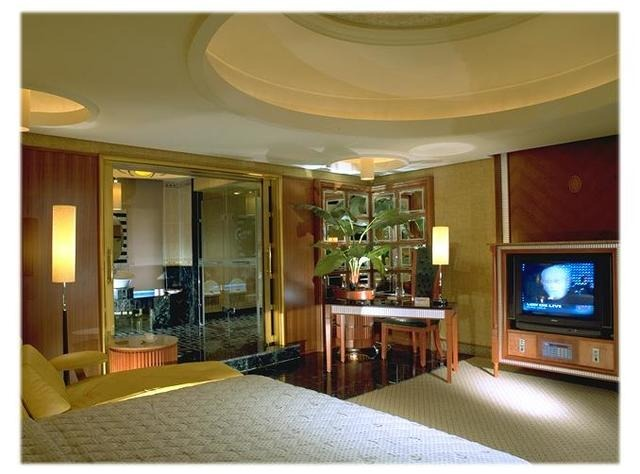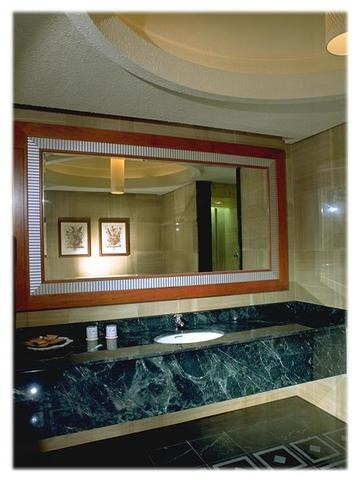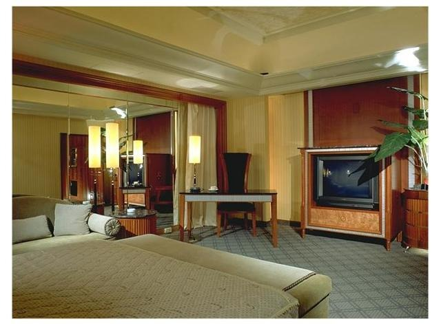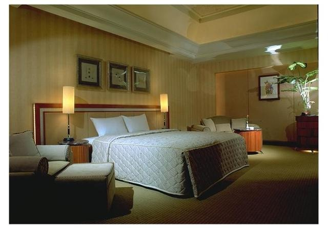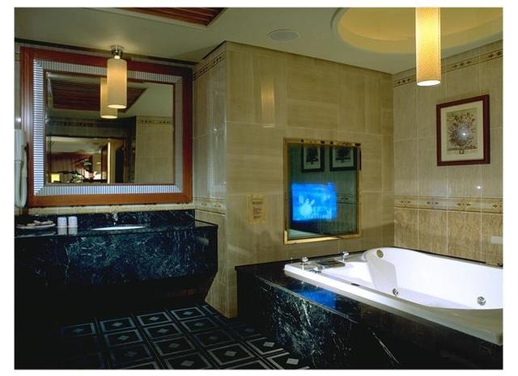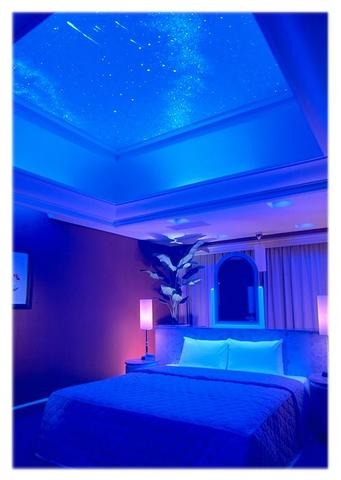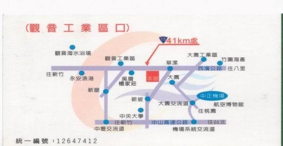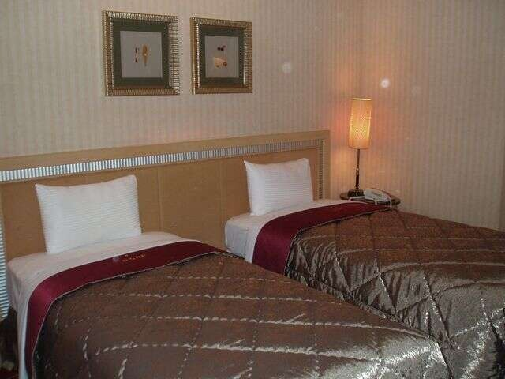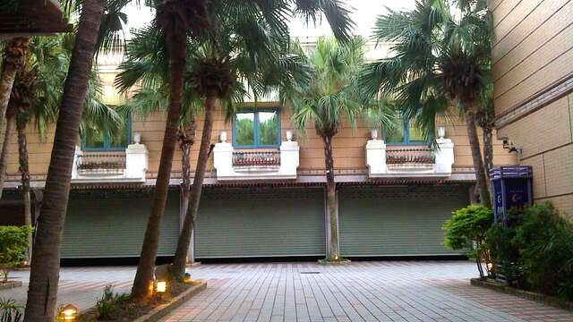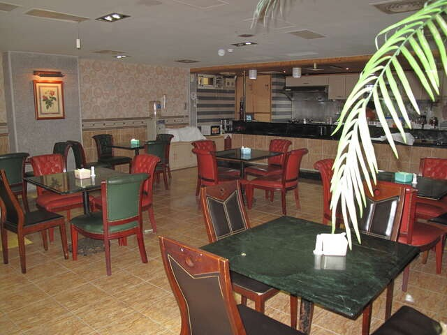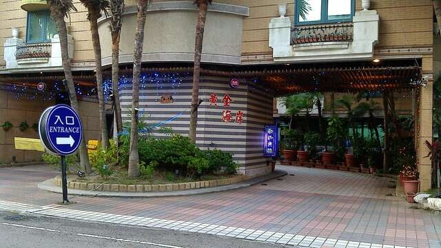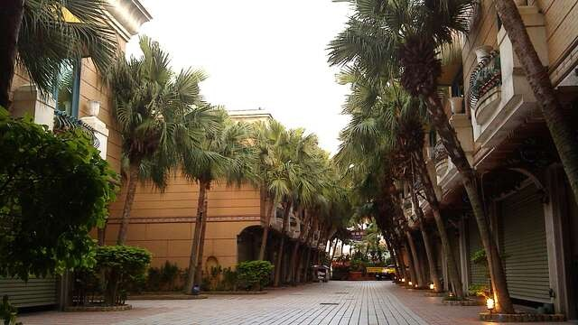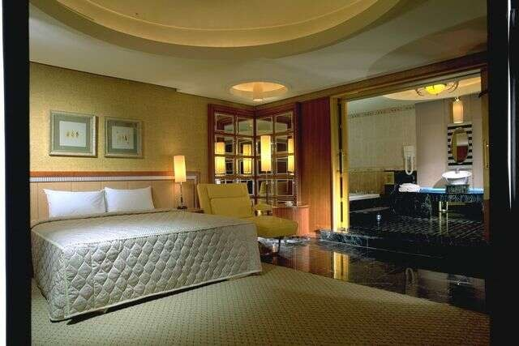旅遊標章桃園市旅館004號電話03-4389999、03-4389888傳真03-4834686地址桃園市觀音區六合街16號電子郵件goldcoa.motel@msa.hinet.net營業時間星期日：00:00 - 23:59
星期一：00:00 - 23:59
星期二：00:00 - 23:59
星期三：00:00 - 23:59
星期四：00:00 - 23:59
星期五：00:00 - 23:59
星期六：00:00 - 23:59
消費區間NT$1880~2880(實際價格請電話洽詢)星期日：00:00 - 23:59旅遊標章： 桃園市旅館004號

定位點以休閒的異國風情迎接客人，讓您猶如置身於世外桃源．獨立的車庫讓您免去停車的煩惱，共有六大主題房型任君挑選．遠離煩惱就是這樣簡單，說走就走的旅行，就是生活最好的調味料．**交通地理位置**黃金海岸坐落於純樸的草漯地區，距離機場約２０分鐘車程，鄰近繁忙的觀音工業區，是一個聚集眾多不同景點的特殊區域．想要回到市區的生活，２０分鐘車程就能夠到達華泰名品城、桃園高鐵、青埔棒球場、機場捷運等設施．若想要來趟自然之旅，本館靠近西濱公路４０公里處，是一個理想的環島旅行的起點．**旅館介紹**本旅館把單調的住宿發展出了另一種主題風情．獨特的上下樓層設計，讓旅客多了更多的安全與舒適感，另類的主題也給了客人逃離塵囂的小確幸．旅館不在只是一個休息點，而是旅程上的充電站．**景點介紹**桃園就像是台灣的大門，因為桃園國際機場是他們踏上台灣的第一個景點．台灣得天獨厚的地形，讓世人們驚嘆，西部擁有美地的海岸線，東部有蜿蜒崎嶇的自然山景．這樣無語倫比的自然景觀是世上少有的自然寶藏．那也是為何台灣擁有寶島（formosa）這個美名．習慣了城市的喧囂，讓國際級的旅人，選擇了台灣來逃離壓力的生活．既然來到美麗的寶島，何不放縱自己來場無拘無束的自然景觀之旅？在黃金海岸內充分的休息，把一身飛行的勞累一掃而空，讓身體充分的休息，以便能好好地享受這段台灣奇幻的美景之旅．當然在您結束環島之旅時，別忘了回來本館好好的放鬆一下身心．從濱海公路開始的環島旅行，以最近的距離挑望美麗的台灣海峽．

繼續閱讀### 交通資訊

進入後可依您的出發地，選擇適合的交通方式### 停車資訊

客房皆備有專屬的停車位（商務套房除外）
還有多個平面車位，可供使用．### 周遭停車場

查看更多停車優惠### 預約/注意事項

訂房：（０３）４３８９９９９
一般房型，可入住２位旅客．若要增加一位，需加收＄５００清潔費
四人房型，可入住４位旅客．若要增加一位，需加收＄５００清潔費
（入房超過１５分鐘，皆加收清潔費）### 服務設施

- 冷氣空調網路停車位信用卡

### 關鍵字標籤

濱海漁港上一則回列表下一則
