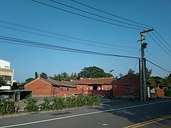
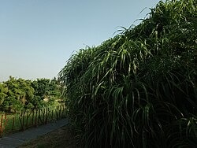

座標：25°2′10.70″N121°4′54.10″E / 25.0363056°N 121.0816944°E /25.0363056; 121.0816944維基百科，自由的百科全書[25°2′10.70″N121°4′54.10″E / 25.0363056°N 121.0816944°E /25.0363056; 121.0816944](//geohack.toolforge.org/geohack.php?language=zh&pagename=%E8%A7%80%E9%9F%B3%E5%8D%80&params=25_2_10.70_N_121_4_54.10_E_type:city(60000)_region:TW-TAO)

| 觀音區 Guanyin District 舊稱：石觀音 |
| --- |
| 區 |
| 白沙岬燈塔 |
| 觀音區位置圖 |
| 坐標： 25°02′N 121°06′E  /  25.03°N 121.1°E  / 25.03; 121.1 |
| 國家 | 中華民國 |
| 上級區劃 | 桃園市 |
| 下級區劃 | 24 里 402 鄰 |
| • 區長 | 劉草典 |
| 面積 |
| • 總計 | 87.9807平方公里（33.9695平方英里） |
| 海拔 | 44公尺（144英尺） |
| 人口 （2026年7月）（32,515戶） |
| • 總計 | 78,137人（桃園市的第11位） |
| • 密度 | 888人/平方公里（2,300人/平方英里） |
| 時區 | 國家標準時間 （ UTC+08:00 ） |
| 郵遞區號 | 328 |
| 戶政資料代碼 | 68000120 |
| 毗鄰 | 大園區 、 新屋區 、 中壢區 |
| 網站 | www .guanyin .tycg .gov .tw |

| 觀音區－ 台灣語言 寫法及拼音 |
| --- |
| 注音 | ㄍㄨㄢ- ㄧㄣ- ㄑㄩ- |
| 漢語拼音 | Guān yīn qū |
| 通用拼音 | Guan yin cyu |
| 威妥瑪拼音 | Kuan yin ch'ü |
| 台語白話字 | Koan-im Khu |
| 台語羅馬字 | Kuan-im Khu |
| 客語白話字 | Kôn-yîm Khî |
| 客羅 | 海陸腔 ：gonˋ rhimˋ kiˋ 四縣腔 ：gonˊ imˊ ki^ 饒平腔 ：guanˇ rhimˇ kiˇ |

**觀音區**，舊稱「石觀音」[[1]](#cite_note-本所沿革-1)，前身「觀音鄉」，位於[臺灣](/wiki/%E8%87%BA%E7%81%A3)[桃園市](/wiki/%E6%A1%83%E5%9C%92%E5%B8%82)西部沿海。東臨[大園區](/wiki/%E5%A4%A7%E5%9C%92%E5%8D%80)、[中壢區](/wiki/%E4%B8%AD%E5%A3%A2%E5%8D%80)，南邊與[新屋區](/wiki/%E6%96%B0%E5%B1%8B%E5%8D%80)相臨，西濱[臺灣海峽](/wiki/%E8%87%BA%E7%81%A3%E6%B5%B7%E5%B3%BD)。區內人口約7.8萬人[[2]](#cite_note-人口統計-2)，人口主要分布於觀音市區、草漯及新坡三大聚落中，居民大多屬[客家族群](/wiki/%E8%87%BA%E7%81%A3%E5%AE%A2%E5%AE%B6%E4%BA%BA)。當地原為農業鄉鎮，1970年代以後隨著臺灣工業的蓬勃發展而設立工業區，境內有[觀音工業區](/w/index.php?title=%E8%A7%80%E9%9F%B3%E5%B7%A5%E6%A5%AD%E5%8D%80&action=edit&redlink=1)和新創的[桃園科技工業園區](/wiki/%E6%A1%83%E5%9C%92%E7%A7%91%E6%8A%80%E5%B7%A5%E6%A5%AD%E5%9C%92%E5%8D%80)。觀音區也盛產[蓮花](/wiki/%E8%93%AE%E8%8A%B1)，每年夏天會舉辦蓮花季。

## 歷史

[編輯]觀音區舊稱「石觀音」[[1]](#cite_note-本所沿革-1)，係於1860年一名[竹北二堡](/wiki/%E7%AB%B9%E5%8C%97%E4%BA%8C%E5%A0%A1)[石牌嶺庄](/wiki/%E7%9F%B3%E7%89%8C%E5%B6%BA)（今屬新屋區）的農民往返耕作途中，在當地的小溪中撿到一顆酷似[觀音佛](/wiki/%E8%A7%80%E4%B8%96%E9%9F%B3%E8%8F%A9%E8%96%A9)的天然石，供奉瞻拜，故名。直至1920年設庄時，石觀音改稱「觀音」[[3]](#cite_note-鄉志土地篇-3): 51。

[日治時期](/wiki/%E5%8F%B0%E7%81%A3%E6%97%A5%E6%B2%BB%E6%99%82%E6%9C%9F)，1895年，觀音屬[臺北縣](/wiki/%E8%87%BA%E5%8C%97%E7%B8%A3_(%E6%97%A5%E6%B2%BB%E6%99%82%E6%9C%9F))新竹支廳，一部份隸屬[桃澗堡](/wiki/%E6%A1%83%E6%BE%97%E5%A0%A1)，一部份則隸屬竹北二堡。1896年3月，全臺設3縣1廳，觀音隸屬臺北縣[[4]](#cite_note-鄉志大事記-4): 308。1901年11月改為20廳，屬[桃園廳](/wiki/%E6%A1%83%E5%9C%92%E5%BB%B3)[[4]](#cite_note-鄉志大事記-4): 309。1920年改訂地方制度，廢廳置州，全臺灣設5州2廳3市，[觀音庄](/wiki/%E8%A7%80%E9%9F%B3%E5%BA%84)隸屬[新竹州](/wiki/%E6%96%B0%E7%AB%B9%E5%B7%9E)[中壢郡](/wiki/%E4%B8%AD%E5%A3%A2%E9%83%A1)[[4]](#cite_note-鄉志大事記-4): 310。

[二戰後](/wiki/%E8%87%BA%E7%81%A3%E6%88%B0%E5%BE%8C%E6%99%82%E6%9C%9F)1946年，隸屬[新竹縣](/wiki/%E6%96%B0%E7%AB%B9%E7%B8%A3_(1945%E5%B9%B4%EF%BC%8D1950%E5%B9%B4))中壢區觀音鄉[[4]](#cite_note-鄉志大事記-4): 312。1950年，桃園立縣，與新竹縣分治，觀音鄉改隸[桃園縣](/wiki/%E6%A1%83%E5%9C%92%E7%B8%A3)[[4]](#cite_note-鄉志大事記-4): 313。之後境內村數歷經兩次變更[[註 1]](#cite_note-5)[[4]](#cite_note-鄉志大事記-4): 314，至2014年1月1起，觀音鄉共轄24個村；12月25日因應桃園縣改制為直轄市，觀音鄉改制為「觀音區」[[1]](#cite_note-本所沿革-1)。

## 地理

[編輯]### 地形

[編輯]觀音區屬於[桃園沖積扇](/w/index.php?title=%E6%A1%83%E5%9C%92%E6%B2%96%E7%A9%8D%E6%89%87&action=edit&redlink=1)的一部分。

### 水文

[編輯]- 河川：富林溪、大堀溪、觀音溪、新屋溪。
- 灌溉系統：[桃園大圳](/wiki/%E6%A1%83%E5%9C%92%E5%A4%A7%E5%9C%B3)（[大漢溪](/wiki/%E5%A4%A7%E6%BC%A2%E6%BA%AA)）。

### 人口

[編輯]| 年份 | 人口 | ±% |
| --- | --- | --- |
| 1946 | 27,040 | — |
| 1951 | 29,951 | +10.8% |
| 1956 | 33,454 | +11.7% |
| 1961 | 38,317 | +14.5% |
| 1966 | 44,283 | +15.6% |
| 1971 | 47,698 | +7.7% |
| 1976 | 47,408 | −0.6% |
| 1981 | 45,758 | −3.5% |
| 1986 | 44,069 | −3.7% |
| 1991 | 43,911 | −0.4% |
| 1996 | 49,808 | +13.4% |
| 2001 | 54,227 | +8.9% |
| 2006 | 58,901 | +8.6% |
| 2011 | 61,676 | +4.7% |
| 2016 | 65,555 | +6.3% |
| 2021 | 69,995 | +6.8% |
| 來源： 謝公倉 1986 ，第128頁 內政部統計月報-各鄉鎮市區人口數 . 內政部 . [ 2019-12-19 ] . （ 原始內容 存檔於2020-11-10）. |

根據桃園市政府觀音區戶政事務所統計，2025年底觀音區戶數約3.2萬戶，人口約7.8萬人，區內人口最多與最少的里分別是草新里與新興里，2025年底兩里人口分別為8,599人與909人[[2]](#cite_note-人口統計-2)。2025年底，觀音區人口中0至14歲人口佔比約有12.54%，15至64歲人口佔比約有72.01%，65歲以上人口則佔比約有15.45%，是桃園市青壯年人口佔比最高的行政區[[5]](#cite_note-6)。

人口數年份20,00030,00040,00050,00060,00070,00080,000194019601980200020202040人口數觀音區歷年人口變化（1946年～）.mw-chart-e8562d2613d78a59185f90f16686cc212b6ca43ec0f4265deab90cb58c26f5b1e407385eb69e374a35810f390fa7321ce0badd2bdf51714d17cfc9e474b5909d__zr204590-cls-1038916:hover{pointer-events:none}.mw-chart-e8562d2613d78a59185f90f16686cc212b6ca43ec0f4265deab90cb58c26f5b1e407385eb69e374a35810f390fa7321ce0badd2bdf51714d17cfc9e474b5909d__zr204590-cls-1038917:hover{cursor:pointer;fill:rgba(0,0,0,1)}.mw-chart-e8562d2613d78a59185f90f16686cc212b6ca43ec0f4265deab90cb58c26f5b1e407385eb69e374a35810f390fa7321ce0badd2bdf51714d17cfc9e474b5909d__zr204590-cls-1038918:hover{cursor:pointer}.mw-chart-e8562d2613d78a59185f90f16686cc212b6ca43ec0f4265deab90cb58c26f5b1e407385eb69e374a35810f390fa7321ce0badd2bdf51714d17cfc9e474b5909d__zr204590-cls-1038919:hover{cursor:pointer;fill:rgba(82,130,235,1)}.mw-chart-e8562d2613d78a59185f90f16686cc212b6ca43ec0f4265deab90cb58c26f5b1e407385eb69e374a35810f390fa7321ce0badd2bdf51714d17cfc9e474b5909d__zr204590-cls-1038920:hover{cursor:pointer;fill:rgba(0,0,0,0)}查看原始資料。## 政治

[編輯]### 歷任首長

[編輯]#### 鄉長

[編輯]| 任次 | 姓名 | 備註 |
| --- | --- | --- |
| 1 | 古萬桂 |  |
| 2 | 黃阿壁 |  |
| 3 | 廖德景 |  |
| 4 |  |
| 5 | 許金燦 |  |
| 6 |  |
| 7 | 廖運清 |  |
| 8 | 黃金春 | 民主進步黨 |
| 9 |
| 10 | 李文貴 |  |
| 11 |  |
| 12 | 郭榮宗 | 民主進步黨 |
| 13 | 當選立委 |
| 13 | 張永輝 | 民主進步黨 |
| 14 | 解職 |
| 14 | 黃茂實 | 補選 |
| 15 |  |
| 16 | 歐炳辰 | 民主進步黨 |

#### 區長（指派）

[編輯]| 任次 | 姓名 | 備註 |
| --- | --- | --- |
| 1 | 洪清淵 |  |
| 2 | 林國甯 |  |
| 3 | 劉草典 | 現任 |

### 區政組織

[編輯]觀音區公所是[桃園市政府](/wiki/%E6%A1%83%E5%9C%92%E5%B8%82%E6%94%BF%E5%BA%9C)在觀音區的派出機關，在中華民國政府架構中為市政府綜理區政的執行機關，上級業務監督機關為桃園市政府。[區長](/wiki/%E5%8C%BA%E9%95%BF)由[市長](/wiki/%E6%A1%83%E5%9C%92%E5%B8%82%E5%B8%82%E9%95%B7)任命，其任期為無任期保障。在區長及主任秘書之下，設有5課4室等9個內部單位[[6]](#cite_note-7)。觀音區為[桃園市議會](/wiki/%E6%A1%83%E5%9C%92%E5%B8%82%E8%AD%B0%E6%9C%83)第十二選區，在市議會的63席市議員中，觀音區共選出2席區域市議員（不含平地原住民與山地原住民議員）[[7]](#cite_note-8)。

### 行政區

[編輯]#### 沿革

[編輯]現今觀音區行政範圍的確立，來自於1920年，日本將臺灣十二廳改為五州二廳，設觀音庄屬新竹州中壢郡。觀音庄轄茄苳坑、大潭、觀音、三座屋、坑尾、坡寮、白沙屯、樹林仔、新坡、上大堀、下青埔、草漯、塔子腳、崙坪、下大堀、苦苓腳等16個大字。1945年，改為「觀音鄉」，屬新竹縣中壢區。1950年，調整行政區域並裁撤區署，觀音鄉改隸新成立的桃園縣[[8]](#cite_note-鄉志政事篇-9): 84。2014年12月25日，桃園縣改制為直轄市，觀音鄉改制為市轄區「觀音區」，隸屬桃園市[[1]](#cite_note-本所沿革-1)。

觀音區共轄24里，其行政區域分布情形為[[9]](#cite_note-10)[[10]](#cite_note-11)：

| 次分區 | 里名 |
| --- | --- |
| 觀音區 | 觀音里 | 廣興里 | 白玉里 | 武威里 | 保生里 | 坑尾里 | 三和里 | 新興里 | 大潭里 |
| 草漯區 | 草漯里 | 富林里 | 樹林里 | 保障里 | 塔腳里 | 草新里 |  |  |  |
| 新坡區 | 新坡里 | 大同里 | 崙坪里 | 廣福里 | 上大里 | 藍埔里 | 富源里 | 金湖里 | 大堀里 |

#### 次分區

[編輯]觀音區的次分區

- **觀音次分區**指大堀溪以南，坑尾以西地帶，包括觀音、白沙屯、大潭、茄苳坑、三座屋、坑尾地段及坡寮一部分。早年移墾較其他二區有成就故莊役場設於觀音次分區。但日治時代後，交通改道，發展變緩[[11]](#cite_note-觀音鄉志-12): 48。
- **草漯次分區**位於觀音區東北角，指大堀溪以東地帶；範圍最小，是觀音區開發最早的地區。草漯素來與大園區有深厚感情，因其居民大多同為[台灣閩南人](/wiki/%E5%8F%B0%E7%81%A3%E9%96%A9%E5%8D%97%E4%BA%BA)，而觀音區則以[台灣客家人](/wiki/%E5%8F%B0%E7%81%A3%E5%AE%A2%E5%AE%B6%E4%BA%BA)為主，位於草漯村內，供奉主神為[媽祖](/wiki/%E5%AA%BD%E7%A5%96)的[草漯保障宮](/wiki/%E8%8D%89%E6%BC%AF%E4%BF%9D%E9%9A%9C%E5%AE%AE)更是香火鼎盛，已有兩百多年的歷史，是當地居民信仰中心，而且廟內建築格局奇特，參拜時不需爬高爬低，僅需要一炷香就能拜眾神，因此，[草漯保障宮](/wiki/%E8%8D%89%E6%BC%AF%E4%BF%9D%E9%9A%9C%E5%AE%AE)有「通天香」的美名。而現今草漯里由於農地重劃，釋出150公頃的建地，成為[桃園航空城](/wiki/%E6%A1%83%E5%9C%92%E8%88%AA%E7%A9%BA%E5%9F%8E)被徵收戶的標的，房價已大幅攀升[[12]](#cite_note-13)。
- **新坡次分區**包括新坡、上下大堀、苦練腳、下青埔、崙坪及坡寮一部分。發展迅速是在日治時代以後，尤其大正十三年（1924年）[桃園大圳](/wiki/%E6%A1%83%E5%9C%92%E5%A4%A7%E5%9C%B3)完成後，農村的繁榮，使其與觀音次分區立於分庭抗禮之地位；觀音次分區雖為行政中心，但全區的農會和郵局卻在新坡。公路交通發達後，新坡以接近中壢，地當中壢往觀音中途，且為南北往新屋、大園道路交會點，市況繁榮超過觀音。此次分區因毗鄰中壢，富源里部份區域被劃入[中壢都會區都市計畫區](/wiki/%E4%B8%AD%E5%A3%A2%E9%83%BD%E6%9C%83%E5%8D%80%E9%83%BD%E5%B8%82%E8%A8%88%E7%95%AB%E5%8D%80)。

## 文化

[編輯]### 藝文活動

[編輯]- [桃園蓮花季](/w/index.php?title=%E6%A1%83%E5%9C%92%E8%93%AE%E8%8A%B1%E5%AD%A3&action=edit&redlink=1)

### 宗教信仰

[編輯]- [觀音甘泉寺](/wiki/%E8%A7%80%E9%9F%B3%E7%94%98%E6%B3%89%E5%AF%BA)，供奉[觀世音菩薩](/wiki/%E8%A7%80%E4%B8%96%E9%9F%B3%E8%8F%A9%E8%96%A9)，香火鼎盛，十分靈驗。
- [草漯保障宮](/wiki/%E8%8D%89%E6%BC%AF%E4%BF%9D%E9%9A%9C%E5%AE%AE)，位於草漯里，主神供奉[媽姐](/wiki/%E5%AA%BD%E5%A7%90)，香火十分鼎盛。
- [觀音復興宮](/wiki/%E8%A7%80%E9%9F%B3%E5%BE%A9%E8%88%88%E5%AE%AE)：位於臺灣桃園市觀音區觀音工業區的[開漳聖王](/wiki/%E9%96%8B%E6%BC%B3%E8%81%96%E7%8E%8B)廟，前身為大溪區的[阿姆坪復興宮](/w/index.php?title=%E5%BE%A9%E8%88%88%E5%AE%AE%EF%BC%88%E9%98%BF%E5%A7%86%E5%9D%AA%EF%BC%89&action=edit&redlink=1)。
- [石橋應天宮](/w/index.php?title=%E7%9F%B3%E6%A9%8B%E6%87%89%E5%A4%A9%E5%AE%AE&action=edit&redlink=1)，主神供奉[關聖帝君](/wiki/%E9%97%9C%E8%81%96%E5%B8%9D%E5%90%9B)。
- [協天宮](/wiki/%E5%8D%94%E5%A4%A9%E5%AE%AE)，主神供奉[關聖帝君](/wiki/%E9%97%9C%E8%81%96%E5%B8%9D%E5%90%9B)，在地的居民稱關平爺公廟。
- [理教石橋復興宮](/w/index.php?title=%E7%90%86%E6%95%99%E7%9F%B3%E6%A9%8B%E5%BE%A9%E8%88%88%E5%AE%AE&action=edit&redlink=1)，主神供奉[開漳聖王](/wiki/%E9%96%8B%E6%BC%B3%E8%81%96%E7%8E%8B)。
- [觀音永興宮](/w/index.php?title=%E8%A7%80%E9%9F%B3%E6%B0%B8%E8%88%88%E5%AE%AE&action=edit&redlink=1)，主神供奉[天上聖母](/wiki/%E5%A4%A9%E4%B8%8A%E8%81%96%E6%AF%8D)。
- [正大宮](/w/index.php?title=%E6%AD%A3%E5%A4%A7%E5%AE%AE&action=edit&redlink=1)，主神供奉[五年千歲十二王爺](/w/index.php?title=%E4%BA%94%E5%B9%B4%E5%8D%83%E6%AD%B2%E5%8D%81%E4%BA%8C%E7%8E%8B%E7%88%BA&action=edit&redlink=1)。
- [溥濟宮](/w/index.php?title=%E6%BA%A5%E6%BF%9F%E5%AE%AE&action=edit&redlink=1)，主神供奉[保生大帝](/wiki/%E4%BF%9D%E7%94%9F%E5%A4%A7%E5%B8%9D)，俗稱保生廟。
- [慈母宮](/w/index.php?title=%E6%85%88%E6%AF%8D%E5%AE%AE&action=edit&redlink=1)，主神供奉[驪山老母](/wiki/%E9%AA%8A%E5%B1%B1%E8%80%81%E6%AF%8D)、[王母娘娘](/wiki/%E7%8E%8B%E6%AF%8D%E5%A8%98%E5%A8%98)、[地母娘娘](/wiki/%E5%9C%B0%E6%AF%8D%E5%A8%98%E5%A8%98)、[觀音菩薩](/wiki/%E8%A7%80%E9%9F%B3%E8%8F%A9%E8%96%A9)、[九天玄女](/wiki/%E4%B9%9D%E5%A4%A9%E7%8E%84%E5%A5%B3)。

### 語言

[編輯]觀音的本土語言以[臺灣客家語](/wiki/%E8%87%BA%E7%81%A3%E5%AE%A2%E5%AE%B6%E8%AA%9E)[海陸腔](/wiki/%E6%B5%B7%E9%99%B8%E5%AE%A2%E8%AA%9E)及[臺灣閩南語](/wiki/%E8%87%BA%E7%81%A3%E9%96%A9%E5%8D%97%E8%AA%9E)[偏漳腔](/wiki/%E6%BC%B3%E5%B7%9E%E8%AF%9D)為主。

- [富源](/wiki/%E5%AF%8C%E6%BA%90)，[臺灣閩南語](/wiki/%E8%87%BA%E7%81%A3%E9%96%A9%E5%8D%97%E8%AA%9E)、[臺灣客家語](/wiki/%E8%87%BA%E7%81%A3%E5%AE%A2%E5%AE%B6%E8%AA%9E)。
- [白玉](/wiki/%E7%99%BD%E7%8E%89)，[臺灣閩南語](/wiki/%E8%87%BA%E7%81%A3%E9%96%A9%E5%8D%97%E8%AA%9E)、[臺灣客家語](/wiki/%E8%87%BA%E7%81%A3%E5%AE%A2%E5%AE%B6%E8%AA%9E)。
- [大潭](/wiki/%E5%A4%A7%E6%BD%AD_(%E6%A1%83%E5%9C%92%E5%B8%82))，[臺灣閩南語](/wiki/%E8%87%BA%E7%81%A3%E9%96%A9%E5%8D%97%E8%AA%9E)、[臺灣客家語](/wiki/%E8%87%BA%E7%81%A3%E5%AE%A2%E5%AE%B6%E8%AA%9E)。
- [草漯](/wiki/%E8%8D%89%E6%BC%AF)，[臺灣閩南語](/wiki/%E8%87%BA%E7%81%A3%E9%96%A9%E5%8D%97%E8%AA%9E)。
- [崙坪](/wiki/%E5%B4%99%E5%9D%AA)，[臺灣閩南語](/wiki/%E8%87%BA%E7%81%A3%E9%96%A9%E5%8D%97%E8%AA%9E)。
- [上大](/wiki/%E4%B8%8A%E5%A4%A7)，[臺灣閩南語](/wiki/%E8%87%BA%E7%81%A3%E9%96%A9%E5%8D%97%E8%AA%9E)。
- [新坡](/wiki/%E6%96%B0%E5%9D%A1)，[臺灣閩南語](/wiki/%E8%87%BA%E7%81%A3%E9%96%A9%E5%8D%97%E8%AA%9E)。

## 教育

[編輯][大潭發電廠](/wiki/%E5%A4%A7%E6%BD%AD%E7%99%BC%E9%9B%BB%E5%BB%A0)坐落於觀音區，桃園市政府以發電廠回饋金實施國中、國小學生免費營養午餐[[13]](#cite_note-14)。

### 大專院校

[編輯]觀音區現有為[國立臺灣海洋大學](/wiki/%E5%9C%8B%E7%AB%8B%E8%87%BA%E7%81%A3%E6%B5%B7%E6%B4%8B%E5%A4%A7%E5%AD%B8)（桃園觀音校區）一校，於2018年11月1日揭牌[[14]](#cite_note-15)。

### 公立高級中學

[編輯]- [桃園市立觀音高級中等學校](/wiki/%E6%A1%83%E5%9C%92%E5%B8%82%E7%AB%8B%E8%A7%80%E9%9F%B3%E9%AB%98%E7%B4%9A%E4%B8%AD%E7%AD%89%E5%AD%B8%E6%A0%A1)一校，並附設國中部。

### 國民中學

[編輯]- [桃園市立觀音國民中學](/wiki/%E6%A1%83%E5%9C%92%E5%B8%82%E7%AB%8B%E8%A7%80%E9%9F%B3%E5%9C%8B%E6%B0%91%E4%B8%AD%E5%AD%B8)
- [桃園市立草漯國民中學](/wiki/%E6%A1%83%E5%9C%92%E5%B8%82%E7%AB%8B%E8%8D%89%E6%BC%AF%E5%9C%8B%E6%B0%91%E4%B8%AD%E5%AD%B8)

### 國民小學

[編輯]- [桃園市觀音區觀音國民小學](/w/index.php?title=%E6%A1%83%E5%9C%92%E5%B8%82%E8%A7%80%E9%9F%B3%E5%8D%80%E8%A7%80%E9%9F%B3%E5%9C%8B%E6%B0%91%E5%B0%8F%E5%AD%B8&action=edit&redlink=1)
- [桃園市觀音區上大國民小學](/w/index.php?title=%E6%A1%83%E5%9C%92%E5%B8%82%E8%A7%80%E9%9F%B3%E5%8D%80%E4%B8%8A%E5%A4%A7%E5%9C%8B%E6%B0%91%E5%B0%8F%E5%AD%B8&action=edit&redlink=1)
- [桃園市觀音區大潭國民小學](/w/index.php?title=%E6%A1%83%E5%9C%92%E5%B8%82%E8%A7%80%E9%9F%B3%E5%8D%80%E5%A4%A7%E6%BD%AD%E5%9C%8B%E6%B0%91%E5%B0%8F%E5%AD%B8&action=edit&redlink=1)
- [桃園市觀音區育仁國民小學](/w/index.php?title=%E6%A1%83%E5%9C%92%E5%B8%82%E8%A7%80%E9%9F%B3%E5%8D%80%E8%82%B2%E4%BB%81%E5%9C%8B%E6%B0%91%E5%B0%8F%E5%AD%B8&action=edit&redlink=1)
- [桃園市觀音區保生國民小學](/w/index.php?title=%E6%A1%83%E5%9C%92%E5%B8%82%E8%A7%80%E9%9F%B3%E5%8D%80%E4%BF%9D%E7%94%9F%E5%9C%8B%E6%B0%91%E5%B0%8F%E5%AD%B8&action=edit&redlink=1)
- [桃園市觀音區草漯國民小學](/w/index.php?title=%E6%A1%83%E5%9C%92%E5%B8%82%E8%A7%80%E9%9F%B3%E5%8D%80%E8%8D%89%E6%BC%AF%E5%9C%8B%E6%B0%91%E5%B0%8F%E5%AD%B8&action=edit&redlink=1)
- [桃園市觀音區崙坪國民小學](/w/index.php?title=%E6%A1%83%E5%9C%92%E5%B8%82%E8%A7%80%E9%9F%B3%E5%8D%80%E5%B4%99%E5%9D%AA%E5%9C%8B%E6%B0%91%E5%B0%8F%E5%AD%B8&action=edit&redlink=1)
- [桃園市觀音區新坡國民小學](/w/index.php?title=%E6%A1%83%E5%9C%92%E5%B8%82%E8%A7%80%E9%9F%B3%E5%8D%80%E6%96%B0%E5%9D%A1%E5%9C%8B%E6%B0%91%E5%B0%8F%E5%AD%B8&action=edit&redlink=1)
- [桃園市觀音區富林國民小學](/w/index.php?title=%E6%A1%83%E5%9C%92%E5%B8%82%E8%A7%80%E9%9F%B3%E5%8D%80%E5%AF%8C%E6%9E%97%E5%9C%8B%E6%B0%91%E5%B0%8F%E5%AD%B8&action=edit&redlink=1)
- [桃園市觀音區樹林國民小學](/w/index.php?title=%E6%A1%83%E5%9C%92%E5%B8%82%E8%A7%80%E9%9F%B3%E5%8D%80%E6%A8%B9%E6%9E%97%E5%9C%8B%E6%B0%91%E5%B0%8F%E5%AD%B8&action=edit&redlink=1)

## 交通

[編輯]### 省道

[編輯]- [台15線](/wiki/%E5%8F%B015%E7%B7%9A)：西濱公路
- [台61線](/wiki/%E5%8F%B061%E7%B7%9A)：西濱快速公路[**33草漯**](/wiki/%E8%8D%89%E6%BC%AF%E4%BA%A4%E6%B5%81%E9%81%93)[草漯交流道](/wiki/%E8%8D%89%E6%BC%AF%E4%BA%A4%E6%B5%81%E9%81%93)[**38桃科**](/wiki/%E6%A1%83%E7%A7%91%E4%BA%A4%E6%B5%81%E9%81%93)[桃科交流道](/wiki/%E6%A1%83%E7%A7%91%E4%BA%A4%E6%B5%81%E9%81%93)[**42觀音**](/wiki/%E8%A7%80%E9%9F%B3%E4%BA%A4%E6%B5%81%E9%81%93)[觀音交流道](/wiki/%E8%A7%80%E9%9F%B3%E4%BA%A4%E6%B5%81%E9%81%93)
- [台66線](/wiki/%E5%8F%B066%E7%B7%9A)：東西向快速公路（觀音－大溪線）[**0觀音**](/wiki/%E8%A7%80%E9%9F%B3%E4%BA%A4%E6%B5%81%E9%81%93)[觀音交流道](/wiki/%E8%A7%80%E9%9F%B3%E4%BA%A4%E6%B5%81%E9%81%93)[**5觀音一**](/wiki/%E8%A7%80%E9%9F%B3%E4%B8%80%E4%BA%A4%E6%B5%81%E9%81%93)[觀音一交流道](/wiki/%E8%A7%80%E9%9F%B3%E4%B8%80%E4%BA%A4%E6%B5%81%E9%81%93)

### 市道

[編輯]- [市道112號](/wiki/%E5%B8%82%E9%81%93112%E8%99%9F)
- [市道115號](/wiki/%E5%B8%82%E9%81%93115%E8%99%9F)

### 公車

[編輯]- [桃園客運](/wiki/%E6%A1%83%E5%9C%92%E5%AE%A2%E9%81%8B)[觀音站](/wiki/%E6%A1%83%E5%9C%92%E5%AE%A2%E9%81%8B%E8%A7%80%E9%9F%B3%E7%AB%99)L512愛心福利專車長庚B線（觀音、高鐵桃園站到長庚）L513愛心福利專車長庚C線（白玉、藍埔到高鐵桃園站）L515愛心福利專車長庚D線

（埔頂、觀音工業區、草漯到高鐵桃園站）

- L516免費公車草漯線L516A免費公車草漯線延駛高鐵桃園站L516B免費公車草漯線延駛觀音高中L517免費公車新坡線L517免費公車新坡線延駛蘭亭集序社區5032中壢-新屋-石橋-觀音5033中壢-新屋-保生-觀音5039中壢-觀崁（先進觀音、永安）5039中壢-崁觀（先進新屋、永安）5040桃園-大園-草漯-觀音5040A桃園-大園-草漯-觀音（繞駛大園國中）5040B桃園-大園-草漯-觀音（繞駛開南大學）5041中壢-觀音工業區-白玉-觀音5042中壢-新坡-觀音5043中壢-草漯-樹林新村-觀音工業區5043A中壢-草漯-樹林新村-觀音工業區（延駛回觀音）

### 輕便軌道

[編輯]觀音區曾有輕便軌道的舖設，目前均已拆除，而當年的輕便軌道是由中壢軌道公司經營，共有二條路線分別如下[[11]](#cite_note-觀音鄉志-12): 224：

- 中壢－觀音：1918年營運，1953年廢除
- 新坡－草漯：1918年營運，1935年廢除

### 自行車租賃系統

[編輯][桃園市公共自行車租賃系統](/wiki/%E6%A1%83%E5%9C%92%E5%B8%82%E5%85%AC%E5%85%B1%E8%87%AA%E8%A1%8C%E8%BB%8A%E7%A7%9F%E8%B3%83%E7%B3%BB%E7%B5%B1)至2020年7月，在觀音區設有4站：

- 觀音高中
- 觀音國小
- 觀音中興停車場
- 觀音區棒壘球場

## 旅遊

[編輯]觀音區每年夏天會舉辦[蓮花](/wiki/%E8%93%AE%E8%8A%B1)季，2017年經行政院農業委員會公告劃定「觀音蓮花園休閒農業區」，配合觀音區蓮花產業、蓮花農場、休閒農場及古厝等農村景點進行整體規劃及行銷[[15]](#cite_note-16)。

### 景點

[編輯]- [草漯沙丘地質公園](/w/index.php?title=%E8%8D%89%E6%BC%AF%E6%B2%99%E4%B8%98%E5%9C%B0%E8%B3%AA%E5%85%AC%E5%9C%92&action=edit&redlink=1)
- [觀音海水浴場](/wiki/%E8%A7%80%E9%9F%B3%E6%B5%B7%E6%B0%B4%E6%B5%B4%E5%A0%B4)
- [觀音藻礁](/wiki/%E8%A7%80%E9%9F%B3%E8%97%BB%E7%A4%81)
- [白沙岬燈塔](/wiki/%E7%99%BD%E6%B2%99%E5%B2%AC%E7%87%88%E5%A1%94)：1901年啟用（全臺第二高的燈塔）
- 觀音鉤漕陂生態園區（桃園大圳第8-2號池）：位於崙坪里
- [觀音蓮花池](/w/index.php?title=%E8%A7%80%E9%9F%B3%E8%93%AE%E8%8A%B1%E6%B1%A0&action=edit&redlink=1)：位於市中心東側，是清領時期農民為灌溉而開挖的埤塘
- 觀音蓮花園休閒農業區林家古厝休閒農場吳厝楊家莊蓮荷園農場青林農場向陽農場
- [漢聲廣播電台](/wiki/%E6%BC%A2%E8%81%B2%E5%BB%A3%E6%92%AD%E9%9B%BB%E5%8F%B0)光華之聲觀音分台：光華之聲在觀音區設有一分台
- [7-Eleven](/wiki/7-Eleven)千塘門市

- [白玉里](/w/index.php?title=%E7%99%BD%E7%8E%89%E9%87%8C&action=edit&redlink=1)的[三合院](/wiki/%E4%B8%89%E5%90%88%E9%99%A2)
- [觀音里](/w/index.php?title=%E8%A7%80%E9%9F%B3%E9%87%8C&action=edit&redlink=1)的[林投](/wiki/%E6%9E%97%E6%8A%95)

## 相關條目

[編輯]- [觀音庄](/wiki/%E8%A7%80%E9%9F%B3%E5%BA%84)
- [桃園市立法委員第二選舉區](/wiki/%E6%A1%83%E5%9C%92%E5%B8%82%E7%AC%AC%E4%BA%8C%E9%81%B8%E8%88%89%E5%8D%80_(%E7%AB%8B%E6%B3%95%E5%A7%94%E5%93%A1))

## 注釋

[編輯]- **[^](#cite_ref-5)**1952年，三和村分出「新興村」，大堀村分出「大同村」。2014年，草漯村分出「草新村」。

## 參考資料

[編輯]引用來源- ^[**1.0**](#cite_ref-本所沿革_1-0)[**1.1**](#cite_ref-本所沿革_1-1)[**1.2**](#cite_ref-本所沿革_1-2)[**1.3**](#cite_ref-本所沿革_1-3)[觀音區介紹-本所沿革](https://www.guanyin.tycg.gov.tw/home.jsp?id=68&parentpath=0,11). 桃園市政府-觀音區公所.[2023-01-22]. （原始內容[存檔](https://web.archive.org/web/20230531155501/https://www.guanyin.tycg.gov.tw/home.jsp?id=68&parentpath=0,11)於2023-05-31）（中文（臺灣））.
- ^[**2.0**](#cite_ref-人口統計_2-0)[**2.1**](#cite_ref-人口統計_2-1)[人口統計資料](https://www.guanyin-hro.tycg.gov.tw/home.jsp?id=42&parentpath=0,15). 桃園市觀音區戶政事務所.[2020-05-12]. （原始內容[存檔](https://web.archive.org/web/20201020113827/https://www.guanyin-hro.tycg.gov.tw/home.jsp?id=42&parentpath=0,15)於2020-10-20）.
- **[^](#cite_ref-鄉志土地篇_3-0)**謝公倉等編纂. 第一篇·土地. 《觀音鄉志》. 桃園縣: 觀音鄉公所. 1986（中文（臺灣））.
- ^[**4.0**](#cite_ref-鄉志大事記_4-0)[**4.1**](#cite_ref-鄉志大事記_4-1)[**4.2**](#cite_ref-鄉志大事記_4-2)[**4.3**](#cite_ref-鄉志大事記_4-3)[**4.4**](#cite_ref-鄉志大事記_4-4)[**4.5**](#cite_ref-鄉志大事記_4-5)謝公倉等編纂. 第九篇·大事記. 《觀音鄉志》. 桃園縣: 觀音鄉公所. 1986（中文（臺灣））.
- **[^](#cite_ref-6)**內政部戶政司.[人口統計資料](https://www.ris.gov.tw/app/portal/346). 中華民國 內政部戶政司 全球資訊網.[2025-01-15]. （原始內容[存檔](https://web.archive.org/web/20210319074202/https://www.ris.gov.tw/app/portal/346)於2021-03-19）（中文（臺灣））.
- **[^](#cite_ref-7)**[觀音區介紹-本所組織介紹-組織架構圖](https://web.archive.org/web/20220709075846/https://www.guanyin.tycg.gov.tw/home.jsp?id=66&parentpath=0,11,62). 桃園市政府觀音區公所.[2021-09-26]. （[原始內容](https://www.guanyin.tycg.gov.tw/home.jsp?id=66&parentpath=0,11,62)存檔於2022-07-09）（中文（臺灣））.
- **[^](#cite_ref-8)**[議員介紹-本屆議員-第十二選區 觀音區](https://web.archive.org/web/20220629052317/https://www2.tycc.gov.tw/content/intro/intro_main.aspx?wtp=1&wnd=204&town=%e7%ac%ac%e5%8d%81%e4%ba%8c%e9%81%b8%e5%8d%80). 桃園市議會.[2021-09-26]. （[原始內容](https://www.tycc.gov.tw/content/intro/intro_main.aspx?wtp=1&wnd=204&town=%e7%ac%ac%e5%8d%81%e4%ba%8c%e9%81%b8%e5%8d%80)存檔於2022-06-29）（中文（臺灣））.
- **[^](#cite_ref-鄉志政事篇_9-0)**謝公倉等編纂. 第三篇·政事. 《觀音鄉志》. 桃園縣: 觀音鄉公所. 1986（中文（臺灣））.
- **[^](#cite_ref-10)**[城鄉發展局-認識城鄉-都市計畫科-都市計畫相關資訊-桃園縣13鄉鎮都市計畫行政區域明細表](http://www.tycg.gov.tw/site/site_index.aspx?preview=1&site_content_sn=14519). 桃園縣政府城鄉發展局.[2011-10-17]. （原始內容[存檔](https://web.archive.org/web/20140103223130/http://www.tycg.gov.tw/site/site_index.aspx?preview=1&site_content_sn=14519)於2014-01-03）（中文（臺灣））.
- **[^](#cite_ref-11)**[各派出所簡介](http://www.tyhp.gov.tw/dayuan/index.php?code=list&ids=542). 桃園縣政府警察局大園分局.[2011-10-17]. （原始內容[存檔](https://web.archive.org/web/20100226013639/http://www.tyhp.gov.tw/dayuan/index.php?code=list&ids=542)於2010-02-26）（中文（臺灣））.
- ^[**11.0**](#cite_ref-觀音鄉志_12-0)[**11.1**](#cite_ref-觀音鄉志_12-1)謝公倉等編纂. 《觀音鄉志》. 桃園縣: 桃園縣觀音鄉公所. 1986-02（中文（臺灣））.
- **[^](#cite_ref-13)**[桃園炒房新樂土 草漯將成為青埔第二？](http://news.housefun.com.tw/news/article/38572389717.html).[2015-01-26]. （原始內容[存檔](https://web.archive.org/web/20171201033839/http://news.housefun.com.tw/news/article/38572389717.html)於2017-12-01）.
- **[^](#cite_ref-14)**[一區一高中！新屋國中改制高中 學生就學方便](http://www.setn.com/E/News.aspx?NewsID=115874).[2017-04-13]. （原始內容[存檔](https://web.archive.org/web/20170413154001/http://www.setn.com/E/News.aspx?NewsID=115874)於2017-04-13）.
- **[^](#cite_ref-15)**[海大觀音校區揭牌帶動地方發展](http://news.ltn.com.tw/news/life/breakingnews/2599138).[2018-11-02]. （原始內容[存檔](https://web.archive.org/web/20200809175918/https://news.ltn.com.tw/news/life/breakingnews/2599138)於2020-08-09）.
- **[^](#cite_ref-16)**[（桃園）591頃觀音蓮花園 劃定休閒農業區](http://news.ltn.com.tw/news/local/paper/1068876).[2017-01-05]. （原始內容[存檔](https://web.archive.org/web/20200809180005/https://news.ltn.com.tw/news/local/paper/1068876)於2020-08-09）.

書籍- 謝公倉等編纂. 《觀音鄉志》. 桃園縣: 觀音鄉公所. 1986（中文（臺灣））.
- 施添福等編纂. 第三章·觀音鄉. 《臺灣地名辭書》. 卷十五·桃園縣（上）. 南投縣: 國史館臺灣文獻館. 2009.[ISBN978-986-01-8864-6](/wiki/Special:BookSources/978-986-01-8864-6)（中文（臺灣））.

## 外部連結

[編輯]觀音區在維基百科的姊妹計畫- 維基共享資源上的[多媒體資源](https://commons.wikimedia.org/wiki/Category:Guanyin_District,_Taoyuan)
- 維基導遊上的[旅行資訊](https://zh.wikivoyage.org/wiki/%E6%A1%83%E5%9C%92/%E8%A7%80%E9%9F%B3)

- [桃園市觀音區公所](https://www.guanyin.tycg.gov.tw/)（[頁面存檔備份](//web.archive.org/web/20200809175925/https://www.guanyin.tycg.gov.tw/)，存於[網際網路檔案館](/wiki/%E4%BA%92%E8%81%94%E7%BD%91%E6%A1%A3%E6%A1%88%E9%A6%86)）[觀音區公所的Facebook專頁](https://www.facebook.com/guanyinOffice)[YouTube上的觀音小編頻道](https://www.youtube.com/channel/UCqY9iei29K_jSbIeEOSNqbQ)
- [桃園市觀音區戶政事務所](https://www.guanyin-hro.tycg.gov.tw/Default.aspx)

| 閱 論 編 桃園市 行政區劃 |
| --- |
| 市政府所在地 ： 桃園區 |
| 市轄區 | 北桃園 桃園區 · 八德區 · 大溪區 · 龜山區 · 蘆竹區 · 大園區 南桃園 中壢區 · 平鎮區 · 龍潭區 · 觀音區 · 新屋區 · 楊梅區 山地原住民區 復興區 |
| 北桃園 | 桃園區 · 八德區 · 大溪區 · 龜山區 · 蘆竹區 · 大園區 |
| 南桃園 | 中壢區 · 平鎮區 · 龍潭區 · 觀音區 · 新屋區 · 楊梅區 |
| 山地原住民區 | 復興區 |
| 歷史沿革 | 明鄭 天興縣 → 天興縣 清治 諸羅縣 西北1683－1723年 → 彰化縣 西元1723－1731年 → 淡水廳 西元1731－1875年 → 臺北府 西元1875－1895年 （ 淡水縣 · 新竹縣 · 南雅廳 ） 日治 臺北縣 西元1895－1897年 → 臺北縣 · 新竹縣 西元1897－1898年 → 臺北縣 西元1898－1901年 → 桃仔園廳 西元1901－1920年 （後改為桃園廳） → 新竹州 西元1920－1945年 （ 中壢郡 · 桃園郡 · 大溪郡 ） 民國 新竹縣 西元1945－1950年 （中壢區 · 桃園區 · 大溪區） → 桃園縣 西元1950年－2014年12月25日 |
| 明鄭 | 天興縣 → 天興縣 |
| 清治 | 諸羅縣 西北1683－1723年 → 彰化縣 西元1723－1731年 → 淡水廳 西元1731－1875年 → 臺北府 西元1875－1895年 （ 淡水縣 · 新竹縣 · 南雅廳 ） |
| 日治 | 臺北縣 西元1895－1897年 → 臺北縣 · 新竹縣 西元1897－1898年 → 臺北縣 西元1898－1901年 → 桃仔園廳 西元1901－1920年 （後改為桃園廳） → 新竹州 西元1920－1945年 （ 中壢郡 · 桃園郡 · 大溪郡 ） |
| 民國 | 新竹縣 西元1945－1950年 （中壢區 · 桃園區 · 大溪區） → 桃園縣 西元1950年－2014年12月25日 |
| 桃園市地理 · 桃園市交通 區劃 索引： 單位 ： 省級 （ 史 ） ＞ 縣級 ： 基隆市 臺北市 新北市 桃園市 新竹縣 新竹市 苗栗縣 臺中市 彰化縣 雲林縣 南投縣 嘉義縣 嘉義市 臺南市 高雄市 屏東縣 宜蘭縣 花蓮縣 臺東縣 澎湖縣 金門縣 連江縣 |

| 閱 論 編 臺灣客家文化重點發展區 |
| --- |
| 桃園市 | 新屋區 77% 楊梅區 68% 平鎮區 50% 龍潭區 59% 中壢區 57% 觀音區 48% 大溪區 34% 大園區 * 26% |  |
| 新竹縣 | 橫山鄉 94% 北埔鄉 93% 關西鎮 92% 竹東鎮 90% 峨眉鄉 89% 新埔鎮 88% 芎林鄉 88% 寶山鄉 82% 湖口鄉 81% 新豐鄉 69% 竹北市 55% |
| 新竹市 | 東 區 37% 香山區 * 27% |
| 苗栗縣 | 公館鄉 91% 頭屋鄉 89% 三灣鄉 88% 大湖鄉 88% 銅鑼鄉 87% 苗栗市 87% 南庄鄉 82% 三義鄉 81% 獅潭鄉 79% 卓蘭鎮 79% 頭份市 78% 造橋鄉 77% 西湖鄉 76% 泰安鄉 41% 竹南鎮 38% 通霄鎮 33% 苑裡鎮 * 30% 後龍鎮 * 29% |
| 臺中市 | 東勢區 77% 石岡區 46% 新社區 45% 和平區 34% 豐原區 * 27% |
| 南投縣 | 國姓鄉 58% 中寮鄉 40% 水里鄉 * 27% |
| 雲林縣 | 崙背鄉 39% 二崙鄉 30% 西螺鎮 25% |
| 高雄市 | 美濃區 87% 杉林區 51% 六龜區 44% 甲仙區 * 28% |
| 屏東縣 | 竹田鄉 71% 麟洛鄉 68% 內埔鄉 61% 新埤鄉 54% 萬巒鄉 49% 長治鄉 43% 高樹鄉 42% 佳冬鄉 41% |
| 臺東縣 | 池上鄉 43% 關山鎮 41% 鹿野鄉 33% |
| 花蓮縣 | 鳳林鎮 66% 富里鄉 50% 瑞穗鄉 42% 玉里鎮 39% 壽豐鄉 34% 吉安鄉 33% 花蓮市 * 32% 光復鄉 * 30% |
| 註： 括號內為當地客家人口佔總人口比例。帶*者，為加上區間估計的誤差值後仍能達三分之一以上的鄉鎮。 中華民國 客家基本法 第6條規定：「 行政院客家委員會 對於 客家人口 達三分之一以上之 鄉 （ 鎮 · 市 · 區 ），應列為客家文化重點發展區，加強 客家 語言 · 文化 與文化產業之傳承及發揚」。 客家委員會依據《105年度全國客家人口暨語言基礎資料調查研究》以 中華民國106年2月24日客會綜字第1060002892號 公布。 |

| 權威控制資料庫 ：地理 | MusicBrainz area |
| --- | --- |

NewPP limit report Parsed by mw‐api‐ext.eqiad.main‐6d6554d764‐kqcs6 Cached time: 20261108001532 Cache expiry: 86400 Cache expiry source: Module:Historical_populations (os.time) Reduced expiry: true Complications: [prevent‐selective‐update, vary‐revision‐sha1, show‐toc] CPU time usage: 0.589 seconds Real time usage: 0.849 seconds Preprocessor visited node count: 11290/1000000 Revision size: 20769/2097152 bytes Post‐expand include size: 160183/2097152 bytes Template argument size: 10396/2097152 bytes Highest expansion depth: 30/100 Expensive parser function count: 4/500 Unstrip recursion depth: 1/20 Unstrip post‐expand size: 159779/5000000 bytes Lua time usage: 0.296/10.000 seconds Lua memory usage: 19114811/52428800 bytes Number of Wikibase entities loaded: 1/500Transclusion expansion time report (%,ms,calls,template) 100.00% 724.552 1 -total 32.17% 233.086 1 Template:中華民國行政區劃基礎資訊 31.91% 231.226 1 Template:Infobox_settlement 31.47% 227.986 2 Template:Infobox 10.43% 75.536 1 Template:Historical_populations 9.12% 66.043 12 Template:Cite_web 9.09% 65.882 7 Template:Lang 8.03% 58.194 1 Template:Coord 8.03% 58.154 10 Template:R 7.69% 55.728 2 Template:NavboxRender ID 82bfee41-db09-11f1-bdc5-c343557af4a0Saved in parser cache with key zhwiki:pcache:74571:|#|:idhash:userlang=zh-tw!zh-tw and timestamp 20261108001532 and revision id 95421883. Rendering was triggered because: api-parse取自「https://zh.wikipedia.org/w/index.php?title=觀音區&oldid=95421883」分類：- [桃園市行政區劃](/wiki/Category:%E6%A1%83%E5%9C%92%E5%B8%82%E8%A1%8C%E6%94%BF%E5%8D%80%E5%8A%83)
- [臺灣客家文化重點發展區](/wiki/Category:%E8%87%BA%E7%81%A3%E5%AE%A2%E5%AE%B6%E6%96%87%E5%8C%96%E9%87%8D%E9%BB%9E%E7%99%BC%E5%B1%95%E5%8D%80)
- [觀音區](/wiki/Category:%E8%A7%80%E9%9F%B3%E5%8D%80)
- [曾為臺灣縣轄鄉的區](/wiki/Category:%E6%9B%BE%E7%82%BA%E8%87%BA%E7%81%A3%E7%B8%A3%E8%BD%84%E9%84%89%E7%9A%84%E5%8D%80)

隱藏分類：- [使用WikiMiniAtlas小工具的頁面](/wiki/Category:%E4%BD%BF%E7%94%A8WikiMiniAtlas%E5%B0%8F%E5%B7%A5%E5%85%B7%E7%9A%84%E9%A1%B5%E9%9D%A2)
- [含有非數字formatnum參數的頁面](/wiki/Category:%E5%90%AB%E6%9C%89%E9%9D%9E%E6%95%B0%E5%AD%97formatnum%E5%8F%82%E6%95%B0%E7%9A%84%E9%A1%B5%E9%9D%A2)
- [使用圖表擴展的頁面](/wiki/Category:%E4%BD%BF%E7%94%A8%E5%9B%BE%E8%A1%A8%E6%89%A9%E5%B1%95%E7%9A%84%E9%A1%B5%E9%9D%A2)
- [維基數據存在坐標數據的頁面](/wiki/Category:%E7%BB%B4%E5%9F%BA%E6%95%B0%E6%8D%AE%E5%AD%98%E5%9C%A8%E5%9D%90%E6%A0%87%E6%95%B0%E6%8D%AE%E7%9A%84%E9%A1%B5%E9%9D%A2)
- [含有英語的條目](/wiki/Category:%E5%90%AB%E6%9C%89%E8%8B%B1%E8%AA%9E%E7%9A%84%E6%A2%9D%E7%9B%AE)
- [含有注音符號的條目](/wiki/Category:%E5%90%AB%E6%9C%89%E6%B3%A8%E9%9F%B3%E7%AC%A6%E8%99%9F%E7%9A%84%E6%A2%9D%E7%9B%AE)
- [含有明確引用中文的條目](/wiki/Category:%E5%90%AB%E6%9C%89%E6%98%8E%E7%A2%BA%E5%BC%95%E7%94%A8%E4%B8%AD%E6%96%87%E7%9A%84%E6%A2%9D%E7%9B%AE)
- [含有客家話的條目](/wiki/Category:%E5%90%AB%E6%9C%89%E5%AE%A2%E5%AE%B6%E8%A9%B1%E7%9A%84%E6%A2%9D%E7%9B%AE)
- [使用人口模板的頁面](/wiki/Category:%E4%BD%BF%E7%94%A8%E4%BA%BA%E5%8F%A3%E6%A8%A1%E6%9D%BF%E7%9A%84%E9%A0%81%E9%9D%A2)
- [使用的姊妹項目連結帶有隱藏維基數據的頁面](/wiki/Category:%E4%BD%BF%E7%94%A8%E7%9A%84%E5%A7%8A%E5%A6%B9%E9%A1%B9%E7%9B%AE%E9%93%BE%E6%8E%A5%E5%B8%A6%E6%9C%89%E9%9A%90%E8%97%8F%E7%BB%B4%E5%9F%BA%E6%95%B0%E6%8D%AE%E7%9A%84%E9%A1%B5%E9%9D%A2)
- [包含MusicBrainz area標識符的維基百科條目](/wiki/Category:%E5%8C%85%E5%90%ABMusicBrainz_area%E6%A0%87%E8%AF%86%E7%AC%A6%E7%9A%84%E7%BB%B4%E5%9F%BA%E7%99%BE%E7%A7%91%E6%9D%A1%E7%9B%AE)
- [有地圖的頁面](/wiki/Category:%E6%9C%89%E5%9C%B0%E5%9B%BE%E7%9A%84%E9%A1%B5%E9%9D%A2)
