## 觀音

探索千年藻礁生態寶庫，徜徉蓮花盛開田園美景更新日期：2024-12-16瀏覽量7540觀音區位於桃園市西北方的海岸區域，距離市中心約30分鐘至1小時的車程。觀音區有北台灣最大的蓮花種植面積，每到夏季，區域內蓮花田紛紛盛開，遊客在賞花的同時，也可品嘗蓮花全餐。除了農家體驗，觀音區的海岸風景及自然生態也非常值得一遊，累積千年的觀新藻礁是生態觀察的天然教室，濱海遊憩區的遼闊沙灘也非常適合戲水消暑。旅遊攻略- 探訪千年藻礁，了解潮間帶生態奧秘。
- 在遼闊海水浴場玩沙戲水，夏季超消暑。
- 穿梭在埤塘、白千層、蓮池之間的自行車道，平坦好騎，適合親子共遊。
- 夏季時蓮花盛開，可享用蓮花大餐及預約DIY體驗。

玩法推薦- 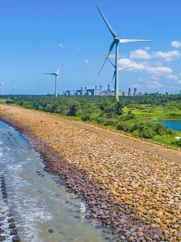坐擁千年藻礁生態寶庫觀音區海岸線坐擁全臺面積最大的植物藻礁，但因沿海工業區的開發，這花費4000年累積的海洋珍寶僅存最後的5公里，為保育難得的自然資產而設立「觀新藻礁生態系野生動物保護區」，退潮時，您可以在此看見露出海面的礁體，以及棲息於其中的魚蟹螺貝等無數海岸生物。在生態觀察之餘，若您想下水解暑，不妨前往觀音濱海遊憩區，有遼闊的沙灘海岸可以盡情散步奔跑，玩沙戲水。
- 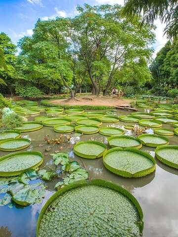農遊觀音蓮花田每年6月起，觀音區內數十間休閒農場及蓮園的蓮花田紛紛盛開，超過百種蓮花吸引眾多遊客前來賞玩。您可以乘坐大王蓮，體驗漂浮在水上的新鮮趣味，也可以品嘗蓮子冰、蓮花茶、荷葉湯包、炒彩蓮等蓮花全餐，還有蓮葉粽、採蓮蓬、睡蓮盆栽等DIY活動，適合一家大小一同出遊，賞花兼體驗農家生活樂趣。
- 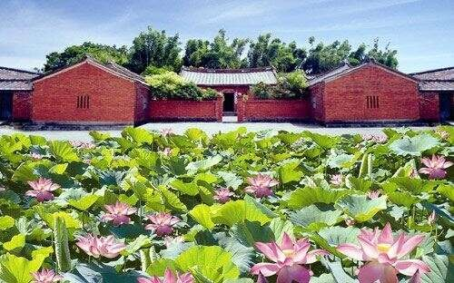一磚一瓦，訴說百年歲月林家古厝是棟紅磚堆砌的三合院建築，至今已有一百二十餘年的歷史。屋內保存著完好的木桌板凳、木製婚床與紅磚大灶，各式農具訴說著世代務農的生活，換上現場租借的古裝，那一刻就是穿越了百年。農場內還有焢土窯區，可以體驗古老的烹飪方式。步道旁的白玉湘蓮，白荷映月，純潔如霜，美的不可言喻。古厝不遠處便是一大片蓮田，一朵朵的荷花，就綻放了整個夏季。蓮花田中有幫鴨群打造「水上鴨家」，隨處可見的小黃鴨，可愛動人。在這裡可以品嘗獨家的香水蓮與香草混搭的「蓮花茶」，也可以體驗挖藕的趣味。
- 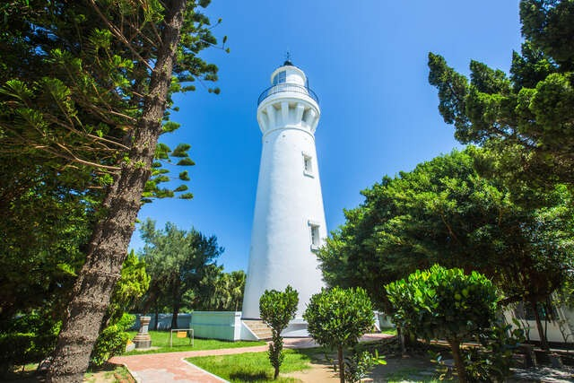守護台海的船隻，年復一年台灣唯一使用紅磚和石頭建造而成的白沙岬燈塔，曾是本島最西側的燈塔，從1901起至今都守護著濱海安全。展覽室的互動體驗，除了介紹燈塔百年歷史，也設計多樣拍照效果供遊客選擇。園中保存著日治時期的日晷，以及由上海機器製造局製作的時鐘。防空洞變成散步乘涼的地方，以前卻是戰機掃射的地方，落差感頓時撲面而來。燈塔旁設有環形步道，一路沿著觀音溪畔修築，展示了許多縮小版的燈塔，也能眺望遠處的風車，人形拱橋則成了拍攝婚紗的選擇。
- 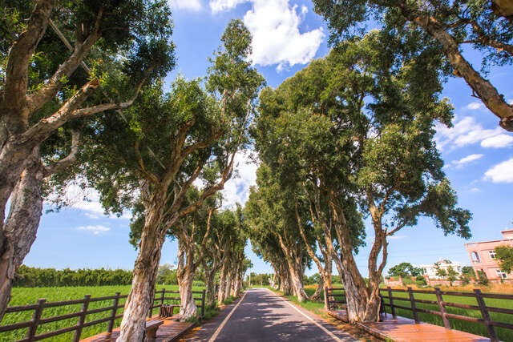穿梭秘境，遇見鐵炮百合白千層綠色隧道全長約2.8公里，約矗立700棵白千層樹。白千層隨著莖部內裡不斷孕育新生，會將外層老皮推出，導致脫落，一層一層包覆著樹幹，正因如此這種獨特的生長方式也成為它的名字。騎著單車或漫步其中，綿延的白千層樹加上高低坡度，似乎沒有盡頭，有種即將通往神秘之境的錯覺。步行到底，與一棟古厝撞個滿懷，古厝前種植整排的鐵炮百合花，就像驚喜般讓人錯不及防，其花瓣潔白如雪，香氣清雅綿長，令人心曠神怡。

旅遊提醒★ 蓮花季約於每年6月開始，花季結束後，也有採蓮蓬、剝蓮子等體驗。各休閒農場及蓮園提供服務以各農家官方公告為準，建議提前聯絡、預約。

★ 造訪觀新藻礁生態系野生動物保護區時，敬請遊客協助保護自然生態，勿破壞自然環境，或捕捉、採集動植物。必遊景點 TOP3- [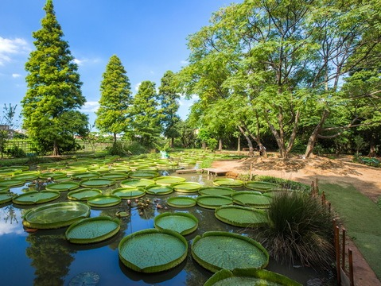3.9蓮荷園休閒農場星期日：08:30 - 17:30人氣250891](/zh-tw/travel/attraction/483)
- [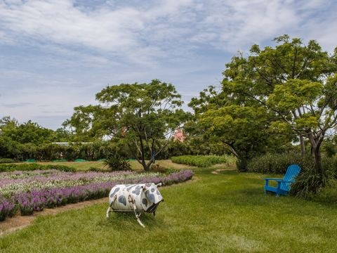4.0青林農場星期日：09:00 – 17:30人氣184636](/zh-tw/travel/attraction/1178)
- [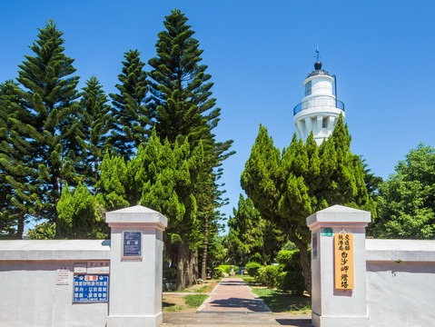白沙岬燈塔夏令時間(4月~10月)：09:00~18:00、冬令時間(11月~隔年3月)：09:00~17:00 週一公休，遇國定假日或連續假期則調整為收假次日不開放人氣174548](/zh-tw/travel/attraction/276)

看更多景點美食及伴手禮- 乾燥蓮蓬觀音區有許多蓮花田，老農鮮摘蓮蓬，日曬成乾，乾燥蓮蓬也成為特色之一，既然來了，不妨試試看吧。
- 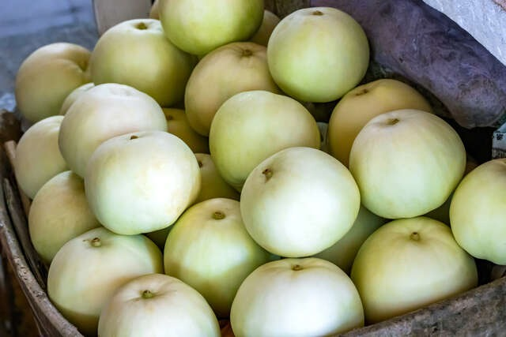香瓜觀音區在地美濃瓜甜度可達到13-15度，飽滿多汁、爽脆香甜，不妨帶一盒回家品嘗或是送禮都是不錯的選擇。

主題遊程- [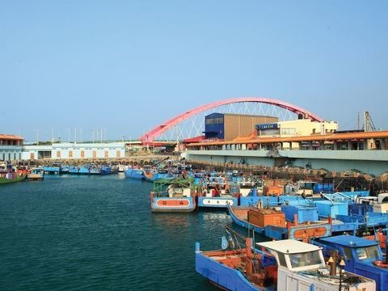穿越濱海線 竹圍嚐鱻鐵馬樂旅遊天數：一日遊旅遊季節：四季皆宜行程類型：達人帶路發佈人：觀光旅遊局人氣7606](https://travel.tycg.gov.tw/zh-tw/travel/tour/10)
- [漁港風光一日遊旅遊天數：一日遊旅遊季節：四季皆宜行程類型：生態環境、歷史巡禮、背包客發佈人：觀光旅遊局人氣7524](https://travel.tycg.gov.tw/zh-tw/travel/tour/5)
- [蔚藍海岸線的浪漫之旅旅遊天數：一日遊旅遊季節：四季皆宜行程類型：生態環境、歷史巡禮、背包客人氣3482](https://travel.tycg.gov.tw/zh-tw/travel/tour/72)
- [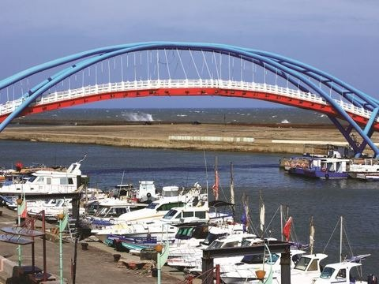暢遊海線․濱海公車自由行旅遊天數：一日遊旅遊季節：四季皆宜行程類型：其他發佈人：觀光旅遊局人氣9540](https://travel.tycg.gov.tw/zh-tw/travel/tour/27)

探索其他區域- [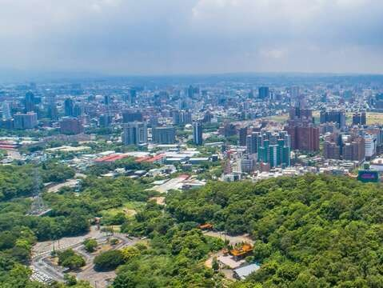桃園桃園區是桃園市的市中心，遊客可在這裡體會都會生活的熱鬧氣氛與活力。商圈內總是人潮不斷，從百貨公司到藥妝店，3C產品到異國美食，任何生活所需都能在這裡滿足。距離市區不遠的都會型森林公園更是孩子們釋放熱力的玩樂天堂，樹屋、滑索、攀繩等等設施，都能讓小朋們玩得不亦樂乎！](/zh-tw/travel/district/1)
- [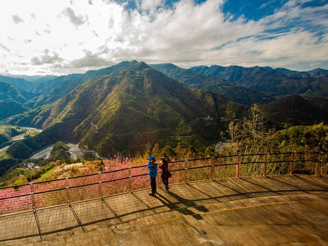復興復興區位於桃園市東南，沿臺7線公路深入東眼山、拉拉山及雪山山脈，走過雲霧繚繞的森林步道，仰望挺拔參天的千年巨木，吸吐乾淨清新的山間氣息。每年春冬兩季，櫻花與梅花接連盛開，在花雨下的散步和野餐好浪漫。也可以在此品嘗風味道地的原住民料理，留宿雲海中的景觀民宿，在無光害星空下沉沉入眠。](/zh-tw/travel/district/2)
- [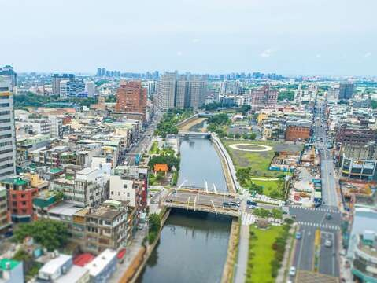中壢中壢區內有桃園機場捷運行經，串聯桃園高鐵站、體育園區以及中壢市區，可單日來回臺灣各主要城市，交通便利。走出桃園高鐵站，周圍環繞的是各知名品牌的大型商場及精品Outlet，日本品牌水族館及頂級影城更豐富此處的娛樂選擇。跳上機捷，15分鐘抵達中壢市區，好逛好買的景點更是多不勝數，匯集數百小吃攤位的知名夜市，選擇眾多的異國美食餐廳，人潮不斷的購物商圈等等，盡情體驗多彩多姿的享樂生活。](/zh-tw/travel/district/9)
