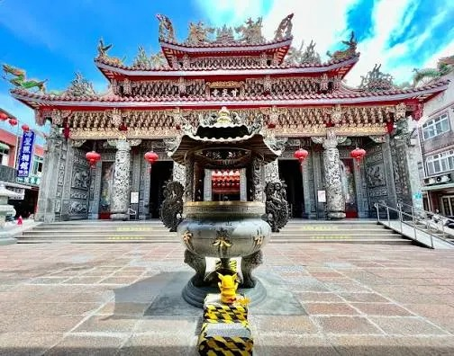
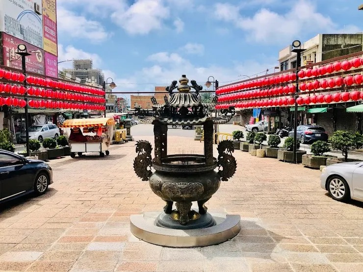
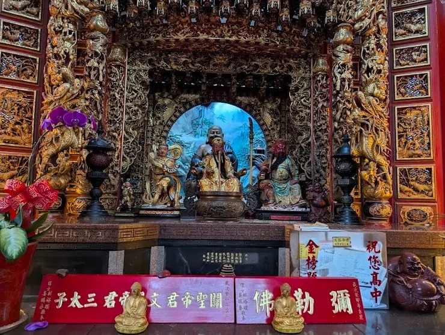
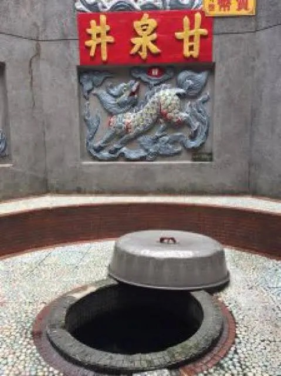
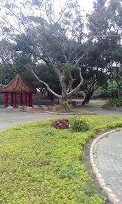
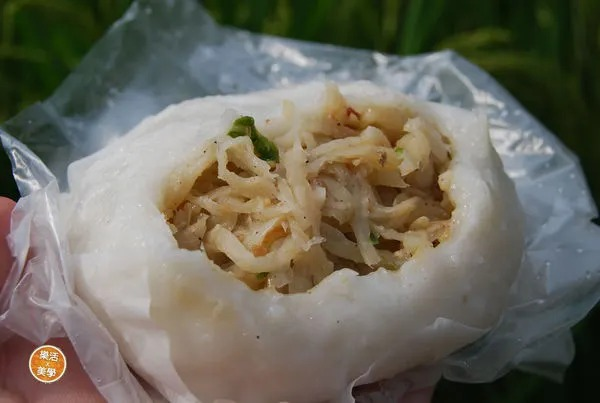
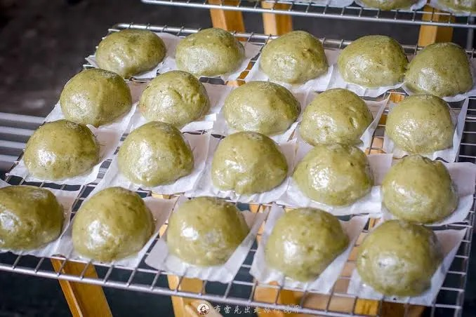
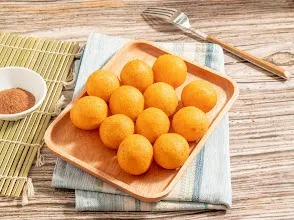
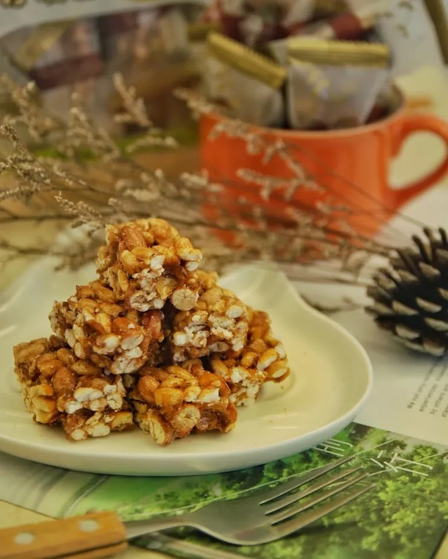

位於桃園市龍潭、楊梅交界山區的桃園石觀音甘泉寺，是一處結合自然奇景、宗教信仰與歷史文化的靜謐聖地。寺內最著名的「石觀音」與「甘泉水」流傳兩百多年，相傳可祈福、解厄、療癒身心，更被視為儒、釋、道三教合一的宗教建築典範。

### 一、甘泉寺歷史沿革與由來典故

龍潭甘泉寺（圖片截圖於網路）

- 清乾隆年間（約西元1780年） 創建
- 前身為「福龍寺」，因山中岩壁湧出甘甜泉水而聲名遠播
- 後因「甘泉」與「石觀音」信仰興盛，更名為「甘泉寺」

****& 石觀音與甘泉傳說****

- 山壁天然岩石形似觀音菩薩側影，信眾稱為「石觀音」
- 岩下湧泉終年不竭，被稱為「甘泉水」
- 相傳甘泉水曾治癒疾病、解除瘟疫，吸引各地信眾前來取水祈福

### 二、主祀神明與信仰特色

觀音菩薩殿（圖片截圖於網路）

****¥ 主祀神明****

- 觀音菩薩（石觀音）

****¥ 宗教特色****

- ****佛教****：以觀音信仰為核心
- ****道教****：融合修行、祈福與地方信仰
- ****儒家****：重倫理、孝道與修身****¥ 形成罕見的「三教合一」信仰空間****

### 三、主要保佑事項（適合拜什麼？）

- 🙏 身體健康、疾病康復
- 🙏 心靈平靜、消災解厄
- 🙏 家庭和諧、子女平安
- 🙏 事業順利、考試祈福
- 🙏 行車出入、登山平安

### 四、參拜流程（樓層與動線說明）

****¥ 建議參拜順序****

天公爐（圖片截圖於網路）

正殿 觀菩薩（圖片截圖於網路）

陪祀神佛（圖片截圖於網路）

甘泉井（圖片截圖於網路）

- ****山門入口****→ 整理衣冠、靜心片刻
- → 合掌參拜、默念祈願
- ****甘泉取水處****→ 以容器取少量，象徵祝福（勿浪費）
- ****主殿觀音菩薩****→ 上香、稟報姓名、生辰、住址、願望
- ****配祀神明區****→ 依序參拜，感謝庇佑
- ****迴向感恩****→ 參拜結束，心存感謝

### 五、周邊造景與園區亮點

園區造景（圖片截圖於網路）

- 山林步道環繞，清幽寧靜
- 天然岩壁石觀音景觀
- 甘泉湧泉池（禁止戲水）
- 林蔭休憩平台，適合靜坐沉澱
- 多處自然取景點，適合攝影與慢遊

### 六、注意要項（參拜與旅遊禮儀）

- 穿著端莊，避免過於暴露
- 取甘泉水「少量即可」，勿商業販售
- 保持安靜，勿喧嘩奔跑
- 山區濕滑，穿防滑鞋
- 禁止破壞自然岩壁與刻字

### 七、重大慶典與熱鬧時節

- 觀音菩薩誕辰（農曆二月十九）
- 觀音成道日（農曆六月十九）
- 觀音出家日（農曆九月十九）

¥ 以上日期香客眾多，建議提早到訪

### 八、建築風格特色

地標造景（圖片截圖於網路）

彩繪浮雕工藝精華（圖片截圖於網路）

大殿 莊嚴隆重（圖片截圖於網路）

- 傳統閩南式寺廟結構
- 自然岩壁融入建築，渾然天成
- 無過度雕琢，保留原始山林氣息
- 展現「依山而建、與自然共存」的宗教美學

### 九、交通指南

****^ 自行開車****

- 國道三號 → 龍潭交流道 → 指標前往石觀音甘泉寺
- 寺外設有簡易停車空間（假日較滿）

****^ 大眾運輸****

- ****桃園／中壢火車站****→ 轉乘往龍潭公車→ 再轉計程車或步行登山路段

### 十、在地美食推薦

- 龍潭客家粄條
- 客家菜包、草仔粿

客家菜包（圖片截圖於網路）

美味的草仔粿（圖片截圖於網路）

- 擂茶、仙草茶
- 地瓜、花生等在地小吃

好吃的地瓜球（圖片截圖於網路）

古早味花生糖（圖片截圖於網路）

### 十一、周邊景點順遊建議

- 龍潭大池風景區
- 三坑老街
- 石門水庫
- 小人國主題樂園（親子行程）

### 「 FAQ 常見問題 」

****Q：甘泉水真的可以喝嗎？****

A：多數信眾取回象徵性飲用，建議少量、心誠即可。

****Q：需要門票嗎？****

A：不需要，屬開放式參拜空間。

****Q：適合親子或長輩嗎？****

A：可以，但部分步道較陡，需注意安全。

****作者｜悠遊時光****

石觀音甘泉寺不僅是一座廟，更像一段被山林守護的信仰記憶。當你站在岩壁前，聽泉水潺潺、合掌靜心的那一刻，會發現這裡真正療癒的，不只是甘泉，而是內心。
