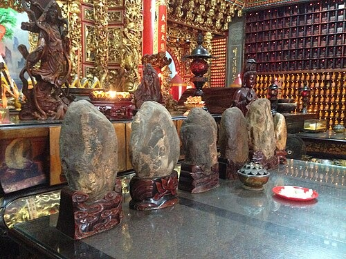
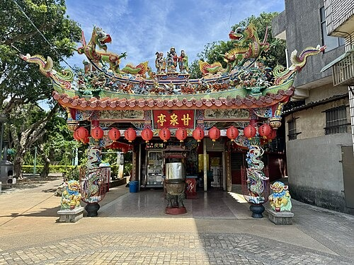
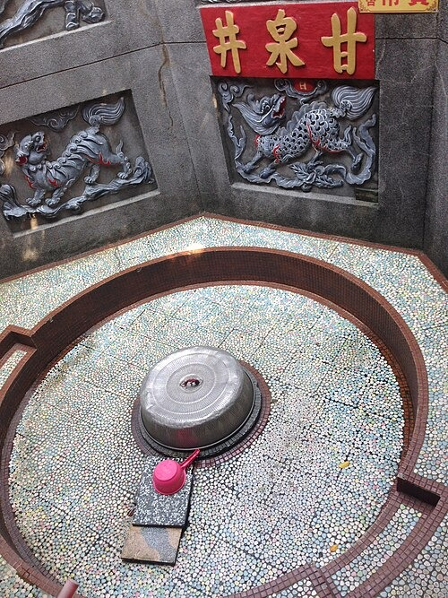

坐标：25°02′13″N121°04′54″E / 25.037070°N 121.081593°E /25.037070; 121.081593维基百科，自由的百科全书[25°02′13″N121°04′54″E / 25.037070°N 121.081593°E /25.037070; 121.081593](//geohack.toolforge.org/geohack.php?language=zh&pagename=%E7%94%98%E6%B3%89%E5%AF%BA_(%E6%A1%83%E5%9C%92%E5%B8%82)&params=25.03707_N_121.081593_E_)

| 甘泉寺 |
| --- |
|  |
| 基本信息 |
| 位置 | 桃園市 觀音區 觀音里甘泉街一號 |
| 宗教 | 佛教 |
| 本尊 | 觀世音菩薩 |
| 例祭 | 農曆九月十九 |
| 开山时间 | 咸豐十年（1860年） |
| 地图 |
|  |

**甘泉寺**，舊稱**福龍寺**、**福龍山寺**，是位於[臺灣](/wiki/%E8%87%BA%E7%81%A3)[桃園市](/wiki/%E6%A1%83%E5%9C%92%E5%B8%82)[觀音區](/wiki/%E8%A7%80%E9%9F%B3%E5%8D%80)觀音里的[觀音寺](/wiki/%E8%A7%80%E9%9F%B3%E5%AF%BA)，為觀音區地名的由來。

## 沿革

[编辑]在[咸豐](/wiki/%E5%92%B8%E8%B1%90)十年（1860年），相傳[竹北二堡](/wiki/%E7%AB%B9%E5%8C%97%E4%BA%8C%E5%A0%A1)[石牌嶺](/wiki/%E7%9F%B3%E7%89%8C%E5%B6%BA)庄一名叫黃等的人在河流中撿到近似觀音的石像，並將此像建置於路傍，成為眾人崇拜的對象。半年後，[白沙墩庄](/wiki/%E7%99%BD%E6%B2%99%E5%B1%AF_(%E6%A1%83%E5%9C%92%E5%B8%82))黃雲中[[a]](#cite_note-2)等發起募捐，於咸豐十年十一月，建築寺宇奉祀之，稱「福龍山寺」、「福龍寺」。[[2]](#cite_note-陳佳穗-3)[[3]](#cite_note-謝進盛-4)[[4]](#cite_note-吳文良-5)[[5]](#cite_note-陳建霖-6)

[同治](/wiki/%E5%90%8C%E6%B2%BB)十一年（1872年），徐水曾獻殿聯，上書：「法雨化甘泉蒼海波中聞貝葉，慈雲流淡水白沙堆土顯曇花。」[[6]](#cite_note-陳天嵐-7)

[光緒](/wiki/%E5%85%89%E7%B7%92)十二年（1886年）由於廟宇破損嚴重，[埔頂庄](/wiki/%E5%9F%94%E9%A0%82_(%E6%96%B0%E7%AB%B9%E5%B8%82))曾坤房、石觀音庄劉文進等鄉紳發起修建募款，六個月完工，並改名為「甘泉寺」[[2]](#cite_note-陳佳穗-3)[[3]](#cite_note-謝進盛-4)[[4]](#cite_note-吳文良-5)[[5]](#cite_note-陳建霖-6)。光緒二十年（1894年），曾阿房等重新改造[[2]](#cite_note-陳佳穗-3)。[明治](/wiki/%E6%98%8E%E6%B2%BB)三十八年（1905年）建立的南崁公學校石觀音分校（今觀音國小）過去尚無校舍時，借用廟堂上課[[7]](#cite_note-莊明仁-8)。

1991年，廟前廣場被徵地為[桃園客運](/wiki/%E6%A1%83%E5%9C%92%E5%AE%A2%E9%81%8B)汽車停車場和調度站，引起信眾不滿[[8]](#cite_note-吳文良2-9)[[9]](#cite_note-吳文良3-10)。1993年整修，1997年完成[[10]](#cite_note-黃文杰2-11)。1997年委由聖光公司在廟宇後牆施作長17.6、高10.5公尺的銅製浮雕，圖案兩旁有金童玉女，另外兩隻神龍騰雲駕霧[[11]](#cite_note-黃文杰-12)。

2002年報導時，地址在觀音鄉觀音村甘泉街一號，緊鄰觀音鄉公所[[3]](#cite_note-謝進盛-4)。

## 祭祀

[编辑]石觀音

農曆正月二十[天穿日](/wiki/%E5%A4%A9%E7%A9%BF%E6%97%A5)，當地[客家人](/wiki/%E5%8F%B0%E7%81%A3%E5%AE%A2%E5%AE%B6%E4%BA%BA)會來此廟膜拜。除頂禮還願外，因客家習俗在天穿日工作會招來不幸，因此來廟祭拜也有消災解厄效果。日治時期，觀音庄長還選在這日開放[白沙岬燈塔](/wiki/%E7%99%BD%E6%B2%99%E5%B2%AC%E7%87%88%E5%A1%94)，讓上完香的客家人至燈塔遊玩，藉此攏絡人心。觀音文化工作陣，曾在這天舉辦燈塔節活動，讓觀音的客人耆老重溫當年。[[12]](#cite_note-羅平、楊宗灝-13)

農曆九月十九，觀世音菩薩成道日，會舉行[神豬](/wiki/%E7%A5%9E%E8%B1%AC)比賽。在2011年報導時，臺灣動物社會研究院主任陳玉敏說，全臺灣839間[觀音寺](/wiki/%E8%A7%80%E9%9F%B3%E5%AF%BA)中，只有[竹林山觀音寺](/wiki/%E7%AB%B9%E6%9E%97%E5%B1%B1%E8%A7%80%E9%9F%B3%E5%AF%BA)、[石觀音甘泉寺](/wiki/%E7%9F%B3%E8%A7%80%E9%9F%B3%E7%94%98%E6%B3%89%E5%AF%BA)和[竹北蓮華寺](/wiki/%E7%AB%B9%E5%8C%97%E8%93%AE%E8%8F%AF%E5%AF%BA)這三間會舉辦此比賽。[[13]](#cite_note-侯俐安-14)

昔日，此地的客家人會讓小孩拜此石觀音為[契母](/wiki/%E5%A5%91%E6%AF%8D)[[14]](#cite_note-楊宗灝2-15)。廟方管委會總幹事曾獻斌曾表示，石觀音曾託夢指示共有16尊石觀音像流落各地，希望信眾代為協尋，於是廟方依據神明指點，依序在[雲林](/wiki/%E9%9B%B2%E6%9E%97%E7%B8%A3)[古坑](/wiki/%E5%8F%A4%E5%9D%91%E9%84%89)、[臺中](/wiki/%E5%8F%B0%E4%B8%AD%E5%B8%82)[太平](/wiki/%E5%A4%AA%E5%B9%B3%E5%8D%80_(%E5%8F%B0%E7%81%A3))及[苗栗](/wiki/%E8%8B%97%E6%A0%97%E7%B8%A3)[獅頭](/wiki/%E7%8D%85%E9%A0%AD%E5%B1%B1_(%E8%8B%97%E6%A0%97%E7%B8%A3))等地找到8尊聖石，其中5尊以[分香](/wiki/%E5%88%86%E9%A6%99)形式作為其他廟宇供奉主神，自留3尊奉祀，在石觀音文化節活動也以會邀請各地的石觀音回家掃街繞境[[15]](#cite_note-楊宗灝-16)。

## 地名

[编辑]因此寺皈依者增加，當地形成聚落，地方名「石觀音街」，後來發展成[石觀音庄](/wiki/%E8%A7%80%E9%9F%B3_(%E5%A4%A7%E5%AD%97))。1920年，[總督府](/wiki/%E8%87%BA%E7%81%A3%E7%B8%BD%E7%9D%A3%E5%BA%9C)施行州廳制度，刪除「石」字，定名「[觀音庄](/wiki/%E8%A7%80%E9%9F%B3%E5%BA%84)」，戰後改名「觀音鄉」。[[2]](#cite_note-陳佳穗-3)[[3]](#cite_note-謝進盛-4)

## 名井

[编辑]甘泉亭

此廟的甘泉井傳說以能治病聞名。該井處於低窪處，南方及東南方地勢較高且均為受壓地下水層，在加上泉井旁約一百公尺處為[觀音溪](/wiki/%E8%A7%80%E9%9F%B3%E6%BA%AA)，因此為自流井。[[5]](#cite_note-陳建霖-6)

逢農曆二月十九日觀音誕辰時，多有信徒會來此泉水取水[[4]](#cite_note-吳文良-5)。香客會攜帶水桶，沿甘井亭的階梯走到泉眼處取水；若取用量並不大可直接到正殿的觀音像前裝取水[[5]](#cite_note-陳建霖-6)。《桃園廳志》就記載[明治](/wiki/%E6%98%8E%E6%B2%BB)二十八年（1895年）七月，當時有患眼疾者用此廟挖出的泉水洗眼，洗之即癒，人們皆感到驚訝，數十里外之百姓亦來參謁，聲名遠播，便改寺名為「甘泉寺」[[2]](#cite_note-陳佳穗-3)。另說發生在光緒十二年，在修廟時發生[[4]](#cite_note-吳文良-5)。還有一說是傳聞撿到石觀音的黃等發現湧出泉水，患者痊癒[[5]](#cite_note-陳建霖-6)。清治時期的《新竹縣志初稿》則記錄相傳石觀音也是從泉水出現[[2]](#cite_note-陳佳穗-3)。

甘泉井

[丁善璽](/wiki/%E4%B8%81%E5%96%84%E7%92%BD)在拍《[八百壯士](/wiki/%E5%85%AB%E7%99%BE%E5%A3%AE%E5%A3%AB_(1976%E5%B9%B4%E7%94%B5%E5%BD%B1))》被爆傷，在醫院躺了一個月。這時丁妻蕭蓉夢到[南極仙翁](/wiki/%E5%8D%97%E6%A5%B5%E4%BB%99%E7%BF%81)要她去中壢找觀音治療她先生的病，輾轉到觀音鄉找到甘泉寺。丁善璽喝了該寺的井水後傷痛減輕，後來又在一場高速公路的車禍中幸運生還。因此，夫妻從[天主教](/wiki/%E5%A4%A9%E4%B8%BB%E6%95%99)[改宗](/wiki/%E6%94%B9%E5%AE%97)佛教，太太還[皈依](/wiki/%E7%9A%88%E4%BE%9D)華嚴蓮社的南亭法師。丁導演為了還願遂拍攝佛教主題電影的故事《陰陽有情天》，由妻子親自飾演觀音，男女主角分別是[秦漢](/wiki/%E7%A7%A6%E6%BC%A2_(%E6%BC%94%E5%93%A1))、[徐楓](/wiki/%E5%BE%90%E6%9E%AB)。在電影上映時，丁善璽本想把妻子夢中景況寫一篇文字大肆宣傳一番，但唯恐被人說成導人[迷信](/wiki/%E8%BF%B7%E4%BF%A1)，招致影片禁映，之後才在佛教會對居士說。[李翰祥](/wiki/%E6%9D%8E%E7%BF%B0%E7%A5%A5)在1981年投稿在《民生報》的連載文章，以多篇文章詳述此事。[[16]](#cite_note-李翰祥1-17)[[17]](#cite_note-李翰祥2-18)[[18]](#cite_note-李翰祥3-19)[[19]](#cite_note-李翰祥4-20)[[20]](#cite_note-李翰祥5-21)[[21]](#cite_note-李翰祥6-22)[[22]](#cite_note-李翰祥7-23)[[23]](#cite_note-李翰祥8-24)[[24]](#cite_note-李翰祥9-25)[[25]](#cite_note-李翰祥10-26)[[26]](#cite_note-李翰祥11-27)

在拍《[旗正飄飄](/wiki/%E6%97%97%E6%AD%A3%E9%A3%84%E9%A3%84_(%E9%9B%BB%E5%BD%B1))》時，丁善璽及妻子蕭蓉、[林青霞](/wiki/%E6%9E%97%E9%9D%92%E9%9C%9E)、[楊麗菁](/wiki/%E6%A5%8A%E9%BA%97%E8%8F%81)等人參加此寺的一百零一年周年慶典與抗戰殉難軍民追悼會[[27]](#cite_note-旗正飄飄-28)。

## 註釋

[编辑]- **[^](#cite_ref-2)**黃雲中，字文偉，祖籍[廣東](/wiki/%E5%BB%A3%E6%9D%B1)[惠州](/wiki/%E6%83%A0%E5%B7%9E)[陸豐](/wiki/%E9%99%B8%E8%B1%90)，[台灣客家人](/wiki/%E5%8F%B0%E7%81%A3%E5%AE%A2%E5%AE%B6%E4%BA%BA)，1822年生，[貢生](/wiki/%E8%B2%A2%E7%94%9F)。在咸豐年間，他與當地[閩人](/wiki/%E9%97%BD%E4%BA%BA)首領郭火金和談，平息該地的[閩客械鬥](/wiki/%E9%96%A9%E5%AE%A2%E6%A2%B0%E9%AC%A5)。1894年去世。曾孫黃貽徐曾任職觀音鄉戶籍課長。[[1]](#cite_note-楊海宴-1)

## 參考文獻

[编辑]- **[^](#cite_ref-楊海宴_1-0)**楊海宴. 義勇千秋 百年往事說從頭 黃雲中刀弭械鬥. 《聯合報》. 1958-09-12（中文（臺灣））.
- ^[**2.0**](#cite_ref-陳佳穗_3-0)[**2.1**](#cite_ref-陳佳穗_3-1)[**2.2**](#cite_ref-陳佳穗_3-2)[**2.3**](#cite_ref-陳佳穗_3-3)[**2.4**](#cite_ref-陳佳穗_3-4)[**2.5**](#cite_ref-陳佳穗_3-5)陳佳穗.[桃園縣「觀音鄉」地名沿革及傳說研究](http://ir.lib.tiit.edu.tw/bitstream/987654321/228/1/%E3%80%8C%E8%A7%80%E9%9F%B3%E9%84%89%E3%80%8D%E5%9C%B0%E5%90%8D%E6%B2%BF%E9%9D%A9%E5%8F%8A%E5%82%B3%E8%AA%AA%E7%A0%94%E7%A9%B6.pdf)(PDF). 《南亞學報》 (南亞技術學院). 2009,**第29期**[2017-03-21]（中文（臺灣））.[[永久失效連結](/wiki/Wikipedia:%E5%A4%B1%E6%95%88%E9%93%BE%E6%8E%A5)]
- ^[**3.0**](#cite_ref-謝進盛_4-0)[**3.1**](#cite_ref-謝進盛_4-1)[**3.2**](#cite_ref-謝進盛_4-2)[**3.3**](#cite_ref-謝進盛_4-3)謝進盛. 甘泉寺 流傳石觀音傳奇 百年傳奇發展成地方信仰中心 平日香火鼎盛 與海水浴場等地連成一氣. 《聯合報》. 2002-08-30（中文（臺灣））.
- ^[**4.0**](#cite_ref-吳文良_5-0)[**4.1**](#cite_ref-吳文良_5-1)[**4.2**](#cite_ref-吳文良_5-2)[**4.3**](#cite_ref-吳文良_5-3)吳文良. 一鄉鎮一特色 觀音鄉 沾神明的光. 《聯合報》. 1995-03-11（中文（臺灣））.
- ^[**5.0**](#cite_ref-陳建霖_6-0)[**5.1**](#cite_ref-陳建霖_6-1)[**5.2**](#cite_ref-陳建霖_6-2)[**5.3**](#cite_ref-陳建霖_6-3)[**5.4**](#cite_ref-陳建霖_6-4)陳建霖.[白沙岬燈塔 古厝風情悠閒遊 桃園觀音 「海線」休閒觀光之旅 百年甘泉寺井水甘甜沁涼](http://www.epochtimes.com/b5/15/6/22/n4463174.htm). 《大紀元時報》. 2015-06-22[2017-03-21]. （原始内容[存档](https://web.archive.org/web/20190606232706/http://www.epochtimes.com/b5/15/6/22/n4463174.htm)于2019-06-06）（中文（臺灣））.
- **[^](#cite_ref-陳天嵐_7-0)**陳天嵐. 田野砂丘老厝巨宅─走訪大園觀音（下）. 《民生報》. 1980-11-04（中文（臺灣））.
- **[^](#cite_ref-莊明仁_8-0)**莊明仁. 百年校慶 觀音國小講古 老樹祈福揭序幕 熱鬧到七日. 《中國時報》. 2004-03-02（中文（臺灣））.
- **[^](#cite_ref-吳文良2_9-0)**吳文良. 甘泉寺前公車站 '擋了佛祖視線'觀音鄉所'順民意'徵收車站土地 客運公司拒絕 雙方僵持. 《聯合晚報》. 1991-01-07（中文（臺灣））.
- **[^](#cite_ref-吳文良3_10-0)**吳文良. 姚客可在甘泉寺前設車站 觀音鄉民不服 據理以爭. 《聯合晚報》. 1991-02-20（中文（臺灣））.
- **[^](#cite_ref-黃文杰2_11-0)**黃文杰. 觀音甘泉寺有座石觀音 傳因雨沖開龍淵巖現出石像 曾顯靈救信眾至今仍流傳. 《中國時報》. 1997-12-25（中文（臺灣））.
- **[^](#cite_ref-黃文杰_12-0)**黃文杰. 觀音甘泉寺全台最大銅製浮雕開始黏貼. 《中國時報》. 1997-11-23（中文（臺灣））.
- **[^](#cite_ref-羅平、楊宗灝_13-0)**羅平、楊宗灝. 議員鞭春牛 籲清水庫淤泥. 《中國時報》. 2004-02-11（中文（臺灣））.
- **[^](#cite_ref-侯俐安_14-0)**侯俐安. 觀世音成道日 竹山觀音寺殺神豬. 《中國時報》. 2011-10-15（中文（臺灣））.
- **[^](#cite_ref-楊宗灝2_15-0)**楊宗灝. 石觀音 契兒契女多. 《中國時報》. 2005-05-22（中文（臺灣））.
- **[^](#cite_ref-楊宗灝_16-0)**楊宗灝. 神奇 觀音石栩栩如生. 《中國時報》. 2005-05-25（中文（臺灣））.
- **[^](#cite_ref-李翰祥1_17-0)**李翰祥. 三十年細說從頭 丁善璽太太的怪夢. 《民生報》. 1981-06-01（中文（臺灣））.
- **[^](#cite_ref-李翰祥2_18-0)**李翰祥. 三十年細說從頭 要到中壢找觀音. 《民生報》. 1981-06-02（中文（臺灣））.
- **[^](#cite_ref-李翰祥3_19-0)**李翰祥. 三十年細說從頭 一切災殃化為塵. 《民生報》. 1981-06-03（中文（臺灣））.
- **[^](#cite_ref-李翰祥4_20-0)**李翰祥. 三十年細說從頭 甘泉寺的一段故事. 《民生報》. 1981-06-04（中文（臺灣））.
- **[^](#cite_ref-李翰祥5_21-0)**李翰祥. 三十年細說從頭 什麼事都要做兩次. 《民生報》. 1981-06-05（中文（臺灣））.
- **[^](#cite_ref-李翰祥6_22-0)**李翰祥. 三十年細說從頭 汽車撞成夾心餅. 《民生報》. 1981-06-06（中文（臺灣））.
- **[^](#cite_ref-李翰祥7_23-0)**李翰祥. 三十年細說從頭 觀音像撞成粉碎. 《民生報》. 1981-06-07（中文（臺灣））.
- **[^](#cite_ref-李翰祥8_24-0)**李翰祥. 三十年細說從頭 小丁夫婦齊唸大悲咒. 《民生報》. 1981-06-08（中文（臺灣））.
- **[^](#cite_ref-李翰祥9_25-0)**李翰祥. 三十年細說從頭 丁善璽高抬貴腳. 《民生報》. 1981-06-09（中文（臺灣））.
- **[^](#cite_ref-李翰祥10_26-0)**李翰祥. 三十年細說從頭 死心塌地要做觀音兵. 《民生報》. 1981-06-10（中文（臺灣））.
- **[^](#cite_ref-李翰祥11_27-0)**李翰祥. 三十年細說從頭 已經做了七世夫妻. 《民生報》. 1981-06-11（中文（臺灣））.
- **[^](#cite_ref-旗正飄飄_28-0)**「旗正飄飄」工作人員 甘泉寺追悼抗戰亡魂. 《民生報》. 1987-05-20（中文（臺灣））.

- [桃園主题](/wiki/Portal:%E6%A1%83%E5%9C%92)
- [佛教主题](/wiki/Portal:%E4%BD%9B%E6%95%99)

维基共享资源上的相关多媒体资源：甘泉寺NewPP limit report Parsed by mw‐api‐int.eqiad.main‐7bf5875945‐h7zmx Cached time: 20261028103435 Cache expiry: 2592000 Cache expiry source: Module:Citation/CS1 (os.date(%Y)) Reduced expiry: false Complications: [prevent‐selective‐update, show‐toc] CPU time usage: 0.256 seconds Real time usage: 0.518 seconds Preprocessor visited node count: 3041/1000000 Revision size: 13065/2097152 bytes Post‐expand include size: 67506/2097152 bytes Template argument size: 2373/2097152 bytes Highest expansion depth: 17/100 Expensive parser function count: 0/500 Unstrip recursion depth: 1/20 Unstrip post‐expand size: 107522/5000000 bytes Lua time usage: 0.169/10.000 seconds Lua memory usage: 5478164/52428800 bytes Number of Wikibase entities loaded: 1/500Transclusion expansion time report (%,ms,calls,template) 100.00% 376.573 1 -total 41.44% 156.043 1 Template:Reflist 25.44% 95.802 26 Template:Cite_news 25.33% 95.373 1 Template:東亞廟宇 18.52% 69.755 1 Template:Infobox 14.23% 53.570 1 Template:Coord 10.15% 38.214 1 Template:Dead_link 9.28% 34.953 1 Template:Commonscat 8.78% 33.072 1 Template:Fix 8.38% 31.562 1 Template:Sister_projectRender ID 2b28b61a-d2bb-11f1-9fb2-4131bd25c7ecSaved in parser cache with key zhwiki:pcache:1729318:|#|:idhash:canonical!zh and timestamp 20261028103435 and revision id 88894640. Rendering was triggered because: unknown取自“https://zh.wikipedia.org/w/index.php?title=甘泉寺_(桃園市)&oldid=88894640”分类：- [桃園市觀音寺](/wiki/Category:%E6%A1%83%E5%9C%92%E5%B8%82%E8%A7%80%E9%9F%B3%E5%AF%BA)
- [觀音區](/wiki/Category:%E8%A7%80%E9%9F%B3%E5%8D%80)
- [1860年台灣建立](/wiki/Category:1860%E5%B9%B4%E5%8F%B0%E7%81%A3%E5%BB%BA%E7%AB%8B)

隐藏分类：- [使用WikiMiniAtlas小工具的页面](/wiki/Category:%E4%BD%BF%E7%94%A8WikiMiniAtlas%E5%B0%8F%E5%B7%A5%E5%85%B7%E7%9A%84%E9%A1%B5%E9%9D%A2)
- [自2019年6月带有失效链接的条目](/wiki/Category:%E8%87%AA2019%E5%B9%B46%E6%9C%88%E5%B8%A6%E6%9C%89%E5%A4%B1%E6%95%88%E9%93%BE%E6%8E%A5%E7%9A%84%E6%9D%A1%E7%9B%AE)
- [条目有永久失效的外部链接](/wiki/Category:%E6%9D%A1%E7%9B%AE%E6%9C%89%E6%B0%B8%E4%B9%85%E5%A4%B1%E6%95%88%E7%9A%84%E5%A4%96%E9%83%A8%E9%93%BE%E6%8E%A5)
- [维基数据存在坐标数据的页面](/wiki/Category:%E7%BB%B4%E5%9F%BA%E6%95%B0%E6%8D%AE%E5%AD%98%E5%9C%A8%E5%9D%90%E6%A0%87%E6%95%B0%E6%8D%AE%E7%9A%84%E9%A1%B5%E9%9D%A2)
- [使用Infobox mapframe但维基数据缺少形状链接的页面](/wiki/Category:%E4%BD%BF%E7%94%A8Infobox_mapframe%E4%BD%86%E7%BB%B4%E5%9F%BA%E6%95%B0%E6%8D%AE%E7%BC%BA%E5%B0%91%E5%BD%A2%E7%8A%B6%E9%93%BE%E6%8E%A5%E7%9A%84%E9%A1%B5%E9%9D%A2)
- [维基共享资源分类链接使用了维基数据上的匹配项](/wiki/Category:%E7%BB%B4%E5%9F%BA%E5%85%B1%E4%BA%AB%E8%B5%84%E6%BA%90%E5%88%86%E7%B1%BB%E9%93%BE%E6%8E%A5%E4%BD%BF%E7%94%A8%E4%BA%86%E7%BB%B4%E5%9F%BA%E6%95%B0%E6%8D%AE%E4%B8%8A%E7%9A%84%E5%8C%B9%E9%85%8D%E9%A1%B9)
- [有地图的页面](/wiki/Category:%E6%9C%89%E5%9C%B0%E5%9B%BE%E7%9A%84%E9%A1%B5%E9%9D%A2)
