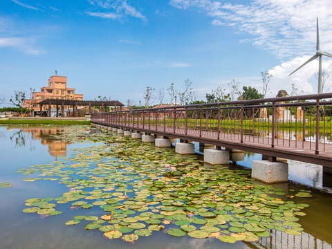
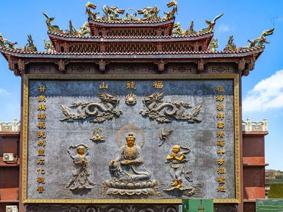
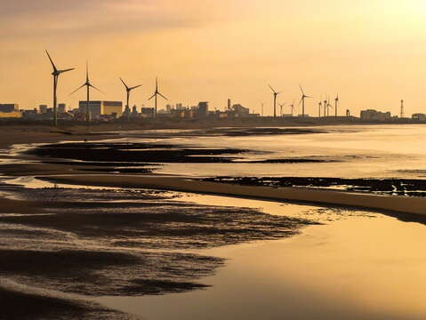

## 白沙岬灯塔(灯台)(白沙岬燈塔)

更新しました2026-10-27人氣7877- 海浜地区
- 歷史と人文

- 台湾歴史建築百景！最も完全な形で保存されている日本統治時代の灯台
- 灯台の中の様子！ベールを脱ぐ百年灯台
- SNSで人気の時計台広場！来れば瞬時に地中海
- ロマンチックな三月、紫の美しいセンダンの花

白沙岬灯台は観音海岸にあります。台南の国聖灯台が建設されるまでは、台湾本島で最西端の灯台でした。週辺には環状遊歩道が設けられ、観音浜海レクリエーションエリアまで足を延ばすこともできます。白沙岬灯台の雪のように白い姿は、青い海と空を背景に目が覚めるような鮮やかさ。1901年の点灯後、日本統治時代にはすでに台湾の著名な景勝地となっていました。百年を超える歲月を経て、2001年には文建会「台湾歷史建築百景」に列せられ、灯台の建物、周囲の塀、日本統治時代の日時計は翌年、桃園で初めての県定史跡に指定されました。そしてさらに、2021年5月には桃園で二つめの国定史跡となりました。保存状態が極めて良好な日本統治時代初期の灯台です。

「白沙岬灯台」は墾丁の「鵝鑾鼻灯台」に次ぐ高さ約37m。台湾の他の灯台がセメントで作られているのとは異なり、この灯台は台湾で唯一、赤レンガと石材で作られています。清代末期、灯台の機器の多くはイギリス、フランスからの輸入でした。製造会社は塔身、灯具等のパーツの鋳造を完成させてから、船舶で設置地点に運び組み立てましたが、三年を費やして完成された「白沙岬灯台」は、鋳鉄組み立て式ではなく、日本語で「レンガ石造り」と呼ばれる二層式の耐震構造で作られた珍しいものです。円形の塔身は、伝統工法を採用し、レンガの接着にもち米、黒糖、石灰の混合物を用いています。灯台の上段は大きな石材を積んで、鋳鉄造りの塔頂を支えています。第二次世界大戦では戦闘機の掃射を受け、また地震や台風に何度も見舞われましたが深刻な損傷もなく、今も頼もしい姿を見せてくれています。

内部には案内室があり、灯台内の各設備について解説しています。灯台周囲には環状遊歩道、公園、東屋、広場、子供用遊具があります。遊歩道は観音溪に沿って設けられており、風車が並ぶ観音海浜の有名な風景を眺めることもできます。鐘塔広場、観音溪人形アーチ橋は結婚写真撮影の人気スポットです。- 照片写真
- 全景パノラマ
- 街景ストリートビュー

観光スポット情報電話/03-4732249アドレス/台湾桃園市観音区新坡下16号営業時間/立入可能範囲は灯台内部と庭園施設。主灯台室は見学できません。チケット/無料サービス施設- バス停
- トイレ
- 遊歩道

アクセス方法お選びになった出発点に応じて適した交通手段を選択します前の一覧に戻る次の## 周辺の観光スポット

- [4.4観音海浜レジャーエリア (觀音濱海遊憩區)日曜日：24時間昼夜営業人氣11113](/ja/travel/attraction/778)
- [4.6甘泉寺日曜日：06:00 - 21:00人氣601](/ja/travel/attraction/2247)
- [2.6中台環境資源教育センター(中台環境資源教育中心)日曜日：店休人氣5222](/ja/travel/attraction/1201)
- [4.1観音区「白玉海岸」(觀音白玉海岸)日曜日：00:00 - 23:59人氣415](/ja/travel/attraction/2250)

もっと見る
