## 2025桃園蓮花季

發佈日：2025-06-02更新日：2025-09-16瀏覽量131025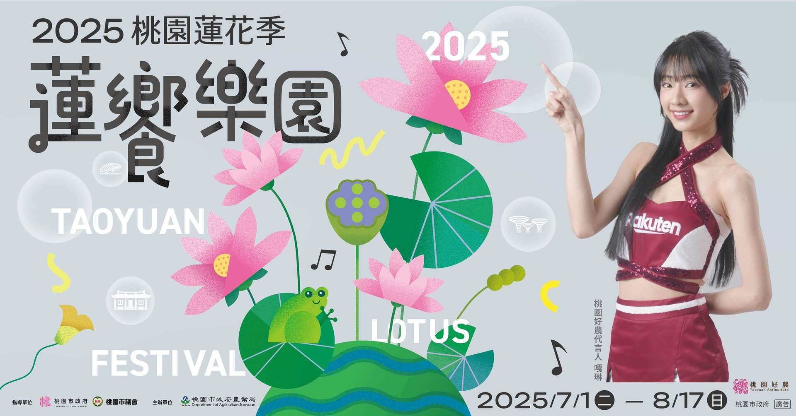活動日期：2025-07-01~：2025-08-17(活動時間以主辦單位最新公告為主)活動地點桃園市觀音區觀音蓮花園休閒農業區附近交通路況加入 Google 行事曆￭相關細節可電洽本府農業局(03-3322101#5415、5416)

觀音區蓮花園休閒農業區臉書粉絲專頁

桃園市觀音區每年7月至8月期間為蓮花盛開季節，有「北觀音、南白河」美名，每年蓮花季活動結合周邊休閒農場、觀光蓮園，推出各項豐富有趣的農事體驗及一日遊套裝行程，同時提供許多在地蓮花相關農特產品、風味餐及其他衍生性商品。

2025桃園蓮花季7月盛大登場 14場活動精彩不間斷

2025桃園蓮花季將於7月1日至8月17日盛大展開，今年以「蓮饗樂園」為主題，融合永續生活、在地文化與慢食理念，邀請親子家庭與旅人一同踏入蓮花盛開的夏日饗宴。活動主場設於觀音區蓮花園休閒農業區，規劃五大裝置藝術遍布休區，營造兼具美感與生態的拍照熱點。

活動期間每週末皆有精彩活動登場，7月系列活動包括有7月5日舉辦的「114年桃園市西瓜評鑑暨促銷活動&觀音區超級大南瓜頒獎典禮，邀請民眾品嘗最優質風味極佳比賽瓜果、7月6日親子劇團表演，邀請小花果玩劇場、萬花筒劇團，近距離的互動演出，還有親子寫生嘉年華可以參加，7月12日及7月13日原林藝術舞集表演，欣賞臺灣原住民族文化的獨特魅力，7月19日舉辦民歌演唱會，邀請「軍中女神」方季惟和江念庭、迷霧森林樂團，獻唱經典民歌金曲，7月20日舉辦瓜瓜學堂，教大家種瓜、挑瓜、吃瓜、玩瓜，體驗食農的田野樂趣，7月26日北觀音蓮荷展售會，邀請多位蓮花種植專家一同參展，7月27日舉辦蓮響樂園演唱會，邀請「丘與樂」樂團、桃園星人秀-孤寂輔導室、鄭如鈞、智涓接力登場，展現年輕世代的創作與音樂魅力，8月9日客家藝文表演邀請大小朋友一起感受客家文化的魅力，來蓮花季當然不能錯過8月16日荷塘月色蓮花宴大啖在地特色蓮花料理的機會。

活動從7月1日至8月17日精彩不斷，音樂表演、農夫市集及民歌藝文演出等，共計14場次，熱鬧非凡。休區內多家農場亦推出蓮花主題DIY與食農體驗，如荷葉米香、蓮子甜點、蓮香囊製作等，讓民眾不只賞蓮，還能「玩」出在地特色，體驗從田間到餐桌的樂趣。

活動期間假日也貼心提供免費接駁車，歡迎全台民眾一同來桃園賞蓮、品蓮、樂生活，活動詳情可至「觀音區蓮花園休閒農業區」臉書粉絲專頁
(https://www.facebook.com/lotus.guanyin/)查詢。

🌸活動日期：2025/7/1(二)～8/17(日)
🌸活動時間：09：00～17：00
活動主會場：蓮花園休閒農業區遊客服務中心旁 (桃園市觀音區新華路一段及金華路交叉口)
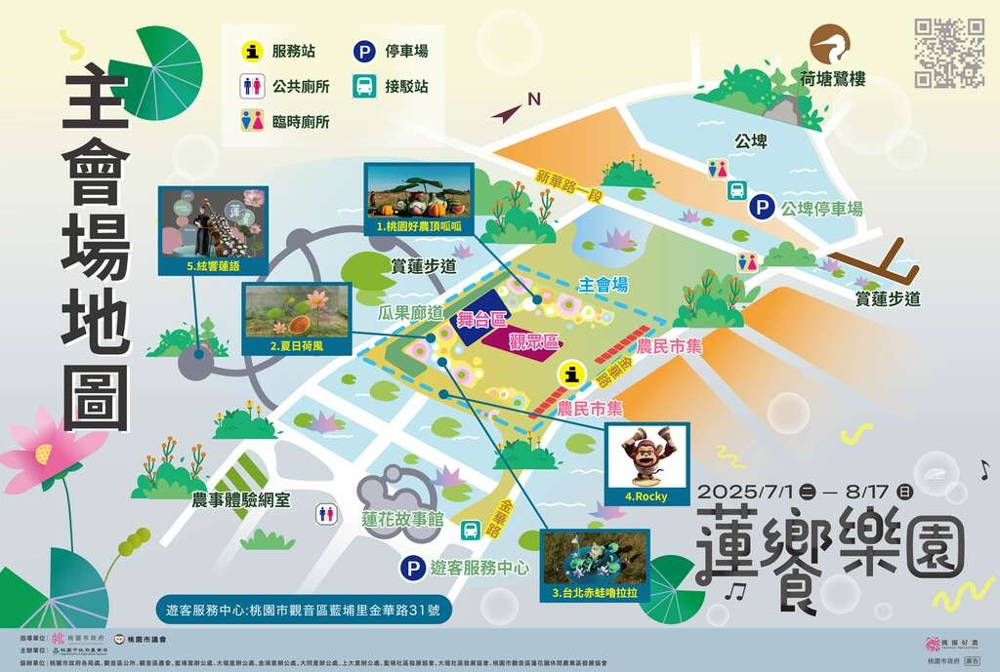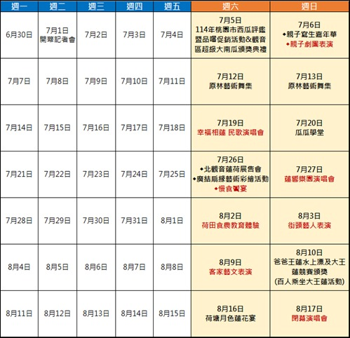亮點活動介紹(活動地點：主會場)

🌸7/5(六) 09:00-12:00
114年桃園市西瓜評鑑暨品嚐促銷活動&觀音區超級大南瓜頒獎典禮
活動地點：主會場
好吃的瓜果來自桃園，出產的香甜脆口特優高品質西瓜，甜度都有13度以上，活動現場遊客能看到大西瓜(華寶)、小西瓜(黃肉品種)、超級大西瓜比賽，並邀請彩繪大師現場彩繪瓜果及農產品展售，瓜果評鑑後辦理頒獎，頒獎完畢免費請遊客品嘗優質風味極佳比賽瓜果。
🌸7/6(日) 09:00~15:00 親子寫生嘉年華
活動地點：遊客服務中心
結合地方藝文協會增加蓮荷藝文畫廊活動，讓外縣市與桃園在地親子遊客除了體驗蓮荷的戶外美景外也增添濃濃的藝文風采。
🌸7/6(日) 10:00-12:00 親子劇團表演
活動地點：主會場
小花果玩戲場以近距離互動劇場，引導孩子思考與文化內化；萬花筒劇團由黃韋翔領軍，帶來超過百部精彩兒童劇作。結合時農教育與環保議題，邀請全家共遊桃園蓮花季，歡笑賞蓮花、共享親子美好時光！
🌸7/12(六)、7/13(日) 15:00-17:00 原林藝術舞集
活動地點：主會場
原林藝術舞集除了傳承傳統原住民族樂舞外，也致力發展創新的樂舞表演形式，試圖突破與追求嶄新的表演藝術，並讓更多民眾欣賞領略到台灣原民文化之美。
🌸7/19(六) 16:00-17:30 幸福相蓮 民歌演唱會
活動地點：主會場
邀您共赴民歌與回憶的美麗盛宴！「軍中女神」方季惟獻唱經典金曲，江念庭以深情嗓音唱出民歌歲月，迷霧森林樂團則帶來超燃動感演出。讓我們在音樂與歌聲中相聚，感受幸福與共鳴！
🌸7/20(日) 09:00~11:00;14:00~16:00 瓜瓜學堂
活動地點：遊客服務中心
歡迎各位來賞花喔！帶你到田間採瓜體驗及西瓜手作挫冰DIY喔！讓全家不用去大賣場挑瓜，來觀音我們教你種瓜、挑瓜、採瓜、吃瓜、玩瓜！善用在地食材，落實減碳。
🌸7/26(六) 09:00~16:30 北觀音蓮荷展售會
活動地點：遊客服務中心
每年初夏，是蓮花綻放的季節，從北到南部都可以見其身影，吸引大批遊客拍照打卡，還有熱愛攝影人士甘顧頂著豔陽天，在池畔捕捉蓮花倩影。桃園觀音區「蓮花園休閒農業區」，境內數十家農場及蓮園都有種植蓮花，可以欣賞美麗的蓮花、大啖蓮花主題餐、蓮子挫冰消暑氣、乘坐大王蓮體驗。
🌸7/26(六) 09:00~10:00;10:00~11:00;11:00~12:00 廣結扇緣藝術彩繪活動(桃園市禾心藝文協會)
活動地點：遊客服務中心
桃園蓮花季每年吸引大批觀光客前來觀音賞蓮，在炎熱的夏季舉辦蓮花季一系列活動，由桃園市禾心藝文協會藝術創作家，彩繪工藝扇，廣結扇緣，數量有限，讓蓮花季更添加人文藝術氣息。
🌸7/26(六) 17:00-18:30 慢食饗宴
活動地點：賞蓮步道
桃園蓮花季攜手張逸軍與食養山房，以西式流動立食宴會結合蓮花元素，呈現在地美食、景色與人文的交融。賓客可在自由分享的小點中，感受一場跨越傳統、充滿感官與情感交流的慢食體驗，共度美好盛夏。
🌸7/27(日) 15:30-17:30 蓮響樂園演唱會
活動地點：主會場
熱力開唱！街頭嘻哈樂團「丘與樂」帶來最潮節奏，桃園「星人秀」孤寂輔導室、鄭如鈞、智涓接力登場，展現年輕世代的創作能量與音樂魅力。邀您一起來到蓮響樂園，盡情搖擺、享受音樂的美好共鳴！
🌸8/3(日) 14:00-16:00 街頭藝人表演
活動地點：遊客服務中心
邀請4組街頭藝人表演，分別為氣球魔術雜耍、花式拋球、氣球魔術小丑等，邀請大小朋友一起互動遊戲，豐富又好玩！想要在歡樂的氛圍中暢快玩樂嗎
🌸8/9(六) 10:00-12:00 客家藝文表演
活動地點：主會場
2025桃園蓮花季「蓮饗樂園」推出客家藝文表演，邀集梁陳吉日樂團演繹融合客家古調的現代民謠、修曼樂團•HUMAN結合吉他吟唱與多元曲風，以及歐比王x神棍樂團帶來客語搖滾，展現傳統與創新交融的音樂魅力。
🌸8/10(日) 10:00~11:00;11:00~12:00;14:00~15:00;15:00~16:00 爸爸王蓮水上漂及大王蓮競賽頒獎
(百人乘坐大王蓮活動)
活動地點：遊客服務中心及指定農場
父親節這個屬於爸爸的日子裡，我們用特別的方式讓辛苦付出的老爸坐上巴西熱帶雨林的大王蓮，去感受宛如輕功般浮在水面上的輕盈與寧靜。8/10 當天蓮花園遊客服務中心結合農場特別為爸爸們準備了共200張的免費王蓮體驗券，讓他們在悠閒水波中放鬆心情，享受尊榮的片刻，千萬別錯過了。
🌸8/16(六) 17:30~20:30 荷塘月色蓮花宴
活動地點：主會場
來到蓮花季，看得到蓮花、吃得到蓮花，但你有參加過大自然的饗宴嗎?
這天夜晚，蓮葉亭發出柔和的光芒，營造出一個浪漫而神秘的氛圍，等著你報名體驗！
🌸8/17(日) 15:30-17:00 閉幕演唱會
活動地點：主會場
2025桃園蓮花季壓軸登場！閉幕演唱會邀請實力派跨國原民獨立樂團卡尼特KaNit，以民族融合現代的曲風，為民歌注入新能量。還有桃園星人秀的易辰&米米、SOLARISM熱情接力，用音樂點亮夜晚。讓我們一起在蓮花季最後一場盛會中，感受青春、傳承與滿滿感動！

2025蓮花季DIY活動及報名網址：半日遊體驗| 日期 | 時段 | DIY體驗活動 | 費用 | 地點 | 報名梯次 |
| --- | --- | --- | --- | --- | --- |
| 7/20 (日) 7/5 (六) 8/3 (日) | 9:00~17:00 | 拍打棒草編 DIY+植物生態導覽+乘坐大王蓮 | 450元 | 蓮荷園休閒農場 | 二梯次 |
| https://www.beclass.com/rid=294ffeb683e99fa8a82e |
| 7/12 (六) 8/9 (六) | 10:00~17:00 | 剝蓮子體驗 DIY+蓮花生態 與埤塘導覽+乘坐大王蓮 | 250元 | 蓮花園遊客服務中心 | 三梯次 |
| https://www.beclass.com/rid=294ffea683cf2c85b87f |

生態體驗| 日期 | 時段 | DIY體驗活動 | 費用 | 地點 | 報名梯次 |
| --- | --- | --- | --- | --- | --- |
| 7/13(日)、7/20(日) 7/27(日)、7/6(日) 8/10(日)、8/17(日) 8/3 (日) | 9:00~17:00 | 天才小釣手 (釣螯蝦) | 100元 | 水蓮之鄉農場 | 二梯次 |
| https://www.beclass.com/rid=294ffed684093aa38c29 |

農事體驗| 日期 | 時段 | DIY體驗活動 | 費用 | 地點 | 報名梯次 |
| --- | --- | --- | --- | --- | --- |
| 8/2 (六) | 10:00~16:00 | 手作荷葉飯 DIY | 100 | 大田蓮花農場 | 三梯次 |
| https://www.beclass.com/rid=294ffed6840913c5ac95 |
| 7/12 (六) 7/13 (日) 8/10 (日) 8/9 (六) | 10:00~16:00 | 手作糖葫蘆 DIY | 180 | 林家古厝休閒農場 | 五梯次 |
| https://www.beclass.com/rid=294ffeb683eb3092c5e7 |
| 8/9 (六) | 10:00~16:00 | 冷壓鮮榨葵花油 DIY | 250 | 向陽休閒農場 | 五梯次 |
| https://www.beclass.com/rid=294ffeb683eb6a6e2b37 |
| 7/6 (日) 7/19 (六) | 10:00~16:00 | 乘坐大王蓮+蓮香囊+蓮蓬茶 +荷扇DIY | 350 | 康莊蓮園 | 五梯次 |
| https://www.beclass.com/rid=294ffeb683e9a500cc09 |
| 7/19 (六) 8/16 (六) | 10:00~16:00 | 剝蓮子體驗 DIY | 100 | 荷竹農場 | 五梯次 |
| https://www.beclass.com/rid=294ffeb683eb4502ad55 |
| 7/27 (日) | 10:00~16:00 | 乾燥花盆飾 DIY | 150 | 青林農場 | 五梯次 |
| https://www.beclass.com/rid=294ffed68409304683e9 |
| 8/2 (六) | 10:00~16:00 | 搗客家麻糬+賞荷 | 400 | ㄚ昌伯美食屋 | 三梯次 |
| https://www.beclass.com/rid=294ffed6840915f26072 |

活動接駁 開放時間：7/5（六）～8/17（日）僅周末六日接駁接駁路線：

A車紅線
公埤停車場→新坡農會→ㄚ昌伯美食屋→荷竹/青林農場→大田蓮花→主會場→公埤停車場
B車藍線
公埤停車場→水蓮之鄉→福德宮→蓮荷園→向陽農場→蓮荷園→水蓮之鄉→主會場→公埤停車場
接駁班距：首班車 09:00於公埤停車場發車
末班車 17:30於公埤停車場發車
僅假日接駁每30分鐘一班
接駁車客服專線 0930-760-402 (服務時間：活動期間週六和週日09:00-18:00)
註：實際情況依現場為主，主辦方保有調整及最終解釋權之權利。
- 相關連結[觀音區蓮花園休閒農業區](https://www.facebook.com/lotus.guanyin/)

| 鍵盤快速鍵 | 動作 |
| --- | --- |
| ← | 向左移動 |
| → | 向右移動 |
| ↑ | 向上移動 |
| ↓ | 向下移動 |
| + | 放大 |
| - | 縮小 |
| Home 鍵 | 向左移 75% |
| End 鍵 | 向右移 75% |
| Page Up 鍵 | 向上移 75% |
| Page Down 鍵 | 向下移 75% |

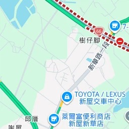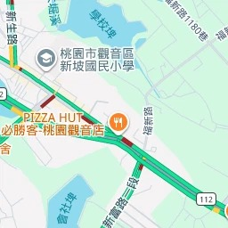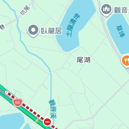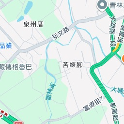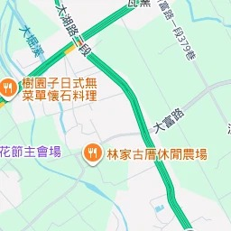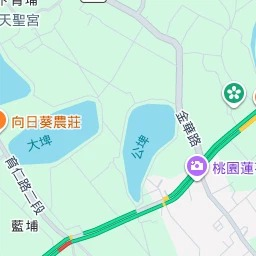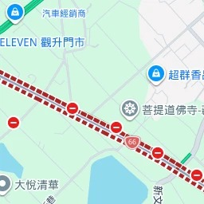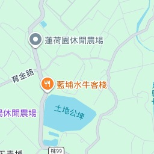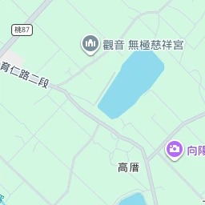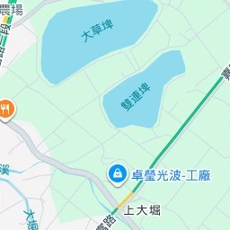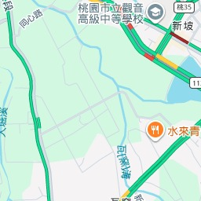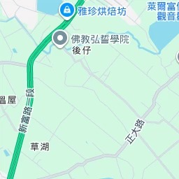鍵盤快速鍵地圖資料地圖資料 ©2026 Google地圖資料 ©2026 Google200 公尺按一下即可切換公制和英制單位條款回報地圖錯誤- [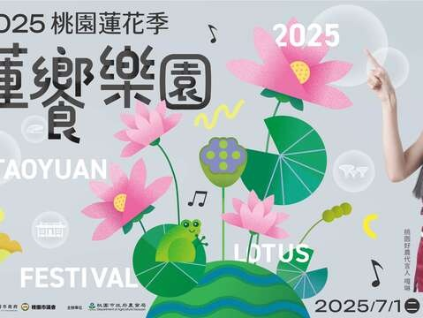](https://travel.tycg.gov.tw/content/images/articles/110185/1024x768_articles-image-axq_jtdzdeurxf48gogv0a.jpg)
- [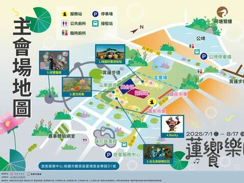](https://travel.tycg.gov.tw/content/images/articles/110186/1024x768_articles-image-3bge4006ok2n7b8mauje-a.jpg)
- [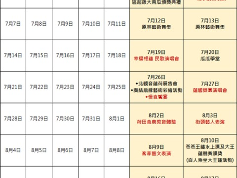](https://travel.tycg.gov.tw/content/images/articles/110187/1024x768_articles-image-mdf9sq8eguehjhnxu1jy8q.png)

上一則回列表下一則## 其他活動

查看更多活動
