:::- [首頁](/zh-tw/)
- 農遊好所在
- [休閒農業區](/zh-tw/leisure-areas/)

# 蓮花園休閒農業區

4.1更新日期:2026-02-26人氣115918加入收藏蓮花園休閒農業區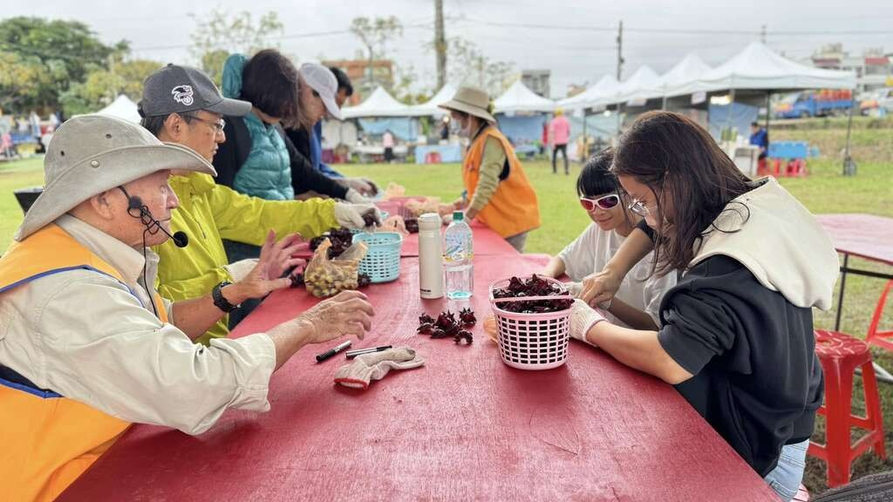洛神訪觀音–食農體驗遊活動_洛神花DIY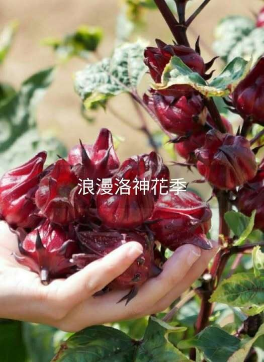洛神訪觀音–食農體驗遊活動_浪漫洛神花季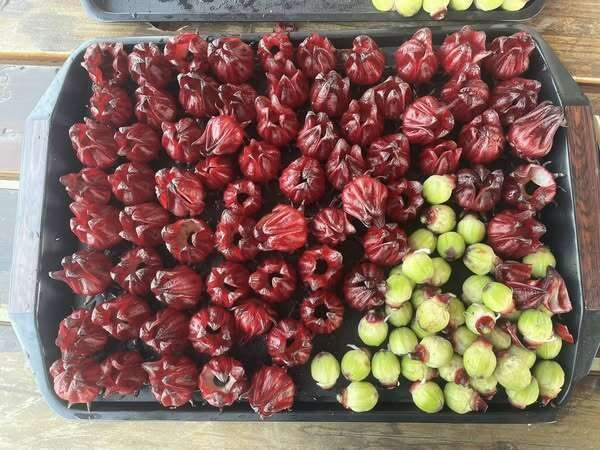洛神訪觀音–食農體驗遊活動_洛神花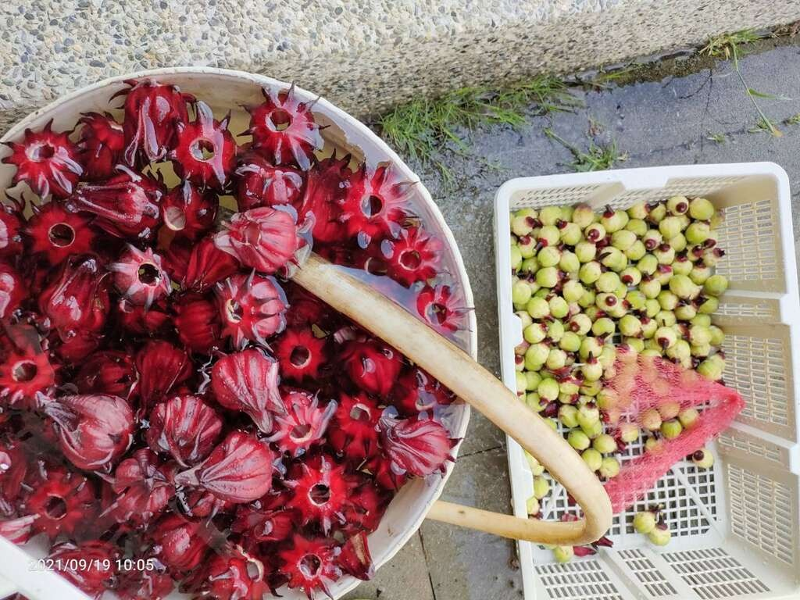洛神訪觀音–食農體驗遊活動_洛神花季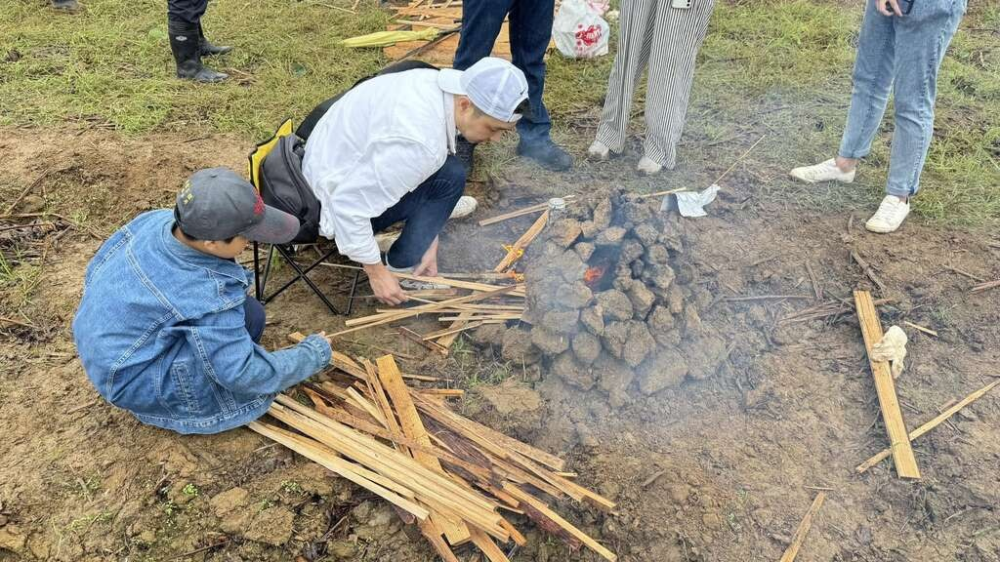荷田千人焢窯露天野餐_開窯2特色農遊場域認證星期日：08:30 – 17:30桃園市觀音區新華路一段跟金華路交叉口03-497-0166- [官方網站](https://www.lotuspark.com.tw/home)
- [Facebook](https://www.facebook.com/lotus.guanyin/?locale=zh_TW)

[蓮花園休閒農業區](https://www.lotuspark.com.tw/?fbclid=IwZXh0bgNhZW0CMTAAAR0_nKS6CquWKRZQrSRm5CZF2GvFK4y601bIcGqphxgU6QbVogZWyokb1W8_aem_UlUxM8cji3Ib-H4X5ibAIg)位於桃園市觀音區近郊為純樸的沿海農業風味的鄉村地區，區內具豐富農業資源、景觀資源及生態資源，以種植蓮花聞名，蓮花季結束後，農戶會接續挖蓮藕，尚有楊梅、瓜果類、稻米、花卉及各式蔬菜。

**桃園市觀音區蓮花園休閒農業區 遊客服務中心**地址：桃園市觀音區藍埔里金華路31號電話： 03-4970166營業時間： 週三至週日 08:30~17:30(週一及週二公休)

**遊覽景點**蓮花園的蓮花、楊梅、蓮藕、瓜果類、洛神花與蜂蜜等農產品，品質優良，深受民眾喜愛，此外，週邊景點如白沙岬燈塔、甘泉寺、桃園觀新藻礁生態系野生動物保護區、永安漁港、埤塘等地方。適合規劃半日遊或一日遊，蓮花季活動(6-8月)、西瓜節活動(7月)、洛神花節及焢窯活動(9-11月)。**建議遊程➤請點選進入[官網](https://www.lotuspark.com.tw/tag/%e5%bb%ba%e8%ad%b0%e9%81%8a%e7%a8%8b)(建議遊程頁面)➤請關注[蓮花園休閒農業區FACEBOOK](https://www.facebook.com/lotus.guanyin)取得最新資訊**相關影片104年樂活農村 - 第004集 精彩蓮鄉 趣遊觀音**本集主持人孟孟來到桃園觀音，在白沙岬燈塔欣賞美麗風景，接著到觀音蓮花季主會場走逛逛，還體驗筆筒彩繪DIY，再至林家古厝休閒農場及蓮花池，中午到水來青舍品嚐無菜單創意料理，下午至蓮荷園休閒農場和稻草博物館做草鞋DIY，最後還坐了大王蓮。本集節目以如何區分「荷花」、「睡蓮」和「蓮花」的介紹做為達人教室主題，並介紹蓮子的挑選、保存方法與料理方式。**

****交通指南****

****※自行開車**▶國道一號：南下65K處接台66東西向快速道路，往觀音方向，至7.2公里處右轉至桃84線(新華路)續行，至桃99線(金華路口)左轉續行約2公里，即可到達。▶國道三號：南下62.7K 處下交流道，往中壢方向接台66東西向快速道路，往觀音方向，至7.2公里處右轉至桃84線(新華路)續行，至桃99線(金華路口)左轉續行約2公里，即可到達。**

****※搭乘大眾交通公具**桃園客運「5025 中壢總站往新屋站」幸福村下車，即可到達本區。**

完整顯示體驗內容- 蓮荷園休閒農場-客家花布拍打棒、荷葉米苔目DIY、大王蓮乘坐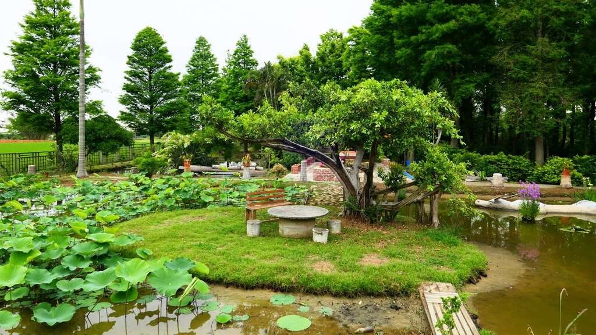電話：03-4776972【如欲安排前往，建議事先電話聯繫確認】 ★實際農場開放時間請關注農場FACEBOOK公告。[相關連結](https://www.facebook.com/p/%E8%93%AE%E8%8D%B7%E5%9C%92%E4%BC%91%E9%96%92%E8%BE%B2%E5%A0%B4-100063971143518/)
- 林家古厝休閒農場-焢窯樂、套裝遊程、DIY體驗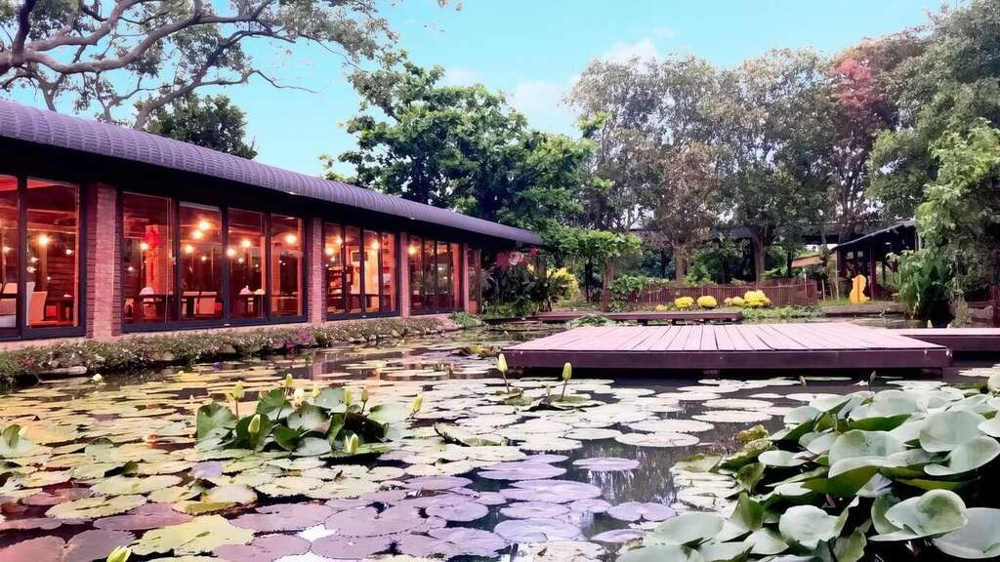電話：03-4980753 【如欲安排前往建議事先電話聯繫確認】[相關連結](https://www.lin-jia.com/#wrapper)
- 三奇蜜蜂生態農園-食農教育體驗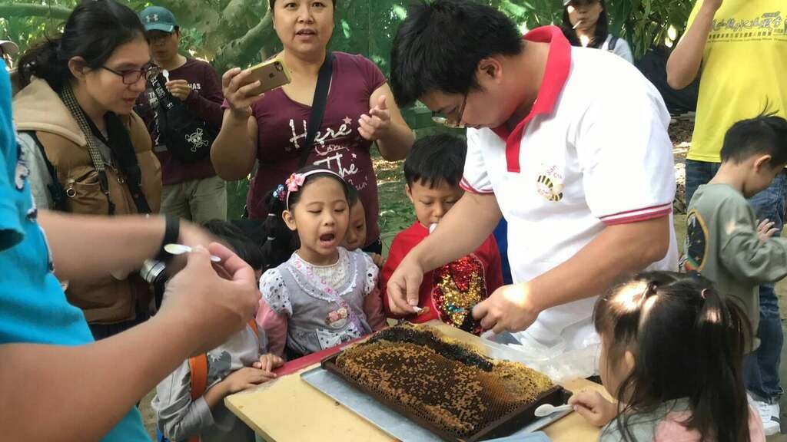電話：03-4839882 【如欲安排前往建議事先電話聯繫確認】[相關連結](https://www.facebook.com/SanciBeeEcologicalFarm/?locale=zh_TW)
- 向陽休閒農場-賞花、DIY手做課程、戶外教學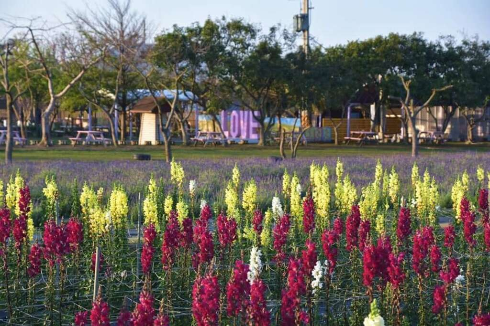電話：03-4971202 【如欲安排前往建議事先電話聯繫確認】[相關連結](http://www.sun-green.com.tw/)
- 青林農場-乾燥花DIY、烤肉趣、植栽體驗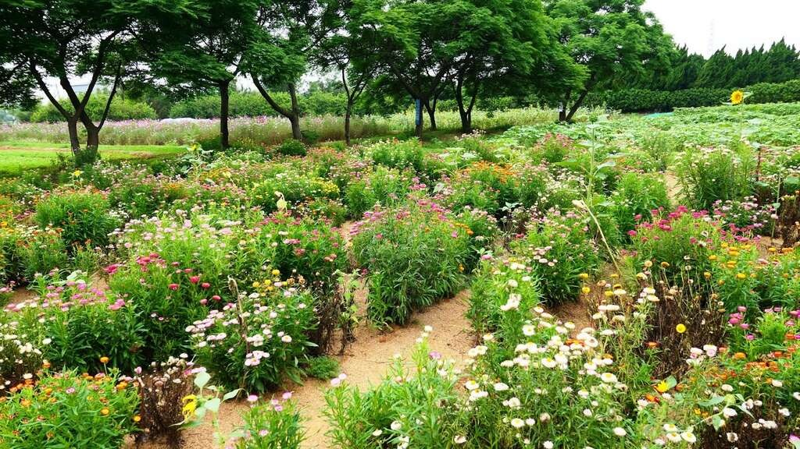電話：03-4987747【如欲安排前往，建議事先電話聯繫確認】[相關連結](https://www.facebook.com/chinglin.farm/?locale=zh_TW)
- 金湖岸楊梅大王農場-農場DIY、一日遊小旅行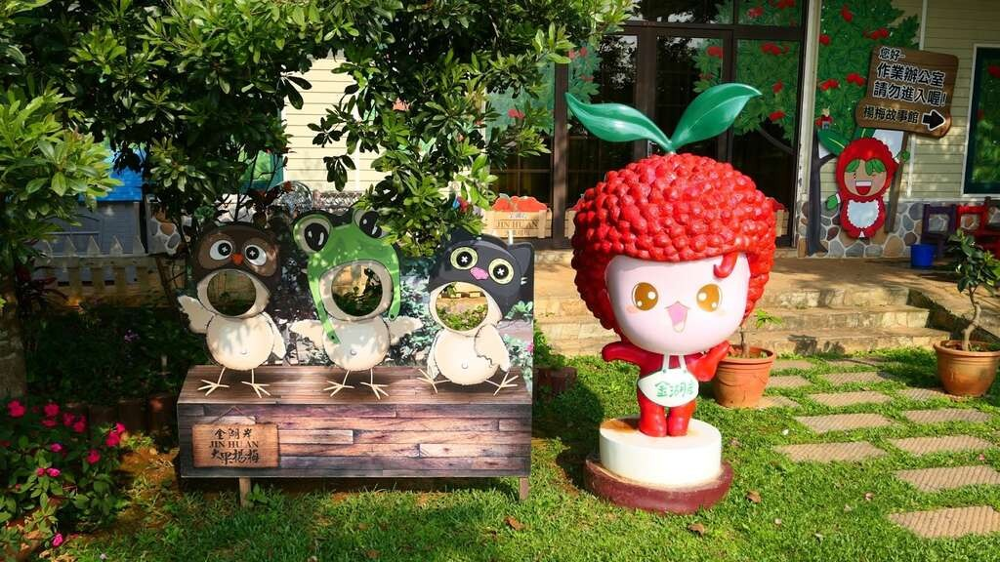電話：03-4733543【如欲安排前往，建議事先電話聯繫確認】[相關連結](https://www.jha.tw/settrv/%E5%A5%97%E8%A3%9D%E8%A1%8C%E7%A8%8B)
- 水蓮之鄉農場-乘坐大王蓮體驗、剝蓮子DIY體驗、垂釣小龍蝦、荷葉飯DIY(要預約)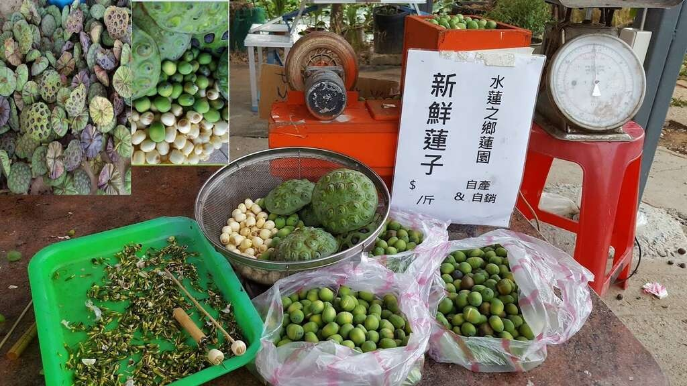電話：03-4777425【如欲安排前往，建議事先電話聯繫確認】 ★實際農場開放時間請關注農場FACEBOOK公告。[相關連結](https://www.facebook.com/profile.php?id=100063686302194#)

區內業者在地美食- [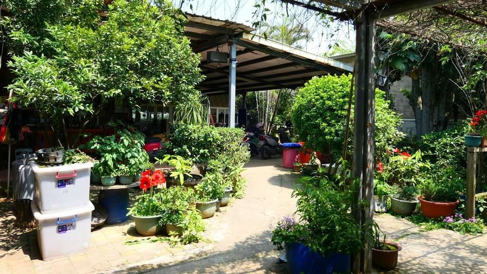大田蓮花園餐廳](https://ezgo.ardswc.gov.tw/_api/content/images/agrispots/30561/1024x768_agrispots-image-7jui6srrtks-wy9y1gfsvq.jpg)大田蓮花園餐廳[相關連結](https://www.facebook.com/profile.php?id=100063766459707&locale=zh_TW)
- [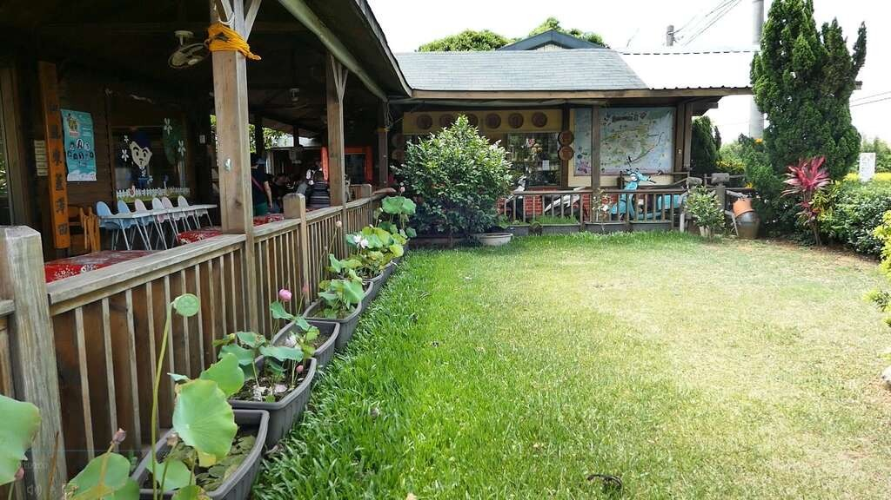ㄚ昌伯美食屋](https://ezgo.ardswc.gov.tw/_api/content/images/agrispots/30562/1024x768_agrispots-image-ye5vus2a20irf1dudvqgqq.jpg)ㄚ昌伯美食屋[相關連結](https://www.facebook.com/a4904140/?locale=zh_TW)
- [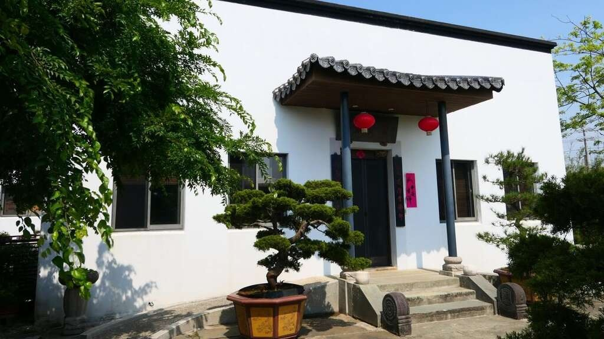水來青舍](https://ezgo.ardswc.gov.tw/_api/content/images/agrispots/30569/1024x768_agrispots-image-8psnxuz7d0a4ghexxdazjq.jpg)水來青舍[相關連結](https://www.facebook.com/guanyinshuilai/?locale=zh_TW)

必買好物- 伴手禮與農特產✦蓮子冰淇淋(蓮花飲品系列)販售地點：遊客服務中心、休區各農場均有販售✦天然蜂蜜(純蜂蜜無添加物)販售地點：遊客服務中心、三奇蜜蜂生態農園、青林農場✦乾燥蓮蓬-農特產(包)販售地點：遊客服務中心、康莊蓮園✦冷凍真空包蓮子農特產(包)販售地點：遊客服務中心、大田蓮花園農場✦水中丹養生茶(副方茶葉包/盒裝)販售地點：遊客服務中心、ㄚ昌伯美食屋民宿✦香水蓮咖啡(全年，需預訂)特選薩爾瓦多的莊園豆，其獨特的咖啡口感及淡雅的香氣，搭配桃園在地香水蓮花，形成強烈的對比，輕輕的咖啡香中，又不失蓮花的高雅，微妙的比例在口中達到完美的平衡。販售地點：蓮荷園休閒農場✦蓮子豆奶布丁選用觀音在地生產蓮子，加入健康概念古早味豆奶，農場自製成老少咸宜的蓮子豆奶布丁。榮獲2018年農委會農業旅遊伴手禮，食品安全檢驗合格，投保產品責任險。販售地點：向陽休閒農場✦向日葵花茶禮盒以歐洲進口食用種葵花加入馬鞭草、紅茶製成的向日葵茶包,清香甘甜的向日葵花茶,有濃濃菊花茶的香味，順口消暑的天然飲品。販售地點：向陽休閒農場

住宿推薦- [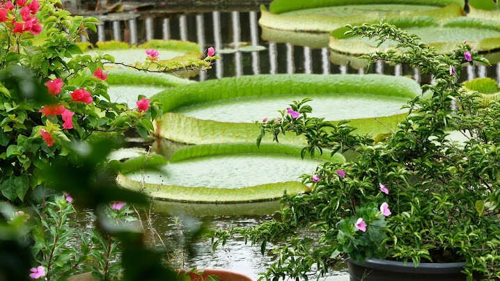康莊蓮園民宿](https://ezgo.ardswc.gov.tw/_api/content/images/agrispots/30567/1024x768_agrispots-image-tkk6xdqjp0oh9vr7hng-aw.jpg)康莊蓮園民宿電話：03-4081517[相關連結](https://www.taiwanstay.net.tw/TSA/web_page/TSA020200.jsp?hohi_id=12469)

基本資訊開放時間：- 星期日：08:30 – 17:30
- 星期一：08:30 – 17:30
- 星期二：08:30 – 17:30
- 星期三：08:30 – 17:30
- 星期四：08:30 – 17:30
- 星期五：08:30 – 17:30
- 星期六：08:30 – 17:30

分類：- 自助旅行

天氣狀態：交通方式：進入後可依您的出發地，選擇適合的交通方式訪客評論4.1- Vicky2 年前很適合親子共遊 , 園區內不收費。 因為荷花季已經過了 , 但是還是有少數未凋零的荷花可以觀賞 , 園區內很美 , 平日賞荷也有絲瓜園區可以漫步絲瓜步道。
- 賴彥本2 年前夏季來賞園區內各種蓮花和荷花。 叁觀時間約1小時。

免責聲明：這些評論是旅遊者個人的主觀評論，並不代表農業易遊網及Google Map的意見。我要分享- [分享到 facebook](https://www.facebook.com/sharer/sharer.php?u=)
- [分享到 twitter](https://twitter.com/home/?status=蓮花園休閒農業區%20)
- [分享到 line](http://line.naver.jp/R/msg/text/?蓮花園休閒農業區%20)
- 複製網址
