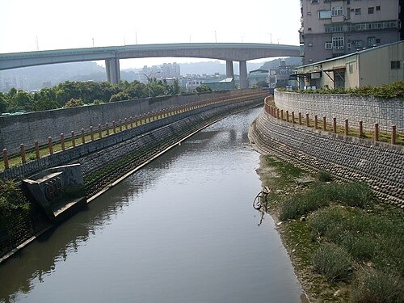

维基百科，自由的百科全书| 觀音坑溪 |
| --- |
| 過觀音坑溪橋入淡水河，對岸右邊是社子，左邊是關渡 |
|  |
| 流域 |
| 水系 | 淡水河 |
|  |
| 源頭 |  |
| • 位置 | 觀音山 南側（凌雲禪寺附近） |
| • 海拔 | 372米（1,220英尺） |
|  |
| 河口 | 獅子頭 |
| 流域面積 | 9.2平方公里（3.6平方英里） |
| 位置 | 新北市 五股區 |
| 本貌 |
| 長度 | 6.2公里（3.9英里） |

觀音坑溪橋上看上游，遠方為[台64線](/wiki/%E5%8F%B064%E7%B7%9A)高架。

**觀音坑溪**(或以中下游地名另稱北勢坑溪)，位於[台灣](/wiki/%E5%8F%B0%E7%81%A3)北部，是[淡水河](/wiki/%E6%B7%A1%E6%B0%B4%E6%B2%B3)的一條支流，河長6.2公里，流域面積9.2平方公里，分佈於[新北市](/wiki/%E6%96%B0%E5%8C%97%E5%B8%82)[五股區](/wiki/%E4%BA%94%E8%82%A1%E5%8D%80)。其源頭位於[觀音山](/wiki/%E8%A7%80%E9%9F%B3%E5%B1%B1_(%E6%96%B0%E5%8C%97%E5%B8%82))南側的凌雲禪寺附近，標高372公尺[[1]](#cite_note-1)，向東南流入[台北盆地](/wiki/%E5%8F%B0%E5%8C%97%E7%9B%86%E5%9C%B0)後，轉向東注入淡水河。

觀音坑溪原本注入淡水河的另一支流[塭子川](/wiki/%E5%A1%AD%E5%AD%90%E5%B7%9D)[[2]](#cite_note-2)，後因拓寬淡水河道工程而炸毀[獅子頭](/wiki/%E7%8B%AE%E5%AD%90%E5%A4%B4)隘口，即變成現況之各自注入淡水河。

導演[齊柏林](/wiki/%E9%BD%8A%E6%9F%8F%E6%9E%97)在所執導的《[看見台灣](/wiki/%E7%9C%8B%E8%A6%8B%E5%8F%B0%E7%81%A3)》紀綠片中，拍攝到觀音坑溪遭上游染整廠排放的廢水汙染，河面呈暗紅色。

## 橋樑

[编辑]觀音坑溪橋:[八里左岸自行車道](/wiki/%E6%96%B0%E5%8C%97%E5%B8%82%E8%87%AA%E8%A1%8C%E8%BB%8A%E9%81%93#八里左岸自行車道)跨過觀音坑溪。

## 相關條目

[编辑]- [淡水河](/wiki/%E6%B7%A1%E6%B0%B4%E6%B2%B3)
- [塭子川](/wiki/%E5%A1%AD%E5%AD%90%E5%B7%9D)

## 參考資料

[编辑]维基共享资源上的相关多媒体资源：觀音坑溪- **[^](#cite_ref-1)**李錫堤等，[林口台地及其鄰接海岸地形變遷與地貌復原可行性探討](http://140.115.123.30/LINKOU/CH02/CH02X.htm)（[页面存档备份](//web.archive.org/web/20200917143016/http://140.115.123.30/LINKOU/CH02/CH02X.htm)，存于[互联网档案馆](/wiki/%E4%BA%92%E8%81%94%E7%BD%91%E6%A1%A3%E6%A1%88%E9%A6%86)）
- **[^](#cite_ref-2)**楊萬全，臺北盆地零公尺地區的問題，台灣水文論文集，2000年5月，第114頁

| 查 论 编 淡水河 水系 |
| --- |
| 橋樑 水利設施 |
| 噶瑪蘭坑溪 米粉寮溪 西門溝 庄子内溪 鼻頭溪 黃高溪 竿蓁林溪 八勢溪 高厝溪 烏山頭溝 樹梅坑溪 龍形溪 艋舺溪 中港河 觀音坑溪 洲子尾溝 溪美大排 |
| 基隆河 水系 | 磺港溪 內溝溪 草濫溪 下寮溪 北峰溪 叭嗹溪 北港溪 康誥坑溪 智慧溪 禮門溪 茄苳溪 鄉長溪 保長坑溪 鹿寮溪 瑪陵坑溪 拔西猴溪 大武崙溪 暖暖溪 𫙮魚坑溪 深澳坑溪 新寮溪 灰窯溪 芊蓁林溪 三坑溪 大坑溪 四分溪 山豬窟溪 橫科溪 外雙溪 玉潮坑溪 石角溪 新安溪 菁礐溪 磺溪 松溪 紫明溪 下湖溪 陽明溪 內雙溪 內厝溪 內雙溝溪 |
| 磺港溪 內溝溪 草濫溪 下寮溪 北峰溪 叭嗹溪 北港溪 康誥坑溪 智慧溪 禮門溪 茄苳溪 鄉長溪 保長坑溪 鹿寮溪 瑪陵坑溪 拔西猴溪 大武崙溪 暖暖溪 𫙮魚坑溪 深澳坑溪 新寮溪 灰窯溪 芊蓁林溪 三坑溪 |
| 大坑溪 | 四分溪 山豬窟溪 橫科溪 |
| 外雙溪 | 玉潮坑溪 石角溪 新安溪 菁礐溪 磺溪 松溪 紫明溪 下湖溪 陽明溪 內雙溪 內厝溪 內雙溝溪 |
| 玉潮坑溪 石角溪 新安溪 菁礐溪 |
| 磺溪 | 松溪 紫明溪 下湖溪 陽明溪 |
| 內雙溪 | 內厝溪 內雙溝溪 |
| 塭子川 水系 | 大窠溪 舊塭子川 五股坑溪 貴子坑溪 中港大排 |
| 新店溪 水系 | 中原溝 安坑溪 青潭溪 粗坑溪 磺窟溪 平廣溪 萬盛溪 北勢溪 金瓜寮溪 𩻸魚堀溪 後坑溪 石硿子溪 灣潭溪 溪尾寮溪 後寮溪 泰平溪 南勢溪 加九寮溪 烏砂溪 內洞溪 斯其野溪 大羅蘭溪 扎孔溪 波露溪 露門溪 哈盆溪 桶後溪 阿玉溪 景美溪 指南溪 昇高坑溪 永定溪 烏塗溪 崩山溪 南勢角溪 瓦磘溝 二八張溝 中和溝 |
| 中原溝 安坑溪 青潭溪 粗坑溪 磺窟溪 平廣溪 萬盛溪 |
| 北勢溪 | 金瓜寮溪 𩻸魚堀溪 後坑溪 石硿子溪 灣潭溪 溪尾寮溪 後寮溪 泰平溪 |
| 南勢溪 | 加九寮溪 烏砂溪 內洞溪 斯其野溪 大羅蘭溪 扎孔溪 波露溪 露門溪 哈盆溪 桶後溪 阿玉溪 |
| 加九寮溪 烏砂溪 內洞溪 斯其野溪 大羅蘭溪 扎孔溪 波露溪 露門溪 哈盆溪 |
| 桶後溪 | 阿玉溪 |
| 景美溪 | 指南溪 昇高坑溪 永定溪 烏塗溪 崩山溪 |
| 南勢角溪 | 瓦磘溝 二八張溝 中和溝 |
| 大漢溪 水系 | 湳仔溝 塔寮坑溪 鶯歌溪 草嶺溪 打鐵坑溪 三民溪 奎輝溪 霞雲溪 宇內溪 義興溪 高坡溪 雪霧鬧溪 榮華溪 寶里苦溪 卡拉溪 三峽河 橫溪 五寮河 東眼溪 大豹溪 熊空溪 中坑溪 三光溪 塔曼溪 馬里闊丸溪 抬耀溪 泰平溪 石磊溪 薩克亞金溪 塔克金溪 斯烏庫斯溪 — 鴛鴦湖 |
| 湳仔溝 塔寮坑溪 鶯歌溪 草嶺溪 打鐵坑溪 三民溪 奎輝溪 霞雲溪 宇內溪 義興溪 高坡溪 雪霧鬧溪 榮華溪 寶里苦溪 卡拉溪 |
| 三峽河 | 橫溪 五寮河 東眼溪 大豹溪 熊空溪 中坑溪 |
| 三光溪 | 塔曼溪 |
| 馬里闊丸溪 | 抬耀溪 泰平溪 石磊溪 薩克亞金溪 塔克金溪 斯烏庫斯溪 — 鴛鴦湖 |
| 抬耀溪 泰平溪 石磊溪 薩克亞金溪 |
| 塔克金溪 | 斯烏庫斯溪 — 鴛鴦湖 |

NewPP limit report Parsed by mw‐web.codfw.main‐6b979c7866‐jlqz5 Cached time: 20261010123451 Cache expiry: 2592000 Reduced expiry: false Complications: [prevent‐selective‐update] CPU time usage: 0.286 seconds Real time usage: 0.643 seconds Preprocessor visited node count: 1571/1000000 Revision size: 2187/2097152 bytes Post‐expand include size: 45211/2097152 bytes Template argument size: 1544/2097152 bytes Highest expansion depth: 12/100 Expensive parser function count: 0/500 Unstrip recursion depth: 0/20 Unstrip post‐expand size: 18518/5000000 bytes Lua time usage: 0.165/10.000 seconds Lua memory usage: 4525143/52428800 bytes Number of Wikibase entities loaded: 1/500Transclusion expansion time report (%,ms,calls,template) 100.00% 308.668 1 -total 57.19% 176.540 2 Template:Infobox 52.88% 163.214 1 Template:Infobox_river 29.93% 92.389 1 Template:淡水河 29.41% 90.789 1 Template:NavboxV2 11.62% 35.859 1 Template:Commons_cat 10.86% 33.521 1 Template:Sister_project 10.75% 33.182 5 Template:Infobox_river/source 10.38% 32.043 1 Template:Side_box 7.35% 22.694 3 Template:ConvertRender ID fccb795a-c4a6-11f1-9d6e-e324edf639f2Saved in parser cache with key zhwiki:pcache:698364:|#|:idhash:canonical!zh and timestamp 20261010123451 and revision id 85606836. Rendering was triggered because: page_view取自“https://zh.wikipedia.org/w/index.php?title=觀音坑溪&oldid=85606836”分类：- [淡水河水系](/wiki/Category:%E6%B7%A1%E6%B0%B4%E6%B2%B3%E6%B0%B4%E7%B3%BB)
- [新北市河流](/wiki/Category:%E6%96%B0%E5%8C%97%E5%B8%82%E6%B2%B3%E6%B5%81)

隐藏分类：- [维基共享资源分类链接使用了维基数据上的匹配项](/wiki/Category:%E7%BB%B4%E5%9F%BA%E5%85%B1%E4%BA%AB%E8%B5%84%E6%BA%90%E5%88%86%E7%B1%BB%E9%93%BE%E6%8E%A5%E4%BD%BF%E7%94%A8%E4%BA%86%E7%BB%B4%E5%9F%BA%E6%95%B0%E6%8D%AE%E4%B8%8A%E7%9A%84%E5%8C%B9%E9%85%8D%E9%A1%B9)
- [有地图的页面](/wiki/Category:%E6%9C%89%E5%9C%B0%E5%9B%BE%E7%9A%84%E9%A1%B5%E9%9D%A2)
