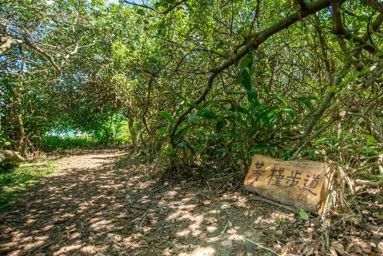
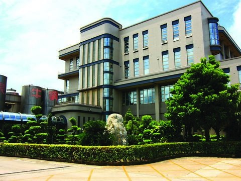
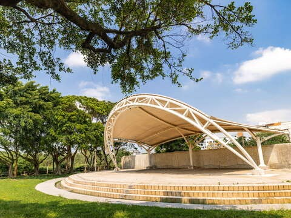

## 草漯沙丘地質公園

4.2更新日期2026-08-03人氣370233- 濱海追風

草漯沙丘是會「偷偷移動」的沙丘樂園！隨著海風與季風變化，沙丘天天換表情，搭配風力發電機、夕陽與海浪聲，走一趟就像闖進自然冒險故事書，邊玩邊認識地質生態- 認識沙丘生態，變身自然小探險家
- 台版撒哈拉，8.1公里的沿海沙漠
- 百年漂沙x濱海風車，遼闊系美照Get

你以為沙丘只是靜靜躺在海邊的沙堆嗎？那你一定還沒來過草漯沙丘！在全世界的地質公園中，只有台灣的草漯沙丘與日本鳥取砂丘，擁有如此珍貴的「會動的沙丘」地景。隨著東北季風、海浪與時間推移，沙粒不停搬家，讓整片沙丘每天都在悄悄改變模樣，像一座正在呼吸的天然樂園。

海風與季風一起畫出的沙丘畫布
草漯沙丘位於桃園市大園區老街溪西側至觀音區大堀溪東側的沿海地帶，北起老街溪、南至大堀溪，範圍橫跨約 284 公頃。這片沙丘因海岸線與季風形成特殊夾角，加上河川沙源堆積而成，孕育出長約 8.1 公里、最寬可達 150 公尺的大規模濱海沙丘，是台灣少見且極具代表性的地質景觀。

沙丘的秘密地形大集合
在草漯沙丘，不只看得到沙，還能一次認識多種沙丘造型。這裡保留了條狀丘、櫛齒狀丘、複合丘與臺狀沙丘等不同形態，隨著季節、風向與浪況變化，每次造訪都有不同風景。靠近海岸的濱海沙丘變化最快，內陸側則有防風林守護，讓沙丘呈現動靜交錯的有趣樣貌。

沙丘也是守護家園的小幫手
別看沙丘一臉軟綿綿，其實它們肩負重要任務。草漯沙丘與保安林地結合，能有效降低冬季強烈東北季風對內側土地的衝擊，是低維護又兼顧生態的天然防風屏障。劃設為地質公園後，也能減少不當開發，持續監測海岸線變化，對國土保安具有重要意義。
沙丘生存環境缺水、多風又含鹽，只有最堅強的植物才能留下來。馬鞍藤、天人菊、蔓荊、林投、木麻黃等耐旱抗鹽植物，在這裡各顯神通，發展出獨特的生存方式，也讓沙丘多了層層綠意。

風車、夕陽與沙丘的夢幻時刻
草漯沙丘最迷人的時刻，莫過於傍晚時分。夕陽慢慢落下，橘紅色的光鋪滿沙丘與海面，海岸邊一整排風力發電風車化成剪影，隨風轉動，畫面浪漫又壯闊。數林子海濱段更是人氣最高的拍照地點，許多影視作品也曾在此取景，讓人一站就捨不得離開。

一邊玩，一邊認識自然地景
自 2020 年成立為草漯沙丘地質公園後，這裡不只是看風景的地方，更是認識地質、生態與永續的重要教室。走在潮音海觀景步道上，聽海浪、看沙丘、賞風車，用最輕鬆的方式，親近一座會移動、會說故事的沙丘世界。- 照片照片
- 街景街景

景點特色- 潮音海觀景步道草漯沙丘地質公園為全國第1座以沙丘為保護標的的地質公園 (圖文來源:市政新聞)
- 黃槿步道潮音海觀景步道設置包括觀景平台、休憩座椅、木質廣場、漂流木入口意象、遊客停車場、黃槿步道等設施。 (圖文來源:市政新聞)

景點資訊電話/03-3386021地址/桃園市大園區老街溪口南岸至觀音區大堀溪口北岸開放時間/- 星期日：00:00 - 23:59
- 星期一：00:00 - 23:59
- 星期二：00:00 - 23:59
- 星期三：00:00 - 23:59
- 星期四：00:00 - 23:59
- 星期五：00:00 - 23:59
- 星期六：00:00 - 23:59

門票資訊/免費相關連結/FB粉絲團服務資訊- 廁所
- 停車場

旅遊叮嚀￭因地形高達15尺，且沙面下遍佈定沙籬，請穿著包覆性鞋履，行走時小心沙坡滑落，注意安全
￭風大時請避免在沙丘稜線行走如何到達依您的出發地，選擇適合的交通方式停車資訊草漯沙丘地質公園之潮音海步道及白沙屯步道入口處停車場周圍停車場- 居善醫院停車場(全時段免費)[導航](https://www.google.com.tw/maps/place/25.0582298,121.1662973)
- 嘟嘟房大園2站(全時段每次 250 元)[導航](https://www.google.com.tw/maps/place/25.0684071,121.1918035)
- 嘟嘟房大園3站(全時段每次 250 元（跨日重新計算）)[導航](https://www.google.com.tw/maps/place/25.0685152,121.1919178)

查看更多停車優惠下一則網友推推關閉上一則回列表下一則## 周邊景點

- [4.3許厝港濕地星期日：00:00 - 23:59人氣282213](/zh-tw/travel/attraction/961)
- [4.0國巨洋傘文創園區星期日：09:30 - 17:00人氣64535](/zh-tw/travel/attraction/1650)
- [4.1光泉牛奶園地（大園廠）星期日：休息人氣129854](/zh-tw/travel/attraction/502)
- [4.1大園公園星期日：00:00 - 23:59人氣40053](/zh-tw/travel/attraction/1000)

看更多
