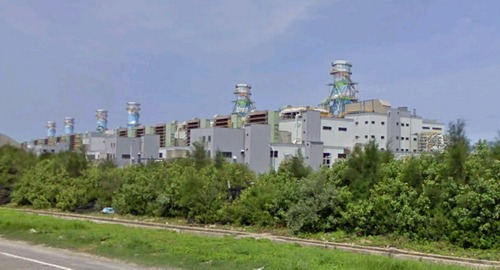
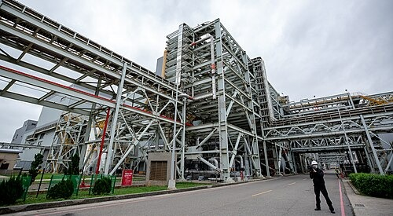

坐标：25°1′34″N121°2′50″E / 25.02611°N 121.04722°E /25.02611; 121.04722坐标：参数： "type=" 应为 "type:"
维基百科，自由的百科全书| 大潭發電廠 |
| --- |
| 大潭發電廠 |
|  |
| 國家／地区 | 中華民國 （ 臺灣 ） |
| 位置 | 桃園市 觀音區 電廠路1號 |
| 坐標 | 25°1′34″N 121°2′50″E  /  25.02611°N 121.04722°E  / 25.02611; 121.04722 坐标：参数： "type=" 应为 "type:" |
| 現況 | 商轉中 |
| 啟用时间 | 2005年 |
| 持有單位 | 台灣電力公司 |
| 运营单位 | 台灣電力公司 |
| 火力发电站 |
| 主要燃料 | 液化天然氣 |
| 類型 | 燃氣複循環發電 |
| 联合循环 | Stage I：3部氣渦輪機+1部汽輪機 Stage II：2部氣渦輪機+1部汽輪機 |
| 冷卻來源 | 海水 |
| 水力发电站远程集控中心 |
| 總额定容量 | 7,540.2MW |
| 發電概況 |
|  |
|  |
| 计划建设机组 | 4部 |
| 额定容量 | 7,540.2MW |
| 年发电量 | 132.74億度 [ 1 ] |
| 網站 |
| 大潭發電廠簡介 |
| （本信息框数据截至2013年） |

遠望大潭發電廠

**大潭發電廠**，是[台灣](/wiki/%E5%8F%B0%E7%81%A3)最大的[天然氣](/wiki/%E5%A4%A9%E7%84%B6%E6%B0%A3)電廠，同時是世界第四大燃氣發電廠，隸屬[台灣電力公司](/wiki/%E5%8F%B0%E7%81%A3%E9%9B%BB%E5%8A%9B%E5%85%AC%E5%8F%B8)，位於[台灣](/wiki/%E5%8F%B0%E7%81%A3)[桃園市](/wiki/%E6%A1%83%E5%9C%92%E5%B8%82)[觀音區](/wiki/%E8%A7%80%E9%9F%B3%E5%8D%80)大潭里，佔地約102公頃，廠區有[台61線](/wiki/%E5%8F%B061%E7%B7%9A)（西濱快速公路）及[台66線](/wiki/%E5%8F%B066%E7%B7%9A)穿越，東側為[台15線](/wiki/%E5%8F%B015%E7%B7%9A)，南臨[新屋溪](/wiki/%E6%96%B0%E5%B1%8B%E6%BA%AA)。機組分為Stage I、Stage II、緊急燃油及主要燃氣系統。

## 沿革

[编辑]大潭發電廠

大潭發電廠最初為台灣電力公司為配合國家長期經濟發展及電力負載逐年增長之需求，以及解決[臺灣北部](/wiki/%E8%87%BA%E7%81%A3%E5%8C%97%E9%83%A8)地區長期缺電，導致南電北送的常態狀況，因此選定於[桃園市](/wiki/%E6%A1%83%E5%9C%92%E5%B8%82)[觀音區](/wiki/%E8%A7%80%E9%9F%B3%E5%8D%80)大潭濱海工業區內設置一座天然氣複循環發電廠，稱為大潭發電廠。

2001年，大潭複循環發電計畫開始動工，由台電核能火力工程處旗下的北部施工處進駐施工。[[2]](#cite_note-台電月刊-2)2006年6月20日，大潭複循環一號機完工開始商轉。[[2]](#cite_note-台電月刊-2)

2008年11月19日，大潭複循環六號機完工商轉，大潭發電計畫告一段落。[[2]](#cite_note-台電月刊-2)

2017年6月，政府因應臺灣可能發生缺電之危機，推動大潭緊急發電計畫，向美國[通用電氣](/wiki/%E9%80%9A%E7%94%A8%E9%9B%BB%E6%B0%A3)（GE）採購兩部容量各300MW的單循環的汽渦輪發電機組，空運來臺後安裝於大潭複循環6號機左(南)側之空地。[[3]](#cite_note-3)

同時間，台灣電力公司也開始推動大潭擴建計畫，預計利用大潭發電廠南側的空地新增四部天然氣複循環發電機組，共增加3,168MW之發電量，而稍早推動的大潭緊急發電計畫中，兩部單循環汽渦輪發電機組，也改稱為大潭7-1與7-2號機，以作為接下來安裝熱回收爐與汽輪發電機後，成為大潭複循環7號機。[[4]](#cite_note-4)

2017年8月15日，發生[815全臺大停電](/wiki/815%E5%85%A8%E8%87%BA%E5%A4%A7%E5%81%9C%E9%9B%BB)，肇因於[台灣中油](/wiki/%E5%8F%B0%E7%81%A3%E4%B8%AD%E6%B2%B9)施工不慎，誤關天然氣供氣管線的關斷閥，導致大潭複循環1至6號機組因無燃料可燒全部跳脫，發電量瞬間缺少4,384MW，全臺各地傳出停電狀況，事件爆發後，政府進行究責與檢討，時任經濟部長[李世光](/wiki/%E6%9D%8E%E4%B8%96%E5%85%89)於該次事件後請辭獲准。[[5]](#cite_note-5)[[6]](#cite_note-6)[[7]](#cite_note-7)

## 設備

[编辑]廠內[複循環](/wiki/%E8%A4%87%E5%BE%AA%E7%92%B0)機組，由[三菱重工](/wiki/%E4%B8%89%E8%8F%B1%E9%87%8D%E5%B7%A5)製造[氣渦輪](/wiki/%E7%87%83%E6%B0%A3%E6%B8%A6%E8%BC%AA%E7%99%BC%E5%8B%95%E6%A9%9F)發電機組，第一級渦輪葉片溫度在1400℃以上，產生熱燃氣加熱鍋爐推動[汽輪機](/wiki/%E8%92%B8%E6%B1%BD%E6%B8%A6%E8%BC%AA%E7%99%BC%E5%8B%95%E6%A9%9F)發電機組，複循環發電優點為電力調度反應快速，熱效率接近60%，碳排放量低於燃煤與燃油發電，僅高於[核能發電](/wiki/%E6%A0%B8%E8%83%BD%E7%99%BC%E9%9B%BB)，缺點為每度電燃氣成本約[新台幣](/wiki/%E6%96%B0%E5%8F%B0%E5%B9%A3)3元，高於核能與燃煤發電。

[複循環](/wiki/%E8%A4%87%E5%BE%AA%E7%92%B0)機組及風力發電機組的總裝機容量為4,418.7MW，為[台灣北部](/wiki/%E5%8F%B0%E7%81%A3%E5%8C%97%E9%83%A8)地區最大單一電廠，次於[台中發電廠](/wiki/%E5%8F%B0%E4%B8%AD%E7%99%BC%E9%9B%BB%E5%BB%A0)居台灣第二位[[8]](#cite_note-台灣電力發展現況-8)。預計自2018年起，陸續完成四部機組的擴建後，總發電量將達7,400MW，成為全台發電量最大的電廠[[9]](#cite_note-9)，新機組則採用美國[奇異公司](/wiki/%E5%A5%87%E7%95%B0%E5%85%AC%E5%8F%B8)製造之7HA.02燃氣渦輪機，淨效率64%，可在30分鐘內從冷機啟動到滿載發電，同時增強使用燃料的靈活性，可容納各種氣體燃料（頁岩氣、高乙烷、氫氣）和液體燃料（柴油、原油）[[10]](#cite_note-10)。

大潭發電廠為全台電唯一具有電力系統崩潰，機組自動卸載House Load以及[全黑快速啟動](/w/index.php?title=%E5%85%A8%E9%BB%91%E5%BF%AB%E9%80%9F%E5%95%9F%E5%8B%95&action=edit&redlink=1)功能的[火力發電廠](/wiki/%E7%81%AB%E5%8A%9B%E7%99%BC%E9%9B%BB%E5%BB%A0)。

### 發電機組

[编辑]Stage I| 氣渦輪發電機類型 | 熱回收爐類型 | 汽輪發電機類型 | 機組數量 （汽渦輪機+汽輪機） | 發電燃料 | 裝置容量（MW） | 商轉日期 | 狀態 |
| --- | --- | --- | --- | --- | --- | --- | --- |
| 1-1 日本 三菱重工 製M501F型氣渦輪發電機 [ 11 ] 1-2 日本 三菱重工 製M501F型氣渦輪發電機 [ 11 ] 1-3 日本 三菱重工 製M501F型氣渦輪發電機 [ 11 ] | 日本 三菱重工 製立式排熱回收自然循環三壓熱回收爐 | ST-1 日本 三菱重工 製汽輪發電機 | 3部氣渦輪機 1部汽輪機 | 天然氣 | 742.7MW | 2006年8月27日 | 商轉中 |
| 2-1 日本 三菱重工 製M501F型氣渦輪發電機 [ 11 ] 2-2 日本 三菱重工 製M501F型氣渦輪發電機 [ 11 ] 2-3 日本 三菱重工 製M501F型氣渦輪發電機 [ 11 ] | 日本 三菱重工 製立式排熱回收自然循環三壓熱回收爐 | ST-2 日本 三菱重工 製汽輪發電機 | 3部氣渦輪機 1部汽輪機 | 天然氣 | 742.7MW | 2006年12月26日 | 商轉中 |

Stage II| 氣渦輪發電機類型 | 熱回收爐類型 | 汽輪發電機類型 | 機組數量 （氣渦輪機+汽輪機） | 發電燃料 | 裝置容量（MW） | 商轉日期 | 狀態 |
| --- | --- | --- | --- | --- | --- | --- | --- |
| 3-1 日本 三菱重工 製M501G型氣渦輪發電機 [ 11 ] 3-2 日本 三菱重工 製M501G型氣渦輪發電機 [ 11 ] | 日本 三菱重工 製立式排熱回收自然循環三壓熱回收爐 | ST-3 日本 三菱重工 製汽輪發電機 | 2部氣渦輪機 1部汽輪機 | 天然氣 | 724.7MW | 2007年11月12日 | 商轉中 |
| 4-1 日本 三菱重工 製M501G型氣渦輪發電機 [ 11 ] 4-2 日本 三菱重工 製M501G型氣渦輪發電機 [ 11 ] | 日本 三菱重工 製立式排熱回收自然循環三壓熱回收爐 | ST-4 日本 三菱重工 製汽輪發電機 | 2部氣渦輪機 1部汽輪機 | 天然氣 | 724.7MW | 2007年11月12日 | 商轉中 |
| 5-1 日本 三菱重工 製M501G型氣渦輪發電機 [ 11 ] 5-2 日本 三菱重工 製M501G型氣渦輪發電機 [ 11 ] | 日本 三菱重工 製立式排熱回收自然循環三壓熱回收爐 | ST-5 日本 三菱重工 製汽輪發電機 | 2部氣渦輪機 1部汽輪機 | 天然氣 | 724.7MW | 2008年7月3日 | 商轉中 |
| 6-1 日本 三菱重工 製M501G型氣渦輪發電機 [ 11 ] 6-2 日本 三菱重工 製M501G型氣渦輪發電機 [ 11 ] | 日本 三菱重工 製立式排熱回收自然循環三壓熱回收爐 | ST-6 日本 三菱重工 製汽輪發電機 | 2部氣渦輪機 1部汽輪機 | 天然氣 | 724.7MW | 2009年1月14日 | 商轉中 |

大潭複循環增建機組| 氣渦輪發電機類型 | 熱回收爐類型 | 汽輪發電機類型 | 機組數量 （氣渦輪機+汽輪機） | 發電燃料 | 裝置容量（MW） | 商轉日期 | 狀態 |
| --- | --- | --- | --- | --- | --- | --- | --- |
| 7-1 美国 奇異 公司製7HA.02型氣渦輪發電機 [ 12 ] 7-2 美国 奇異 公司製7HA.02型氣渦輪發電機 [ 12 ] |  | ST-7 日本 三菱重工 製汽輪發電機 | 2部氣渦輪機 1部汽輪機 | 天然氣 | 913MW |  | 更新施工中 |
| 8-1 美国 奇異 公司製7HA.02型氣渦輪發電機 8-2 美国 奇異 公司製7HA.02型氣渦輪發電機 [ 13 ] |  | ST-8 美国 奇異公司 製汽輪發電機 | 2部氣渦輪機 1部汽輪機 | 天然氣 | 1,123.6MW | 2024年7月31日 | 商轉中 |
| 9-1 美国 奇異 公司製7HA.02型氣渦輪發電機 9-2 美国 奇異 公司製7HA.02型氣渦輪發電機 [ 13 ] |  | ST-9 美国 奇異公司 製汽輪發電機 | 2部氣渦輪機 1部汽輪機 | 天然氣 | 1,123.6MW | 2025年7月23日 | 商轉中 |

## 回饋金

[编辑]觀音區、[新屋區](/wiki/%E6%96%B0%E5%B1%8B%E5%8D%80)因受到大潭發電廠影響，桃園市政府以發電廠回饋金實施國中國小學生免費營養午餐，教職員健康雖同受影響，但仍自費使用營養午餐[[14]](#cite_note-14)。

## 工安意外

[编辑]2021年12月15日，電廠委外包商[丸紅](/wiki/%E4%B8%B8%E7%B4%85)的工程師與同事因西側大門未關閉而前往查看，關門時大門推引不慎導致脫軌倒塌並壓住工程師[[15]](#cite_note-15)，其被拉出後送往[桃園醫院](/wiki/%E8%A1%9B%E7%A6%8F%E9%83%A8%E6%A1%83%E5%9C%92%E9%86%AB%E9%99%A2)新屋分院急救後再轉往桃園醫院，最終因頭顱破裂且[內出血](/wiki/%E5%85%A7%E5%87%BA%E8%A1%80)嚴重，於次日不治逝世。[[16]](#cite_note-16)

## 參見

[编辑]- [臺灣發電廠列表](/wiki/%E8%87%BA%E7%81%A3%E7%99%BC%E9%9B%BB%E5%BB%A0%E5%88%97%E8%A1%A8)
- [觀塘液化天然氣接收站](/wiki/%E8%A7%80%E5%A1%98%E6%B6%B2%E5%8C%96%E5%A4%A9%E7%84%B6%E6%B0%A3%E6%8E%A5%E6%94%B6%E7%AB%99)（三接）

## 參考文獻

[编辑]- **[^](#cite_ref-1)**[大潭發電廠簡介](http://dept.taipower.com.tw/detail4-1-4.htm).[台灣電力公司](/wiki/%E5%8F%B0%E7%81%A3%E9%9B%BB%E5%8A%9B%E5%85%AC%E5%8F%B8).[2013-12-06]. （原始内容[存档](https://web.archive.org/web/20131211001331/http://dept.taipower.com.tw/detail4-1-4.htm)于2013-12-11）（中文（臺灣））.
- ^[**2.0**](#cite_ref-台電月刊_2-0)[**2.1**](#cite_ref-台電月刊_2-1)[**2.2**](#cite_ref-台電月刊_2-2)[大潭發電廠](https://web.archive.org/web/20131211002145/http://info.taipower.com.tw/TaipowerWeb//upload/files/29/TP559_coverstory.pdf)(PDF). 台電月刊. 2009-07[2013-12-06]. （[原始内容](http://info.taipower.com.tw/TaipowerWeb//upload/files/29/TP559_coverstory.pdf)(PDF)存档于2013-12-11）（中文（臺灣））.
- **[^](#cite_ref-3)**許麗珍.[潭緊急發電機組 巨無霸級運輸機空運來台](http://www.appledaily.com.tw/realtimenews/article/new/20170608/1135950/). 台北: 蘋果日報. 2017年6月8日[2017-08-16]. （原始内容[存档](https://web.archive.org/web/20170816105018/http://www.appledaily.com.tw/realtimenews/article/new/20170608/1135950/)于2017-08-16）（中文（臺灣））.
- **[^](#cite_ref-4)**[106 年長期電源開發方案(10605 案)](http://www.taipower.com.tw/content/new_info/images/c40/106%E5%B9%B4%E9%95%B7%E6%9C%9F%E9%9B%BB%E6%BA%90%E9%96%8B%E7%99%BC%E6%96%B9%E6%A1%8810605%E6%A1%88.pdf)(PDF). 台灣電力公司. 2017-05-[2017-09-14]. （原始内容[存档](https://web.archive.org/web/20170914220359/http://www.taipower.com.tw/content/new_info/images/c40/106%E5%B9%B4%E9%95%B7%E6%9C%9F%E9%9B%BB%E6%BA%90%E9%96%8B%E7%99%BC%E6%96%B9%E6%A1%8810605%E6%A1%88.pdf)(PDF)于2017-09-14）.请检查|date=中的日期值 ([帮助](/wiki/Help:%E5%BC%95%E6%96%87%E6%A0%BC%E5%BC%8F1%E9%94%99%E8%AF%AF#bad_date))
- **[^](#cite_ref-5)**陳雅芃.[【全台大跳電】經濟部長李世光請辭獲准](https://web.archive.org/web/20170816004412/http://www.appledaily.com.tw/realtimenews/article/new/20170815/1183064/). 蘋果日報. 2017-08-15[2017-08-16]. （[原始内容](http://www.appledaily.com.tw/realtimenews/article/new/20170815/1183064/)存档于2017-08-16）.
- **[^](#cite_ref-6)**[誤關發電機台灣大停電 部長及相關單位道歉](https://web.archive.org/web/20170815184001/http://www.orientaldaily.com.my/s/208800). 馬來西亞東方日報. 2017-08-15[2017-08-16]. （[原始内容](http://www.orientaldaily.com.my/s/208800)存档于2017-08-15）（中文）.
- **[^](#cite_ref-7)**簡榮豐.[中油疏失致全台大跳電 中油董事長：負完全責任](https://web.archive.org/web/20170816002515/http://news.ltn.com.tw/news/life/breakingnews/2163880). 自由時報. 2017-08-15[2017-08-16]. （[原始内容](http://news.ltn.com.tw/news/life/breakingnews/2163880)存档于2017-08-16）.
- **[^](#cite_ref-台灣電力發展現況_8-0)**台灣電力公司，台灣電力發展現況--火力發電
- **[^](#cite_ref-9)**高嘉和、謝武雄.[核一核二除役 3電廠擬擴建供電](https://web.archive.org/web/20130501083645/http://www.libertytimes.com.tw/2012/new/feb/6/today-life8.htm). 自由時報. 2012-02-06[2013-02-28]. （[原始内容](http://www.libertytimes.com.tw/2012/new/feb/6/today-life8.htm)存档于2013-05-01）.
- **[^](#cite_ref-10)**[為台灣帶來快速、靈活又安全的電力](https://www.gevernova.com/gas-power/tw/tw/bringing-fast-flexible-secure-power-to-taiwan). GE VERNOVA. （原始内容[存档](https://web.archive.org/web/20241110173115/https://www.gevernova.com/gas-power/tw/tw/bringing-fast-flexible-secure-power-to-taiwan)于2024-11-10）.
- ^[**11.00**](#cite_ref-:0_11-0)[**11.01**](#cite_ref-:0_11-1)[**11.02**](#cite_ref-:0_11-2)[**11.03**](#cite_ref-:0_11-3)[**11.04**](#cite_ref-:0_11-4)[**11.05**](#cite_ref-:0_11-5)[**11.06**](#cite_ref-:0_11-6)[**11.07**](#cite_ref-:0_11-7)[**11.08**](#cite_ref-:0_11-8)[**11.09**](#cite_ref-:0_11-9)[**11.10**](#cite_ref-:0_11-10)[**11.11**](#cite_ref-:0_11-11)[**11.12**](#cite_ref-:0_11-12)[**11.13**](#cite_ref-:0_11-13)三菱重工.[台湾大潭発電所Stage-I で2号系列の商業運転を開始](https://web.archive.org/web/20170923002036/http://www.mhi.co.jp/power/news/sec1/2007_jan_07.html). 2007-07[2017-09-23]. （[原始内容](http://www.mhi.co.jp/power/news/sec1/2007_jan_07.html)存档于2017-09-23）.
- ^[**12.0**](#cite_ref-:1_12-0)[**12.1**](#cite_ref-:1_12-1)GE Power.[HA Fleet Status](https://www.gepower.com/gas/gas-turbines/h-class).[2017-11-25]. （原始内容[存档](https://web.archive.org/web/20171201030753/https://www.gepower.com/gas/gas-turbines/h-class)于2017-12-01）.
- ^[**13.0**](#cite_ref-台灣丸紅_13-0)[**13.1**](#cite_ref-台灣丸紅_13-1)[電力專案・基礎建設部](https://www.marubeni.com/tw/cn/business/power_infra/). 台灣丸紅股份有限公司.[2023-01-05]. （原始内容[存档](https://web.archive.org/web/20171201030753/https://www.gepower.com/gas/gas-turbines/h-class)于2017-12-01）.
- **[^](#cite_ref-14)**[一區一高中！新屋國中改制高中 學生就學方便](http://www.setn.com/E/News.aspx?NewsID=115874). 三立新聞網. 2016-01-01[2017-04-13]. （原始内容[存档](https://web.archive.org/web/20170413154001/http://www.setn.com/E/News.aspx?NewsID=115874)于2017-04-13）.
- **[^](#cite_ref-15)**張君豪.[大潭電廠工安意外！缺電趕工「鐵門脫軌」壓死包商工人](https://www.ettoday.net/news/20211216/2148064.htm). 桃園: ETtoday新聞雲. 2021-12-16[2021-12-18]. （原始内容[存档](https://web.archive.org/web/20211218132046/https://www.ettoday.net/news/20211216/2148064.htm)于2021-12-18）（中文（繁體））.
- **[^](#cite_ref-16)**葉臻. 方沛清 , 编.[大潭電廠大門倒塌壓死工程師 檢警釐清事故原因](https://www.cna.com.tw/news/firstnews/202112160401.aspx). 桃園: 中央通訊社. 2021-12-16[2021-12-18]. （原始内容[存档](https://web.archive.org/web/20211218132038/https://www.cna.com.tw/news/firstnews/202112160401.aspx)于2021-12-18）（中文（繁體））.

## 外部連結

[编辑]- （繁體中文）[台灣電力股份有限公司 - 大潭發電廠簡介](https://www.taipower.com.tw/tc/news_noclassify_info.aspx?id=2874&chk=3b993c9c-49b1-444f-afeb-7c4df52b3647&mid=334&param=pn%3d1%26mid%3d334%26key%3d)（[页面存档备份](//web.archive.org/web/20220329035118/https://www.taipower.com.tw/tc/news_noclassify_info.aspx?id=2874&chk=3b993c9c-49b1-444f-afeb-7c4df52b3647&mid=334&param=pn%3d1%26mid%3d334%26key%3d)，存于[互联网档案馆](/wiki/%E4%BA%92%E8%81%94%E7%BD%91%E6%A1%A3%E6%A1%88%E9%A6%86)）
- [桃園市政府-產業園區聯合服務中心-大潭電廠簡介](https://www.tyht.nat.gov.tw/home.jsp?id=40&parentpath=0,1,10)（[页面存档备份](//web.archive.org/web/20190515170256/https://www.tyht.nat.gov.tw/home.jsp?id=40&parentpath=0,1,10)，存于[互联网档案馆](/wiki/%E4%BA%92%E8%81%94%E7%BD%91%E6%A1%A3%E6%A1%88%E9%A6%86)）

| 查 论 编 臺灣發電廠 |
| --- |
| 火力 | 北部 協和 松山 林口 海湖 ＊ 大潭 國光 ＊ 新桃 ＊ 深澳 禮樂 高原 蘇澳 中部 台中 通霄 中佳 ＊ 海渡 ＊ 星元 ＊ 彰濱 ＊ 彰工 麥寮 ＊ 南部 興達 大林 南部 高雄 豐德 ＊ 嘉惠 ＊ 旭光 東部 和平 ＊ 綠島 蘭嶼 澎湖 澎湖 尖山 望安 七美 桶盤簡易 ＊ 花嶼簡易 ＊ 東吉簡易 ＊ 東坪簡易 ＊ 西坪簡易 ＊ 虎井 吉貝 鳥嶼 金門 馬祖 北竿 南竿 協和 珠山 西莒 東莒 東引 塔山 夏興 麒麟 |
| 北部 | 協和 松山 林口 海湖 ＊ 大潭 國光 ＊ 新桃 ＊ 深澳 禮樂 高原 蘇澳 |
| 中部 | 台中 通霄 中佳 ＊ 海渡 ＊ 星元 ＊ 彰濱 ＊ 彰工 麥寮 ＊ |
| 南部 | 興達 大林 南部 高雄 豐德 ＊ 嘉惠 ＊ 旭光 |
| 東部 | 和平 ＊ 綠島 蘭嶼 |
| 澎湖 | 澎湖 尖山 望安 七美 桶盤簡易 ＊ 花嶼簡易 ＊ 東吉簡易 ＊ 東坪簡易 ＊ 西坪簡易 ＊ 虎井 吉貝 鳥嶼 |
| 金門 馬祖 | 北竿 南竿 協和 珠山 西莒 東莒 東引 塔山 夏興 麒麟 |
| 水力 | 北部 桂山 桂山 烏來 粗坑 翡翠 軟橋 石門 石門 義興 石圳 右岸抽蓄 蘭陽 天埤 圓山 仲岳 碧潭堰 ＊ 安農萬富 ＊ 深溝淨水場 ＊ 中部 明潭 抽蓄 鉅工 水里 濁水 北山 南岸沉砂池 南岸二 南岸三 南岸四 南岸九號跌水 南岸十號跌水 南岸十一號跌水 湖山 大觀 一廠 二廠 大甲溪 德基 青山 光明 谷關 天輪 社寮 后里 馬鞍 萬大 松林 卓蘭 景山 名間 ＊ 二水N19 ＊ 二水N20 ＊ 后里示範 ＊ 后里圳十八漒 ＊ 后里第一淨水場 ＊ 沙鹿配水中心 ＊ 食水嵙溪 ＊ 石岡南幹線 ＊ 六合 ＊ 雲水第一 ＊ 雲水第二 ＊ 鹿場課圳 ＊ 雲鹿七號 ＊ 泰田配水池 ＊ 湖山淨水場 ＊ 鳥嘴潭淨水場 ＊ 南部 曾文 高屏 竹門 六龜 烏山頭 ＊ 西口 ＊ 八田 ＊ 南化淨水場 ＊ 牡丹小型 ＊ 東部 東部 碧海 立霧 龍溪 龍澗 水簾 清水 清流 銅門 榕樹 初英 溪口 東興 西寶 萬里 溪畔 豐坪溪 ＊ 卑南上圳 ＊ 松浦 ＊ 關山圳 ＊ 關山圳十漒 ＊ 利嘉淨水場 ＊ |
| 北部 | 桂山 桂山 烏來 粗坑 翡翠 軟橋 石門 石門 義興 石圳 右岸抽蓄 蘭陽 天埤 圓山 仲岳 碧潭堰 ＊ 安農萬富 ＊ 深溝淨水場 ＊ |
| 中部 | 明潭 抽蓄 鉅工 水里 濁水 北山 南岸沉砂池 南岸二 南岸三 南岸四 南岸九號跌水 南岸十號跌水 南岸十一號跌水 湖山 大觀 一廠 二廠 大甲溪 德基 青山 光明 谷關 天輪 社寮 后里 馬鞍 萬大 松林 卓蘭 景山 名間 ＊ 二水N19 ＊ 二水N20 ＊ 后里示範 ＊ 后里圳十八漒 ＊ 后里第一淨水場 ＊ 沙鹿配水中心 ＊ 食水嵙溪 ＊ 石岡南幹線 ＊ 六合 ＊ 雲水第一 ＊ 雲水第二 ＊ 鹿場課圳 ＊ 雲鹿七號 ＊ 泰田配水池 ＊ 湖山淨水場 ＊ 鳥嘴潭淨水場 ＊ |
| 南部 | 曾文 高屏 竹門 六龜 烏山頭 ＊ 西口 ＊ 八田 ＊ 南化淨水場 ＊ 牡丹小型 ＊ |
| 東部 | 東部 碧海 立霧 龍溪 龍澗 水簾 清水 清流 銅門 榕樹 初英 溪口 東興 西寶 萬里 溪畔 豐坪溪 ＊ 卑南上圳 ＊ 松浦 ＊ 關山圳 ＊ 關山圳十漒 ＊ 利嘉淨水場 ＊ |
| 核能 | 北部 金山（核一） 國聖（核二） 龍門（核四） 南部 馬鞍山（核三） |
| 北部 | 金山（核一） 國聖（核二） 龍門（核四） |
| 南部 | 馬鞍山（核三） |
| 地熱 | 北部 結元四磺子坪 ＊ 結元硫磺子坪 ＊ 宜元清水 ＊ 仁澤 中油員山 ＊ 中油土場 ＊ 工研院土場 ＊ 東部 維默比瑞穗 ＊ 台泥紅葉谷 ＊ 八方知本 ＊ 泓泉知本 ＊ 全陽金崙 ＊ 宏崙金崙 ＊ 太乙金崙 ＊ 環台金崙 ＊ 久立金崙 ＊ 東部外島 綠島示範 |
| 北部 | 結元四磺子坪 ＊ 結元硫磺子坪 ＊ 宜元清水 ＊ 仁澤 中油員山 ＊ 中油土場 ＊ 工研院土場 ＊ |
| 東部 | 維默比瑞穗 ＊ 台泥紅葉谷 ＊ 八方知本 ＊ 泓泉知本 ＊ 全陽金崙 ＊ 宏崙金崙 ＊ 太乙金崙 ＊ 環台金崙 ＊ 久立金崙 ＊ |
| 東部外島 | 綠島示範 |
| 風力 | 離岸風力 海洋離岸 ＊ 海能離岸 ＊ 海盛離岸 ＊ 海碩離岸 ＊ 台電離岸 允能離岸 ＊ 中能離岸 ＊ 海龍離岸 ＊ 彰芳暨西島離岸 ＊ 沃旭大彰化 ＊ 福海離岸 ＊ 陸域風力 新北石門 新北林口 桃園大潭 觀威觀音 ＊ 桃威觀屋 ＊ 桃園觀園 桃園蘆竹 新竹香山 崎威崎頂 ＊ 新竹風威 ＊ 龍威後龍 ＊ 苗栗竹南 ＊ 苗栗大鵬 ＊ 東鋼龍港 ＊ 清風清水 ＊ 臺中臺中港 臺中臺中電廠 臺中安威 ＊ 中威大安 ＊ 彰化王功 彰化彰工 鹿威彰濱 ＊ 鹿威鹿港 ＊ 台泥彰濱 ＊ 台泥彰旺 ＊ 星寶彰化 ＊ 彰化永興 雲林四湖 雲林麥寮 雲林臺西 嘉義布袋港 屏東恆春 澎湖中屯 澎湖湖西 澎湖龍門 澎湖講美 澎湖大赤崁 金門金沙 |
| 離岸風力 | 海洋離岸 ＊ 海能離岸 ＊ 海盛離岸 ＊ 海碩離岸 ＊ 台電離岸 允能離岸 ＊ 中能離岸 ＊ 海龍離岸 ＊ 彰芳暨西島離岸 ＊ 沃旭大彰化 ＊ 福海離岸 ＊ |
| 陸域風力 | 新北石門 新北林口 桃園大潭 觀威觀音 ＊ 桃威觀屋 ＊ 桃園觀園 桃園蘆竹 新竹香山 崎威崎頂 ＊ 新竹風威 ＊ 龍威後龍 ＊ 苗栗竹南 ＊ 苗栗大鵬 ＊ 東鋼龍港 ＊ 清風清水 ＊ 臺中臺中港 臺中臺中電廠 臺中安威 ＊ 中威大安 ＊ 彰化王功 彰化彰工 鹿威彰濱 ＊ 鹿威鹿港 ＊ 台泥彰濱 ＊ 台泥彰旺 ＊ 星寶彰化 ＊ 彰化永興 雲林四湖 雲林麥寮 雲林臺西 嘉義布袋港 屏東恆春 澎湖中屯 澎湖湖西 澎湖龍門 澎湖講美 澎湖大赤崁 金門金沙 |
| 太陽能 | 地面太陽能 台中龍井 南投大彎 彰化彰濱 雲林新興 ＊ 韋能義竹 ＊ 晨亞學甲 ＊ 心忠學甲 ＊ 台南鹽田 台南七股 志光七股 ＊ 中興電工七股 ＊ 高雄永安 水面太陽能 馬鞍後池 日益萬興滯洪池 ＊ 晨亞崙尾 ＊ 日益公館滯洪池 ＊ 昱鼎內埔子水庫 ＊ 星曄烏山頭水庫 ＊ 鹽水埤水庫 ＊ 日益典寶溪滯洪池 ＊ 晨亞阿公店水庫 ＊ 鳳山水庫 森崴金湖水庫 ＊ |
| 地面太陽能 | 台中龍井 南投大彎 彰化彰濱 雲林新興 ＊ 韋能義竹 ＊ 晨亞學甲 ＊ 心忠學甲 ＊ 台南鹽田 台南七股 志光七股 ＊ 中興電工七股 ＊ 高雄永安 |
| 水面太陽能 | 馬鞍後池 日益萬興滯洪池 ＊ 晨亞崙尾 ＊ 日益公館滯洪池 ＊ 昱鼎內埔子水庫 ＊ 星曄烏山頭水庫 ＊ 鹽水埤水庫 ＊ 日益典寶溪滯洪池 ＊ 晨亞阿公店水庫 ＊ 鳳山水庫 森崴金湖水庫 ＊ |
| ※備註1：標註「＊」為民營發電廠，無該記號者為 台灣電力公司 營運。 ※備註2：橫槓者為已取消/停建/停止/不曾運轉發電廠。 ※備註3：斜體者為停機備役狀態發電廠。 |

NewPP limit report Parsed by mw‐api‐int.eqiad.main‐7bf5875945‐lp5xq Cached time: 20261028104940 Cache expiry: 2592000 Cache expiry source: Module:Citation/CS1 (os.date(%Y)) Reduced expiry: false Complications: [prevent‐selective‐update, show‐toc] CPU time usage: 0.347 seconds Real time usage: 0.614 seconds Preprocessor visited node count: 4095/1000000 Revision size: 16933/2097152 bytes Post‐expand include size: 155147/2097152 bytes Template argument size: 1989/2097152 bytes Highest expansion depth: 13/100 Expensive parser function count: 0/500 Unstrip recursion depth: 1/20 Unstrip post‐expand size: 75792/5000000 bytes Lua time usage: 0.187/10.000 seconds Lua memory usage: 5578636/52428800 bytes Number of Wikibase entities loaded: 1/500Transclusion expansion time report (%,ms,calls,template) 100.00% 440.469 1 -total 54.02% 237.940 1 Template:Infobox_power_station 51.57% 227.161 1 Template:Infobox 23.62% 104.047 1 Template:Reflist 16.20% 71.376 7 Template:Cite_web 13.98% 61.594 1 Template:台灣發電廠 13.05% 57.460 1 Template:Navbox 12.36% 54.430 43 Template:If_empty 6.68% 29.431 1 Template:Coord 6.00% 26.428 25 Template:If_first_display_bothRender ID 4694c864-d2bd-11f1-9302-a97cbaf7e198Saved in parser cache with key zhwiki:pcache:1528774:|#|:idhash:canonical!zh and timestamp 20261028104940 and revision id 94099281. Rendering was triggered because: unknown取自“https://zh.wikipedia.org/w/index.php?title=大潭發電廠&oldid=94099281”分类：- [使用电厂信息框的火力发电站](/w/index.php?title=Category:%E4%BD%BF%E7%94%A8%E7%94%B5%E5%8E%82%E4%BF%A1%E6%81%AF%E6%A1%86%E7%9A%84%E7%81%AB%E5%8A%9B%E5%8F%91%E7%94%B5%E7%AB%99&action=edit&redlink=1)
- [2005年台灣建立](/wiki/Category:2005%E5%B9%B4%E5%8F%B0%E7%81%A3%E5%BB%BA%E7%AB%8B)
- [2005年完工基礎設施](/wiki/Category:2005%E5%B9%B4%E5%AE%8C%E5%B7%A5%E5%9F%BA%E7%A4%8E%E8%A8%AD%E6%96%BD)
- [臺灣電力公司火力發電廠](/wiki/Category:%E8%87%BA%E7%81%A3%E9%9B%BB%E5%8A%9B%E5%85%AC%E5%8F%B8%E7%81%AB%E5%8A%9B%E7%99%BC%E9%9B%BB%E5%BB%A0)
- [臺灣桃園大潭發電廠](/wiki/Category:%E8%87%BA%E7%81%A3%E6%A1%83%E5%9C%92%E5%A4%A7%E6%BD%AD%E7%99%BC%E9%9B%BB%E5%BB%A0)
- [桃園市發電廠](/wiki/Category:%E6%A1%83%E5%9C%92%E5%B8%82%E7%99%BC%E9%9B%BB%E5%BB%A0)
- [觀音區](/wiki/Category:%E8%A7%80%E9%9F%B3%E5%8D%80)

隐藏分类：- [使用WikiMiniAtlas小工具的页面](/wiki/Category:%E4%BD%BF%E7%94%A8WikiMiniAtlas%E5%B0%8F%E5%B7%A5%E5%85%B7%E7%9A%84%E9%A1%B5%E9%9D%A2)
- [坐标标签格式错误的页面](/wiki/Category:%E5%9D%90%E6%A0%87%E6%A0%87%E7%AD%BE%E6%A0%BC%E5%BC%8F%E9%94%99%E8%AF%AF%E7%9A%84%E9%A1%B5%E9%9D%A2)
- [引文格式1错误：日期](/wiki/Category:%E5%BC%95%E6%96%87%E6%A0%BC%E5%BC%8F1%E9%94%99%E8%AF%AF%EF%BC%9A%E6%97%A5%E6%9C%9F)
- [使用Infobox mapframe但维基数据缺少形状链接的页面](/wiki/Category:%E4%BD%BF%E7%94%A8Infobox_mapframe%E4%BD%86%E7%BB%B4%E5%9F%BA%E6%95%B0%E6%8D%AE%E7%BC%BA%E5%B0%91%E5%BD%A2%E7%8A%B6%E9%93%BE%E6%8E%A5%E7%9A%84%E9%A1%B5%E9%9D%A2)
- [维基数据存在坐标数据的页面](/wiki/Category:%E7%BB%B4%E5%9F%BA%E6%95%B0%E6%8D%AE%E5%AD%98%E5%9C%A8%E5%9D%90%E6%A0%87%E6%95%B0%E6%8D%AE%E7%9A%84%E9%A1%B5%E9%9D%A2)
- [使用未知Infobox power station参数的页面](/wiki/Category:%E4%BD%BF%E7%94%A8%E6%9C%AA%E7%9F%A5Infobox_power_station%E5%8F%82%E6%95%B0%E7%9A%84%E9%A1%B5%E9%9D%A2)
- [有地图的页面](/wiki/Category:%E6%9C%89%E5%9C%B0%E5%9B%BE%E7%9A%84%E9%A1%B5%E9%9D%A2)
