# 超過２萬朵「純白百合花海」50元拍爆！順遊日系樹林隧道、超低調麵包工廠

桃園市撰文 陳怡璇｜圖片提供 各單位｜$$!/$/$發佈｜$$!/$/$更新

TVBS《食尚玩家》記者 陳怡璇在 Google 更常看到食尚玩家分享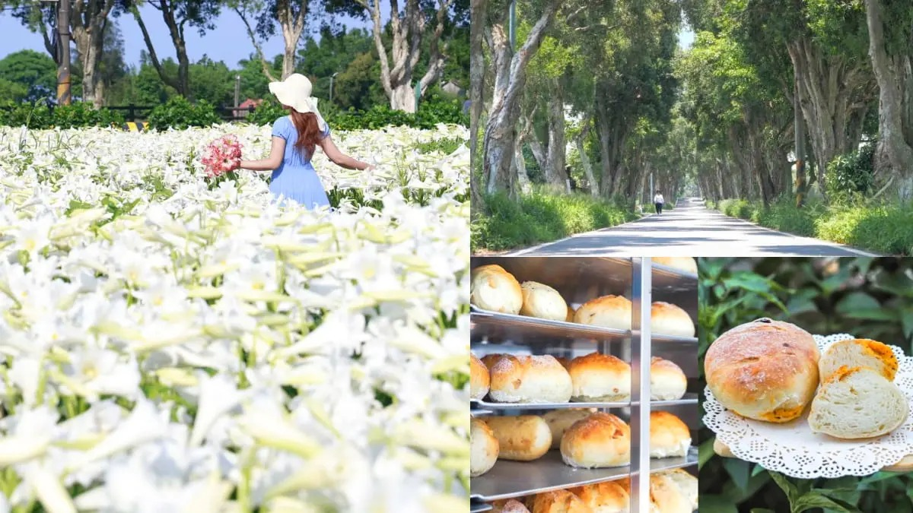搶優惠搶優惠搶優惠- [《愛童學會》把孩子變成故事主角！客製化兒童繪本限時85折](https://supertaste.tvbs.com.tw/offers/14457/?from=MAsticker)
- [《品冠旅遊》全台獨家玩日韓現省8000元！再享帝王蟹吃到飽](https://supertaste.tvbs.com.tw/offers/14432/?from=MAsticker)
- [《璦勒芬莊園》雲海第一排！阿里山最美旅宿入住現折1920元](https://supertaste.tvbs.com.tw/offers/14456/?from=MAsticker)

桃園賞花景點再＋１！小編發現這處「隱藏版百合花園」，最近開滿了多達２萬朵以上的鐵炮百合花，純白花海放眼望去壯觀又療癒，而且每人50元就可以入園參觀、仙氣美照拍到飽，花況更是一年比一年還要漂亮呢！看完花還能順遊附近的日系雜誌封面「綠意隧道」，再造訪有提供免費試吃麵包＋咖啡的「麵包工廠」來個下午茶，完美的１日遊行程這樣玩就對了！[**下載食尚APP，天天免費抽大獎！**](https://tvbs.to/9l873p)

## 本週優惠券，領起來

更多優惠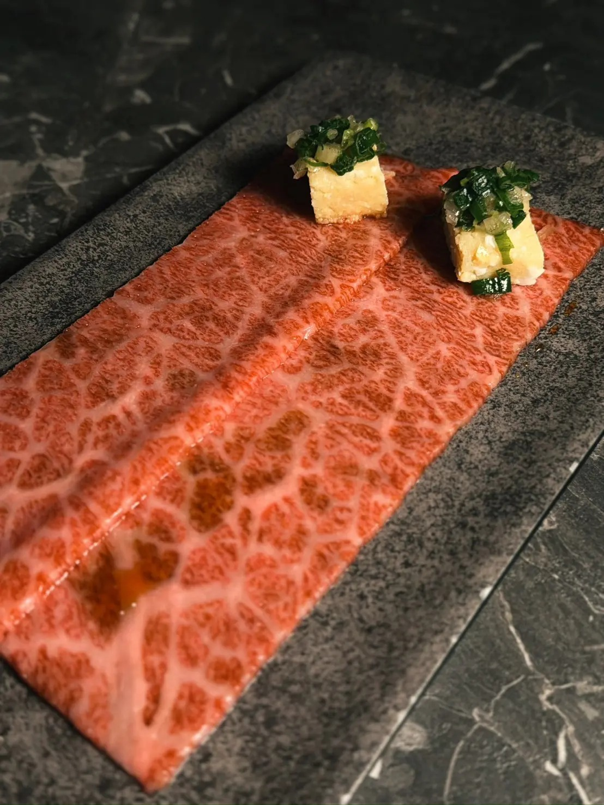送A5和牛三角包

京燒肉

台中去領券第２杯11元

丘森茶室

連鎖門市去領券本文目錄- [1白千層鐵砲百合花園｜景點位置、費用](#A01)
- [2白千層鐵砲百合花園｜今年花況](#A02)
- [3順遊２處吃玩景點](#A03)
- [401. 白千層綠色隧道](#A04)

顯示全部## 50元拍到飽！桃園百合祕境

桃園賞花景點「白千層鐵砲百合花園」，位於白千層綠色隧道入口旁的三合院中，先前4/25起已開放民眾入園賞花，每人須酌收50元清潔費。據說花園的由來，是園主為了追思母親，便在自家庭院前辛勤耕耘、種下了一整片鐵砲百合花，每朵花都飽含了對母親的思念。每年百合都會在母親節前夕逐漸盛開，而本週剛好迎來花況最美的時候！

廣告 - 內文未完請往下捲動

▲每逢母親節前夕，「白千層鐵砲百合花園」就會準時盛開，據說花況一年比一年還要美。（圖片來源：IG@[yijiun_lee](https://www.instagram.com/yijiun_lee/)，圖為4/29花況）

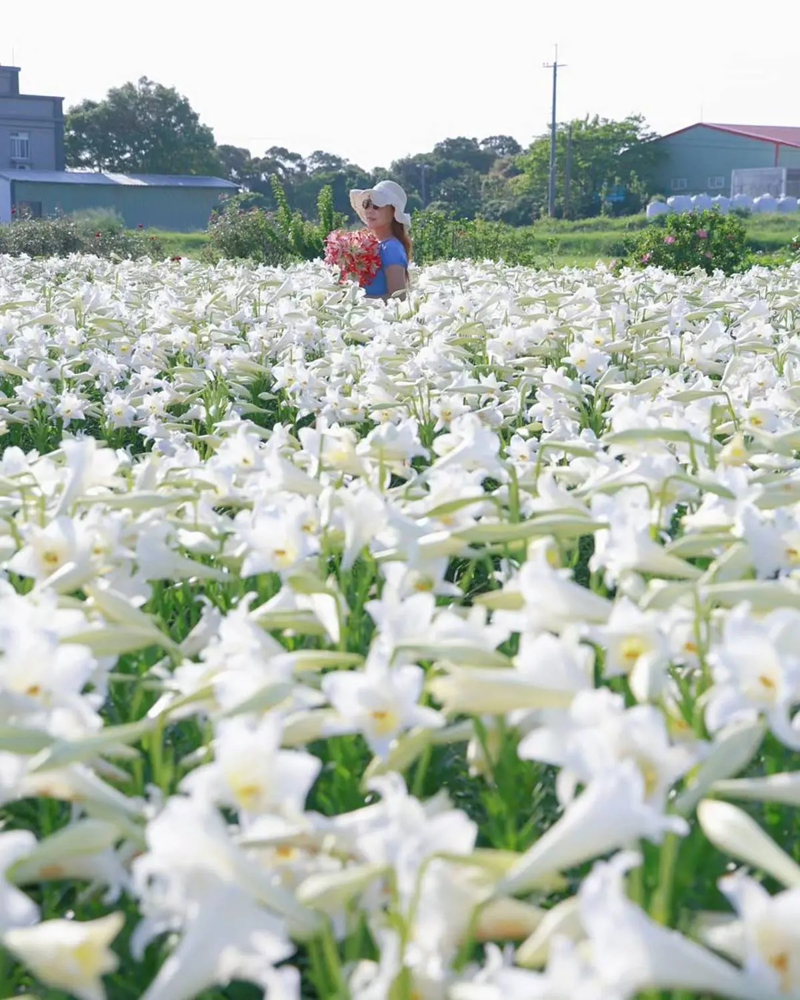▲花園就在白千層綠色隧道附近，民眾參觀要收入園清潔費50元。（圖片來源：IG@[yijiun_lee](https://www.instagram.com/yijiun_lee/)，圖為4/29花況）

**看更多：**[錯過等明年！全台唯一「康乃馨花田」破千坪100元拍爆，母親節快帶媽媽賞花](https://supertaste.tvbs.com.tw/travel/348915?from=readmore_article_348994)

## 逾２萬朵純白花海美翻

鐵砲百合花的別名是「麝香百合」，外型極似樂器嗩吶。今年種植了超過２萬朵鐵炮百合，形成一片純白無瑕又帶有陣陣獨特香氣的花海，漫步其中怎麼拍都好看，放眼望去超壯觀！園區各個角落還有黃牛裝置，以及獨角獸、熊熊氣球可以打卡呢。如果喜歡百合，也可購買百合盆栽帶回家，１盆100元。園主表示，花期預計會持續至母親節前，不過天氣也多少會影響花況，大家快快把握時間、帶媽媽來賞花啦！

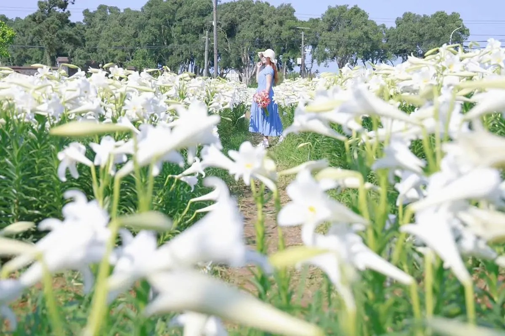▲鐵砲百合花外型很像嗩吶，且帶有獨特花香，又有「麝香百合」的別名。（圖片來源：IG@[yijiun_lee](https://www.instagram.com/yijiun_lee/)，圖為4/29花況）

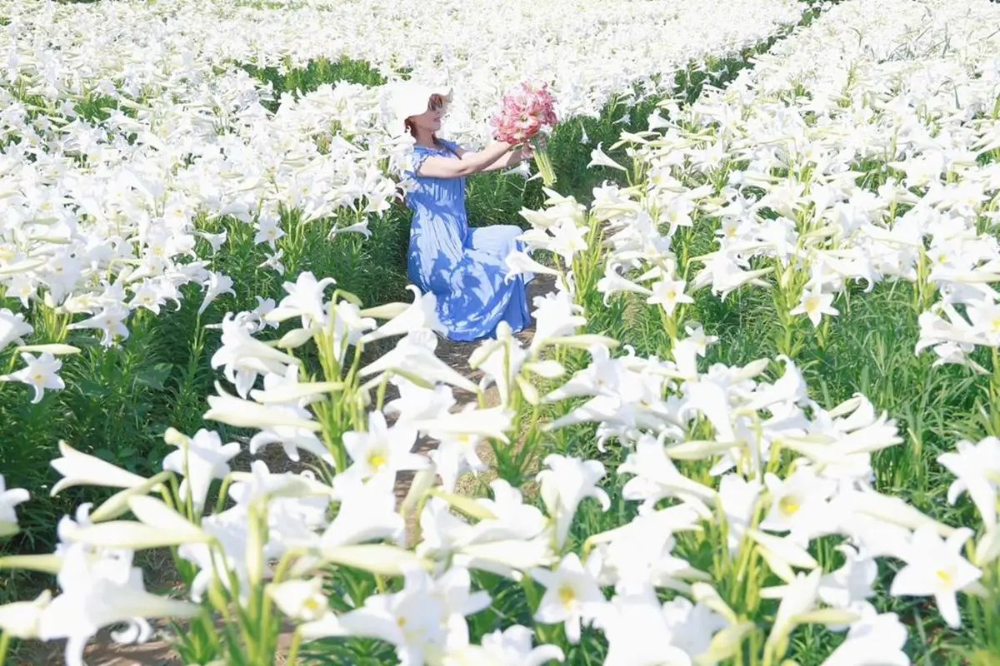▲今年園主種植了超過２萬朵鐵炮百合，一大片純白花海映入眼簾好美啊！（圖片來源：IG@[yijiun_lee](https://www.instagram.com/yijiun_lee/)，圖為4/29花況）

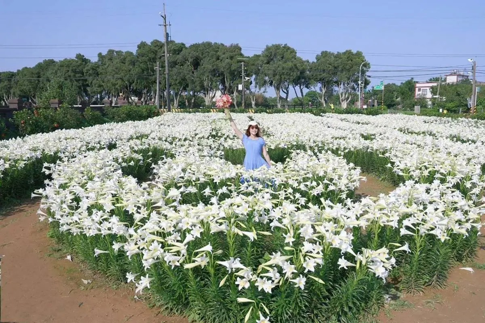▲中間還有１處愛心形狀的百合花海，站在中央從上往下拍的角度也美到炸裂！（圖片來源：IG@[yijiun_lee](https://www.instagram.com/yijiun_lee/)，圖為4/29花況）

白千層鐵砲百合花園

Google 評分：4.3地址：桃園市觀音區廣青路672巷50號電話：0937-813-599營業時間：週一至日07：30～18：30更多資訊### 順遊鄰近２處吃玩景點

## 01. 白千層綠色隧道 日系雜誌封面感美照

賞完美美的百合後別急著離開！記得順遊花園旁的祕境「白千層綠色隧道」。筆直的綠色隧道全長2.8公里，因兩旁種滿了超過700棵白千層樹而聞名，據說這些樹是在日治時期引入台灣的，樹齡可是阿公阿嬤的等級了呢！陽光透過林間縫隙灑下，站在隧道中央、用正面角度拍出去，就可以拍出日系文青雜誌封面的那種唯美感，難怪早在多年前就意外暴紅！

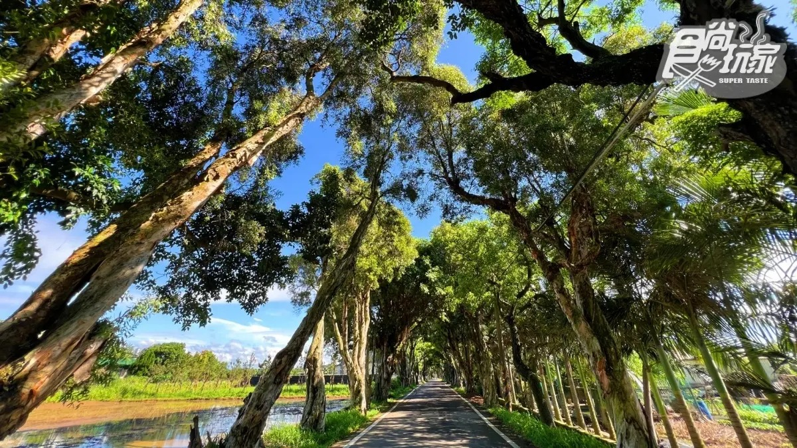▲在花園的一旁，還有全長2.8公里的白千層綠色隧道。（許庭瑋 攝）

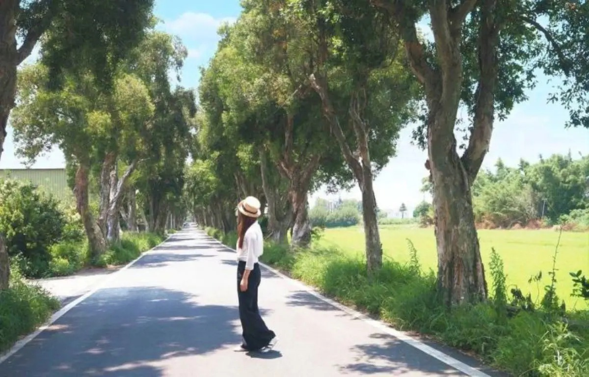▲隧道兩旁種滿了超過700棵的白千層樹，站在中央還能拍出日系文青雜誌封面的唯美感。（圖片來源：[蔣妮i拍](https://jiangnilife.com/post-404735980/)）

###### **白千層綠色隧道**地址：桃園市觀音區福山路二段51-1號

## 02. 全村的希望麵包工廠 免費試吃麵包、咖啡

去隧道拍完美照，別忘了去附近的「全村的希望麵包工廠」，是去年低調開幕的麵包工廠，散步走路４分鐘就能到。店內販售多款手工製作的歐式麵包、吐司，價位約落在80～180元內，口味很多元，最近還開始賣起了手工披薩呢。老闆除了大方提供免費試吃麵包，讓民眾可以嘗試喜歡的口味再購買，就連咖啡也是免費招待，麵包＋咖啡完全是最佳的下午茶組合。

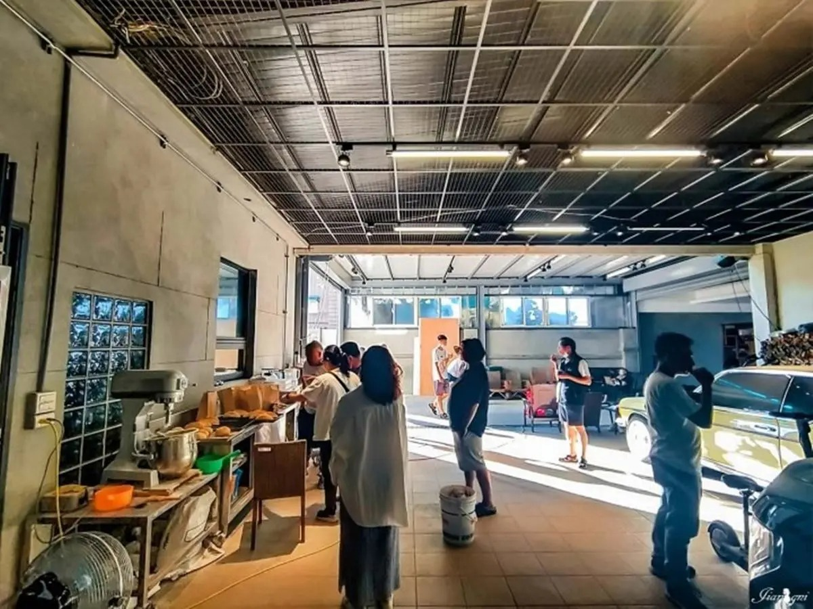▲「全村的希望麵包工廠」藏身在白千層隧道中，這裡是私人民宅，許多老饕都慕名而來。（圖片來源：[蔣妮の冰斗人生](https://jiangnilife.com/%e5%85%a8%e6%96%b0%e7%9a%84%e5%b8%8c%e6%9c%9b%e9%ba%b5%e5%8c%85%e5%b7%a5%e5%bb%a0-%e7%99%bd%e5%8d%83%e5%b1%a4%e7%b6%a0%e8%89%b2%e9%9a%a7%e9%81%93-%e8%a7%80%e9%9f%b3%e7%be%8e%e9%a3%9f-%e5%af%b5/)）

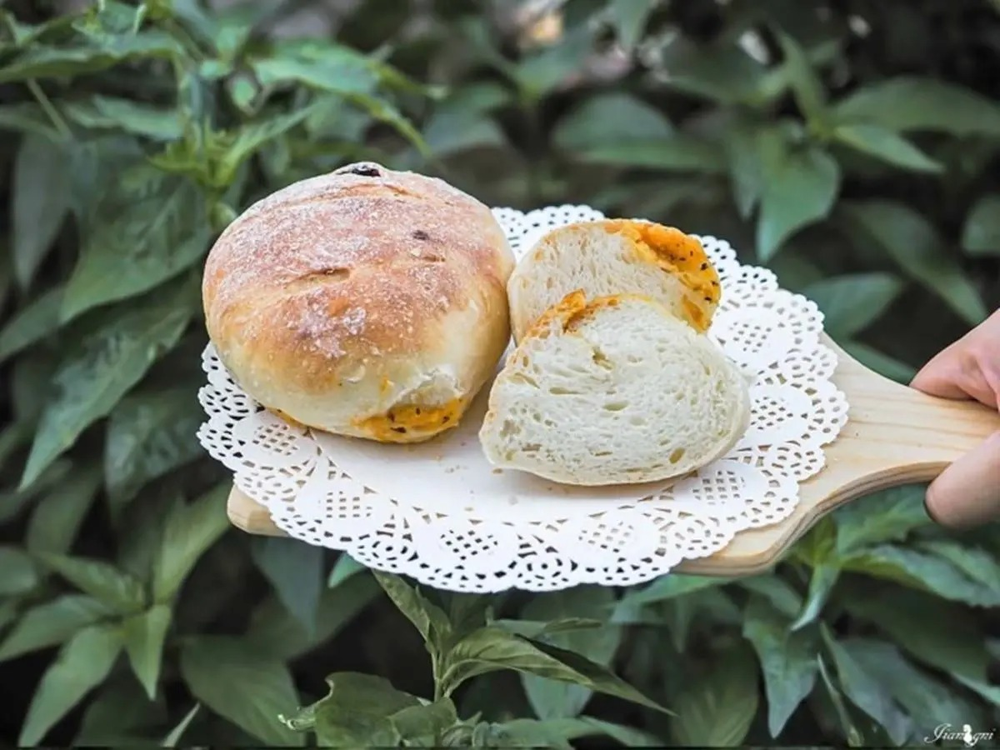▲樸實無華的手工歐式麵包，香醇的小麥香溢散在口齒間，健康清爽。（圖片來源：[蔣妮の冰斗人生](https://jiangnilife.com/%e5%85%a8%e6%96%b0%e7%9a%84%e5%b8%8c%e6%9c%9b%e9%ba%b5%e5%8c%85%e5%b7%a5%e5%bb%a0-%e7%99%bd%e5%8d%83%e5%b1%a4%e7%b6%a0%e8%89%b2%e9%9a%a7%e9%81%93-%e8%a7%80%e9%9f%b3%e7%be%8e%e9%a3%9f-%e5%af%b5/)）

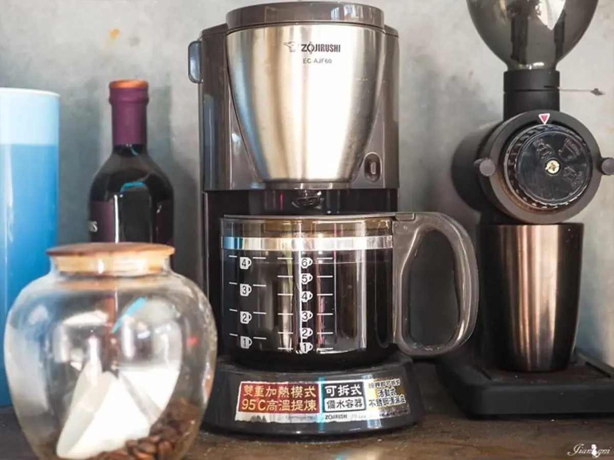▲老闆大方提供麵包免費試吃，愛吃再買，更佛心免費招待黑咖啡。（圖片來源：[蔣妮の冰斗人生](https://jiangnilife.com/%e5%85%a8%e6%96%b0%e7%9a%84%e5%b8%8c%e6%9c%9b%e9%ba%b5%e5%8c%85%e5%b7%a5%e5%bb%a0-%e7%99%bd%e5%8d%83%e5%b1%a4%e7%b6%a0%e8%89%b2%e9%9a%a7%e9%81%93-%e8%a7%80%e9%9f%b3%e7%be%8e%e9%a3%9f-%e5%af%b5/)）

全村的希望麵包工廠

Google 評分：4.2地址：桃園市觀音區福新路646號電話：0932-211-122營業時間：週一、四至五14：30～19：00／週六、日12：00～19：00（週二、三休）更多資訊
