桃園觀音的白千層綠韻大道是一個熱門的小秘境

特色就在於兩旁夾道的白千層

濃密的綠蔭覆蓋與白色斑薄的樹幹極有特色

怎麼拍都美!

**桃園觀音白千層綠韻大道參觀資訊**

參觀日期:2019.10.31

地點: 桃園市觀音區福山路二段

簡介: 全長2.8公里的白千層藝術大道，種植近700棵白千層樹

開放時間: 24小時(無門票)

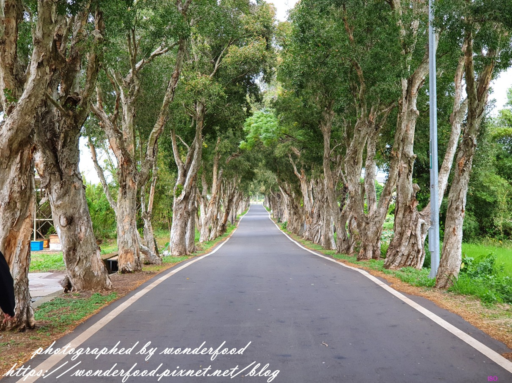

more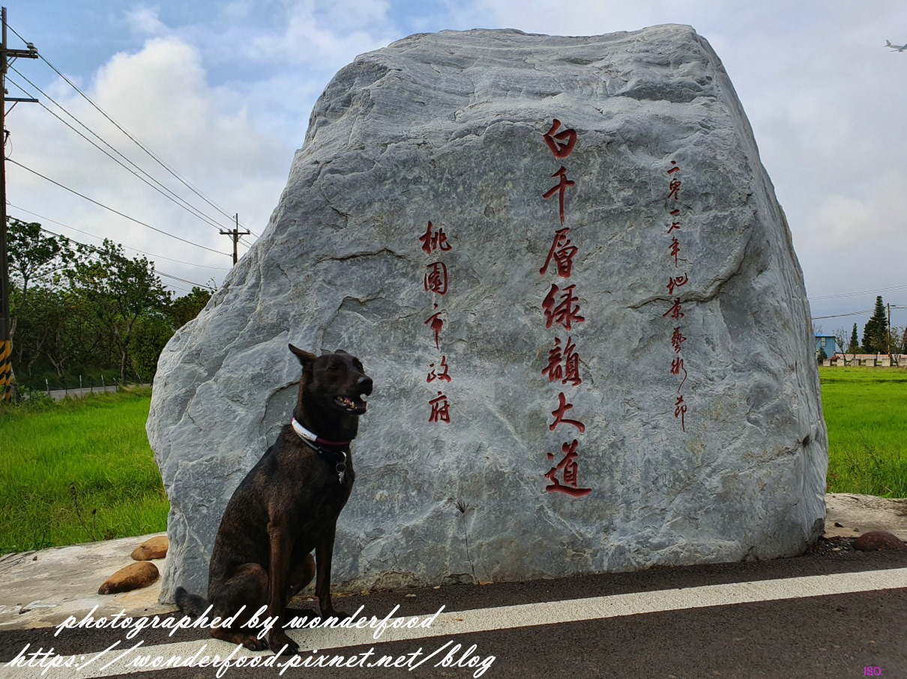

這天我們來桃園吃中餐和晚餐

獸大正在尋找適合下午時分走走逛逛，散步拍照的小景點

結果位在觀音鄉廣福村的這條綠道秘境雀屏中選

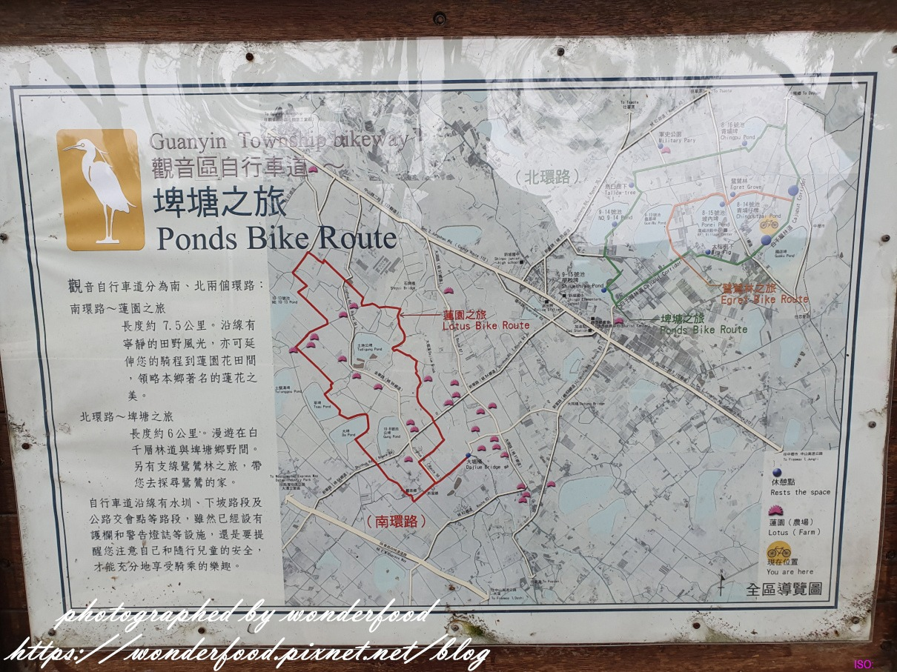

來看看地圖上的標示吧!

觀音鄉很美

若是沿著圖上推薦的自行車道繞一圈

更能領會埤塘、蓮園和鷺鷥林之美

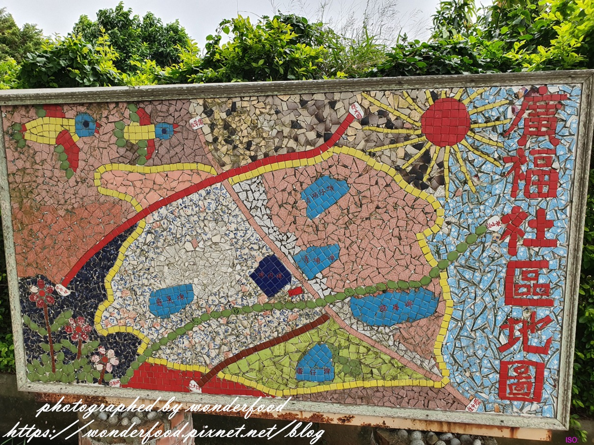

用壁貼做成充滿童趣的廣福社區地圖

我們今天不騎自行車

而是要走走圖上那條綠色的白千層林道

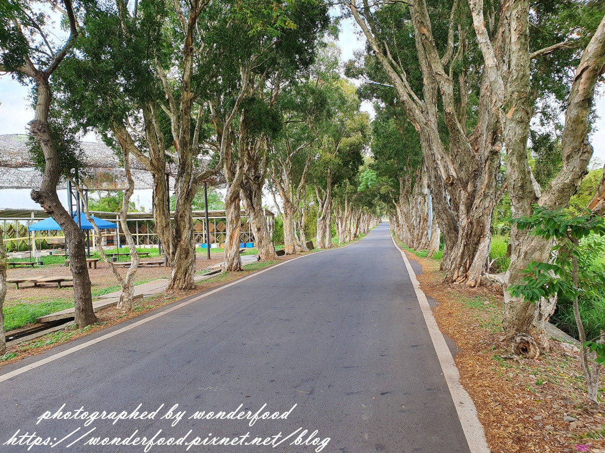

全長2.8公里的白千層大道

種植近700棵白千層樹

筆直的林道一眼望去

彷彿沒有盡頭

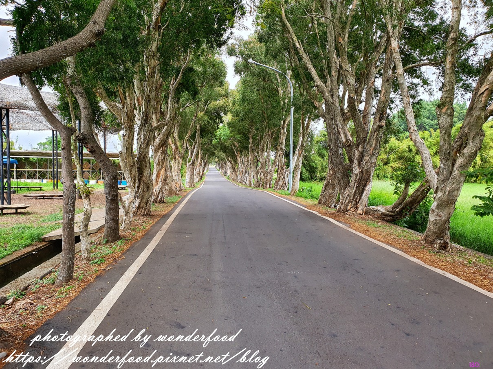

白千層是一種很有趣的樹種

隨著莖部內裡不斷孕育著新生，將外層老皮推出而斑駁脫落，層層疊疊般包覆著樹幹

也因這獨特生長方式而得名

而外層呈現剝落特色所以又俗稱<脫皮樹>

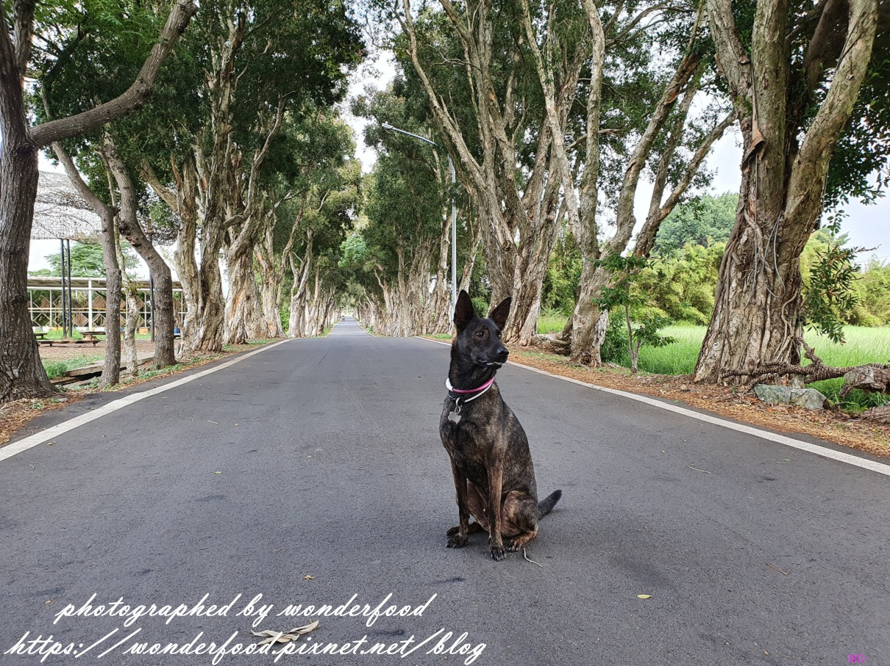

因為這個漂亮又獨特的風景

這裡成為了文青、網美、婚照照的熱門取景地

別人是拍日雜風美照

錢拔則是熱衷於拍錢錢帥照

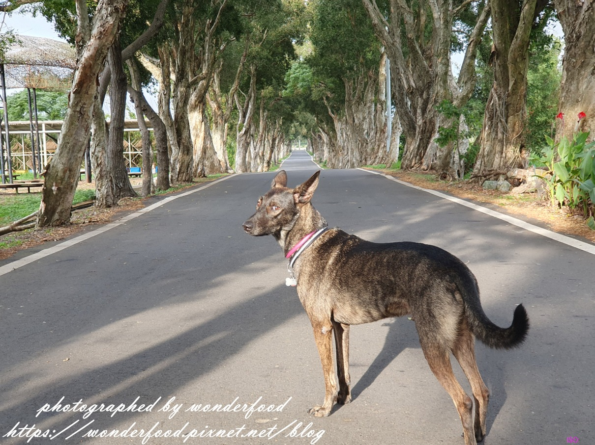

幫狗狗拍照不是一件簡單的事

雖然錢錢是一個稱職的犬模特

但牠有時候也會拍到不耐煩回頭瞪人

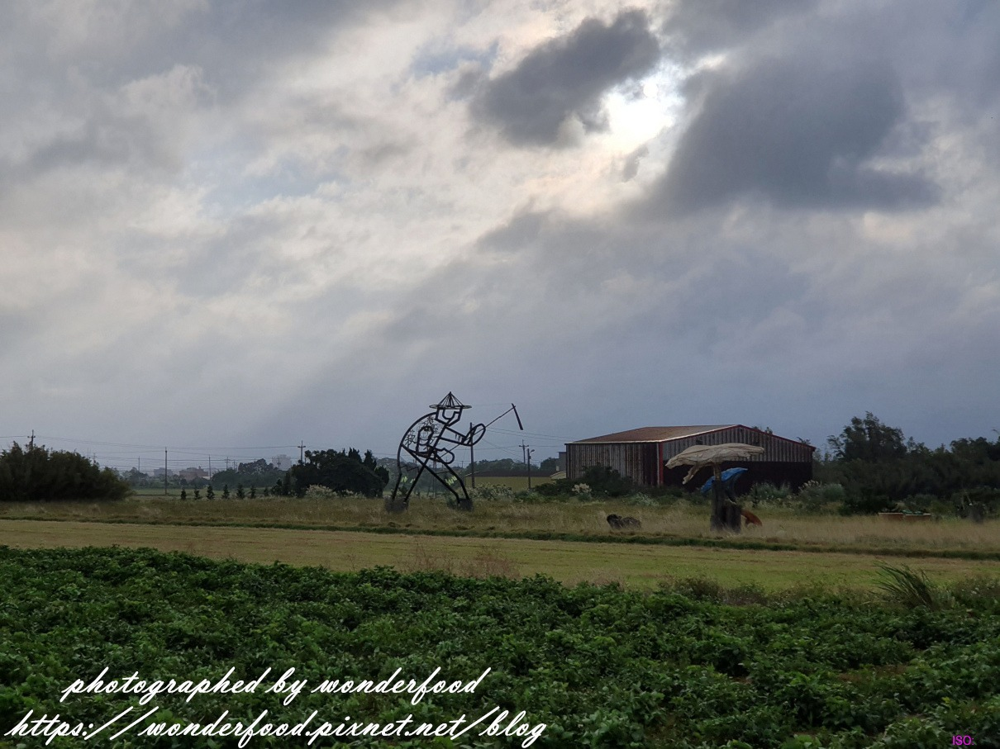

2017年桃園地景藝術節的主展場就在白千層林道旁邊

雖然目前大多拆除

但有些大型藝術創作仍保留

一邊享受綠蔭還能一邊觀賞田間的藝術品

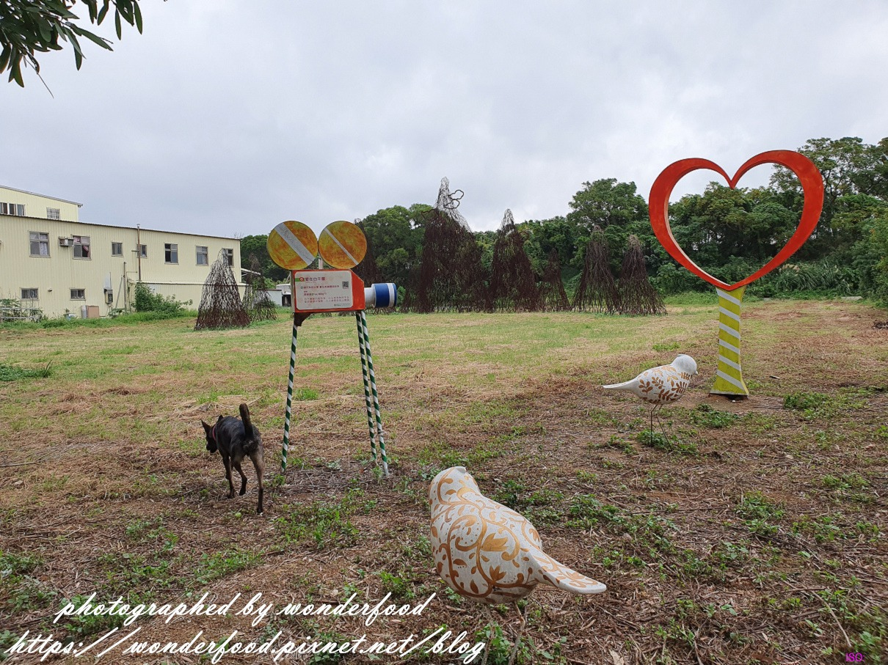

地景節過後

殘餘的藝術品散置

看起來格外頹廢

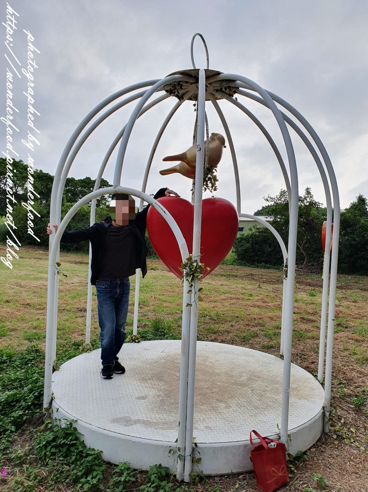

獸大與愛心鳥籠合照

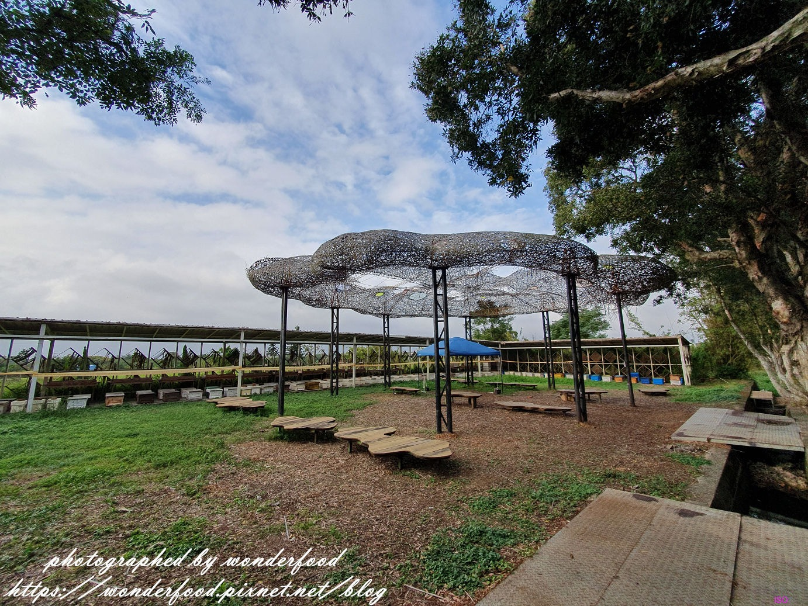

這個涼亭應該也是藝術品

但感覺沒啥實際用途

晴天不能遮陽，雨天無法遮雨

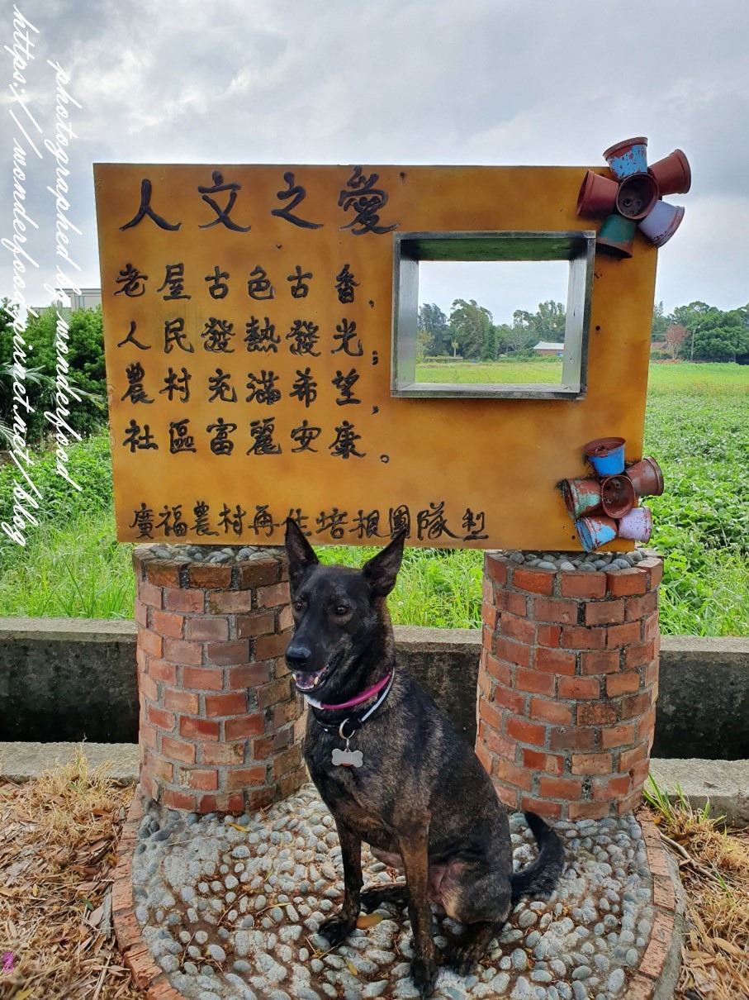

廣福農村的趣味拍照小景

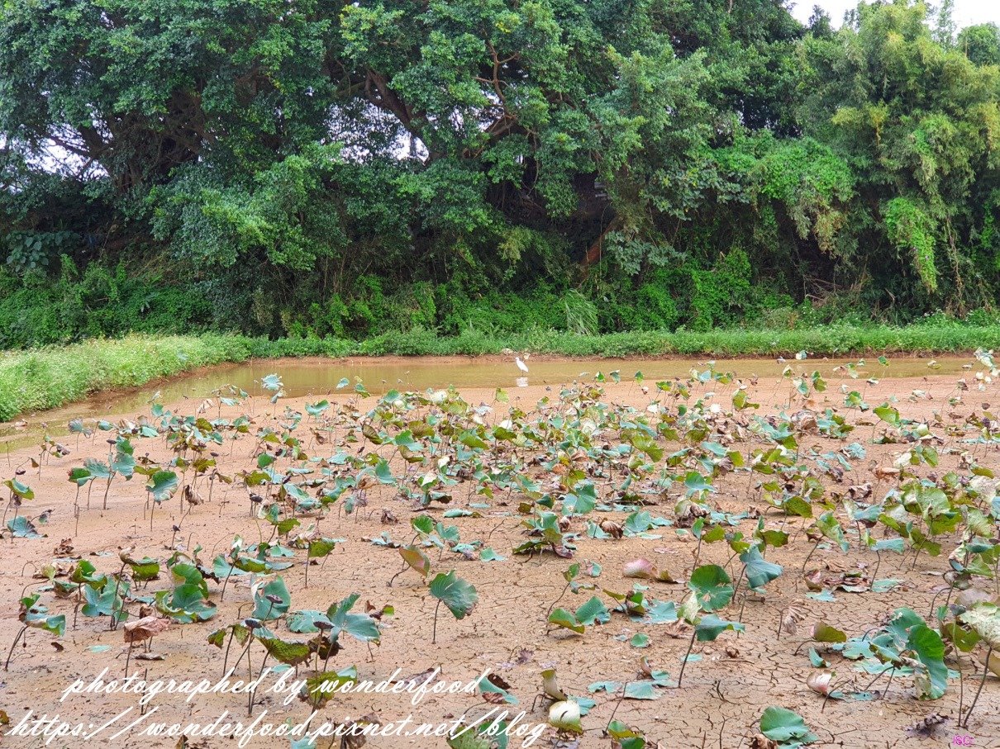

路旁經過的一畝蓮花池

池面都快乾涸了

蓮花也蕭條的垂頭喪氣

不過白鷺鷥靈活的跳來跳去倒是添了一絲生機

回頭再看一眼這美麗的白千層綠韻大道

觀音鄉還有許多景點

比如說: 古厝田園風光、美麗的海岸線、IG超夯的草漯沙丘、白沙岬燈塔、七月賞蓮等等

之後一一造訪!

**桃園觀音白千層綠韻大道參觀資訊**

參觀日期:2019.10.31

地點: 桃園市觀音區福山路二段

簡介: 全長2.8公里的白千層藝術大道，種植近700棵白千層樹

開放時間: 24小時(無門票)

延伸閱讀:[【白沙岬燈塔 & 觀音濱海遊憩區】桃園半日遊 ★ 觀燈塔、踩海浪、吹海風](https://wonderfood.pixnet.net/blog/post/228444359-%e3%80%90%e7%99%bd%e6%b2%99%e5%b2%ac%e7%87%88%e5%a1%94-%26-%e8%a7%80%e9%9f%b3%e6%bf%b1%e6%b5%b7%e9%81%8a%e6%86%a9%e5%8d%80%e3%80%91%e6%a1%83%e5%9c%92%e5%8d%8a%e6%97%a5%e9%81%8a)

[【桃園半日遊】軒獸微旅行之要吃也要動 ★ 野上麵包坊---第三航廈---祕密景點觀機---白沙岬燈塔---晚餐](https://wonderfood.pixnet.net/blog/post/201847942)

[【桃園白沙岬燈塔】觀音夕照 ★ 日落觀浪](https://wonderfood.pixnet.net/blog/post/201804730)

[【桃園機場觀機祕密景點】近距離看飛機 ★ 機場聯絡道](https://wonderfood.pixnet.net/blog/post/201783370)

/.article-content-inner/.tag-container-parent創作者介紹美食人生美食人生

/.author-profile/.article-content美食人生 發表在[痞客邦](https://www.pixnet.net)[留言](#comments)(1)人氣(13688)

/.author/#pixnet-ad-content-left-right-wrapper- 全站分類：[國內旅遊](https://www.pixnet.net/channel/domestic)
- 個人分類：[桃園](https://wonderfood.pixnet.net/blog/categories/8002975521)

▲top載入更多/.post-comment__body請先登入以發表留言。

/.post-comment__footerfunction pixPostRecommendWidget(config = {}) { return { postId: config.postId || '', limit: Number(config.limit || 6), endpoint: '/blog/get-widget-data?name=pixPostRecommend&postId=', loading: false, error: '', posts: [], fallbackImage: 'https://picsum.photos/seed/pixpostrecommend/800/500', async init() { if (!this.postId) { this.error = '缺少 postId'; return; } this.loading = true; this.error = ''; try { const response = await fetch(`${this.endpoint}${encodeURIComponent(this.postId)}`, { method: 'GET', headers: { 'Accept': 'application/json' } }); if (!response.ok) { throw new Error(`HTTP ${response.status}`); } const result = await response.json(); if (!result || Number(result.code) !== 0 || !Array.isArray(result.data)) { throw new Error('API 回傳格式不正確'); } this.posts = result.data .slice(0, this.limit) .map(item => ({ id: item.id, title: item.title || '', url: item.url || '#', published_at: item.published_at || '', date: item.date || '', time: item.time || '', timestamp: item.timestamp || 0, views: item.views || '', feature_image: item.feature_image || null, summary: item.summary || '', })); } catch (err) { console.error('[pixPostRecommendWidget]', err); this.error = '推薦文章載入失敗'; } finally { this.loading = false; } }, getImage(post) { return post.feature_image || this.fallbackImage; }, formatDate(post) { if (post.date) { return post.date.replace(/-/g, '/'); } return post.published_at || ''; } }; }/.article-footer
