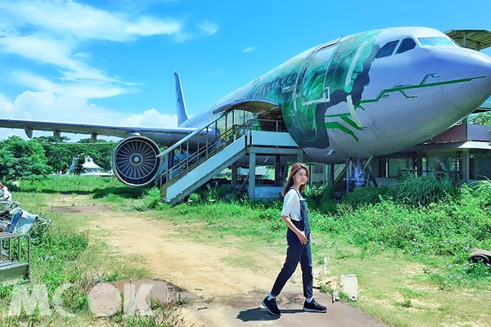
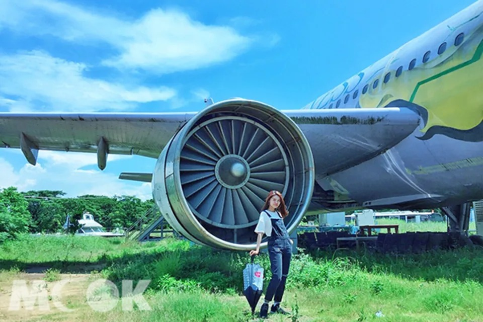
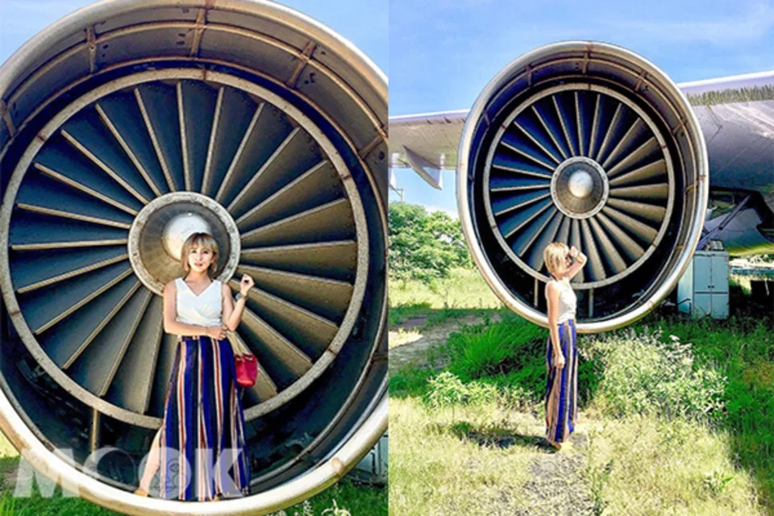
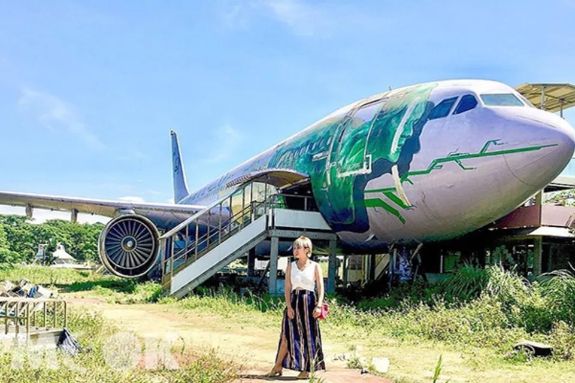
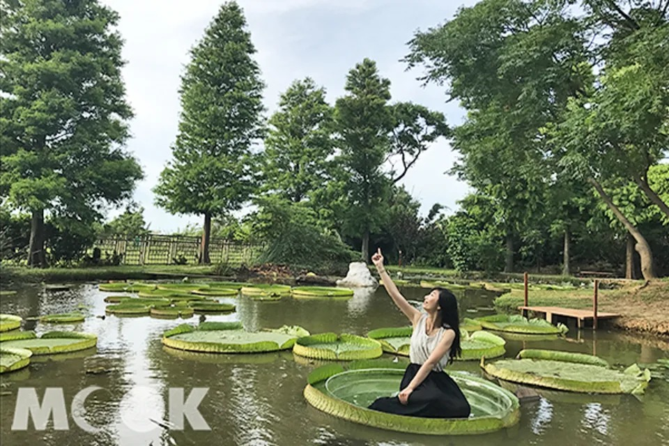
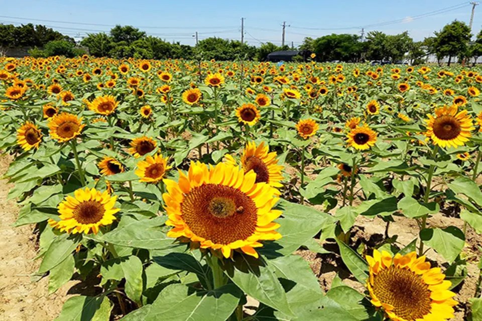
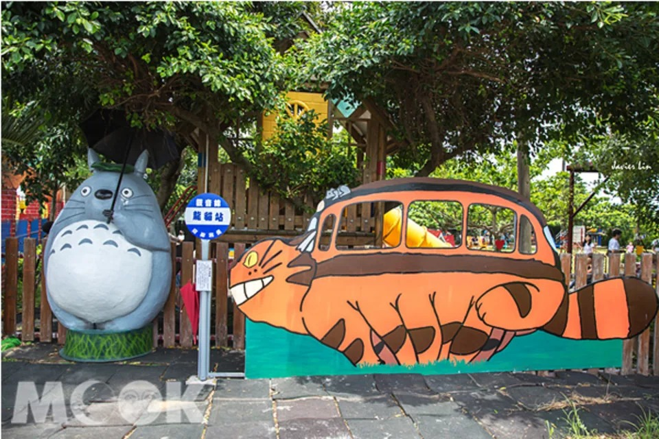
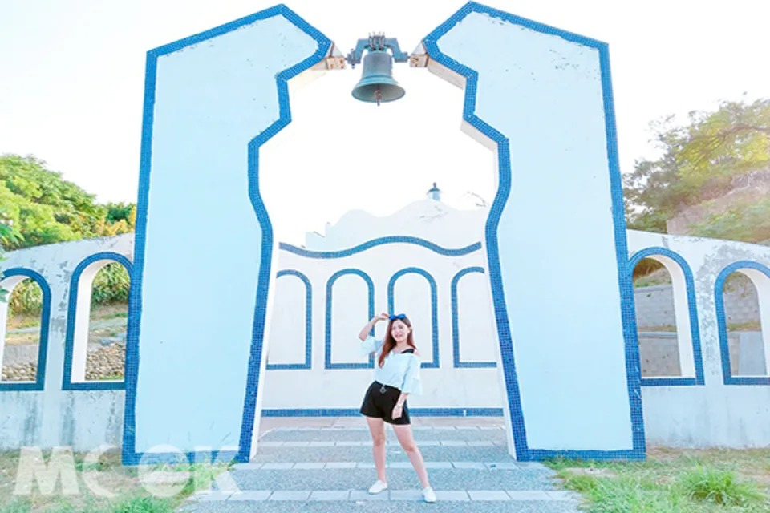

文／MOOK景點家編輯部整理報導2015年桃園觀音區曾要興建一座飛機景觀餐廳，還特別運來已報廢的真實飛機降落在餐廳外，不過因該建築屬違建，違反了土地使用管制規定，被強制拆除。不過飛機仍留在原地，因此吸引許多網友前往打卡拍照。

觀音飛機 (圖片提供／yuga1211)

原本要在觀音區打造的金湖景觀餐廳，從早期將真實飛機運來，到餐廳建築的施工，都引起當地人的重視，當時希望讓機場餐廳與蓮花季相呼應，帶起觀音區的觀光產業，後來因違建而拆除，令許多人感到不捨。

廣告廣告因違建而被拆除的金湖景觀餐廳外，有真實的飛機可拍照 (圖片提供／yuga1211)

不過當時的飛機依舊留在原地，日後吸引許多網友前往打卡拍照，想近距離地跟真實飛機合照，反而成為另類的景點。

飛機吸引許多網友前往打卡拍照 (圖片提供／fly_travel120205040610)

網友可以近距離接觸飛機 (圖片提供／fly_travel120205040610)

除了到觀音區跟飛機拍照外，還可以趁著蓮花季前往各大蓮園，體驗坐在大王蓮花上的樂趣。另外也能順遊其他景點，包括向陽農場、龍貓公車站、白沙岬燈塔等，可以安排一日遊行程。

2018桃園蓮花季開跑 (圖／桃園市政府)

佔地18,000坪的向陽農場，為北台灣最大的向日葵主題農場，每年5至10月是向日葵的花季，一株株比人還高的花，形成大片的金黃花海，景色十分壯觀，園區免費入園。另外還有窯烤區、戶外教學、DIY樂趣、紀念品、主題餐廳等。

向陽農場向日葵盛開 (圖／向陽農場)

觀音區龍貓公車站，位在和美幼稚園外牆，據說是幼稚園園長喜愛龍貓卡通，因此打造了龍貓公車站的場景，吸引了許多大小朋友們遊客前來駐足停留，園方更貼心的在一旁提供了雨傘道具，讓每個來拍照的遊客都能很快融入。

位於桃園觀音的龍貓公車 (圖片提供／林亦倫)

白沙岬燈塔位於觀音海岸，塔高約37公尺，僅次於墾丁鵝鑾鼻燈塔，是台灣唯一使用紅磚與石頭建造而成的，不同於台灣其他使用水泥構成的燈塔。燈塔旁的環形步道有湛藍結合純白的鐘塔，有地中海的浪漫景色。

白沙岬燈塔 (圖片提供／tiffany.1103)

【Info】觀音飛機地址：桃園市觀音區號中山路一段1115號

## **巨大飛機超吸睛！曼谷文創新指標好拍又好逛**

》[https://www.mook.com.tw/article.php?op=articleinfo&articleid=16960](https://www.mook.com.tw/article.php?op=articleinfo&articleid=16960)
