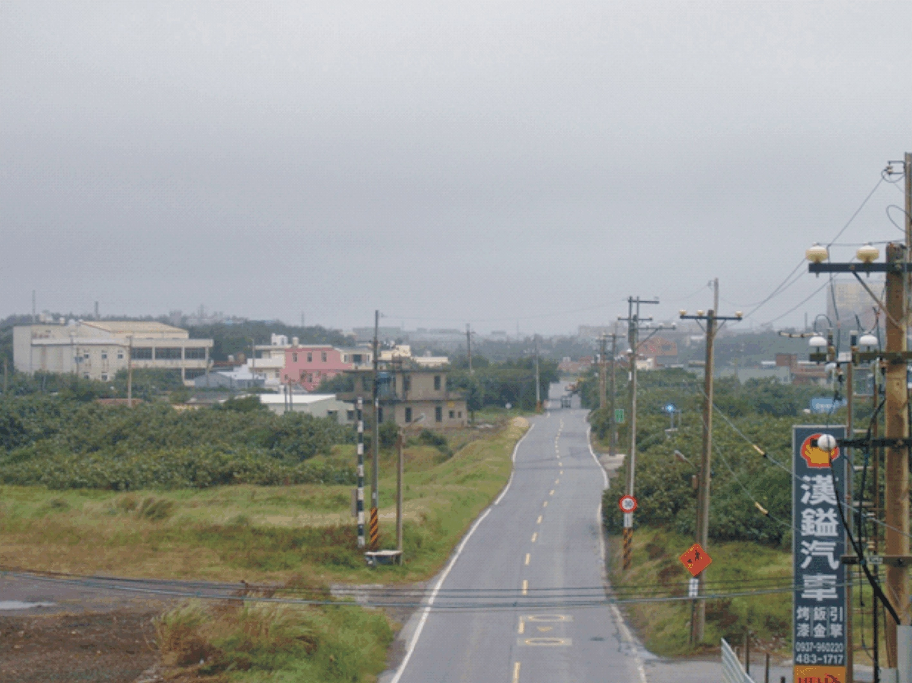

查看大圖創用CC姓名標示 3.0 台灣及其後版本(CC BY 3.0 TW +)## 石門水庫移民聚落─觀音草漯移民新村

創用CC姓名標示 3.0 台灣及其後版本(CC BY 3.0 TW +)88531收藏引用下載列印觀音草漯移民新村，位於觀音區草漯里忠孝路濱海端（原桃園縣觀音鄉草漯村18鄰），是數個石門水庫移民村中最早遷入的聚落，遷入的時間約為1957~1963年（民國46~52年）間。第一批遷入29戶，後期有7戶再安置進來，合計有36戶。

依照流程規定，移殖戶先經過抽籤決定移殖區位置並興建房舍，辦理完耕地貸款後，再抽籤分配耕地。部分移殖戶的配租耕地，因整地困難，水源不足，在難以耕種的狀況下，自行將房屋及田地出售。也有因不符合移殖資格（原耕地面積過小，無法參與分配土地房舍），而向原移殖戶購買房屋或土地的案例。

部分農地因地勢較高，並處於水源管線末端，灌溉不易。移殖戶為了改良土壤利於耕作，會在耕地表層挖除一層砂土，一來降低農地高度，便於引水灌溉，再將原本含沙、鹽成分高的土壤予以清除。為了克服臨海耕地土質的問題，移殖戶經過數年的養土引水，逐漸形成耕地的規模。當時主要農作物仍以稻米為主，有時種植花生、玉米、甘藷及西瓜等季節性農作物，或另種植蔬菜以及養些雞、鴨、鵝及豬隻等牲畜來增加收入。

早期政府為美化移殖區之移民成果，特選定此區為示範場所，初期設置警察所、村辦公室、樹林衛生室、灌溉井及灌溉渠道等多項公共建築。官方本欲在此設置小學一所，但因樹林新村移殖戶抗議，而改設置在樹林新村。2020年訪查現況，村辦公處及警察所早已因火災燒毀，只剩下登記為歷史建築的衛生室。

此區有土地公廟一座，名為「新興宮」，是從石門水庫新柑坪淹沒區遷移過來的。

### 基本資訊

展開- 關鍵詞[石門水庫](/zh-tw/datasearch?indexCode=Culture_Route&id=593957&keyword=%E7%9F%B3%E9%96%80%E6%B0%B4%E5%BA%AB)[石門水庫移民新村紀念碑](/zh-tw/datasearch?indexCode=Culture_Route&id=593957&keyword=%E7%9F%B3%E9%96%80%E6%B0%B4%E5%BA%AB%E7%A7%BB%E6%B0%91%E6%96%B0%E6%9D%91%E7%B4%80%E5%BF%B5%E7%A2%91)[忠孝路](/zh-tw/datasearch?indexCode=Culture_Route&id=593957&keyword=%E5%BF%A0%E5%AD%9D%E8%B7%AF)[復興宮](/zh-tw/datasearch?indexCode=Culture_Route&id=593957&keyword=%E5%BE%A9%E8%88%88%E5%AE%AE)[開漳聖王](/zh-tw/datasearch?indexCode=Culture_Route&id=593957&keyword=%E9%96%8B%E6%BC%B3%E8%81%96%E7%8E%8B)[新興宮](/zh-tw/datasearch?indexCode=Culture_Route&id=593957&keyword=%E6%96%B0%E8%88%88%E5%AE%AE)[觀音樹林衛生室](/zh-tw/datasearch?indexCode=Culture_Route&id=593957&keyword=%E8%A7%80%E9%9F%B3%E6%A8%B9%E6%9E%97%E8%A1%9B%E7%94%9F%E5%AE%A4)
- 原始資料連結[原始資料連結](https://cmsdb.culture.tw/route/0E98088E-7626-49C6-BD95-A81E82DEFA86)
- 資料來源[收存系統](/zh-tw/datasearch?query=%7B%22fetchIndex%22:%5B%22%E6%94%B6%E5%AD%98%E7%B3%BB%E7%B5%B1%22%5D%7D)
- 主題分類[空間、地域與遷徙](/zh-tw/datasearch?query=%7B%22subject%22:%22%E7%A9%BA%E9%96%93%E3%80%81%E5%9C%B0%E5%9F%9F%E8%88%87%E9%81%B7%E5%BE%99%22%7D)
- 建檔單位[京兆企業社](/zh-tw/datasearch?query=%7B%22createDept%22:%22%E4%BA%AC%E5%85%86%E4%BC%81%E6%A5%AD%E7%A4%BE%22%7D)

- 撰寫者巫秀千

- 地圖

- 相關建檔單位

### 觀音草漯移民新村衛生室

### 許厝港藻礁圳頭段

### 二二八、白色恐怖時期─郭茂順

更 多
