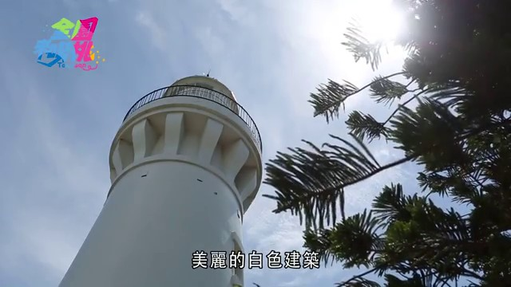
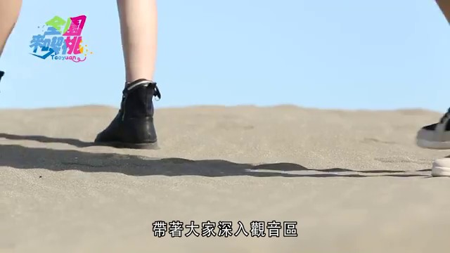
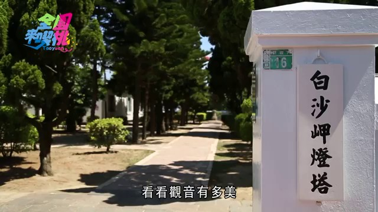

# 【全園來喫桃】第1集「觀音區」

## 影片基本資訊
- **資料編號**：`extra_040`
- **頻道來源**：桃園事
- **原始網址**：[https://www.youtube.com/watch?v=ZC3aSIDH5rw](https://www.youtube.com/watch?v=ZC3aSIDH5rw)
- **處理狀態**：success (whisper (base))
- **擷取時間**：2026-11-05T15:33:51+08:00

## 代表性畫面截圖
### 畫面 [00:23] - 其實這裡就是桃園觀音

### 畫面 [00:33] - 帶著大家深入觀音區

### 畫面 [00:37] - 觀音五瓜後家

### 畫面 [00:40] - 觀音五瓜後家

## 字幕逐字稿內容
- `[00:18]` 今天要去哪裡玩呢
- `[00:20]` 美麗的白色建築
- `[00:21]` 管理制生在地中海國家
- `[00:23]` 其實這裡就是桃園觀音
- `[00:25]` 可是北海灣著名的花會之鄉
- `[00:28]` 今日我們就跟著兩位藍衣
- `[00:30]` 各式北少女小繁跟張平
- `[00:33]` 帶著大家深入觀音區
- `[00:35]` 看看觀音
- `[00:36]` 五瓜歲
- `[00:37]` 觀音五瓜後家
- `[00:39]` 觀音五瓜歲
- `[00:40]` 觀音五瓜後家
- `[00:42]` 觀音五瓜後勝利
- `[00:45]` 打燈桃
- `[01:01]` 一秒鐘
- `[01:07]` 一秒鐘
- `[01:08]` 一秒鐘
- `[01:09]` 一秒鐘
- `[01:10]` 一秒鐘
- `[01:17]` 一秒鐘
- `[01:18]` 一秒鐘
- `[01:19]` 一秒鐘
- `[01:20]` 一秒鐘
- `[01:21]` 一秒鐘
- `[01:22]` 一秒鐘
- `[01:23]` 一秒鐘
- `[01:24]` 一秒鐘
- `[01:27]` 我說你們兩個打算要淘汰到什麼時候
- `[01:30]` 阿卡關就不用蓋消息了
- `[01:32]` 看美景不用出國
- `[01:33]` 桃園就很多
- `[01:35]` 這個白沙甲燈桃園區
- `[01:37]` 建於1899年
- `[01:38]` 可是有上百年歷史
- `[01:40]` 白色建築
- `[01:41]` 搭配藍天白雲
- `[01:43]` 好像來到希臘
- `[01:45]` 而且今天恨幸運
- `[01:46]` 製作單位還準備了
- `[01:48]` 著名的聯花跑車戴布
- `[01:50]` 這是聯花跑車
- `[02:05]` 你看
- `[02:06]` 自己用腳動
- `[02:19]` 要接觸大自然
- `[02:32]` 就是不要在家裡吹冷心
- `[02:34]` 所以大家是沒錯
- `[02:35]` 接近大自然
- `[02:38]` 那我們現在
- `[02:42]` 觀音真的是拍照的好地方
- `[02:44]` 整個燈桃園區
- `[02:46]` 都是地中海風格
- `[02:47]` 怎麼拍這麼美
- `[02:49]` 好啦
- `[02:50]` 兩個主持人
- `[02:51]` 真的是要一點點
- `[02:52]` 炒女神之路邁進
- `[02:54]` 重點是來到觀音
- `[02:56]` 最好的交通工具
- `[02:58]` 就是腳踏車了
- `[02:59]` 悠悠觀音
- `[03:00]` 蓋受觀音的漫活態度
- `[03:02]` 而且觀音區
- `[03:03]` 不僅有美景
- `[03:05]` 還有充滿歷史感的建築物跟廟宇
- `[03:08]` 來到這裡
- `[03:09]` 也別忘了要到廟宇走一走
- `[03:11]` 到廟甘群寺
- `[03:13]` 供奉著觀音地名遊來的觀音時像
- `[03:15]` 蓋受這裡的妝鏡氛圍
- `[03:17]` 似乎也能感受到神明
- `[03:20]` 對觀音人民的祝福與保護
- `[03:47]` 這兩個主持人
- `[03:48]` 真的很聰明
- `[03:49]` 沒錯
- `[03:50]` 其實觀音靠海
- `[03:52]` 這裡的大風車
- `[03:53]` 除了可以提供電力之外
- `[03:55]` 觀光客來到這邊
- `[03:56]` 當然又是可以好好拍照一番
- `[03:59]` 來
- `[04:00]` 一、二、三
- `[04:01]` 還有出神圍拜
- `[04:04]` 你看看
- `[04:05]` 這裡到處都可以看到大風車
- `[04:08]` 有好幾個壯觀的風車連成一排
- `[04:11]` 但是話說回來
- `[04:12]` 除了玩樂之餘
- `[04:13]` 今天給兩位連花跑車
- `[04:15]` 這種大王班的禮運
- `[04:17]` 可是有任務在身
- `[04:18]` 就是要找出觀音的四大王者
- `[04:21]` 昆蟲之王
- `[04:22]` 竹竹之王
- `[04:23]` 廟宇之王
- `[04:24]` 跟植物界天王了
- `[04:26]` 你們可別子過著玩
- `[04:28]` 趕快去執行你們的政府吧
- `[04:31]` 我們要去哪兒了
- `[04:32]` 跟我走就對了
- `[04:34]` 走到等一下
- `[04:35]` 我們要去哪兒
- `[04:36]` 等一下
- `[04:37]` 你到底要去哪兒
- `[04:39]` 我們不是今天要去觀音島
- `[04:41]` 四大王者嗎
- `[04:42]` 對
- `[04:43]` 對 我跟妳講
- `[04:44]` 真的講
- `[04:45]` 跟妳講真的是太簡單了
- `[04:47]` 我們馬上就要找第一個王者
- `[04:49]` 真的講的
- `[04:50]` 跟我走就對了
- `[04:51]` 有那麼簡單
- `[04:52]` 真的
- `[04:53]` 你跟我走就對了
- `[04:54]` 好 走
- `[04:55]` 奇怪
- `[04:56]` 沒錯 降到昆蟲之王
- `[04:59]` 當然就是指我們的秘峰
- `[05:01]` 關於這裡
- `[05:02]` 可是有一個秘峰自然放幕生態區
- `[05:05]` 可以進去離觀察秘峰生態
- `[05:07]` 而且生態區的主人
- `[05:09]` 跟秘峰相處將近半個世紀之久
- `[05:12]` 要找到昆蟲之王
- `[05:13]` 就要請主人來幫忙囉
- `[05:21]` 妳知道為什麼我要帶妳來這裡嗎
- `[05:23]` 為什麼
- `[05:24]` 因為我們要來觀音島
- `[05:25]` 昆蟲之王
- `[05:27]` 昆蟲之王
- `[05:29]` 昆蟲之王
- `[05:30]` 昆蟲之王
- `[05:31]` 難道是我們
- `[05:32]` 四大王者之一的
- `[05:34]` 對
- `[05:35]` 那什麼是昆蟲之王
- `[05:37]` 妳不知道什麼是昆蟲之王
- `[05:38]` 不知道
- `[05:39]` 有關係
- `[05:40]` 我帶妳去找大哥
- `[05:41]` 大哥會告訴我們
- `[05:42]` 大哥
- `[05:44]` 妳這個嗎
- `[05:46]` 這個在你秘峰
- `[05:48]` 天啊
- `[05:49]` 超好多的
- `[05:51]` 妳是怎麼進去的
- `[05:52]` 妳看到了
- `[05:53]` 妳是第一次看見
- `[05:55]` 妳在找什麼大哥
- `[05:56]` 找昆蟲王
- `[05:57]` 對
- `[05:58]` 找昆蟲王
- `[06:01]` 昆蟲王
- `[06:02]` 我們四大王者之一
- `[06:04]` 我們四大王者之一
- `[06:05]` 很有王
- `[06:06]` 不要怎麼找啊大哥
- `[06:08]` 這個
- `[06:09]` 好幾萬次的功夫
- `[06:11]` 真的是否想找昆蟲
- `[06:13]` 太胡先生了
- `[06:16]` 大哥
- `[06:17]` 我們是不是現在很冷靜
- `[06:18]` 他才不會挑釁我嗎
- `[06:19]` 不要
- `[06:20]` 不要躲
- `[06:21]` 我們要冷靜
- `[06:23]` 平靜
- `[06:24]` 他們是我們毫無煩
- `[06:25]` 太激烈不行
- `[06:26]` 對
- `[06:27]` 動作太平靜了
- `[06:28]` 他那裡是不是跟他們成為好朋友了
- `[06:29]` 對啊
- `[06:30]` 對啊
- `[06:31]` 不要解他的習性
- `[06:32]` 把動作放溫而已
- `[06:33]` 那要怎麼找昆蟲
- `[06:35]` 你往哪
- `[06:36]` 你便宜
- `[06:37]` 你便拿起來慢慢找
- `[06:39]` 因為他是最辛苦的
- `[06:40]` 你便宜
- `[06:42]` 每一片都有跟從在
- `[06:43]` 第一次這麼進去
- `[06:45]` 已經看到耶
- `[06:46]` 對
- `[06:47]` 我先生就是我們眼前
- `[06:49]` 一整箱
- `[06:51]` 一整箱
- `[06:52]` 還要找昆蟲王
- `[06:53]` 大哥
- `[06:54]` 你每天跟他們招戲下去
- `[06:56]` 對啊
- `[06:57]` 要為他們是不是
- `[06:58]` 不是為他們
- `[06:59]` 不是要整理
- `[07:00]` 管理
- `[07:01]` 管理他們
- `[07:02]` 所以我找到昆蟲王
- `[07:03]` 也就是大哥
- `[07:04]` 對
- `[07:05]` 對 昆蟲王
- `[07:06]` 大哥是昆蟲王
- `[07:07]` 大哥是昆蟲王
- `[07:08]` 你要管理他們太厲害了
- `[07:09]` 我是昆蟲王之王
- `[07:11]` 昆蟲王之王
- `[07:12]` 我們找到昆蟲王之王了
- `[07:14]` 他體型跟小的
- `[07:16]` 功峰不一樣
- `[07:17]` 體型比較大是不是
- `[07:18]` 他的肚子特別的八大
- `[07:20]` 對不對
- `[07:21]` 他是負責在採管
- `[07:22]` 對啦
- `[07:23]` 看到那麼多的節目
- `[07:25]` 就那一隻昆蟲
- `[07:26]` 全部都是昆蟲
- `[07:27]` 剩下的
- `[07:28]` 對
- `[07:29]` 他的小孩有那麼多
- `[07:30]` 對
- `[07:31]` 好幾萬一次
- `[07:32]` 所以剩下每一個
- `[07:33]` 這個像這個
- `[07:34]` 一個箱子
- `[07:35]` 都會有一個昆蟲王
- `[07:36]` 對 一箱一隻
- `[07:37]` 一箱一隻
- `[07:38]` 不能有兩隻
- `[07:39]` 有兩隻的話
- `[07:40]` 就會倒下
- `[07:41]` 一箱不容易
- `[07:42]` 對
- `[07:43]` 風王一天
- `[07:44]` 可以升一千
- `[07:45]` 不到兩千隻小孩
- `[07:47]` 一千五
- `[07:48]` 那兩千隻
- `[07:49]` 冰冰冰的一張姿勢
- `[07:51]` 對
- `[07:52]` 本身真的確實是我
- `[07:54]` 因為本身這個蜜蜂
- `[07:55]` 他的壽命沒有很長
- `[07:56]` 一出生就開始勞動
- `[07:58]` 多到什麼位置
- `[08:00]` 另外一邊的蜜月多
- `[08:02]` 他就夜秦分
- `[08:03]` 夜秦分的話
- `[08:04]` 就壽命就夜短
- `[08:07]` 這樣怎麼有一點
- `[08:09]` 所以說蜜蜂
- `[08:10]` 他有一點過勞死的氣象
- `[08:11]` 過勞死的氣象
- `[08:12]` 過勞死的氣象
- `[08:13]` 對
- `[08:14]` 我們趕快解決我們的任務
- `[08:16]` 對
- `[08:17]` 風王
- `[08:18]` 是在那個很多蜜月那邊
- `[08:21]` 在這邊
- `[08:22]` 我們找到風王了
- `[08:24]` 找到了
- `[08:26]` 風王看到了
- `[08:27]` 看到了
- `[08:28]` 找到蜜蜜飯了
- `[08:29]` 還有發生的風王
- `[08:31]` 第一次那麼近距離看到風王
- `[08:33]` 來看看
- `[08:34]` 那現在還近鏡子讓你看
- `[08:35]` 真的
- `[08:36]` 他還有危險的感覺
- `[08:38]` 通知說
- `[08:39]` 很多蜜蜂
- `[08:40]` 我不是的
- `[08:41]` 實在是蜜蜂
- `[08:42]` 真的
- `[08:43]` 大家可以觀察一下那個規律
- `[08:46]` 旁邊真的是很關巧的
- `[08:47]` 在服飾場
- `[08:49]` 謝謝大哥
- `[08:50]` 帶我們這麼一趟近期展示的感覺
- `[08:54]` 也就是我們的
- `[08:55]` 是大王者
- `[08:56]` 破解了
- `[08:58]` 其中一關
- `[08:59]` 對
- `[09:00]` 其中一關
- `[09:03]` 你們兩個真的是好棒
- `[09:05]` 居然可以找到蜜蜂重蜜王
- `[09:07]` 被這麼多蜜蜂環繞之下
- `[09:09]` 給我得點小聲趴趴
- `[09:12]` 請好主人吳大哥
- `[09:13]` 可是蜜蜂界的王者之王
- `[09:15]` 而且吳大哥
- `[09:16]` 還有一樣很肥秀的東西
- `[09:18]` 要跟你們兩人分享
- `[09:21]` 好 我現在來歌這個
- `[09:23]` 很特殊的一個風產品
- `[09:25]` 是為了品嘗品嘗
- `[09:27]` 是什麼東西啊
- `[09:29]` 真的
- `[09:30]` 好緊張
- `[09:31]` 風蜜口香感
- `[09:33]` 風蜜口香
- `[09:35]` 對
- `[09:36]` 是什麼
- `[09:37]` 我們可以露眼看
- `[09:39]` 到那個防防的那個東西嗎
- `[09:41]` 對
- `[09:42]` 大哥現在都把它割下來
- `[09:44]` 上面還有蜜蜂
- `[09:45]` 我們再跟他們搶食物嗎
- `[09:51]` 然後我們在神經病來找蜜蜂
- `[09:54]` 天啊
- `[09:58]` 超遠蛋白在裡面的感覺
- `[10:00]` 對
- `[10:01]` 現在我們來吃是黃色的
- `[10:03]` 它大哥
- `[10:04]` 黃推薦的
- `[10:05]` 蜂蜜口香感
- `[10:06]` 來看
- `[10:07]` 大家看一下
- `[10:08]` 芝麻蜜的蜂蜜
- `[10:10]` 芝麻蜜的蜂蜜
- `[10:11]` 它的流汁
- `[10:12]` 它的流汁
- `[10:14]` 最天然的
- `[10:15]` 真的
- `[10:16]` 好吃
- `[10:23]` 它們吃一個
- `[10:24]` 它們吃完的蜂蜜
- `[10:28]` 它是蒸的
- `[10:29]` 它是流
- `[10:30]` 你看就是剛剛割下來的
- `[10:32]` 非常的天然
- `[10:33]` 最新鮮的蜂蜜對
- `[10:35]` 天啊
- `[10:36]` 它還好吃
- `[10:37]` 蜂蜜蜂
- `[10:38]` 好吃
- `[10:41]` 農場主人吳大哥
- `[10:42]` 把這群蜜蜂
- `[10:43]` 當成自己的小孩在照顧
- `[10:45]` 提供蜜蜂
- `[10:46]` 無獨有健康的環境
- `[10:47]` 讓來到這裡的遊客
- `[10:49]` 不僅可以進去
- `[10:50]` 離觀察蜜蜂生態
- `[10:51]` 還能品牆到各種
- `[10:53]` 不同的蜂蜜
- `[10:54]` 真的是好吃又好玩
- `[10:56]` 第一個王者就這麼厲害
- `[10:58]` 想必第二個王者
- `[11:00]` 也一定非常有特色
- `[11:02]` 聞到聞到
- `[11:23]` 聞到什麼
- `[11:24]` 怎麼會這樣聞
- `[11:25]` 跟你說
- `[11:27]` 你現在所在的地方
- `[11:29]` 是擁有竹竹之王的號稱
- `[11:32]` 竹竹之王
- `[11:34]` 沒錯
- `[11:35]` 很期待吧
- `[11:36]` 不知道是什麼吧
- `[11:37]` 你想知道是什麼樣
- `[11:39]` 我再進去查查
- `[11:59]` 聞到聞到
- `[12:00]` 聞到
- `[12:01]` 聞到老德莊莎
- `[12:06]` 吃吃看
- `[12:07]` 吃吃看
- `[12:08]` 好香
- `[12:12]` 吃的這一家
- `[12:13]` 就是剛剛講的
- `[12:14]` 有竹竹
- `[12:15]` 竹竹之王美春
- `[12:17]` 趕快試試看
- `[12:18]` 趕快試看
- `[12:19]` 這家竹竹好香
- `[12:20]` 特別介紹一下
- `[12:22]` 因為它這個
- `[12:23]` 竹竹很厲害
- `[12:24]` 很厲害
- `[12:25]` 你還在哪裡
- `[12:26]` 加菜給大家看一下
- `[12:27]` 你看
- `[12:28]` 炸得非常酥脆
- `[12:30]` 金黃色的感覺
- `[12:32]` 有沒有
- `[12:33]` 炸得酥脆
- `[12:34]` 感覺一樣
- `[12:35]` 很帥
- `[12:37]` 我要告訴你
- `[12:38]` 厲害的出在哪裡
- `[12:42]` 發現
- `[12:43]` 發現什麼
- `[12:44]` 很脆
- `[12:45]` 而且它
- `[12:46]` 很脆
- `[12:46]` 吃軟的
- `[12:48]` 外酥內軟
- `[12:50]` 對
- `[12:51]` 真的
- `[12:52]` 臭豆腐
- `[12:53]` 好吃就是它在於外酥內軟
- `[12:55]` 很脆
- `[12:56]` 而且跟你們說
- `[12:58]` 吃臭豆腐
- `[12:59]` 一定要配炮菜
- `[13:00]` 還有醬料
- `[13:01]` 炮菜也是覺得這樣
- `[13:03]` 炮菜跟醬料
- `[13:04]` 老闆他們這一家很透明
- `[13:07]` 他們的醬料有獨特的迷方
- `[13:09]` 炮菜也很甘爽
- `[13:11]` 讓我們一口也接一口
- `[13:13]` 所以你要
- `[13:14]` 炮豆腐
- `[13:15]` 加炮菜
- `[13:16]` 加配料
- `[13:17]` 一口吃下
- `[13:18]` 我來看看
- `[13:23]` 是不是很好吃
- `[13:24]` 我已經受不了了
- `[13:25]` 我真的超愛他們家的
- `[13:27]` 炮豆腐
- `[13:28]` 好香
- `[13:37]` 加它他們炮菜
- `[13:38]` 清爽中
- `[13:40]` 帶有一些臭豆腐的豆腐香
- `[13:42]` 切在裡面
- `[13:43]` 很好吃
- `[13:45]` 對
- `[13:46]` 搭起來醬料臭豆
- `[13:48]` 加它炮菜
- `[13:49]` 絕配
- `[13:50]` 看這兩個人享受的模樣
- `[13:53]` 就知道臭豆腐有多香
- `[13:55]` 多好吃的
- `[13:56]` 其實這個臭豆腐
- `[13:58]` 可是老闆便便的明星商品
- `[14:00]` 來到店裡的客人
- `[14:01]` 可是每個人都要來一盤
- `[14:03]` 這個豆腐
- `[14:04]` 除了炸的外酥內軟之外
- `[14:06]` 裡面的豆腐
- `[14:07]` 更加是實實在在
- `[14:09]` 在搭配上老闆客汁的蒜蓉醬料
- `[14:12]` 還有酸酸的辣辣的炮菜
- `[14:14]` 保證是讓你一口接一口
- `[14:16]` 停不下來
- `[14:17]` 來
- `[14:18]` 出發
- `[14:19]` 快點給你吃
- `[14:20]` 又明星朋友
- `[14:21]` 是我們的
- `[14:22]` 太在哪裡
- `[14:30]` 到哪裡
- `[14:31]` 你先喝
- `[14:32]` 好
- `[14:33]` 等一下
- `[14:34]` 密密在哪裡
- `[14:35]` 怎麼樣
- `[14:37]` 好香
- `[14:39]` 有沒有覺得喝成這樣
- `[14:41]` 不會太重
- `[14:42]` 不會太重
- `[14:43]` 那老闆
- `[14:44]` 他自己是豆腐被人
- `[14:46]` 那他們的口感不喜歡
- `[14:48]` 要為太重
- `[14:49]` 所以他這邊的
- `[14:50]` 要做太重
- `[14:51]` 其實是跟別家喝起來不太一樣
- `[14:54]` 真的
- `[14:55]` 就是要的口感沒有那麼重
- `[14:57]` 所以如果比較喜歡
- `[14:58]` 就是要為比較帶一點點的人
- `[15:00]` 一定會喜歡這一盤
- `[15:01]` 真的
- `[15:02]` 而且滿輕的
- `[15:03]` 很輕鬆
- `[15:04]` 很輕鬆的
- `[15:05]` 對
- `[15:06]` 而且
- `[15:07]` 裡面的還有個密密在裡面
- `[15:09]` 你們覺得特別好
- `[15:11]` 有
- `[15:12]` 因為老闆在裡面
- `[15:14]` 加了七種
- `[15:15]` 七種藥材在裡面
- `[15:17]` 一種藥肥還是非常紮實
- `[15:20]` 也太特別了
- `[15:21]` 真的
- `[15:22]` 而且大家手臂
- `[15:23]` 大手臂
- `[15:24]` 這個排骨
- `[15:25]` 一定要試試看
- `[15:26]` 因為這個排骨
- `[15:27]` 我光用湯匙壓下去
- `[15:30]` 它就散排了
- `[15:31]` 因為它
- `[15:33]` 很久
- `[15:34]` 這非常用心
- `[15:36]` 就是整個畫在裡面
- `[15:38]` 那種感覺
- `[15:39]` 我感覺我這樣用夾的
- `[15:40]` 它就上夾了
- `[15:41]` 肉都散排了
- `[15:42]` 對
- `[15:43]` 這個用這個排骨
- `[15:44]` 厲害了
- `[15:45]` 因為老闆
- `[15:46]` 應該是頓這個藥膚
- `[15:47]` 要頓排骨的時候
- `[15:48]` 是非常用心的畫質
- `[15:50]` 多時間在熬的時候
- `[15:52]` 所以才會有幾天
- `[15:53]` 那麼這一碗
- `[15:54]` 就是那麼紅色
- `[15:55]` 而且
- `[15:56]` 那麼香
- `[15:57]` 那麼好喝
- `[15:58]` 那麼入味的藥膚排骨
- `[16:00]` 肉粒口
- `[16:01]` 真的很好吃
- `[16:02]` 來
- `[16:03]` 記得觀眾朋友們
- `[16:04]` 然後這邊的話
- `[16:05]` 不妨點一下
- `[16:06]` 他們順有名的
- `[16:07]` 臭豆腐夾上
- `[16:08]` 也頓排骨
- `[16:10]` 點一碗
- `[16:13]` 夏天藥進骨
- `[16:14]` 就要來這邊
- `[16:15]` 給它來一碗藥頓排骨
- `[16:17]` 其中藥材
- `[16:18]` 加上老闆的精綜藥組
- `[16:19]` 一口湯一口臭豆腐
- `[16:21]` 堅持深圳
- `[16:22]` 堅天湯
- `[16:23]` 拿手菜不止如此
- `[16:25]` 另外各式各樣的滷味
- `[16:26]` 也是很受顧客歡迎的
- `[16:28]` 還有老闆娘自己包的
- `[16:29]` 東北韭菜水餃
- `[16:31]` 北邊西菇材
- `[16:32]` 調味就是不一樣
- `[16:34]` 據說還有媽媽們
- `[16:35]` 特地來跟她一定
- `[16:36]` 講到這間經營
- `[16:38]` 很多年的小店
- `[16:39]` 就是隱藏在觀音
- `[16:40]` 工業區裡面
- `[16:42]` 是在地
- `[16:43]` 家中不在
- `[16:44]` 臭豆腐
- `[16:45]` 這是被你們兩個找出來
- `[16:46]` 勝利厲害
- `[16:48]` 這個足錯之王是找到了
- `[16:50]` 接下來下一個王者
- `[16:52]` 又在哪裡
- `[16:54]` 你知道嗎
- `[16:55]` 我現在帶你來的地方
- `[16:57]` 就是我們的
- `[16:58]` 觀音四大王者之一的一個地表
- `[17:02]` 王者之一
- `[17:04]` 沒錯
- `[17:05]` 因為這個島藏工
- `[17:07]` 在我們的廟宇
- `[17:08]` 建築裡面
- `[17:09]` 可是位於第一名
- `[17:11]` 之王的意思
- `[17:13]` 真的耶
- `[17:14]` 真的
- `[17:15]` 不是看得以好狀況嗎
- `[17:16]` 很狀況
- `[17:17]` 超大的
- `[17:18]` 你看到面
- `[17:19]` 很多很高耶
- `[17:20]` 很少看到廟那麼大
- `[17:21]` 可以專業圈
- `[17:22]` 我都看不完的感覺
- `[17:24]` 非常地大
- `[17:25]` 非常地兇的味道
- `[17:26]` 這邊的建築真的很厲害
- `[17:28]` 所以還是我們
- `[17:29]` 四大王者之一
- `[17:31]` 你真的好厲害哦
- `[17:33]` 厲害嗎
- `[17:34]` 我們又默默完成了一個
- `[17:35]` 任務一樣
- `[17:36]` 這才優秀了
- `[17:38]` 兩個觀眾
- `[17:40]` 別用睡眠幾年了
- `[17:41]` 這間位於桃園
- `[17:42]` 是觀音區的
- `[17:43]` 潮塌裡寶藏工
- `[17:45]` 歷史可是非常悠久的
- `[17:47]` 裡面供奉的
- `[17:48]` 可是從清康西
- `[17:49]` 23年保存至今的
- `[17:51]` 八族生象
- `[17:52]` 而且大家看看
- `[17:53]` 這個跳高又寬廣的
- `[17:55]` 室內設計
- `[17:56]` 上城圍
- `[17:57]` 北積電
- `[17:58]` 零銷寶電
- `[17:59]` 元帥服
- `[18:00]` 中城圍
- `[18:01]` 吳盛電
- `[18:02]` 三官寶電
- `[18:03]` 寶神農電
- `[18:04]` 下城圍
- `[18:05]` 林水宮
- `[18:06]` 聖母寶電
- `[18:07]` 觀音延
- `[18:08]` 最熟悔的廟宇之一
- `[18:10]` 簡直是屁妹
- `[18:11]` 犯地鋼的
- `[18:12]` 聖筆德教堂
- `[18:13]` 農林
- `[18:14]` 我們今天起
- `[18:15]` 縮小地方版
- `[18:16]` 好了
- `[18:17]` 這個新賞完民間的藝術
- `[18:19]` 在每年七、八月的時候
- `[18:21]` 來到觀音
- `[18:22]` 你們一定要準備好相機
- `[18:24]` 跟自拍神器
- `[18:25]` 因為
- `[18:26]` 有樣儘官
- `[18:27]` 可是絕對不能錯過了
- `[18:31]` 原來我們最後一項命運
- `[18:33]` 我們最後的
- `[18:34]` 留好關係
- `[18:35]` 等一下
- `[18:36]` 好
- `[18:37]` 我們現在就趕快去找我們的秘密任務
- `[18:39]` 工作人員
- `[18:42]` 不發錢
- `[18:43]` 是不是剛開始的時候
- `[18:44]` 做經驗
- `[18:45]` 我去那邊吃那邊
- `[18:47]` 我們很開心
- `[18:48]` 阿瓜利連
- `[18:53]` 這兩個小魚
- `[18:54]` 還要忘記任務了
- `[18:55]` 阿叔媽不然怪你了
- `[18:56]` 因為每年七、八月
- `[18:58]` 就是觀音區的廉花季
- `[19:00]` 一大片美麗的廉花
- `[19:01]` 和花盛開
- `[19:02]` 交錯一起
- `[19:03]` 自身其中
- `[19:04]` 仿佛生出泛國的名話
- `[19:06]` 末內花園一樣
- `[19:08]` 吸引大皮
- `[19:09]` 游客和攝影師
- `[19:10]` 前來一千方則
- `[19:11]` 而且廉花不僅可以觀賞
- `[19:13]` 還有個更實在的用處
- `[19:16]` 太厲害了
- `[19:18]` 難道這就是我們世代
- `[19:20]` 我們在晚餐任務前
- `[19:26]` 當然來吃一頓大餐
- `[19:28]` 吃大餐
- `[19:29]` 我之前吃大餐
- `[19:30]` 但我們在這個廉花的幾點
- `[19:31]` 我們家吃一個廉花大餐
- `[19:33]` 你看
- `[19:34]` 是不是這麼多
- `[19:41]` 你有什麼廉花的秘密
- `[19:42]` 在裡面的
- `[19:43]` 今天我們來吃的
- `[19:50]` 這個是廉花的特色餐
- `[19:52]` 現在看到這個主食
- `[19:53]` 這個是合夜面線
- `[19:55]` 因為面線
- `[19:56]` 太酷了
- `[19:57]` 所以是用合夜做的
- `[19:58]` 是用合夜做的面線
- `[20:00]` 合夜是一乾淨
- `[20:01]` 塞乾窩生粉
- `[20:02]` 加在面裡面
- `[20:03]` 做出來的面線
- `[20:05]` 哇
- `[20:06]` 好厲害為你撲起來
- `[20:07]` 我撲起來了
- `[20:08]` 我一定要趕快吃
- `[20:09]` 你看
- `[20:10]` 它這個面線真的不一樣
- `[20:12]` 來
- `[20:13]` 它這個面線
- `[20:14]` 裡面感覺就有加一點點
- `[20:15]` 跟我們外面看到
- `[20:16]` 面線的顏色就不一樣
- `[20:18]` 看起來有點粒粒
- `[20:19]` 有點粒粒
- `[20:20]` 對
- `[20:21]` 所以是有合夜的成分在裡面
- `[20:23]` 做大很特別
- `[20:24]` 硬搖起來就很香
- `[20:25]` 有點大口
- `[20:27]` 可以嗎
- `[20:28]` 吃掉了
- `[20:29]` 因為美食可以一趟口塞入
- `[20:30]` 好香
- `[21:13]` 對
- `[21:14]` 它也是加了合夜的
- `[21:15]` 合夜湯包
- `[21:16]` 對
- `[21:17]` 這樣一下
- `[21:24]` 你看
- `[21:25]` 我們用一般的湯包
- `[21:32]` 蔡第一道
- `[22:29]` 你們兩個就吃得這麼美形象
- `[22:31]` 可憐老闆的料理有多好吃
- `[22:33]` 加入合夜粉的湯包比
- `[22:35]` 又Q又清香
- `[22:36]` 搭配份量十足的內餡
- `[22:38]` 絕對一龍吃包包
- `[22:40]` 喜歡碎粒
- `[22:41]` 記得維持餐桌的儀益
- `[22:42]` 內餡很糟糕
- `[22:44]` 特別把湯汁噴到別人的身上
- `[22:47]` 對
- `[22:48]` 剛剛看到那個板子
- `[22:49]` 對
- `[22:50]` 就是加入蓮花的
- `[22:51]` 蓮花排骨湯
- `[22:53]` 蓮花
- `[22:57]` 對
- `[22:58]` 因為我們平常外面的湯裡面
- `[23:02]` 蓮花它煮的時候
- `[23:03]` 它會融在裡面
- `[23:05]` 它看到竹筍
- `[23:07]` 我們還有放竹筍
- `[23:09]` 很多人說
- `[23:10]` 怎麼沒看到蓮花
- `[23:11]` 只有竹筍
- `[23:13]` 老闆幫他獨家配房靠處
- `[23:15]` 大家一定要來寫
- `[23:17]` 來就看這個獨家的湯
- `[23:19]` 蓮花排骨湯
- `[23:20]` 蓮花排骨湯
- `[23:20]` 蓮花排骨湯
- `[23:21]` 蓮花排骨湯
- `[23:22]` 對
- `[23:23]` 很好吃喔
- `[23:24]` 因為我已經想說
- `[23:25]` 就是想吃竹筍
- `[23:26]` 它很脆
- `[23:28]` 很脆
- `[23:29]` 很脆
- `[23:30]` 很入味
- `[23:31]` 可以
- `[23:32]` 它一馬來的時候
- `[23:34]` 端起來就聞到
- `[23:35]` 真的
- `[23:36]` 竹筍香
- `[23:43]` 好清爽喔
- `[23:45]` 天氣很熱
- `[23:46]` 還要喝這個湯
- `[23:47]` 有人會覺得說
- `[23:48]` 喝湯喝這個
- `[23:50]` 對
- `[23:51]` 裡面錯了
- `[23:52]` 你們真的錯了
- `[23:53]` 最後下去真的是
- `[23:54]` 結殼很清涼的感覺
- `[23:55]` 雖然它的湯
- `[23:56]` 可是有很清涼的感覺
- `[23:58]` 不相信的話
- `[23:59]` 你們下一次
- `[24:00]` 一定要飾演到來看它
- `[24:01]` 好喝喔
- `[24:03]` 剛剛啊
- `[24:04]` 剛剛看到了一個
- `[24:05]` 有點特別的東西
- `[24:08]` 這個東西
- `[24:09]` 是我們的小菜盤嗎
- `[24:11]` 對
- `[24:12]` 很多人都分不清楚
- `[24:13]` 這個是蓮花
- `[24:14]` 這個是蓮花
- `[24:15]` 這是蓮花
- `[24:16]` 蓮紅
- `[24:18]` 蓮絲
- `[24:19]` 對
- `[24:20]` 所以這個是一個小菜的竹筍
- `[24:22]` 對
- `[24:23]` 放一個蓮蓮蓬就讓大家去體驗一下
- `[24:25]` 說原來蓮絲的長菜
- `[24:27]` 這個蓮蓬裡面
- `[24:28]` 大家可以親手過開來吃
- `[24:30]` 那我們來試試看
- `[24:32]` 因為我覺得它就是
- `[24:33]` 自從沙拉前菜
- `[24:34]` 還有燈燈之類的一個
- `[24:36]` 很重要的地方
- `[24:37]` 就是一定要清爽
- `[24:38]` 要清爽
- `[24:39]` 要開胃
- `[24:40]` 我們才可以吃得下後面的竹筍
- `[24:42]` 大家看到上面
- `[24:43]` 我們慢慢的美麗來吃
- `[24:45]` 加上一整裏的椰子
- `[24:49]` 吃下去囉
- `[24:55]` 有一個很特別的地方
- `[24:57]` 廣大哥的蓮絲
- `[24:59]` 跟外面的蓮絲不一樣
- `[25:00]` 一定有秘密的
- `[25:02]` 像我們現在所看到的
- `[25:03]` 所有的蓮絲
- `[25:04]` 雖然都是一樣
- `[25:05]` 蓮絲
- `[25:06]` 但是每一道的
- `[25:07]` 蓮絲的口感都不一樣
- `[25:09]` 是每一道
- `[25:10]` 都是你的小孩
- `[25:11]` 都有不同的名稱
- `[25:12]` 的口感都不一樣
- `[25:14]` 對不對
- `[25:15]` 老闆真的是健康美食專家
- `[25:18]` 起宮夏天來到
- `[25:19]` 這裏享受蓮花套餐
- `[25:21]` 不僅有蓮絲天菜
- `[25:22]` 還有蓮絲豆花
- `[25:23]` 清爽又不甜蜜
- `[25:25]` 還可以一這樣夏天的熟悉
- `[25:27]` 吃完之後
- `[25:28]` 大哥這邊有一項體驗
- `[25:30]` 是絕對不能錯過的
- `[25:32]` 天阿公
- `[25:33]` 還跟我們最後要找的
- `[25:34]` 大天王有關
- `[25:37]` 最後一關
- `[25:52]` 這大王子
- `[25:53]` 跟你坐在那邊有什麼關係
- `[25:55]` 你不信
- `[25:56]` 你不信我們的大哥
- `[25:57]` 大哥大哥
- `[25:59]` 他坐在那邊幹嘛
- `[26:00]` 他在坐大王蓮
- `[26:02]` 原來是大王者
- `[26:04]` 就是我們大王蓮
- `[26:05]` 其中之一就是大王蓮
- `[26:07]` 剛剛講最後的大王找到了
- `[26:11]` 就是關於有名的大王蓮
- `[26:13]` 原產於南梅熱帶地區
- `[26:16]` Amgo要坐大王蓮之前
- `[26:18]` 可得先知道自己的體重
- `[26:21]` 這個50公斤
- `[26:23]` 夏才能坐
- `[26:25]` 超過就不能坐了
- `[26:27]` 那很前辣
- `[26:28]` 我也可以上去
- `[26:29]` 還可以大哥
- `[26:30]` 你可以跟我一起上去
- `[26:31]` 對不對
- `[26:32]` 真的
- `[26:34]` 真的不太特別
- `[26:35]` 來這邊一定要
- `[26:36]` 等一種
- `[27:02]` 神上手
- `[27:04]` 神經氣少
- `[27:05]` 然後等他的威脅的感覺
- `[27:07]` 我覺得大家
- `[27:08]` 來到這個大王蓮這邊
- `[27:10]` 一定
- `[27:11]` 你一定要偷偷看
- `[27:13]` 而且這個大哥
- `[27:14]` 真的是太親切了
- `[27:15]` 他剛剛跟我說
- `[27:17]` 我好心喔
- `[27:18]` 這邊可以走
- `[27:19]` 我覺得我來飄動
- `[27:20]` 你看我就是
- `[27:24]` 而且其實他真的很安全
- `[27:25]` 在上面可以
- `[27:26]` 做很多很多的東西
- `[27:28]` 他是
- `[27:29]` 太小之類的
- `[27:31]` 一些神展
- `[27:32]` 走開
- `[27:33]` 可以看這個大哥
- `[27:39]` 面有男生
- `[27:40]` 就知道小蘭講話
- `[27:41]` 是在有過誇張啦
- `[27:43]` 坐大王蓮
- `[27:44]` 是蓮花即時
- `[27:45]` 大朋友小朋友
- `[27:46]` 最喜歡的活動之一啦
- `[27:48]` 夏天不知道去哪裡嗎
- `[27:49]` 除了來關於王大哥
- `[27:51]` 這裡吃美食出來
- `[27:52]` 還可以欣賞
- `[27:53]` 美麗的點花跟兒花
- `[27:55]` 最後
- `[27:56]` 我們來體驗成做大王蓮
- `[27:58]` 趕快撥緊啦
- `[27:59]` 絕對是夏天最棒的
- `[28:01]` 玩樂形成之一啦
- `[28:03]` 強推啊
- `[28:09]` 這次找出關於四大王子啊
- `[28:12]` 這才能夠原來關於
- `[28:13]` 真是個好玩又美麗的地方啦
- `[28:15]` 四大天王
- `[28:16]` 分別代表這關於好吃
- `[28:18]` 好玩
- `[28:19]` 以及關於你的民間藝術
- `[28:20]` 跟關於你的大自然
- `[28:22]` 關於你的美啊
- `[28:23]` 昏然天成
- `[28:25]` 關於你的人
- `[28:26]` 熱情又大幫
- `[28:27]` 我們有多少次經過桃園
- `[28:29]` 卻從未領略呢
- `[28:31]` 全員來一起投
- `[28:32]` 想知道下次
- `[28:33]` 我們還會去哪裡嗎
- `[28:35]` 嘿嘿
- `[28:36]` 那就跟著我們一起
- `[28:38]` 桃園
- `[28:39]` Papa Go

## 清洗後完整文章段落
今天要去哪裡玩呢

美麗的白色建築

管理制生在地中海國家

其實這裡就是桃園觀音

可是北海灣著名的花會之鄉

今日我們就跟著兩位藍衣

各式北少女小繁跟張平

帶著大家深入觀音區

看看觀音

五瓜歲

觀音五瓜後家

觀音五瓜歲

觀音五瓜後家

觀音五瓜後勝利

打燈桃

一秒鐘

一秒鐘

一秒鐘

一秒鐘

一秒鐘

一秒鐘

一秒鐘

一秒鐘

一秒鐘

一秒鐘

一秒鐘

一秒鐘

一秒鐘

我說你們兩個打算要淘汰到什麼時候

阿卡關就不用蓋消息了

看美景不用出國

桃園就很多

這個白沙甲燈桃園區

建於1899年

可是有上百年歷史

白色建築

搭配藍天白雲

好像來到希臘

而且今天恨幸運

製作單位還準備了

著名的聯花跑車戴布

這是聯花跑車

你看

自己用腳動

要接觸大自然

就是不要在家裡吹冷心

所以大家是沒錯

接近大自然

那我們現在

觀音真的是拍照的好地方

整個燈桃園區

都是地中海風格

怎麼拍這麼美

好啦

兩個主持人

真的是要一點點

炒女神之路邁進

重點是來到觀音

最好的交通工具

就是腳踏車了

悠悠觀音

蓋受觀音的漫活態度

而且觀音區

不僅有美景

還有充滿歷史感的建築物跟廟宇

來到這裡

也別忘了要到廟宇走一走

到廟甘群寺

供奉著觀音地名遊來的觀音時像

蓋受這裡的妝鏡氛圍

似乎也能感受到神明

對觀音人民的祝福與保護

這兩個主持人

真的很聰明

沒錯

其實觀音靠海

這裡的大風車

除了可以提供電力之外

觀光客來到這邊

當然又是可以好好拍照一番

來

一、二、三

還有出神圍拜

你看看

這裡到處都可以看到大風車

有好幾個壯觀的風車連成一排

但是話說回來

除了玩樂之餘

今天給兩位連花跑車

這種大王班的禮運

可是有任務在身

就是要找出觀音的四大王者

昆蟲之王

竹竹之王

廟宇之王

跟植物界天王了

你們可別子過著玩

趕快去執行你們的政府吧

我們要去哪兒了

跟我走就對了

走到等一下

我們要去哪兒

等一下

你到底要去哪兒

我們不是今天要去觀音島

四大王者嗎

對

對 我跟妳講

真的講

跟妳講真的是太簡單了

我們馬上就要找第一個王者

真的講的

跟我走就對了

有那麼簡單

真的

你跟我走就對了

好 走

奇怪

沒錯 降到昆蟲之王

當然就是指我們的秘峰

關於這裡

可是有一個秘峰自然放幕生態區

可以進去離觀察秘峰生態

而且生態區的主人

跟秘峰相處將近半個世紀之久

要找到昆蟲之王

就要請主人來幫忙囉

妳知道為什麼我要帶妳來這裡嗎

為什麼

因為我們要來觀音島

昆蟲之王

昆蟲之王

昆蟲之王

昆蟲之王

難道是我們

四大王者之一的

對

那什麼是昆蟲之王

妳不知道什麼是昆蟲之王

不知道

有關係

我帶妳去找大哥

大哥會告訴我們

大哥

妳這個嗎

這個在你秘峰

天啊

超好多的

妳是怎麼進去的

妳看到了

妳是第一次看見

妳在找什麼大哥

找昆蟲王

對

找昆蟲王

昆蟲王

我們四大王者之一

我們四大王者之一

很有王

不要怎麼找啊大哥

這個

好幾萬次的功夫

真的是否想找昆蟲

太胡先生了

大哥

我們是不是現在很冷靜

他才不會挑釁我嗎

不要

不要躲

我們要冷靜

平靜

他們是我們毫無煩

太激烈不行

對

動作太平靜了

他那裡是不是跟他們成為好朋友了

對啊

對啊

不要解他的習性

把動作放溫而已

那要怎麼找昆蟲

你往哪

你便宜

你便拿起來慢慢找

因為他是最辛苦的

你便宜

每一片都有跟從在

第一次這麼進去

已經看到耶

對

我先生就是我們眼前

一整箱

一整箱

還要找昆蟲王

大哥

你每天跟他們招戲下去

對啊

要為他們是不是

不是為他們

不是要整理

管理

管理他們

所以我找到昆蟲王

也就是大哥

對

對 昆蟲王

大哥是昆蟲王

大哥是昆蟲王

你要管理他們太厲害了

我是昆蟲王之王

昆蟲王之王

我們找到昆蟲王之王了

他體型跟小的

功峰不一樣

體型比較大是不是

他的肚子特別的八大

對不對

他是負責在採管

對啦

看到那麼多的節目

就那一隻昆蟲

全部都是昆蟲

剩下的

對

他的小孩有那麼多

對

好幾萬一次

所以剩下每一個

這個像這個

一個箱子

都會有一個昆蟲王

對 一箱一隻

一箱一隻

不能有兩隻

有兩隻的話

就會倒下

一箱不容易

對

風王一天

可以升一千

不到兩千隻小孩

一千五

那兩千隻

冰冰冰的一張姿勢

對

本身真的確實是我

因為本身這個蜜蜂

他的壽命沒有很長

一出生就開始勞動

多到什麼位置

另外一邊的蜜月多

他就夜秦分

夜秦分的話

就壽命就夜短

這樣怎麼有一點

所以說蜜蜂

他有一點過勞死的氣象

過勞死的氣象

過勞死的氣象

對

我們趕快解決我們的任務

對

風王

是在那個很多蜜月那邊

在這邊

我們找到風王了

找到了

風王看到了

看到了

找到蜜蜜飯了

還有發生的風王

第一次那麼近距離看到風王

來看看

那現在還近鏡子讓你看

真的

他還有危險的感覺

通知說

很多蜜蜂

我不是的

實在是蜜蜂

真的

大家可以觀察一下那個規律

旁邊真的是很關巧的

在服飾場

謝謝大哥

帶我們這麼一趟近期展示的感覺

也就是我們的

是大王者

破解了

其中一關

對

其中一關

你們兩個真的是好棒

居然可以找到蜜蜂重蜜王

被這麼多蜜蜂環繞之下

給我得點小聲趴趴

請好主人吳大哥

可是蜜蜂界的王者之王

而且吳大哥

還有一樣很肥秀的東西

要跟你們兩人分享

好 我現在來歌這個

很特殊的一個風產品

是為了品嘗品嘗

是什麼東西啊

真的

好緊張

風蜜口香感

風蜜口香

對

是什麼

我們可以露眼看

到那個防防的那個東西嗎

對

大哥現在都把它割下來

上面還有蜜蜂

我們再跟他們搶食物嗎

然後我們在神經病來找蜜蜂

天啊

超遠蛋白在裡面的感覺

對

現在我們來吃是黃色的

它大哥

黃推薦的

蜂蜜口香感

來看

大家看一下

芝麻蜜的蜂蜜

芝麻蜜的蜂蜜

它的流汁

它的流汁

最天然的

真的

好吃

它們吃一個

它們吃完的蜂蜜

它是蒸的

它是流

你看就是剛剛割下來的

非常的天然

最新鮮的蜂蜜對

天啊

它還好吃

蜂蜜蜂

好吃

農場主人吳大哥

把這群蜜蜂

當成自己的小孩在照顧

提供蜜蜂

無獨有健康的環境

讓來到這裡的遊客

不僅可以進去

離觀察蜜蜂生態

還能品牆到各種

不同的蜂蜜

真的是好吃又好玩

第一個王者就這麼厲害

想必第二個王者

也一定非常有特色

聞到聞到

聞到什麼

怎麼會這樣聞

跟你說

你現在所在的地方

是擁有竹竹之王的號稱

竹竹之王

沒錯

很期待吧

不知道是什麼吧

你想知道是什麼樣

我再進去查查

聞到聞到

聞到

聞到老德莊莎

吃吃看

吃吃看

好香

吃的這一家

就是剛剛講的

有竹竹

竹竹之王美春

趕快試試看

趕快試看

這家竹竹好香

特別介紹一下

因為它這個

竹竹很厲害

很厲害

你還在哪裡

加菜給大家看一下

你看

炸得非常酥脆

金黃色的感覺

有沒有

炸得酥脆

感覺一樣

很帥

我要告訴你

厲害的出在哪裡

發現

發現什麼

很脆

而且它

很脆

吃軟的

外酥內軟

對

真的

臭豆腐

好吃就是它在於外酥內軟

很脆

而且跟你們說

吃臭豆腐

一定要配炮菜

還有醬料

炮菜也是覺得這樣

炮菜跟醬料

老闆他們這一家很透明

他們的醬料有獨特的迷方

炮菜也很甘爽

讓我們一口也接一口

所以你要

炮豆腐

加炮菜

加配料

一口吃下

我來看看

是不是很好吃

我已經受不了了

我真的超愛他們家的

炮豆腐

好香

加它他們炮菜

清爽中

帶有一些臭豆腐的豆腐香

切在裡面

很好吃

對

搭起來醬料臭豆

加它炮菜

絕配

看這兩個人享受的模樣

就知道臭豆腐有多香

多好吃的

其實這個臭豆腐

可是老闆便便的明星商品

來到店裡的客人

可是每個人都要來一盤

這個豆腐

除了炸的外酥內軟之外

裡面的豆腐

更加是實實在在

在搭配上老闆客汁的蒜蓉醬料

還有酸酸的辣辣的炮菜

保證是讓你一口接一口

停不下來

來

出發

快點給你吃

又明星朋友

是我們的

太在哪裡

到哪裡

你先喝

好

等一下

密密在哪裡

怎麼樣

好香

有沒有覺得喝成這樣

不會太重

不會太重

那老闆

他自己是豆腐被人

那他們的口感不喜歡

要為太重

所以他這邊的

要做太重

其實是跟別家喝起來不太一樣

真的

就是要的口感沒有那麼重

所以如果比較喜歡

就是要為比較帶一點點的人

一定會喜歡這一盤

真的

而且滿輕的

很輕鬆

很輕鬆的

對

而且

裡面的還有個密密在裡面

你們覺得特別好

有

因為老闆在裡面

加了七種

七種藥材在裡面

一種藥肥還是非常紮實

也太特別了

真的

而且大家手臂

大手臂

這個排骨

一定要試試看

因為這個排骨

我光用湯匙壓下去

它就散排了

因為它

很久

這非常用心

就是整個畫在裡面

那種感覺

我感覺我這樣用夾的

它就上夾了

肉都散排了

對

這個用這個排骨

厲害了

因為老闆

應該是頓這個藥膚

要頓排骨的時候

是非常用心的畫質

多時間在熬的時候

所以才會有幾天

那麼這一碗

就是那麼紅色

而且

那麼香

那麼好喝

那麼入味的藥膚排骨

肉粒口

真的很好吃

來

記得觀眾朋友們

然後這邊的話

不妨點一下

他們順有名的

臭豆腐夾上

也頓排骨

點一碗

夏天藥進骨

就要來這邊

給它來一碗藥頓排骨

其中藥材

加上老闆的精綜藥組

一口湯一口臭豆腐

堅持深圳

堅天湯

拿手菜不止如此

另外各式各樣的滷味

也是很受顧客歡迎的

還有老闆娘自己包的

東北韭菜水餃

北邊西菇材

調味就是不一樣

據說還有媽媽們

特地來跟她一定

講到這間經營

很多年的小店

就是隱藏在觀音

工業區裡面

是在地

家中不在

臭豆腐

這是被你們兩個找出來

勝利厲害

這個足錯之王是找到了

接下來下一個王者

又在哪裡

你知道嗎

我現在帶你來的地方

就是我們的

觀音四大王者之一的一個地表

王者之一

沒錯

因為這個島藏工

在我們的廟宇

建築裡面

可是位於第一名

之王的意思

真的耶

真的

不是看得以好狀況嗎

很狀況

超大的

你看到面

很多很高耶

很少看到廟那麼大

可以專業圈

我都看不完的感覺

非常地大

非常地兇的味道

這邊的建築真的很厲害

所以還是我們

四大王者之一

你真的好厲害哦

厲害嗎

我們又默默完成了一個

任務一樣

這才優秀了

兩個觀眾

別用睡眠幾年了

這間位於桃園

是觀音區的

潮塌裡寶藏工

歷史可是非常悠久的

裡面供奉的

可是從清康西

23年保存至今的

八族生象

而且大家看看

這個跳高又寬廣的

室內設計

上城圍

北積電

零銷寶電

元帥服

中城圍

吳盛電

三官寶電

寶神農電

下城圍

林水宮

聖母寶電

觀音延

最熟悔的廟宇之一

簡直是屁妹

犯地鋼的

聖筆德教堂

農林

我們今天起

縮小地方版

好了

這個新賞完民間的藝術

在每年七、八月的時候

來到觀音

你們一定要準備好相機

跟自拍神器

因為

有樣儘官

可是絕對不能錯過了

原來我們最後一項命運

我們最後的

留好關係

等一下

好

我們現在就趕快去找我們的秘密任務

工作人員

不發錢

是不是剛開始的時候

做經驗

我去那邊吃那邊

我們很開心

阿瓜利連

這兩個小魚

還要忘記任務了

阿叔媽不然怪你了

因為每年七、八月

就是觀音區的廉花季

一大片美麗的廉花

和花盛開

交錯一起

自身其中

仿佛生出泛國的名話

末內花園一樣

吸引大皮

游客和攝影師

前來一千方則

而且廉花不僅可以觀賞

還有個更實在的用處

太厲害了

難道這就是我們世代

我們在晚餐任務前

當然來吃一頓大餐

吃大餐

我之前吃大餐

但我們在這個廉花的幾點

我們家吃一個廉花大餐

你看

是不是這麼多

你有什麼廉花的秘密

在裡面的

今天我們來吃的

這個是廉花的特色餐

現在看到這個主食

這個是合夜面線

因為面線

太酷了

所以是用合夜做的

是用合夜做的面線

合夜是一乾淨

塞乾窩生粉

加在面裡面

做出來的面線

哇

好厲害為你撲起來

我撲起來了

我一定要趕快吃

你看

它這個面線真的不一樣

來

它這個面線

裡面感覺就有加一點點

跟我們外面看到

面線的顏色就不一樣

看起來有點粒粒

有點粒粒

對

所以是有合夜的成分在裡面

做大很特別

硬搖起來就很香

有點大口

可以嗎

吃掉了

因為美食可以一趟口塞入

好香

對

它也是加了合夜的

合夜湯包

對

這樣一下

你看

我們用一般的湯包

蔡第一道

你們兩個就吃得這麼美形象

可憐老闆的料理有多好吃

加入合夜粉的湯包比

又Q又清香

搭配份量十足的內餡

絕對一龍吃包包

喜歡碎粒

記得維持餐桌的儀益

內餡很糟糕

特別把湯汁噴到別人的身上

對

剛剛看到那個板子

對

就是加入蓮花的

蓮花排骨湯

蓮花

對

因為我們平常外面的湯裡面

蓮花它煮的時候

它會融在裡面

它看到竹筍

我們還有放竹筍

很多人說

怎麼沒看到蓮花

只有竹筍

老闆幫他獨家配房靠處

大家一定要來寫

來就看這個獨家的湯

蓮花排骨湯

蓮花排骨湯

蓮花排骨湯

蓮花排骨湯

對

很好吃喔

因為我已經想說

就是想吃竹筍

它很脆

很脆

很脆

很入味

可以

它一馬來的時候

端起來就聞到

真的

竹筍香

好清爽喔

天氣很熱

還要喝這個湯

有人會覺得說

喝湯喝這個

對

裡面錯了

你們真的錯了

最後下去真的是

結殼很清涼的感覺

雖然它的湯

可是有很清涼的感覺

不相信的話

你們下一次

一定要飾演到來看它

好喝喔

剛剛啊

剛剛看到了一個

有點特別的東西

這個東西

是我們的小菜盤嗎

對

很多人都分不清楚

這個是蓮花

這個是蓮花

這是蓮花

蓮紅

蓮絲

對

所以這個是一個小菜的竹筍

對

放一個蓮蓮蓬就讓大家去體驗一下

說原來蓮絲的長菜

這個蓮蓬裡面

大家可以親手過開來吃

那我們來試試看

因為我覺得它就是

自從沙拉前菜

還有燈燈之類的一個

很重要的地方

就是一定要清爽

要清爽

要開胃

我們才可以吃得下後面的竹筍

大家看到上面

我們慢慢的美麗來吃

加上一整裏的椰子

吃下去囉

有一個很特別的地方

廣大哥的蓮絲

跟外面的蓮絲不一樣

一定有秘密的

像我們現在所看到的

所有的蓮絲

雖然都是一樣

蓮絲

但是每一道的

蓮絲的口感都不一樣

是每一道

都是你的小孩

都有不同的名稱

的口感都不一樣

對不對

老闆真的是健康美食專家

起宮夏天來到

這裏享受蓮花套餐

不僅有蓮絲天菜

還有蓮絲豆花

清爽又不甜蜜

還可以一這樣夏天的熟悉

吃完之後

大哥這邊有一項體驗

是絕對不能錯過的

天阿公

還跟我們最後要找的

大天王有關

最後一關

這大王子

跟你坐在那邊有什麼關係

你不信

你不信我們的大哥

大哥大哥

他坐在那邊幹嘛

他在坐大王蓮

原來是大王者

就是我們大王蓮

其中之一就是大王蓮

剛剛講最後的大王找到了

就是關於有名的大王蓮

原產於南梅熱帶地區

Amgo要坐大王蓮之前

可得先知道自己的體重

這個50公斤

夏才能坐

超過就不能坐了

那很前辣

我也可以上去

還可以大哥

你可以跟我一起上去

對不對

真的

真的不太特別

來這邊一定要

等一種

神上手

神經氣少

然後等他的威脅的感覺

我覺得大家

來到這個大王蓮這邊

一定

你一定要偷偷看

而且這個大哥

真的是太親切了

他剛剛跟我說

我好心喔

這邊可以走

我覺得我來飄動

你看我就是

而且其實他真的很安全

在上面可以

做很多很多的東西

他是

太小之類的

一些神展

走開

可以看這個大哥

面有男生

就知道小蘭講話

是在有過誇張啦

坐大王蓮

是蓮花即時

大朋友小朋友

最喜歡的活動之一啦

夏天不知道去哪裡嗎

除了來關於王大哥

這裡吃美食出來

還可以欣賞

美麗的點花跟兒花

最後

我們來體驗成做大王蓮

趕快撥緊啦

絕對是夏天最棒的

玩樂形成之一啦

強推啊

這次找出關於四大王子啊

這才能夠原來關於

真是個好玩又美麗的地方啦

四大天王

分別代表這關於好吃

好玩

以及關於你的民間藝術

跟關於你的大自然

關於你的美啊

昏然天成

關於你的人

熱情又大幫

我們有多少次經過桃園

卻從未領略呢

全員來一起投

想知道下次

我們還會去哪裡嗎

嘿嘿

那就跟著我們一起

桃園

Papa Go
