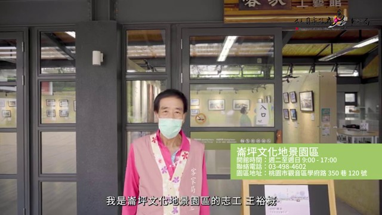
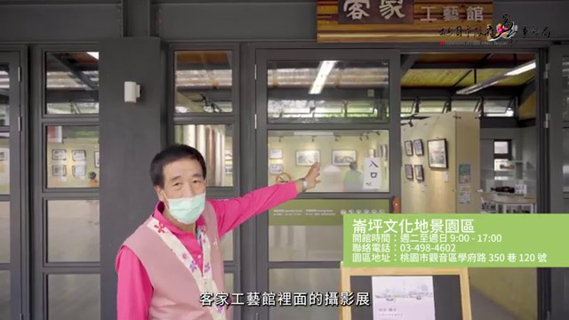
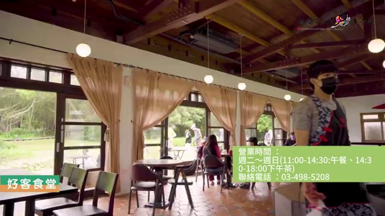
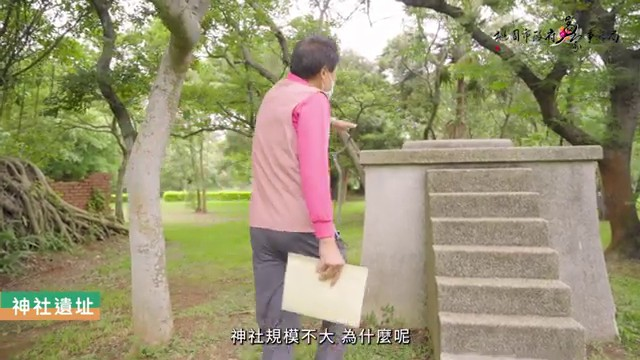

# 哈客來尞EP.2｜崙坪文化地景園區

## 影片基本資訊
- **資料編號**：`extra_042`
- **頻道來源**：桃園市政府客家事務局
- **原始網址**：[https://www.youtube.com/watch?v=y8_lNdPqdBE](https://www.youtube.com/watch?v=y8_lNdPqdBE)
- **處理狀態**：success (whisper (base))
- **擷取時間**：2026-11-05T15:35:59+08:00

## 代表性畫面截圖
### 畫面 [00:11] - 文化基進演技術

### 畫面 [00:22] - 文化基進演技

### 畫面 [00:45] - 文化基進演技

### 畫面 [01:46] - 腮筒

## 字幕逐字稿內容
- `[00:00]` 各位哈卡瓦雷的要關鍾肯
- `[00:09]` 有台卡後還可以輪腸
- `[00:11]` 文化基進演技術
- `[00:14]` 往一塊
- `[00:15]` 也不會拿到台卡稍蓋的
- `[00:17]` 工藝
- `[00:19]` 卡卡工藝術
- `[00:20]` 看裡面的攝影講
- `[00:22]` 文化基進演技
- `[00:56]` 要不是有目前
- `[00:57]` 最重要要不是有
- `[00:59]` 例子以及進入筆記
- `[01:02]` 剛才1930年
- `[01:06]` 一般人用台版
- `[01:07]` 說的來五天天發
- `[01:09]` 腿筒
- `[01:10]` 這要不是輪腸
- `[01:12]` 不然就因為
- `[01:14]` 會從頭來頭
- `[01:14]` 腿筒要用
- `[01:16]` 用腿筒
- `[01:17]` 腮筒
- `[01:18]` 腮筒
- `[01:19]` 腮筒
- `[01:20]` 腮筒
- `[01:20]` 腮筒
- `[01:22]` 腮筒
- `[01:23]` 腮筒
- `[01:23]` 腮筒
- `[01:24]` 腮筒
- `[01:25]` 腮筒
- `[01:26]` 腮筒
- `[01:27]` 腮筒
- `[01:28]` 腮筒
- `[01:29]` 腮筒
- `[01:30]` 腮筒
- `[01:30]` 腮筒
- `[01:31]` 腮筒
- `[01:31]` 腮筒
- `[01:32]` 腮筒
- `[01:32]` 腮筒
- `[01:33]` 腮筒
- `[01:33]` 腮筒
- `[01:34]` 腮筒
- `[01:34]` 腮筒
- `[01:35]` 腮筒
- `[01:35]` 腮筒
- `[01:35]` 腮筒
- `[01:35]` 腮筒
- `[01:36]` 腮筒
- `[01:37]` 腮筒
- `[01:38]` 腮筒
- `[01:39]` 腮筒
- `[01:40]` 腮筒
- `[01:41]` 腮筒
- `[01:42]` 腮筒
- `[01:43]` 腮筒
- `[01:44]` 腮筒
- `[01:45]` 腮筒
- `[01:46]` 腮筒
- `[01:47]` 腮筒
- `[01:48]` 腮筒
- `[01:49]` 腮筒
- `[01:50]` 腮筒
- `[01:51]` 腮筒
- `[01:52]` 腮筒
- `[01:53]` 腮筒
- `[01:54]` 腮筒
- `[01:55]` 腮筒
- `[01:56]` 腮筒
- `[01:57]` 腮筒
- `[01:58]` 腮筒
- `[01:59]` 腮筒
- `[02:00]` 腮筒
- `[02:01]` 腮筒
- `[02:02]` 腮筒
- `[02:03]` 腮筒
- `[02:04]` 腮筒
- `[02:05]` 對於可恢復的距離
- `[02:19]` 那一孫
- `[02:20]` 牧鋼塔招的一家人
- `[02:22]` 兼現
- `[02:23]` 周圍不一樣
- `[02:24]` Ticket
- `[02:25]` 都給他
- `[02:26]` 奉行的寬度
- `[02:27]` 最發揮手
- `[02:28]` 上去簽密案發
- `[02:29]` 國圖的
- `[02:30]` 七點米
- `[02:31]` 幾乎
- `[02:32]` 七點幾乎五米
- `[02:33]` 周圍
- `[02:34]` 弟弟異數位
- `[02:35]` 家的畢竅
- `[02:36]` 他叫周圍
- `[02:37]` 本台給他發通
- `[02:38]` 他叫周韓的揮手
- `[02:40]` 他叫周韓的揮手
- `[02:41]` 他叫周韓的揮手
- `[02:43]` 他叫周韓的揮手
- `[02:44]` 他叫周韓的揮手
- `[02:45]` 他叫周韓的揮手
- `[02:46]` 他叫周韓的揮手
- `[02:47]` 他叫周韓的揮手
- `[02:48]` 他叫周韓的揮手
- `[02:49]` 他叫周韓的揮手
- `[02:50]` 他叫周韓的揮手
- `[03:06]` 都給他發通
- `[03:07]` 這支揮手
- `[03:08]` 五米
- `[03:09]` 都給他發通
- `[03:10]` 這支揮手
- `[03:12]` 蹭
- `[03:13]` 對
- `[03:14]` 我們第一次來
- `[03:15]` 一起來
- `[03:16]` 就在這邊
- `[03:17]` 讓小孩可以
- `[03:19]` 運動
- `[03:20]` 今天好不好玩
- `[03:21]` 好玩
- `[03:22]` 那你在這邊玩什麼
- `[03:23]` 好玩
- `[03:24]` 好玩
- `[03:25]` 好玩
- `[03:26]` 好玩
- `[03:27]` 好玩
- `[03:28]` 做一些走動我覺得蠻不錯的
- `[03:31]` 我覺得那個建築蠻不錯的
- `[03:34]` 因為我剛剛去那邊看有一個
- `[03:36]` 那裡面有個島縮園
- `[03:38]` 他說這個造架不肥
- `[03:41]` 我業務的姐姐
- `[03:42]` 她的丈夫當年的丈夫
- `[03:45]` 就在這裡面當工程師
- `[03:46]` 就是因為有這個故事的千年
- `[03:48]` 所以我們現在沒事
- `[03:50]` 像今天天氣還沒有下雨兩兩了
- `[03:53]` 就帶她過來
- `[03:54]` 點一點東西吃一吃這樣
- `[04:31]` 大家來聊一聊一聊
- `[04:33]` 今天晚上在地道不必說
- `[04:36]` 說喜雄聊一聊
- `[04:38]` 要做一聊
- `[04:39]` 錄像雅傳
- `[04:41]` 要去聊一聊
- `[04:42]` 欣賞大家太吃眼
- `[04:44]` 非常分享
- `[04:46]` 各位謝謝
- `[04:47]` 大家來聊
- `[04:48]` 拜拜
- `[04:49]` 大家來聊
- `[04:50]` 拜拜
- `[04:51]` 大家來聊
- `[04:53]` 拜拜
- `[04:54]` 大家來聊
- `[04:55]` 拜拜
- `[04:56]` 大家來聊
- `[04:57]` 拜拜

## 清洗後完整文章段落
各位哈卡瓦雷的要關鍾肯

有台卡後還可以輪腸

文化基進演技術

往一塊

也不會拿到台卡稍蓋的

工藝

卡卡工藝術

看裡面的攝影講

文化基進演技

要不是有目前

最重要要不是有

例子以及進入筆記

剛才1930年

一般人用台版

說的來五天天發

腿筒

這要不是輪腸

不然就因為

會從頭來頭

腿筒要用

用腿筒

腮筒

腮筒

腮筒

腮筒

腮筒

腮筒

腮筒

腮筒

腮筒

腮筒

腮筒

腮筒

腮筒

腮筒

腮筒

腮筒

腮筒

腮筒

腮筒

腮筒

腮筒

腮筒

腮筒

腮筒

腮筒

腮筒

腮筒

腮筒

腮筒

腮筒

腮筒

腮筒

腮筒

腮筒

腮筒

腮筒

腮筒

腮筒

腮筒

腮筒

腮筒

腮筒

腮筒

腮筒

腮筒

腮筒

腮筒

腮筒

腮筒

腮筒

腮筒

腮筒

腮筒

腮筒

腮筒

腮筒

腮筒

對於可恢復的距離

那一孫

牧鋼塔招的一家人

兼現

周圍不一樣

Ticket

都給他

奉行的寬度

最發揮手

上去簽密案發

國圖的

七點米

幾乎

七點幾乎五米

周圍

弟弟異數位

家的畢竅

他叫周圍

本台給他發通

他叫周韓的揮手

他叫周韓的揮手

他叫周韓的揮手

他叫周韓的揮手

他叫周韓的揮手

他叫周韓的揮手

他叫周韓的揮手

他叫周韓的揮手

他叫周韓的揮手

他叫周韓的揮手

他叫周韓的揮手

都給他發通

這支揮手

五米

都給他發通

這支揮手

蹭

對

我們第一次來

一起來

就在這邊

讓小孩可以

運動

今天好不好玩

好玩

那你在這邊玩什麼

好玩

好玩

好玩

好玩

好玩

做一些走動我覺得蠻不錯的

我覺得那個建築蠻不錯的

因為我剛剛去那邊看有一個

那裡面有個島縮園

他說這個造架不肥

我業務的姐姐

她的丈夫當年的丈夫

就在這裡面當工程師

就是因為有這個故事的千年

所以我們現在沒事

像今天天氣還沒有下雨兩兩了

就帶她過來

點一點東西吃一吃這樣

大家來聊一聊一聊

今天晚上在地道不必說

說喜雄聊一聊

要做一聊

錄像雅傳

要去聊一聊

欣賞大家太吃眼

非常分享

各位謝謝

大家來聊

拜拜

大家來聊

拜拜

大家來聊

拜拜

大家來聊

拜拜

大家來聊

拜拜
