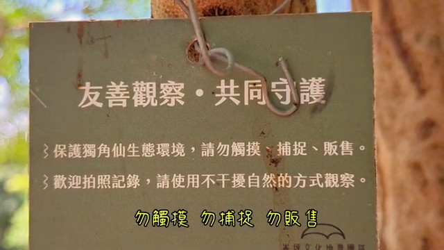
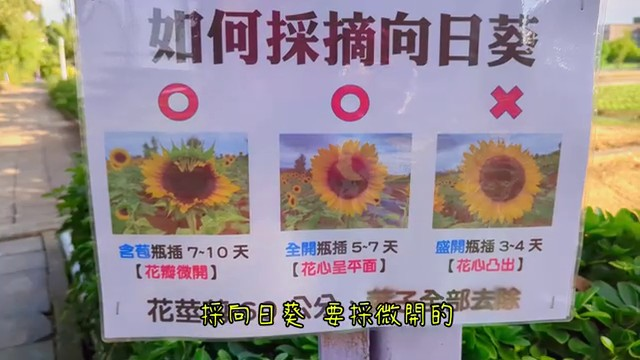

# 20260624桃園觀音蓮花季｜蓮花園農業區｜蓮荷園農場｜向陽農場｜崙坪地景園區｜Hold Toast厚吐司｜來來牛家莊｜草漯沙丘｜觀音濱海遊憩區

## 影片基本資訊
- **資料編號**：`extra_043`
- **頻道來源**：新竹池上-慢活旅遊足跡
- **原始網址**：[https://www.youtube.com/watch?v=yL4ZMN3SAeE](https://www.youtube.com/watch?v=yL4ZMN3SAeE)
- **處理狀態**：success (youtube_vtt (.vtt))
- **擷取時間**：2026-11-05T15:36:45+08:00

## 代表性畫面截圖
### 畫面 [03:38] - [music]
![[music]](../images/extra_043_frame_01.jpg)

### 畫面 [08:29] - 觀音區相關影片畫面

### 畫面 [13:20] - You sing it over [music] me. Like water, my love runs
![You sing it over [music] me. Like water, my love runs](../images/extra_043_frame_03.jpg)

### 畫面 [18:11] - 觀音區相關影片畫面

## 字幕逐字稿內容
- `[00:00]` Simple, [music]
- `[00:07]` [music] simple, simple minds. I guess we'll take
- `[00:11]` it one by one, baby. [music] One by one. Just different different kinds. We'll
- `[00:19]` try to take it one by one, baby. One [music] by one.
- `[00:24]` So many problems. I'm already [singing] lost. Yeah. [music] Mhm. Oh, baby, I
- `[00:32]` don't. I miss you too many nights. I miss your colorful lights. I think I
- `[00:37]` love you too much. I miss your blueberry eyes. Fine. Fine. I play the memories
- `[00:43]` [music] over [singing] over.
- `[00:47]` Just tell me my mind. I'm trying to [music] keep it sober sober.
- `[00:54]` Oh, simple [music] simple simple minds. I guess we'll take it one by one, baby.
- `[01:01]` One [music and singing] by one. Just different different kinds. We'll try to
- `[01:07]` take it one by one, baby. [music] One by.
- `[01:16]` I keep stepping off all times. I'll be laughing over. I keep wanting you too
- `[01:22]` long. I keep tripping on [music] myself,
- `[01:26]` thinking you're my lover. I've been wait too long on a superior. I [music] can't
- `[01:33]` tell you why we can't be standing by each other side. [music]
- `[01:38]` I want to know my true feelings inside. Give me some time.
- `[01:45]` [music] Oh, we'll bring it in a simple simple simple mind. I guess we'll take
- `[01:51]` it one by one, baby. One by [music] one. Just different different kinds. We'll
- `[01:59]` try to take it one more baby. [music and singing]
- `[02:04]` Simple simple simple. I [music] guess we'll take it one more.
- `[02:11]` Just different different.
- `[02:17]` [music]
- `[02:22]` [music] Heat.
- `[02:31]` [music]
- `[02:37]` [music]
- `[02:45]` Heat. [music]
- `[02:58]` [music]
- `[03:02]` [music]
- `[03:07]` [music] Heat.
- `[03:19]` &gt;&gt; [music]
- `[03:26]` [music]
- `[03:37]` [music]
- `[03:42]` [music]
- `[03:46]` [music]
- `[03:51]` [music]
- `[03:57]` [music]
- `[04:05]` &gt;&gt; Heat. Heat. [music]
- `[04:10]` [music]
- `[04:15]` [music]
- `[04:30]` Heat.
- `[04:42]` Heat.
- `[08:58]` What you
- `[09:11]` Thank you.
- `[09:29]` DJ.
- `[10:20]` Welcome.
- `[11:45]` Heat. Heat.
- `[12:13]` Hello.
- `[12:25]` [music]
- `[12:27]` Heat.
- `[12:30]` [music]
- `[12:35]` &gt;&gt; [music]
- `[12:41]` [music]
- `[12:47]` [music]
- `[12:52]` &gt;&gt; When I [music and singing] wake, I know you are with me
- `[13:00]` in the dark. &gt;&gt; [music]
- `[13:02]` &gt;&gt; I can almost see you [singing] creeping every day. [music]
- `[13:09]` You sing it over [music] me. Like water, my love runs
- `[13:18]` [music] free. Oh, there [singing] is nothing
- `[13:24]` like your love. [music]
- `[13:28]` There is nothing and [music] no one above.
- `[13:35]` &gt;&gt; [music] &gt;&gt; Oh come be [singing] with us
- `[13:41]` holy one [music]
- `[13:48]` [music]
- `[13:56]` [music] in my pain. I know you can feel it. [music] There I
- `[14:04]` find the comfort in [singing] your spirit.
- `[14:11]` Every day [music] you sing it over
- `[14:17]` me like water. [singing] My [music] love.
- `[14:25]` Oh, there [singing] is nothing [music] like your love.
- `[14:31]` [music] &gt;&gt; There is nothing.
- `[14:35]` [singing]
- `[14:38]` [music] Oh, come be with us,
- `[14:45]` holy [music] one. Oh, come be with the
- `[14:52]` holy one. [music] Anywhere
- `[15:00]` [music] I go and you find [music]
- `[15:08]` my home,
- `[15:11]` anywhere [music]
- `[15:15]` I go,
- `[15:18]` you I find [music] my
- `[15:25]` &gt;&gt; [music] &gt;&gt; There is nothing [singing]
- `[15:28]` like your love. [music]
- `[15:33]` There is nothing and no [music] one will.
- `[15:40]` Oh, come be with [music] us. Oh.
- `[15:47]` Oh, [music] come with us.
- `[15:52]` [music] Oh, you are. Oh, come [singing] with me.
- `[16:00]` &gt;&gt; [music] &gt;&gt; Oh, you are
- `[16:04]` [music]
- `[16:09]` [music]
- `[16:43]` Okay.
- `[16:56]` What's
- `[17:16]` Come
- `[17:28]` &gt;&gt; [music]
- `[17:35]` [music]
- `[17:38]` &gt;&gt; here. Come here.
- `[17:43]` &gt;&gt; [music]
- `[17:49]` &gt;&gt; Look at that. [music]
- `[17:54]` [applause] [music]
- `[18:03]` [music]
- `[18:11]` &gt;&gt; [music]
- `[18:20]` [music]
- `[18:26]` [music]
- `[18:33]` [music]
- `[18:40]` [music]
- `[18:45]` [music]
- `[18:53]` [music]
- `[18:57]` [music]
- `[19:06]` [music]
- `[19:14]` [music] &gt;&gt; moment.
- `[19:20]` [music]
- `[19:25]` &gt;&gt; [music]
- `[19:29]` [music]
- `[19:35]` &gt;&gt; It's hard to stay real in a world full of fakes. It's [music] hard to find
- `[19:40]` truth when the liars are great. I'm trying my best to stay out of your way.
- `[19:46]` Oh well. Oh well. You talk a big talk but got
- `[19:52]` nothing to say. You hold your head [singing and music] high, but your
- `[19:56]` morals are faint. I know you feel cold, but your bubble break.
- `[20:04]` You [music] can walk in tomorrow
- `[20:12]` and every fool will try
- `[20:16]` again. But I'm going to sell my soul just to be
- `[20:23]` someone you want to know. Who you like is out of my control. I'm okay.
- `[20:34]` I'm not going to change myself [music] just to make you fall under some spell
- `[20:41]` be.
- `[20:46]` &gt;&gt; [music]
- `[20:54]` [music]
- `[21:04]` [music] &gt;&gt; Heat. Heat.
- `[21:10]` [music]
- `[21:19]` &gt;&gt; [music]
- `[21:23]` [music]
- `[21:29]` [music]
- `[21:35]` &gt;&gt; Girl, I see that you want it. [music] You're driving me crazy with that fire
- `[21:40]` in your eyes. [music]
- `[21:45]` What drive? Part of me wants to see you [music]
- `[21:50]` between the lines. And all of the back and forth.
- `[21:58]` Baby, [music] won't you take your time with love me? Love me. Your heart be
- `[22:03]` falling right into mine. &gt;&gt; [music]
- `[22:08]` &gt;&gt; I don't want the rush to get the best of me. Best of me. Just [music] know that's
- `[22:13]` all I'm asking for. Don't you call me kissing over [music]
- `[22:20]` me. Just trying to get to know you. Take [music]
- `[22:24]` me there.
- `[22:29]` [music] Don't you call me kissing over just to love you for this.
- `[22:36]` Isn't it crazy how the stars have fall? [music]
- `[22:42]` Oh, can I be honest? [music] I'm so afraid
- `[22:47]` to fall too deep or go too high. Cuz all of this chemistry [music] and
- `[22:53]` caught me by surprise. Baby, won't you take your time with
- `[22:59]` love? [music and singing] Love me. I promise, boy, that we'll be all right.
- `[23:06]` [music] I don't want the rush to get the best of me. Best of me. Just makes me
- `[23:12]` want you more and more. [singing] Oh, [music] we kissing over
- `[23:19]` just trying to get to know you. We can take control [music]
- `[23:25]` over you. Call me kissing over.
- `[23:32]` Just want you [music] to love me. I want you standing right here next to me.
- `[23:38]` Heat. Heat.
- `[23:49]` Heat.
- `[24:01]` Heat.

## 清洗後完整文章段落
Simple, [music]

[music] simple, simple minds. I guess we'll take

it one by one, baby. [music] One by one. Just different different kinds. We'll

try to take it one by one, baby. One [music] by one.

So many problems. I'm already [singing] lost. Yeah. [music] Mhm. Oh, baby, I

don't. I miss you too many nights. I miss your colorful lights. I think I

love you too much. I miss your blueberry eyes. Fine. Fine. I play the memories

[music] over [singing] over.

Just tell me my mind. I'm trying to [music] keep it sober sober.

Oh, simple [music] simple simple minds. I guess we'll take it one by one, baby.

One [music and singing] by one. Just different different kinds. We'll try to

take it one by one, baby. [music] One by.

I keep stepping off all times. I'll be laughing over. I keep wanting you too

long. I keep tripping on [music] myself,

thinking you're my lover. I've been wait too long on a superior. I [music] can't

tell you why we can't be standing by each other side. [music]

I want to know my true feelings inside. Give me some time.

[music] Oh, we'll bring it in a simple simple simple mind. I guess we'll take

it one by one, baby. One by [music] one. Just different different kinds. We'll

try to take it one more baby. [music and singing]

Simple simple simple. I [music] guess we'll take it one more.

Just different different.

[music]

[music] Heat.

[music]

[music]

Heat. [music]

[music]

[music]

[music] Heat.

&gt;&gt; [music]

[music]

[music]

[music]

[music]

[music]

[music]

&gt;&gt; Heat. Heat. [music]

[music]

[music]

Heat.

Heat.

What you

Thank you.

DJ.

Welcome.

Heat. Heat.

Hello.

[music]

Heat.

[music]

&gt;&gt; [music]

[music]

[music]

&gt;&gt; When I [music and singing] wake, I know you are with me

in the dark. &gt;&gt; [music]

&gt;&gt; I can almost see you [singing] creeping every day. [music]

You sing it over [music] me. Like water, my love runs

[music] free. Oh, there [singing] is nothing

like your love. [music]

There is nothing and [music] no one above.

&gt;&gt; [music] &gt;&gt; Oh come be [singing] with us

holy one [music]

[music]

[music] in my pain. I know you can feel it. [music] There I

find the comfort in [singing] your spirit.

Every day [music] you sing it over

me like water. [singing] My [music] love.

Oh, there [singing] is nothing [music] like your love.

[music] &gt;&gt; There is nothing.

[singing]

[music] Oh, come be with us,

holy [music] one. Oh, come be with the

holy one. [music] Anywhere

[music] I go and you find [music]

my home,

anywhere [music]

I go,

you I find [music] my

&gt;&gt; [music] &gt;&gt; There is nothing [singing]

like your love. [music]

There is nothing and no [music] one will.

Oh, come be with [music] us. Oh.

Oh, [music] come with us.

[music] Oh, you are. Oh, come [singing] with me.

&gt;&gt; [music] &gt;&gt; Oh, you are

[music]

[music]

Okay.

What's

Come

&gt;&gt; [music]

[music]

&gt;&gt; here. Come here.

&gt;&gt; [music]

&gt;&gt; Look at that. [music]

[applause] [music]

[music]

&gt;&gt; [music]

[music]

[music]

[music]

[music]

[music]

[music]

[music]

[music]

[music] &gt;&gt; moment.

[music]

&gt;&gt; [music]

[music]

&gt;&gt; It's hard to stay real in a world full of fakes. It's [music] hard to find

truth when the liars are great. I'm trying my best to stay out of your way.

Oh well. Oh well. You talk a big talk but got

nothing to say. You hold your head [singing and music] high, but your

morals are faint. I know you feel cold, but your bubble break.

You [music] can walk in tomorrow

and every fool will try

again. But I'm going to sell my soul just to be

someone you want to know. Who you like is out of my control. I'm okay.

I'm not going to change myself [music] just to make you fall under some spell

be.

&gt;&gt; [music]

[music]

[music] &gt;&gt; Heat. Heat.

[music]

&gt;&gt; [music]

[music]

[music]

&gt;&gt; Girl, I see that you want it. [music] You're driving me crazy with that fire

in your eyes. [music]

What drive? Part of me wants to see you [music]

between the lines. And all of the back and forth.

Baby, [music] won't you take your time with love me? Love me. Your heart be

falling right into mine. &gt;&gt; [music]

&gt;&gt; I don't want the rush to get the best of me. Best of me. Just [music] know that's

all I'm asking for. Don't you call me kissing over [music]

me. Just trying to get to know you. Take [music]

me there.

[music] Don't you call me kissing over just to love you for this.

Isn't it crazy how the stars have fall? [music]

Oh, can I be honest? [music] I'm so afraid

to fall too deep or go too high. Cuz all of this chemistry [music] and

caught me by surprise. Baby, won't you take your time with

love? [music and singing] Love me. I promise, boy, that we'll be all right.

[music] I don't want the rush to get the best of me. Best of me. Just makes me

want you more and more. [singing] Oh, [music] we kissing over

just trying to get to know you. We can take control [music]

over you. Call me kissing over.

Just want you [music] to love me. I want you standing right here next to me.

Heat. Heat.

Heat.

Heat.
