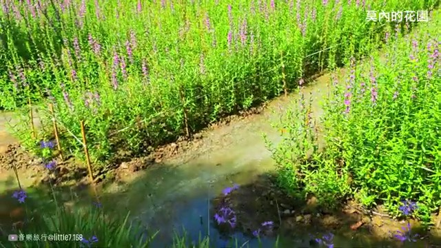

# ❣️桃園蓮花季開幕｜蓮花園 + 莫內的花園 + 蓮荷園 + 向陽農場一日遊｜Taoyuan Lotus Festival, Taiwan

## 影片基本資訊
- **資料編號**：`extra_044`
- **頻道來源**：Music Travel 音樂旅行
- **原始網址**：[https://www.youtube.com/watch?v=hD7z371g-wg](https://www.youtube.com/watch?v=hD7z371g-wg)
- **處理狀態**：success (youtube_vtt (.vtt))
- **擷取時間**：2026-11-05T15:38:56+08:00

## 代表性畫面截圖
### 畫面 [05:52] - 觀音區相關影片畫面

### 畫面 [13:42] - 觀音區相關影片畫面

### 畫面 [21:32] - [music] &gt;&gt; Heat. Heat.
![[music] &gt;&gt; Heat. Heat.](../images/extra_044_frame_03.jpg)

### 畫面 [29:22] - 觀音區相關影片畫面

## 字幕逐字稿內容
- `[00:05]` [music]
- `[00:11]` [music]
- `[00:17]` [music]
- `[00:22]` [music]
- `[00:28]` [music] All
- `[00:49]` right, sunj.
- `[01:21]` It's a downline.
- `[01:24]` &gt;&gt; [music]
- `[01:29]` [music]
- `[01:36]` [music]
- `[01:50]` [music]
- `[02:02]` [music]
- `[02:07]` [music]
- `[02:12]` [music]
- `[02:21]` [music]
- `[02:29]` [music]
- `[02:38]` [music]
- `[02:54]` [music]
- `[03:00]` [music]
- `[03:08]` &gt;&gt; Oh Yeah. [music]
- `[03:13]` [music]
- `[03:18]` [music]
- `[03:32]` Heat. [music]
- `[03:38]` &gt;&gt; [music]
- `[03:49]` [music]
- `[03:55]` &gt;&gt; workout.
- `[04:04]` Huh?
- `[04:15]` I don't know.
- `[04:46]` &gt;&gt; [laughter] &gt;&gt; I can't be
- `[05:24]` [music]
- `[05:32]` [music]
- `[05:34]` Heat.
- `[05:39]` [music]
- `[05:44]` [music]
- `[05:55]` [music] Heat.
- `[05:59]` [music]
- `[06:04]` &gt;&gt; [music]
- `[06:16]` &gt;&gt; Heat. Heat. [music]
- `[06:27]` &gt;&gt; [music]
- `[06:34]` [music]
- `[06:43]` [music]
- `[07:00]` [music]
- `[07:10]` [music]
- `[07:19]` [music]
- `[07:24]` [music]
- `[07:37]` [music]
- `[07:44]` [music]
- `[07:51]` [music]
- `[08:01]` [music]
- `[08:06]` [music]
- `[08:10]` [music]
- `[08:27]` [music]
- `[08:33]` [music]
- `[08:38]` [music]
- `[08:52]` [music]
- `[09:00]` [music]
- `[09:08]` [music]
- `[09:19]` [music]
- `[09:23]` [music] &gt;&gt; Heat. Heat.
- `[09:37]` &gt;&gt; [music]
- `[09:56]` [music]
- `[10:03]` [music]
- `[10:11]` [music]
- `[10:13]` &gt;&gt; Heat. Heat.
- `[10:18]` [music] Heat.
- `[10:23]` [music]
- `[10:30]` [singing] Heat. [music]
- `[10:38]` [music]
- `[10:43]` &gt;&gt; [music]
- `[10:50]` [music] &gt;&gt; Heat up
- `[10:58]` [music] here.
- `[11:04]` Heat. [music]
- `[11:19]` [music]
- `[11:23]` Heat. [music]
- `[11:33]` &gt;&gt; [music]
- `[11:38]` [music]
- `[11:42]` &gt;&gt; Heat. Heat.
- `[11:46]` [music]
- `[12:01]` Heat. [music]
- `[12:06]` [music]
- `[12:10]` Heat. [music]
- `[12:15]` Oh,
- `[12:21]` [music and singing]
- `[12:25]` [music]
- `[12:34]` heat, heat.
- `[12:45]` &gt;&gt; [music]
- `[12:56]` [music]
- `[13:02]` [music]
- `[13:18]` [music] &gt;&gt; Heat.
- `[13:21]` Heat. [music]
- `[13:28]` Heat. Heat.
- `[13:36]` [music]
- `[13:45]` [music]
- `[13:49]` &gt;&gt; [music]
- `[13:57]` [music]
- `[14:03]` &gt;&gt; Heat up here. [music]
- `[14:14]` [music]
- `[14:18]` &gt;&gt; [music]
- `[14:28]` &gt;&gt; Heat. [music]
- `[14:31]` Heat. [music]
- `[14:39]` &gt;&gt; [music]
- `[14:44]` [music]
- `[14:48]` &gt;&gt; Heat. [music]
- `[14:53]` Heat. Heat.
- `[15:02]` [music]
- `[15:07]` [music]
- `[15:15]` &gt;&gt; [music]
- `[15:19]` [music]
- `[15:26]` [music] &gt;&gt; Heat.
- `[15:30]` Heat. [music]
- `[15:37]` Heat. Heat. [music]
- `[15:45]` [music]
- `[15:49]` [music]
- `[15:56]` [music]
- `[16:08]` &gt;&gt; [music]
- `[16:15]` [music]
- `[16:21]` [music]
- `[16:28]` [music]
- `[16:32]` [music]
- `[16:39]` [music]
- `[16:46]` [music]
- `[16:53]` [music]
- `[17:05]` [music]
- `[17:08]` &gt;&gt; Heat.
- `[17:13]` [music]
- `[17:16]` Heat. [music]
- `[17:24]` &gt;&gt; [music]
- `[17:30]` [music]
- `[17:37]` [music]
- `[17:48]` [music]
- `[17:54]` [music]
- `[18:02]` [music]
- `[18:09]` [music]
- `[18:21]` [music]
- `[18:27]` [music]
- `[18:34]` [music]
- `[18:41]` [music]
- `[18:45]` &gt;&gt; Foreign
- `[19:12]` speech. Foreign speech.
- `[19:54]` Uh &gt;&gt; yeah, I know.
- `[19:58]` [music]
- `[20:04]` [music]
- `[20:19]` Heat. Heat. [music]
- `[20:26]` [music]
- `[20:34]` [music]
- `[20:47]` &gt;&gt; [music]
- `[20:52]` [music]
- `[20:58]` [music]
- `[21:06]` [music]
- `[21:13]` [music]
- `[21:25]` [music]
- `[21:31]` [music] &gt;&gt; Heat. Heat.
- `[21:34]` Heat.
- `[21:40]` [music]
- `[21:50]` [music]
- `[21:54]` Heat. [music]
- `[22:02]` &gt;&gt; [music]
- `[22:12]` [music] &gt;&gt; Heat. Heat.
- `[22:20]` [music]
- `[22:31]` &gt;&gt; [music]
- `[22:41]` [music]
- `[22:47]` [music]
- `[22:50]` &gt;&gt; Hey. Hey. Hey.
- `[22:56]` [music]
- `[23:08]` [music]
- `[23:37]` Heat. Heat.
- `[23:43]` &gt;&gt; [music]
- `[23:48]` [music]
- `[24:01]` [music]
- `[24:08]` [music]
- `[24:23]` [music]
- `[24:47]` [music]
- `[24:53]` [music]
- `[24:58]` [music] &gt;&gt; Heat. Heat.
- `[25:03]` [music]
- `[25:13]` [music]
- `[25:18]` [music] Heat. Heat.
- `[25:23]` [music]
- `[25:30]` [music]
- `[25:49]` &gt;&gt; [music]
- `[25:56]` [music]
- `[26:04]` [music]
- `[26:17]` &gt;&gt; Heat. Heat.
- `[26:23]` [music]
- `[26:32]` &gt;&gt; [music]
- `[26:41]` [music]
- `[26:44]` &gt;&gt; Heat. Heat.
- `[26:48]` [music]
- `[26:56]` &gt;&gt; [music]
- `[27:03]` &gt;&gt; Heat [music]
- `[27:10]` &gt;&gt; [music] &gt;&gt; Heat.
- `[27:12]` Heat.
- `[27:16]` [music]
- `[27:22]` [music]
- `[27:32]` &gt;&gt; [music]
- `[27:35]` &gt;&gt; Heat up
- `[27:40]` [music]
- `[27:45]` here. [music]
- `[27:53]` &gt;&gt; [music]
- `[27:58]` [music]
- `[28:00]` &gt;&gt; Heat. Heat.
- `[28:05]` [music]
- `[28:13]` &gt;&gt; [music]
- `[28:22]` [music] &gt;&gt; Heat. Heat.
- `[28:28]` [music]
- `[28:34]` &gt;&gt; [music]
- `[28:43]` [music]
- `[28:49]` [music]
- `[28:55]` [music]
- `[29:01]` [music]
- `[29:08]` [music]
- `[29:18]` [music]
- `[29:37]` [music]
- `[29:46]` [music]
- `[29:58]` [music]
- `[30:05]` [music]
- `[30:12]` [music]
- `[30:15]` &gt;&gt; Heat. Heat. [music]
- `[30:26]` &gt;&gt; [music]
- `[30:32]` [music]
- `[30:39]` [music]
- `[30:47]` [music]
- `[30:58]` [music]
- `[31:05]` [music]
- `[31:17]` [music]
- `[31:23]` [music]
- `[31:30]` &gt;&gt; Heat. Heat.
- `[31:33]` [music]
- `[31:42]` &gt;&gt; [music]
- `[31:48]` [music] &gt;&gt; Heat. Heat.
- `[31:53]` [singing]
- `[31:56]` [music]
- `[32:07]` &gt;&gt; [music]
- `[32:10]` &gt;&gt; Heat. [music]
- `[32:12]` Heat.
- `[32:20]` Heat. [music]
- `[32:28]` [music]
- `[32:38]` Heat.
- `[32:41]` [music]
- `[32:49]` &gt;&gt; [music] [singing]
- `[32:55]` &gt;&gt; Heat up [music] here.
- `[33:05]` [music]
- `[33:10]` Heat. [music]
- `[33:19]` [music]
- `[33:24]` [music]
- `[33:33]` Heat. [music]
- `[33:36]` Heat. Heat. Heat. [music]
- `[33:42]` [music]
- `[33:48]` &gt;&gt; [music]
- `[33:55]` [music]
- `[34:10]` [music]
- `[34:16]` [music]
- `[34:31]` [music]
- `[34:37]` &gt;&gt; Heat. [music]
- `[34:53]` [music]
- `[34:59]` [music]
- `[35:03]` Heat. Heat up
- `[35:07]` &gt;&gt; [music]
- `[35:13]` [music]
- `[35:24]` [music]
- `[35:27]` &gt;&gt; here. [music]
- `[35:42]` &gt;&gt; [music]
- `[35:44]` &gt;&gt; Heat. Heat.
- `[35:51]` [music] Heat. Heat.
- `[35:56]` [music]
- `[36:03]` [music]
- `[36:16]` [music]
- `[36:26]` &gt;&gt; [music]
- `[36:31]` [music]
- `[36:36]` [music]
- `[36:42]` [music]
- `[36:48]` [music]
- `[36:58]` [music]
- `[37:02]` &gt;&gt; Yeah. [music]
- `[37:07]` Heat. Heat.
- `[37:10]` [music]
- `[37:16]` [music]
- `[37:27]` [music]
- `[37:33]` &gt;&gt; [music]
- `[37:40]` [music]
- `[37:46]` [music]
- `[37:51]` [music] &gt;&gt; Heat. Heat.
- `[37:57]` Heat. Heat. [music]
- `[38:10]` [music]
- `[38:18]` [music]
- `[38:25]` &gt;&gt; [music]
- `[38:37]` [music]
- `[38:42]` [music]
- `[38:48]` [music]
- `[38:55]` [music]

## 清洗後完整文章段落
[music]

[music]

[music]

[music]

[music] All

right, sunj.

It's a downline.

&gt;&gt; [music]

[music]

[music]

[music]

[music]

[music]

[music]

[music]

[music]

[music]

[music]

[music]

&gt;&gt; Oh Yeah. [music]

[music]

[music]

Heat. [music]

&gt;&gt; [music]

[music]

&gt;&gt; workout.

Huh?

I don't know.

&gt;&gt; [laughter] &gt;&gt; I can't be

[music]

[music]

Heat.

[music]

[music]

[music] Heat.

[music]

&gt;&gt; [music]

&gt;&gt; Heat. Heat. [music]

&gt;&gt; [music]

[music]

[music]

[music]

[music]

[music]

[music]

[music]

[music]

[music]

[music]

[music]

[music]

[music]

[music]

[music]

[music]

[music]

[music]

[music]

[music] &gt;&gt; Heat. Heat.

&gt;&gt; [music]

[music]

[music]

[music]

&gt;&gt; Heat. Heat.

[music] Heat.

[music]

[singing] Heat. [music]

[music]

&gt;&gt; [music]

[music] &gt;&gt; Heat up

[music] here.

Heat. [music]

[music]

Heat. [music]

&gt;&gt; [music]

[music]

&gt;&gt; Heat. Heat.

[music]

Heat. [music]

[music]

Heat. [music]

Oh,

[music and singing]

[music]

heat, heat.

&gt;&gt; [music]

[music]

[music]

[music] &gt;&gt; Heat.

Heat. [music]

Heat. Heat.

[music]

[music]

&gt;&gt; [music]

[music]

&gt;&gt; Heat up here. [music]

[music]

&gt;&gt; [music]

&gt;&gt; Heat. [music]

Heat. [music]

&gt;&gt; [music]

[music]

&gt;&gt; Heat. [music]

Heat. Heat.

[music]

[music]

&gt;&gt; [music]

[music]

[music] &gt;&gt; Heat.

Heat. [music]

Heat. Heat. [music]

[music]

[music]

[music]

&gt;&gt; [music]

[music]

[music]

[music]

[music]

[music]

[music]

[music]

[music]

&gt;&gt; Heat.

[music]

Heat. [music]

&gt;&gt; [music]

[music]

[music]

[music]

[music]

[music]

[music]

[music]

[music]

[music]

[music]

&gt;&gt; Foreign

speech. Foreign speech.

Uh &gt;&gt; yeah, I know.

[music]

[music]

Heat. Heat. [music]

[music]

[music]

&gt;&gt; [music]

[music]

[music]

[music]

[music]

[music]

[music] &gt;&gt; Heat. Heat.

Heat.

[music]

[music]

Heat. [music]

&gt;&gt; [music]

[music] &gt;&gt; Heat. Heat.

[music]

&gt;&gt; [music]

[music]

[music]

&gt;&gt; Hey. Hey. Hey.

[music]

[music]

Heat. Heat.

&gt;&gt; [music]

[music]

[music]

[music]

[music]

[music]

[music]

[music] &gt;&gt; Heat. Heat.

[music]

[music]

[music] Heat. Heat.

[music]

[music]

&gt;&gt; [music]

[music]

[music]

&gt;&gt; Heat. Heat.

[music]

&gt;&gt; [music]

[music]

&gt;&gt; Heat. Heat.

[music]

&gt;&gt; [music]

&gt;&gt; Heat [music]

&gt;&gt; [music] &gt;&gt; Heat.

Heat.

[music]

[music]

&gt;&gt; [music]

&gt;&gt; Heat up

[music]

here. [music]

&gt;&gt; [music]

[music]

&gt;&gt; Heat. Heat.

[music]

&gt;&gt; [music]

[music] &gt;&gt; Heat. Heat.

[music]

&gt;&gt; [music]

[music]

[music]

[music]

[music]

[music]

[music]

[music]

[music]

[music]

[music]

[music]

&gt;&gt; Heat. Heat. [music]

&gt;&gt; [music]

[music]

[music]

[music]

[music]

[music]

[music]

[music]

&gt;&gt; Heat. Heat.

[music]

&gt;&gt; [music]

[music] &gt;&gt; Heat. Heat.

[singing]

[music]

&gt;&gt; [music]

&gt;&gt; Heat. [music]

Heat.

Heat. [music]

[music]

Heat.

[music]

&gt;&gt; [music] [singing]

&gt;&gt; Heat up [music] here.

[music]

Heat. [music]

[music]

[music]

Heat. [music]

Heat. Heat. Heat. [music]

[music]

&gt;&gt; [music]

[music]

[music]

[music]

[music]

&gt;&gt; Heat. [music]

[music]

[music]

Heat. Heat up

&gt;&gt; [music]

[music]

[music]

&gt;&gt; here. [music]

&gt;&gt; [music]

&gt;&gt; Heat. Heat.

[music] Heat. Heat.

[music]

[music]

[music]

&gt;&gt; [music]

[music]

[music]

[music]

[music]

[music]

&gt;&gt; Yeah. [music]

Heat. Heat.

[music]

[music]

[music]

&gt;&gt; [music]

[music]

[music]

[music] &gt;&gt; Heat. Heat.

Heat. Heat. [music]

[music]

[music]

&gt;&gt; [music]

[music]

[music]

[music]

[music]
