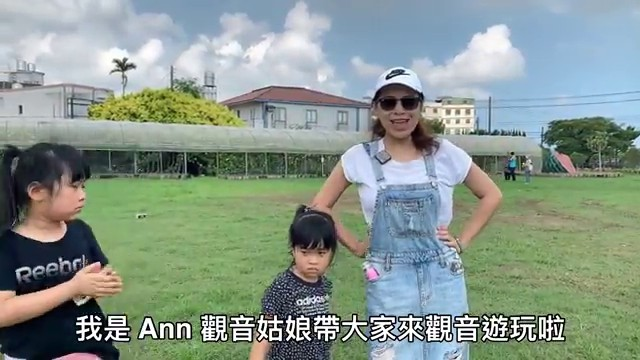
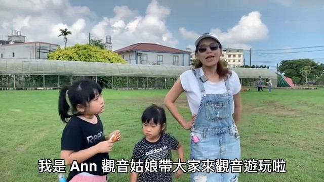
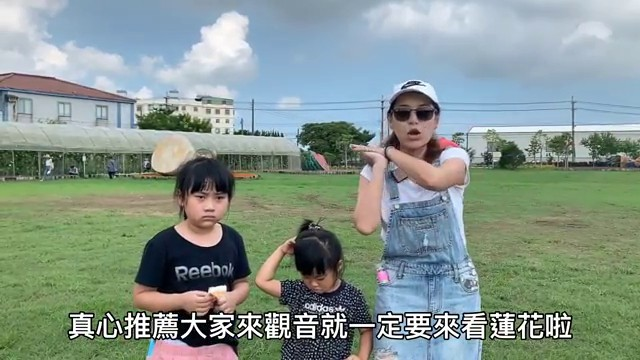

# 桃園旅遊景點/觀音三大必遊景點，康莊蓮園、白沙岬燈塔、草漯沙丘一次走完。

## 影片基本資訊
- **資料編號**：`extra_045`
- **頻道來源**：Ann•榜哥•生活事務所
- **原始網址**：[https://www.youtube.com/watch?v=1ppEttPooWs](https://www.youtube.com/watch?v=1ppEttPooWs)
- **處理狀態**：success (whisper (base))
- **擷取時間**：2026-11-05T15:40:36+08:00

## 代表性畫面截圖
### 畫面 [01:36] - 帶了大家來觀音遊玩啦

### 畫面 [01:39] - 夏天來到觀音

### 畫面 [01:43] - 那景點在哪裡呢

### 畫面 [02:32] - 來觀音

## 字幕逐字稿內容
- `[00:02]` 我找法術
- `[00:30]` 找法術
- `[00:31]` 找法術
- `[00:32]` 找法術
- `[00:33]` 找法術
- `[00:34]` 找法術
- `[00:35]` 找法術
- `[00:44]` 找法術
- `[00:53]` 找法術
- `[01:36]` 帶了大家來觀音遊玩啦
- `[01:39]` 夏天來到觀音
- `[01:41]` 一定要看連花
- `[01:43]` 那景點在哪裡呢
- `[01:45]` And the建議呢
- `[01:46]` 就是在新華路跟金華路的
- `[01:48]` 交叉口這一區的連花
- `[01:50]` 特別多
- `[01:51]` 而且是免費殘關
- `[01:53]` 那像這邊我身後就有很多的
- `[01:55]` 地景藝術可以拍照
- `[01:57]` 是蠻推薦大家的
- `[01:59]` 每一季都有不一樣的東西
- `[02:01]` 那現在夏天呢
- `[02:02]` 就是要看連花
- `[02:04]` 連花看過去唄
- `[02:06]` 對 因為是人群很多
- `[02:15]` 因為今天比較不一樣
- `[02:17]` 今天是有活動的
- `[02:19]` 這邊就是還蠻適合大家
- `[02:21]` 假日的時候呢
- `[02:22]` 前來這邊看連花
- `[02:24]` 跟連花拍照
- `[02:25]` 附近有很多的連花園
- `[02:27]` 有大網連可以承諾
- `[02:30]` 真心推薦大家
- `[02:32]` 來觀音
- `[02:33]` 就一定要來看連花啦
- `[02:35]` 跳 math
- `[02:40]` 跟個個到好不好
- `[02:41]` 跟個先帶進去玩
- `[02:42]` 好嗎
- `[02:43]` 我們慢慢走
- `[02:45]` 右轉
- `[02:46]` 右轉
- `[02:47]` 右轉
- `[02:48]` 右轉
- `[02:49]` 右轉
- `[02:50]` 右轉
- `[02:51]` 右轉
- `[02:53]` 右轉
- `[02:54]` 左轉
- `[02:55]` 右轉
- `[02:56]` 好 來
- `[03:05]` 走
- `[03:09]` 來觀音一定要跟大王連牌照
- `[03:21]` 按推鍵就來跟康莊連圓的大王連牌照
- `[03:25]` 這邊現在變得不一樣了
- `[03:27]` 有規劃很大的停車廠可以停車
- `[03:30]` 那大王連在哪裡呢
- `[03:31]` 跟著我爸在這裡
- `[03:34]` 今天家人超級多的
- `[03:37]` 很熱鬧
- `[03:49]` 快去看一下大王連大流多蜜
- `[03:51]` 超大的多
- `[03:56]` 除了這邊大王連
- `[03:58]` 他只這麼大
- `[03:59]` 他最多我記得老闆之前講過說
- `[04:02]` 可以成宰80公斤
- `[04:03]` 現在有沒有增加不知道
- `[04:05]` 因為真的很大
- `[04:07]` 這邊是一個人拍照是50塊
- `[04:09]` 以人頭計較
- `[04:11]` 今天有個超多的
- `[04:13]` 那現在就是要等候
- `[04:14]` 快去看看吧
- `[04:17]` 這邊來到康莊連圓
- `[04:19]` 要如何購票呢
- `[04:20]` 先到建築物裡面去做購票
- `[04:25]` 然後會給你好馬牌
- `[04:27]` 就照著他們就會喊號
- `[04:30]` 就是依序的排隊
- `[04:32]` 就可以進去拍照
- `[04:33]` 然後他們就是拍照
- `[04:34]` 就是在那個亞克利班裡面
- `[04:35]` 住在裡面
- `[04:36]` 看你知道戰爭的躺著呢
- `[04:39]` 怎麼樣一樣都可以
- `[04:40]` 然後就是去擺出你最喜歡的pose
- `[04:43]` 然後就是自行拍照
- `[04:45]` 記得來這邊就是要拍好拍嗎
- `[04:47]` 拍越多
- `[04:48]` 你才能挑出自己喜歡的照片
- `[04:51]` 那裡面其實要賣一些
- `[04:52]` 就是像冰品類的在地
- `[04:55]` 這邊才吃得到的一些蓮子冰
- `[04:58]` 或者是蓮子食品等等的
- `[05:00]` 都是這邊才有
- `[05:02]` 所以呢夏天來這裡
- `[05:03]` 又記得來我們的康莊連圓
- `[05:11]` 那關於呢就一定要來白刷甲燈塔
- `[05:15]` 這可是百年歷史悠久的燈塔
- `[05:19]` 在哪裡
- `[05:20]` 在這裡
- `[05:25]` 漂亮吧
- `[05:27]` 但是燈塔的主體是不可以進入的
- `[05:30]` 台灣唯一可以進入的燈塔呢
- `[05:32]` 北台灣是三雕甲燈塔
- `[05:35]` 那這邊呢就是走一旁
- `[05:37]` 我的裡面的廣場旁邊的那個
- `[05:39]` 展覽室可以進入
- `[05:40]` 那是主體是不可以進入的
- `[05:43]` 那這邊呢其實它規劃了
- `[05:44]` 蠻多休閒廣場
- `[05:46]` 可以坐在樹下沉涼啊
- `[05:48]` 吃東西啊
- `[05:49]` 其實還蠻切譯的
- `[05:50]` 好啦 那就跟著我進去看一下吧
- `[05:52]` Let's go
- `[06:01]` 可以嗎
- `[06:07]` 最後一個幾年呢
- `[06:08]` 誒 要帶大家來的是
- `[06:10]` 關於超級有名的草塔沙球
- `[06:14]` 那這邊呢其實不好停車
- `[06:16]` 那也不能開車進去
- `[06:17]` 因為它是國有土地
- `[06:19]` 車輛是不可以進入的
- `[06:20]` 所以呢
- `[06:21]` 沿路停好車呢
- `[06:22]` 就是需要步行的
- `[06:24]` 跟著我走吧
- `[06:27]` 路口處呢
- `[07:00]` 走到這個草塔沙球呢
- `[07:02]` 大概步行五分鐘
- `[07:04]` 找到沙球
- `[07:05]` 找到那樣子
- `[07:06]` 就是我後面這一整片啦
- `[07:08]` 看一下吧
- `[07:15]` 黑意有沒有走在沙漠的感覺呢
- `[07:18]` 想要體驗走在沙漠的感覺呢
- `[07:20]` 聽我的
- `[07:21]` 正宗五時間就這個時候
- `[07:23]` 正宗五來走
- `[07:24]` 你就會感覺走在沙漠的感覺
- `[07:27]` 因為沙漠是超級湯的
- `[07:29]` 建議來這裡是夕陽的時候
- `[07:31]` 來會比較合適一點
- `[07:34]` 因為會比較涼爽
- `[07:35]` 然後風吹起來
- `[07:36]` 這樣子還蠻舒服的
- `[07:38]` 但是我覺得它有點可惜
- `[07:39]` 現在是足理為的
- `[07:40]` 就是有點密集
- `[07:43]` 然後它要這邊吹的有點有點亂
- `[07:45]` 有點可惜的一點
- `[07:46]` 但是呢
- `[07:47]` 它如果之後規劃呢
- `[07:48]` 很好的呢
- `[07:49]` 拍照一定很美的
- `[07:52]` 好啦小明片請在右下角
- `[07:53]` 按個訂閱啦
- `[07:54]` 按讚
- `[07:55]` 分享都是給我們很大的支持
- `[07:58]` 咱們下回見
- `[07:59]` 掰掰

## 清洗後完整文章段落
我找法術

找法術

找法術

找法術

找法術

找法術

找法術

找法術

找法術

帶了大家來觀音遊玩啦

夏天來到觀音

一定要看連花

那景點在哪裡呢

And the建議呢

就是在新華路跟金華路的

交叉口這一區的連花

特別多

而且是免費殘關

那像這邊我身後就有很多的

地景藝術可以拍照

是蠻推薦大家的

每一季都有不一樣的東西

那現在夏天呢

就是要看連花

連花看過去唄

對 因為是人群很多

因為今天比較不一樣

今天是有活動的

這邊就是還蠻適合大家

假日的時候呢

前來這邊看連花

跟連花拍照

附近有很多的連花園

有大網連可以承諾

真心推薦大家

來觀音

就一定要來看連花啦

跳 math

跟個個到好不好

跟個先帶進去玩

好嗎

我們慢慢走

右轉

右轉

右轉

右轉

右轉

右轉

右轉

右轉

左轉

右轉

好 來

走

來觀音一定要跟大王連牌照

按推鍵就來跟康莊連圓的大王連牌照

這邊現在變得不一樣了

有規劃很大的停車廠可以停車

那大王連在哪裡呢

跟著我爸在這裡

今天家人超級多的

很熱鬧

快去看一下大王連大流多蜜

超大的多

除了這邊大王連

他只這麼大

他最多我記得老闆之前講過說

可以成宰80公斤

現在有沒有增加不知道

因為真的很大

這邊是一個人拍照是50塊

以人頭計較

今天有個超多的

那現在就是要等候

快去看看吧

這邊來到康莊連圓

要如何購票呢

先到建築物裡面去做購票

然後會給你好馬牌

就照著他們就會喊號

就是依序的排隊

就可以進去拍照

然後他們就是拍照

就是在那個亞克利班裡面

住在裡面

看你知道戰爭的躺著呢

怎麼樣一樣都可以

然後就是去擺出你最喜歡的pose

然後就是自行拍照

記得來這邊就是要拍好拍嗎

拍越多

你才能挑出自己喜歡的照片

那裡面其實要賣一些

就是像冰品類的在地

這邊才吃得到的一些蓮子冰

或者是蓮子食品等等的

都是這邊才有

所以呢夏天來這裡

又記得來我們的康莊連圓

那關於呢就一定要來白刷甲燈塔

這可是百年歷史悠久的燈塔

在哪裡

在這裡

漂亮吧

但是燈塔的主體是不可以進入的

台灣唯一可以進入的燈塔呢

北台灣是三雕甲燈塔

那這邊呢就是走一旁

我的裡面的廣場旁邊的那個

展覽室可以進入

那是主體是不可以進入的

那這邊呢其實它規劃了

蠻多休閒廣場

可以坐在樹下沉涼啊

吃東西啊

其實還蠻切譯的

好啦 那就跟著我進去看一下吧

Let's go

可以嗎

最後一個幾年呢

誒 要帶大家來的是

關於超級有名的草塔沙球

那這邊呢其實不好停車

那也不能開車進去

因為它是國有土地

車輛是不可以進入的

所以呢

沿路停好車呢

就是需要步行的

跟著我走吧

路口處呢

走到這個草塔沙球呢

大概步行五分鐘

找到沙球

找到那樣子

就是我後面這一整片啦

看一下吧

黑意有沒有走在沙漠的感覺呢

想要體驗走在沙漠的感覺呢

聽我的

正宗五時間就這個時候

正宗五來走

你就會感覺走在沙漠的感覺

因為沙漠是超級湯的

建議來這裡是夕陽的時候

來會比較合適一點

因為會比較涼爽

然後風吹起來

這樣子還蠻舒服的

但是我覺得它有點可惜

現在是足理為的

就是有點密集

然後它要這邊吹的有點有點亂

有點可惜的一點

但是呢

它如果之後規劃呢

很好的呢

拍照一定很美的

好啦小明片請在右下角

按個訂閱啦

按讚

分享都是給我們很大的支持

咱們下回見

掰掰
