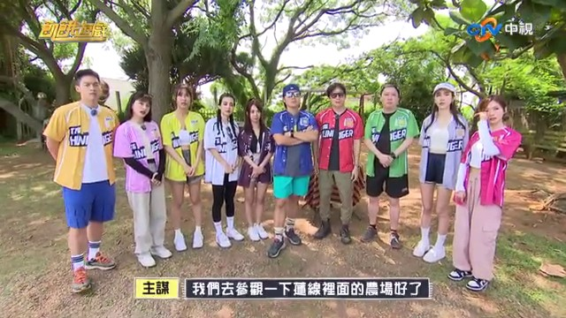
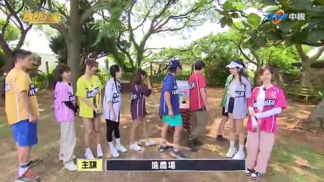
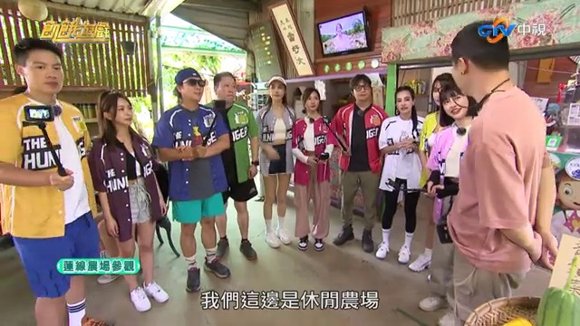
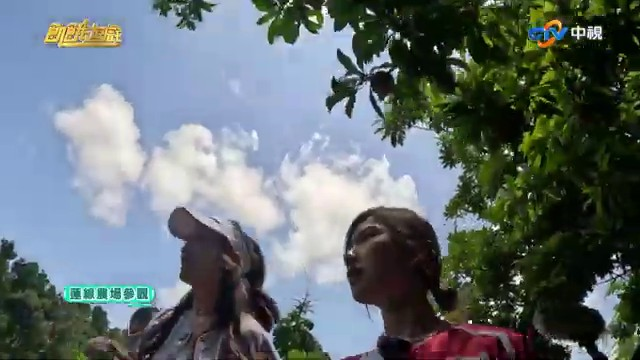

# 2023桃園蓮花季 在觀音區蓮花園休閒農業區與你蓮線！

## 影片基本資訊
- **資料編號**：`extra_046`
- **頻道來源**：飢餓遊戲Hunger Games
- **原始網址**：[https://www.youtube.com/watch?v=rr9f5PtRcPk](https://www.youtube.com/watch?v=rr9f5PtRcPk)
- **處理狀態**：success (whisper (base))
- **擷取時間**：2026-11-05T15:48:22+08:00

## 代表性畫面截圖
### 畫面 [02:07] - 連線裡面的農場好了

### 畫面 [02:29] - 進農場進農場

### 畫面 [02:53] - 休息的農場

### 畫面 [06:32] - 蓮花

## 字幕逐字稿內容
- `[00:00]` 這裡是...
- `[00:02]` 是外桃園耶
- `[00:04]` 還有掌握耶
- `[00:06]` 舉掌環
- `[00:07]` 這次是...
- `[00:11]` 歡迎大家
- `[00:12]` 我是桃園
- `[00:13]` 是政府邏輯局長
- `[00:14]` 陳冠義
- `[00:15]` 大家好
- `[00:16]` 大家好
- `[00:17]` 我是連花園修期
- `[00:18]` 李市長黃陳昌
- `[00:19]` 年少年
- `[00:20]` 好
- `[00:21]` 我是連花園修期總幹事
- `[00:23]` 鄭國全
- `[00:25]` 大家來玩了
- `[00:26]` 歡迎大家
- `[00:27]` 來參加2023年
- `[00:28]` 桃園的連花園
- `[00:30]` 就在我們關於
- `[00:31]` 前面有一個連線
- `[00:33]` 我們這一次的連花機的主機
- `[00:35]` 就是連線
- `[00:36]` 我們非常多的裝置藝術
- `[00:38]` 還有農事體
- `[00:39]` 歡迎大家來玩
- `[00:41]` 所以不是只有在一個點而已
- `[00:42]` 對...
- `[00:43]` 到處做的好事好玩
- `[00:44]` 好看好記載的地方
- `[00:46]` 這連線名字曲的很好玩
- `[00:47]` 對
- `[00:48]` 我們在今年7月1號到8月20號
- `[00:50]` 就在我們的連花園修期的農業區
- `[00:52]` 這整片都非常多的連花
- `[00:55]` 也可以來這邊
- `[00:56]` 說看花
- `[00:57]` 也可以來吃我們的
- `[00:58]` 非常多的
- `[00:59]` 像客家料理
- `[01:00]` 都可以讓大家來這邊體驗
- `[01:02]` 太棒了
- `[01:03]` 來,這個
- `[01:04]` 這個用盒葉去做的
- `[01:05]` 米粉
- `[01:06]` 這我們遊客中心開發的
- `[01:07]` 蓮紙薄薩
- `[01:10]` 薄薩
- `[01:11]` 薄薩
- `[01:12]` 薄薩
- `[01:13]` 蓮紙薄薩
- `[01:14]` 差一點
- `[01:15]` 蓮紙有些畫面
- `[01:17]` 他回家穿的
- `[01:18]` 我在意你們剛剛自己講
- `[01:19]` 蓮紙薄薩
- `[01:20]` 我想說蓮紙還可以做薄薩
- `[01:21]` 薄薩
- `[01:22]` 好厲害
- `[01:23]` 那這裡你都燈
- `[01:25]` 蓮紙
- `[01:26]` 蓮紙
- `[01:27]` 蓮紙
- `[01:28]` 香水蓮紙
- `[01:29]` 泡茶
- `[01:30]` 泡茶也可以
- `[01:31]` 可以
- `[01:34]` 不要我們所有的觀眾朋友
- `[01:36]` 7月1號到8月20號
- `[01:38]` 到我們觀以來
- `[01:39]` 欣賞我們的廉花
- `[01:40]` 那在這邊打卡
- `[01:42]` 拍照
- `[01:43]` 上傳我們的IG
- `[01:45]` 我們就有豐富的獎品送給大家
- `[01:47]` 是
- `[01:48]` 太好了
- `[01:49]` 所以等於有在玩
- `[01:50]` 有在吃
- `[01:51]` 是
- `[01:52]` 有的
- `[01:53]` 吃好玩
- `[01:54]` 好康好精彩
- `[01:55]` 就在我們2023
- `[01:57]` 好玩的電話戲
- `[01:58]` 歡迎大家
- `[01:59]` 謝謝
- `[02:00]` 謝謝
- `[02:01]` 謝謝
- `[02:02]` 好玩
- `[02:03]` 這一關
- `[02:04]` 因為剛剛講到連線
- `[02:05]` 對
- `[02:06]` 去參觀一下
- `[02:07]` 連線裡面的農場好了
- `[02:09]` 每個地方都先去看一下
- `[02:10]` 對
- `[02:11]` 旅行團嘛
- `[02:13]` 旅行團
- `[02:14]` 他就安排了這些
- `[02:15]` 我跟你講戴回應地
- `[02:16]` 有一些要買那個
- `[02:17]` 什麼伴手禮啊之類的心
- `[02:18]` 對
- `[02:19]` 伴手禮
- `[02:20]` 伴手禮
- `[02:21]` 伴手禮
- `[02:22]` 伴手禮
- `[02:23]` 伴手禮
- `[02:24]` 伴手禮
- `[02:25]` 好有紀念是兵啊
- `[02:26]` 然後這這這
- `[02:27]` 新的這這這
- `[02:28]` 夠夠夠
- `[02:29]` 進農場進農場
- `[02:30]` 參觀囉
- `[02:31]` 好
- `[02:32]` 到了
- `[02:35]` 老師機了
- `[02:36]` 我們要記下有幾個同學
- `[02:38]` 記下幾個同學
- `[02:39]` 拿手機
- `[02:40]` 對
- `[02:41]` 拿來一個手機的
- `[02:42]` 對
- `[02:43]` 歡迎大家
- `[02:44]` 歡迎大家
- `[02:45]` 請再講話
- `[02:46]` 再講話
- `[02:47]` 老師
- `[02:48]` 我們的導覽員內長
- `[02:49]` 歡迎大家來到桃園環
- `[02:51]` 我們這邊是連合院
- `[02:53]` 休息的農場
- `[02:54]` 那我是這邊的那個
- `[02:56]` 小院主
- `[02:57]` 連合院就是有
- `[02:58]` 連花又有合化的意思嗎
- `[03:00]` 對
- `[03:01]` 對
- `[03:02]` 然後我們這邊
- `[03:03]` 關卡案牌什麼
- `[03:04]` 對
- `[03:05]` 對
- `[03:08]` 所以我先講話算是
- `[03:10]` 你要講話
- `[03:11]` 那這樣就是有
- `[03:12]` 那這樣就是
- `[03:13]` 對
- `[03:14]` 那這樣就是
- `[03:15]` 圓區呢
- `[03:16]` 我們
- `[03:17]` 練記大家
- `[03:18]` 記下幾下
- `[03:19]` 我們主打的
- `[03:20]` 主打的
- `[03:21]` 連花
- `[03:22]` 還有碎墊
- `[03:23]` 碎墊
- `[03:24]` 很多不一樣的
- `[03:25]` 碎墊
- `[03:26]` 連花跟碎墊
- `[03:27]` 小夥伴我開問一下那個
- `[03:28]` 待會你們的題目
- `[03:29]` 是什麼為基準出題
- `[03:31]` 以我為基準
- `[03:32]` 以我為基準
- `[03:33]` 以我為基準
- `[03:34]` 以我為基準
- `[03:36]` 以我為基準
- `[03:37]` 所以我們要仔細聽
- `[03:39]` 是
- `[03:40]` 那萬一才沒有啦
- `[03:42]` 因為是
- `[03:43]` 然後我們圓區裡面
- `[03:44]` 不只有連花
- `[03:45]` 還有很多裝置藝術
- `[03:48]` 對
- `[03:49]` 然後我們都會給
- `[03:50]` 特別有可能
- `[03:51]` 然後去參考說
- `[03:52]` 真的
- `[03:53]` 它這邊還有貼照片
- `[03:54]` 就是遊客
- `[03:55]` 來可以看一下說
- `[03:56]` 這樣開
- `[03:58]` 可以請教現在
- `[03:59]` 人可以坐在這上面的
- `[04:00]` 這個嗎
- `[04:01]` 這個是連花嘛對不對
- `[04:02]` 你看到重點了
- `[04:03]` 我們在每年7月到10月的時候
- `[04:05]` 都有讓遊客去體驗那個
- `[04:07]` 證實當地的話
- `[04:08]` 它會長
- `[04:11]` 所以可以
- `[04:14]` 所以
- `[04:15]` 所以大王連的
- `[04:16]` 成宰重量
- `[04:17]` 是取決於大王連大過小
- `[04:19]` 對
- `[04:20]` 那我們現在
- `[04:21]` 讓大家自由去拍照好不好
- `[04:23]` 拍照
- `[04:24]` 對啊
- `[04:25]` 有這麼沒有戴手機
- `[04:26]` 就完全不想拍照
- `[04:27]` 很像
- `[04:28]` 好熱
- `[04:29]` 那是戴手拍照
- `[04:30]` 對 所以要拍快一點
- `[04:32]` 沒有戴手機
- `[04:33]` 沒有戴手機
- `[04:34]` 是要拍照
- `[04:36]` 這是短筋嗎
- `[04:37]` 他怎麼過世
- `[04:38]` 對啊 我剛剛就說
- `[04:39]` 什麼要短筋啊
- `[04:40]` 對啊
- `[04:41]` 所以我就開始短筋
- `[04:42]` 這應該就被統統了
- `[04:43]` 他很像耶
- `[04:44]` 如果不是找東西
- `[04:46]` 就是要拍那個照片
- `[04:48]` 我們現在要拍大王連的照片
- `[04:51]` 我知道耶
- `[04:52]` 因為他其實有三種照片
- `[04:54]` 而且他現在
- `[04:55]` 現在就要拍照片
- `[04:56]` 因為我就沒辦法
- `[04:57]` 確定我看得到
- `[04:58]` 沒有 沒比他叫我們這樣做
- `[04:59]` 其實就已經是一個
- `[05:00]` 可以對的模式
- `[05:01]` 對
- `[05:02]` 看一下
- `[05:04]` 可是大王連在哪裡啊
- `[05:07]` 現在應該不行吧
- `[05:08]` 去拍照片
- `[05:09]` 啊 去拍照片
- `[05:10]` 去拍照片
- `[05:12]` 來 這邊
- `[05:14]` 這邊有上出線可以當嗎
- `[05:17]` 不過是在那邊拍照
- `[05:19]` 有可能 我們就先拍
- `[05:20]` 但是如果是的話
- `[05:21]` 有點太簡單
- `[05:22]` 我覺得
- `[05:23]` 那他為什麼叫我們去拍照
- `[05:25]` 去哪拍
- `[05:26]` 一定有什麼吧
- `[05:27]` 一定有什麼吧
- `[05:28]` 一定有事情
- `[05:29]` 自由參觀啊
- `[05:30]` 自由參觀不需要拍照啊
- `[05:32]` 我剛剛長官好介紹啊
- `[05:34]` 短筋怎麼辦
- `[05:38]` 拍短筋幹嘛
- `[05:39]` 他不可能說跟短筋拍照啦
- `[05:41]` 先拍起來 備用
- `[05:44]` 先拍一下備用
- `[05:45]` 他說要拍短筋
- `[05:46]` 可是這個不是短筋耶
- `[05:48]` 這是不是
- `[05:49]` 你一定不是是短筋是誰的
- `[05:50]` 對
- `[05:53]` 短筋是這個啦
- `[05:55]` 那我們去找碎蓮啦
- `[05:57]` 我覺得一定跟碎蓮有關係啦
- `[06:00]` 1 2 3
- `[06:03]` 碎
- `[06:05]` 有了
- `[06:06]` 應該參觀五分鐘就可以走了
- `[06:08]` 一定要趕快啦
- `[06:10]` 要趕快啦
- `[06:11]` 要趕快啦
- `[06:12]` 要找到這種
- `[06:13]` 不錯
- `[06:15]` 合照
- `[06:16]` 合照對
- `[06:17]` 對
- `[06:18]` 要追到合照
- `[06:19]` 是不是要越多人合照越好
- `[06:20]` 來
- `[06:21]` 一起來
- `[06:22]` 一起來
- `[06:23]` 一起來
- `[06:24]` 1 2 3
- `[06:30]` 不要掉
- `[06:32]` 蓮花
- `[06:33]` 蓮花啦
- `[06:34]` 蓮一定要啦
- `[06:35]` 要聽老師的話對不對
- `[06:36]` 這哪裡啊
- `[06:37]` 為什麼沒有看到大王爺
- `[06:39]` 這裡
- `[06:40]` 大王聯區
- `[06:43]` 這裡
- `[06:44]` 這裡
- `[06:46]` 這裡
- `[06:47]` 有個樣子
- `[06:48]` 是不是要拍出一樣的至少一張
- `[06:50]` 對啦
- `[06:51]` 我跟妳講拍
- `[06:52]` 那邊那邊那邊那邊可以
- `[06:53]` 大王聯區快點
- `[06:54]` 這裡
- `[06:55]` 可以去拍
- `[06:57]` 至拍
- `[06:58]` 裝置一組
- `[06:59]` 至拍
- `[07:00]` 3
- `[07:03]` OK
- `[07:06]` 他們是不是
- `[07:07]` 他們已經不管了吧
- `[07:08]` 開始在至拍了
- `[07:09]` 這有點在加亂拍了
- `[07:12]` 沒有 我覺得一定是有什麼
- `[07:15]` 指定的任務
- `[07:18]` 他不會告訴你
- `[07:19]` 他會摸摸讓你看你
- `[07:20]` 去有沒有做到任務一樣
- `[07:22]` 不要都被移開啦
- `[07:24]` 那個
- `[07:25]` 有準備伴手禮的大家
- `[07:27]` 我們長這樣子
- `[07:28]` 我們真的會神經息息的
- `[07:29]` 好難就這樣吧
- `[07:30]` 我們很感謝
- `[07:31]` 好難
- `[07:32]` 我精神衰落了啦
- `[07:34]` 什麼可能
- `[07:35]` 你知道看我們的
- `[07:36]` 對
- `[07:37]` 我們農場這邊
- `[07:38]` 我們可以帶給大家
- `[07:39]` 謝謝
- `[07:40]` 我們的大家子
- `[07:41]` 一人一個
- `[07:42]` 謝謝
- `[07:43]` 謝謝
- `[07:47]` 可以
- `[07:48]` 旅行車上可以吃啊
- `[07:49]` 車上可以吃啊
- `[07:50]` 車上可以吃啊
- `[07:51]` 對
- `[07:52]` 什麼東西
- `[07:55]` 我們來上車上車
- `[07:56]` 我們去
- `[07:57]` 這邊是冰的
- `[07:57]` 謝謝
- `[07:58]` 我們先幫我
- `[07:59]` 我不相信
- `[08:00]` 我們先幫忙
- `[08:01]` 好呢
- `[08:02]` 我們先幫忙
- `[08:03]` 我們先幫忙
- `[08:04]` 好快
- `[08:11]` 當好人還是腦袋壞掉了
- `[08:13]` 一項覆黑的導遊
- `[08:14]` 胡公里
- `[08:15]` 又在賣什麼藥了嗎
- `[08:17]` 聰明群的小星機
- `[08:18]` 使得越來越盧火純青
- `[08:21]` 2023年
- `[08:22]` 桃園連花季
- `[08:24]` 開始了活動日期
- `[08:26]` 開始了活動日期
- `[08:29]` 好
- `[08:30]` 你愛兩年
- `[08:31]` 你愛兩年
- `[08:32]` 你愛兩年
- `[08:33]` 你愛兩年
- `[08:36]` 不是幫我手壓
- `[08:45]` 你愛兩年
- `[08:47]` 謝謝
- `[08:48]` 車上可以吃啊
- `[08:49]` 車上可以吃啊
- `[08:50]` 上車上可以
- `[08:51]` 上車上可以吃啊
- `[08:52]` 我們先幫忙
- `[08:53]` 真的是冰的耶
- `[08:54]` 謝謝
- `[08:55]` 我真的不相信
- `[08:57]` 你喜歡我嗎
- `[08:58]` 幫忙
- `[08:59]` 我們先幫忙
- `[09:00]` 我們先幫忙
- `[09:01]` 不會吃
- `[09:02]` 還不會
- `[09:04]` 你拿出來
- `[09:05]` 你拿出來
- `[09:07]` 你拿出來
- `[09:08]` 你那個字
- `[09:09]` 他們兩個喝幾
- `[09:11]` 打眼
- `[09:12]` 我打眼
- `[09:13]` 他裡面其實有長東西
- `[09:16]` 有一個
- `[09:17]` 就是肉狀
- `[09:18]` 因為沒有那個汁條
- `[09:19]` 很快的行程
- `[09:21]` 可以這樣
- `[09:22]` 換菜
- `[09:23]` 多了
- `[09:24]` 是
- `[09:25]` 蓮子
- `[09:26]` 頭髮上好身
- `[09:27]` 好身
- `[09:28]` 上車的路上的旋軸光了
- `[09:31]` 你還有
- `[09:31]` 你是不是
- `[09:32]` 什麼人吃飯吧
- `[09:34]` 而且你也超多顆蓮子
- `[09:36]` 對
- `[09:36]` 雜食的
- `[09:37]` 你只要帶走多蓮子
- `[09:38]` 而且鳳梨是它是冰起來的
- `[09:40]` 所以現在又很熱
- `[09:42]` 吃這個冰就覺得超讚
- `[09:44]` 你要幹嘛
- `[09:45]` 好
- `[09:46]` 我剛剛叫什麼過去
- `[09:47]` 旅行團
- `[09:48]` 對啊
- `[09:49]` 有吃
- `[09:50]` 有吃又有這個餐館耶
- `[09:51]` 很好
- `[09:51]` 然後現在我問幾個對不對
- `[09:53]` 沒有啦
- `[09:53]` 你不要煮
- `[09:54]` 最後一位
- `[09:55]` 小任務
- `[09:56]` 沒有啦
- `[09:57]` 開機張照片
- `[09:58]` 沒有啦
- `[09:59]` 沒有
- `[10:09]` 這個凌傢...
- `[10:10]` 凌傢
- `[10:11]` 不錯
- `[10:12]` 好凌傢
- `[10:13]` 我們也來過吧
- `[10:13]` 我們去過
- `[10:14]` 來過
- `[10:15]` 有客廚姐那一集
- `[10:17]` 你好
- `[10:18]` 謝謝
- `[10:19]` 你好
- `[10:20]` 不錯
- `[10:21]` 謝謝
- `[10:22]` 好多姐
- `[10:23]` 來
- `[10:23]` 來
- `[10:23]` 對吧
- `[10:24]` 是
- `[10:24]` 因為我們之前有來過
- `[10:25]` 可是我們來到凌傢
- `[10:26]` 古錯
- `[10:27]` 我以為是那邊的那個山河
- `[10:28]` 圓了里河
- `[10:29]` 我那時候
- `[10:29]` 我小時候長大的地方
- `[10:30]` 那是你的住家
- `[10:32]` 這邊呢
- `[10:33]` 這邊是你小時候的花園
- `[10:34]` 我們就是把古錯
- `[10:37]` 跟之前以前的農地
- `[10:40]` 結合整一個古錯裡面
- `[10:42]` 配合一個休閒農場
- `[10:45]` 好厲害
- `[10:46]` 那我們就請老闆帶我們來
- `[10:48]` 稍微參觀一下囉
- `[10:49]` 沒有
- `[10:50]` 我們這個待會要講到
- `[10:51]` 一些東西完了以後
- `[10:52]` 我們要去拍照
- `[10:53]` 會有...有嗎
- `[10:55]` 沒關係
- `[10:55]` 你就跟著就走
- `[10:56]` 來
- `[10:56]` 走一點
- `[10:57]` 走一點
- `[10:58]` 走一點
- `[10:59]` 很重要的很簡單
- `[11:00]` 我們古錯
- `[11:01]` 到今年已經一百三十二年了
- `[11:03]` 一百三十
- `[11:04]` 我們林家那種
- `[11:06]` 農場的種面積
- `[11:08]` 好
- `[11:08]` 林家的種面積
- `[11:09]` 有大概七角
- `[11:10]` 七角
- `[11:11]` 但現在使用的面積
- `[11:13]` 大概有三角
- `[11:14]` 三角
- `[11:15]` 好 你不要介紹
- `[11:15]` 我覺得差不多
- `[11:16]` 差不多
- `[11:16]` 我們要記得差不多了
- `[11:17]` 你在講
- `[11:18]` 多麼我們就忘記了
- `[11:19]` 謝謝
- `[11:19]` 那這個呢
- `[11:20]` 一百三十二
- `[11:21]` 我們現在看到前面
- `[11:22]` 這個是林花姐的這樣
- `[11:24]` 在最後段那一邊
- `[11:26]` 是應該講全國
- `[11:27]` 最大的屋住場的區域
- `[11:29]` OK
- `[11:30]` 屋房
- `[11:31]` 十二月到四月
- `[11:33]` 夏天子林花姐對不對
- `[11:35]` 對
- `[11:35]` 冬天的話是可以挖臉的
- `[11:38]` 好遠
- `[11:39]` 然後往前走一下
- `[11:40]` 來 兄弟 我要走一下
- `[11:41]` 好 我要把三十二
- `[11:43]` 七角
- `[11:44]` 七角
- `[11:45]` 七角
- `[11:45]` 三角
- `[11:46]` 那可以挖一下嗎
- `[11:47]` 你是不是把肥肉
- `[11:48]` 三十歲的林花姐
- `[11:50]` 十二月到四月
- `[11:51]` 他不是有林花嗎
- `[11:52]` 就是這樣
- `[11:52]` 對
- `[11:53]` 對
- `[11:54]` 我那麼高
- `[11:55]` 對
- `[11:55]` 這個是十二月
- `[11:56]` 十二月
- `[11:57]` 今天上下午
- `[11:58]` 這個高了
- `[12:00]` 然後還有小船
- `[12:01]` 可以挖
- `[12:01]` 小船到六月底的時候
- `[12:04]` 你可以看到大王那邊
- `[12:06]` 大王
- `[12:06]` 就長出來了
- `[12:07]` 對 就長出來了
- `[12:08]` 長出來了
- `[12:08]` 長出來了
- `[12:09]` 謝謝大王
- `[12:10]` 好 謝謝大王
- `[12:11]` 謝謝
- `[12:12]` 謝謝大王
- `[12:13]` 來 挖一件
- `[12:14]` 要怎樣
- `[12:15]` 探官這邊
- `[12:16]` 真的有探官
- `[12:17]` 不用拍照
- `[12:18]` 不用拍照
- `[12:19]` 真的不用拍照
- `[12:20]` 好 那沒有辦法有位置
- `[12:22]` 他是不是要出關卡了
- `[12:23]` 你要出關卡了
- `[12:24]` 我居這裡有鳥居
- `[12:25]` 居要關卡
- `[12:26]` 我覺得
- `[12:27]` 我覺得我經過了上一關之後
- `[12:29]` 我有點不想在醫生醫生
- `[12:31]` 會是
- `[12:32]` 會什麼
- `[12:33]` 很累
- `[12:34]` 很痛苦
- `[12:35]` 明明就一定要想痛苦
- `[12:36]` 你要在那邊
- `[12:37]` 肺疑猜的
- `[12:38]` 肥肉拍照
- `[12:39]` 而且
- `[12:40]` 都沒辦法好好逛
- `[12:41]` 而且順同學
- `[12:42]` 順同學 兩兩一組
- `[12:43]` 他也有偷翻了
- `[12:44]` 有嗎
- `[12:45]` 沒有 剛剛沒有說兩兩一組
- `[12:46]` 來 給他一組
- `[12:47]` 來 給他偷偷幹嘛
- `[12:48]` 沒有 給他一組
- `[12:48]` 我剛剛一直正在我旁邊幹嘛
- `[12:49]` 你走開啦
- `[12:50]` 你走開啦
- `[12:52]` 你一直在我旁邊
- `[12:53]` 我還想過兩兩一組
- `[12:54]` 那我就找別人啊
- `[12:55]` 我
- `[12:56]` 我有看手裡哦
- `[12:58]` 有看手裡
- `[12:59]` 對
- `[13:00]` 好厲害
- `[13:02]` 我跟各位特別介紹一下
- `[13:04]` 好
- `[13:05]` 這個臉子
- `[13:06]` 聽起來是我們臉家補充
- `[13:09]` 為了自己種的草呢
- `[13:11]` 臉子買了一台
- `[13:13]` 義大利冰淇淋機
- `[13:14]` 這很完全無天家的
- `[13:17]` 這非常香濃 可口
- `[13:19]` 非常好吃的冰淇淋
- `[13:22]` 今天呢
- `[13:23]` 一人生意
- `[13:24]` 這還要冰家補充
- `[13:25]` 一定要吃這個冰淇淋
- `[13:27]` 都是最天然的食材
- `[13:29]` 這完全沒有冰淇淋
- `[13:30]` 完全沒有冰家
- `[13:31]` 臉子健康啊
- `[13:32]` 好好吃哦
- `[13:33]` 我們站站站
- `[13:34]` 那我們就謝謝老闆
- `[13:36]` 謝謝
- `[13:37]` 來 走
- `[13:38]` 上車
- `[13:39]` 車上車
- `[13:40]` 車上車
- `[13:41]` 這個很棒
- `[13:42]` 好好吃哦
- `[13:43]` 哇
- `[13:45]` 這個冰淇淋
- `[13:46]` 好特別哦
- `[13:47]` 怎麼說
- `[13:48]` 它就把臉子打碎
- `[13:49]` 一光在
- `[13:50]` 不知道臉淇淋
- `[13:51]` 有這樣刹刹
- `[13:52]` 對
- `[13:53]` 口感就是有點刺刺
- `[13:55]` 刺刺的這樣
- `[13:56]` 義大利
- `[13:57]` 都刹刺刺
- `[13:58]` 刹刺的好
- `[13:58]` 實際上就都刹刺
- `[14:11]` 今天不錯
- `[14:12]` 這個旅行團
- `[14:12]` 有讓我們一直吃到東西
- `[14:14]` 真的
- `[14:14]` 前面我們都是吃到甜點
- `[14:16]` 到了這個關卡
- `[14:17]` 我們剛剛說
- `[14:18]` 有鹹的哦
- `[14:20]` 不過這個擺起來
- `[14:21]` 有點奇怪哦
- `[14:22]` 每個字有一點閃
- `[14:24]` 對 真的
- `[14:25]` 飯顏少了
- `[14:25]` 然後前面有個臨智怎麼回事
- `[14:28]` 經過剛才的餐官嗎
- `[14:29]` 大家應該更了解
- `[14:30]` 桃園的連線
- `[14:32]` 的魅力嘛
- `[14:32]` 對
- `[14:34]` 現在進入狀頭戲
- `[14:35]` 你狀頭戲
- `[14:36]` 現在我們會以連線之旅
- `[14:38]` 獲得的資訊
- `[14:40]` 來出題目
- `[14:41]` 你們要進行一對一的搶答
- `[14:43]` 真的嗎
- `[14:45]` 不是
- `[14:45]` 我們做這麼裡面
- `[14:46]` 怎麼出去搶答
- `[14:47]` 對
- `[14:48]` 一對一
- `[14:49]` 對
- `[14:50]` 答對的
- `[14:51]` 可以直接選擇
- `[14:52]` 一道料
- `[14:52]` 來吃
- `[14:54]` 完美
- `[14:55]` 搶答
- `[14:56]` 是一半的成
- `[14:57]` 題目兩個人都答錯了話
- `[14:59]` 料理我們所懂
- `[15:00]` 我們自己吃
- `[15:01]` 是我們吃的
- `[15:02]` 我們吃的
- `[15:03]` 所以一定
- `[15:04]` 一對一
- `[15:04]` 然後一定得答
- `[15:06]` 就算是一個答錯
- `[15:07]` 第二個也得答
- `[15:08]` 如果第二個也是錯
- `[15:09]` 就沒有錯
- `[15:10]` 沒有
- `[15:11]` 然後答題的PK組合
- `[15:13]` 是我們抽出一位
- `[15:14]` 然後他來指定PK對象
- `[15:19]` 但是每個人
- `[15:20]` 只有被選擇兩次的機會
- `[15:21]` 那兩次都沒有撞
- `[15:22]` 他就沒了
- `[15:23]` 對啊
- `[15:24]` 好
- `[15:24]` 瞭解
- `[15:25]` 來
- `[15:25]` 來嘛
- `[15:26]` 所以先一位抽一位
- `[15:28]` 這是誰寄的駐
- `[15:29]` 誰寄的駐
- `[15:30]` 這樣子都忘記
- `[15:31]` 真的是過分
- `[15:32]` 什麼
- `[15:33]` 什麼
- `[15:34]` 你來指定
- `[15:35]` 誰寄的
- `[15:37]` 我真的
- `[15:37]` 清楚的
- `[15:38]` 對啊
- `[15:39]` 就是剛剛不專心的嘛
- `[15:41]` 然後就是
- `[15:42]` 可能也頭腦沒有那麼清楚的
- `[15:44]` 然後可能就是
- `[15:46]` 也就從到底在亂的
- `[15:48]` 在五、四、三的
- `[15:49]` 在五、三的
- `[15:50]` 然後也就是裡面幾個
- `[15:51]` 比較差的
- `[15:52]` 然後比較笨的
- `[15:53]` 比較笨的
- `[15:54]` 比較笨的
- `[15:55]` 比較沒用的
- `[15:56]` 絕對會贏的
- `[16:01]` 你最把吃的話
- `[16:04]` 你確定你要找
- `[16:06]` 你確定要找
- `[16:07]` 我找找
- `[16:08]` 好
- `[16:11]` 有第一道菜是什麼
- `[16:15]` 你有約了我選你
- `[16:16]` 我決了
- `[16:17]` 我想選你
- `[16:18]` 有
- `[16:19]` 我想選你
- `[16:20]` 因為我覺得你從那裡
- `[16:21]` 他還沒搞清楚這個理解
- `[16:22]` OK
- `[16:23]` 你們兩個差不多
- `[16:24]` 他有講我
- `[16:25]` 我是有講你什麼是不是
- `[16:27]` 他應該在隨我
- `[16:28]` 腿底是你說在那五、四、三
- `[16:30]` 快
- `[16:31]` 我等一下
- `[16:32]` 我放輕鬆鬆
- `[16:33]` 我讓他們兩個來好了好不好
- `[16:34]` 我覺得他們兩個
- `[16:35]` 會比較精采一點
- `[16:37]` 來了
- `[16:38]` 來了
- `[16:39]` 第一題
- `[16:40]` 連線之旅
- `[16:41]` 第一個頂點是哪裡
- `[16:47]` 連
- `[16:48]` 合
- `[16:49]` 對
- `[16:50]` 不是答對
- `[16:53]` 對沒錯
- `[16:56]` 好一定是蓋肉
- `[16:58]` 對
- `[16:59]` 烤肉
- `[17:00]` 天啊
- `[17:01]` 一定是招牌控肉啊
- `[17:03]` 可以開動是不是
- `[17:05]` 你吃得不軟耶
- `[17:06]` 如果下一個人開始在指定我
- `[17:07]` 我又可以再出去嘛對不對
- `[17:08]` 對
- `[17:09]` 不該吃
- `[17:10]` 那你說我都會吃兩道耶
- `[17:11]` 對
- `[17:12]` 好
- `[17:13]` 誰敢選這個
- `[17:14]` 誰會來選你啊
- `[17:15]` 指定我啦
- `[17:16]` 很難啦
- `[17:17]` 再往後
- `[17:19]` 好
- `[17:20]` 選誰
- `[17:23]` 好
- `[17:24]` 選
- `[17:25]` 好野人和歌
- `[17:26]` 原和歌
- `[17:27]` 他想像你指定要在我的心裡
- `[17:28]` 那他如果
- `[17:29]` 讓他如果再贏
- `[17:30]` 他就指兩道菜
- `[17:32]` 可是那就少一個人拿線走啦
- `[17:34]` 一個人最多肉眼兩次啦
- `[17:36]` 你完蛋了
- `[17:38]` 你真的完蛋了
- `[17:39]` 我就會讓你我跟妳講
- `[17:40]` 不要讓我
- `[17:41]` 指兩道菜
- `[17:42]` 我剛剛好認真啊
- `[17:43]` 叫字
- `[17:45]` 我要選
- `[17:46]` 是你好不好
- `[17:47]` 是你好不好
- `[17:49]` 好
- `[17:50]` 這個不錯
- `[17:51]` 好來
- `[17:52]` 原和原休閒同場
- `[17:55]` 這大王連最多
- `[17:56]` 可沉重多少攻擊
- `[17:57]` 快點
- `[17:59]` 80
- `[18:01]` 對
- `[18:08]` 好,現在下一個抽錢
- `[18:09]` 人不不能再出現哦
- `[18:11]` 他真的哦
- `[18:12]` 好可惜哦
- `[18:16]` 我要選啊
- `[18:18]` 覺得...
- `[18:19]` 好想畫畫
- `[18:21]` 又是我
- `[18:22]` 我覺得你這樣吃一吃
- `[18:23]` 應該滿好的
- `[18:24]` 媒體一定會有兩道菜啊
- `[18:25]` 對,兩道菜
- `[18:27]` 請說出
- `[18:28]` 與廉花相關的一個成語
- `[18:32]` 等一下,廉花相關的一個成語
- `[18:34]` 廉花相關的一個成語
- `[18:36]` 要有連就可以了,對
- `[18:38]` 我也是相關啦
- `[18:40]` 這個要有連嗎
- `[18:41]` 對,裡面是
- `[18:42]` 要有連跟多餘的
- `[18:43]` 你知道嗎
- `[18:44]` 有連,不可以啊
- `[18:45]` 這只要有連就可以了
- `[18:46]` 好,一步行嗎
- `[18:47]` 一定要那個連
- `[18:49]` 斷絲連
- `[18:51]` 好,真的耶
- `[18:53]` 好
- `[18:56]` 好,換我要選一個下飯的囉
- `[18:58]` 選一個下飯的
- `[19:00]` 一定就客家小炒
- `[19:02]` 對啊,這個多棒
- `[19:04]` 哇,這客家小炒
- `[19:06]` 好,滿厲害
- `[19:08]` 歡迎組
- `[19:12]` 都會出去啊
- `[19:13]` 不行,其實都會出去
- `[19:15]` 其實都會出去
- `[19:21]` 你確定是歡迎我贏的
- `[19:26]` 他剛剛那個是這樣講的
- `[19:28]` 對,你確定
- `[19:29]` 第二個是
- `[19:30]` 我們外面來外炸好不好
- `[19:31]` 好
- `[19:32]` 我覺得一定是
- `[19:34]` 一定是翻譯組
- `[19:35]` 我也覺得翻譯組
- `[19:36]` 對
- `[19:38]` 聯合員修前農場的
- `[19:40]` 示範的美照中
- `[19:44]` 假的,你假的示範
- `[19:46]` 沒辦法
- `[19:47]` 打了
- `[19:48]` 打了
- `[19:49]` 請隨打
- `[19:50]` 你沒說
- `[19:54]` 你也單純
- `[19:55]` 答案是
- `[19:56]` 你也單純
- `[19:58]` 接著展現自己
- `[20:00]` 讀中人創嘴的招歌
- `[20:01]` 究竟會不會從
- `[20:03]` 問一般的題目中
- `[20:04]` 推敲出拳帽
- `[20:05]` 而意外打對呢
- `[20:07]` 好,接下來要帶大家
- `[20:09]` 來體驗速度感
- `[20:10]` 在這裡
- `[20:11]` 速度很好
- `[20:12]` 應該有車子
- `[20:13]` 怎麼會這樣
- `[20:14]` 我們真的很難走耶
- `[20:15]` 你們很難耶
- `[20:16]` 速度
- `[20:19]` 跳著跳著
- `[20:20]` 從後面再來
- `[20:22]` 跳著跳著
- `[20:23]` 誰要跳過
- `[20:24]` 等一下跳過一步
- `[20:26]` 對,跳過
- `[20:27]` 跳過
- `[20:33]` 有過壓,給的
- `[20:36]` 農場的示範的美照中
- `[20:46]` 假的,你假的示範
- `[20:47]` 沒辦法
- `[20:48]` 沒辦法
- `[20:49]` 打了
- `[20:50]` 請隨打
- `[20:51]` 沒辦法
- `[20:52]` 沒錯
- `[20:55]` 來,你單純
- `[20:56]` 對,答案是
- `[20:57]` 沒答案是
- `[20:58]` 我的答案是
- `[20:59]` 那是
- `[21:00]` 裡面的美照
- `[21:02]` 你聽完就行了
- `[21:03]` 你聽完就行了
- `[21:05]` 沒答案過
- `[21:07]` 繼續聽完題目
- `[21:08]` 聯合園修前的中場的示範美照中
- `[21:10]` 有哪一位中性兄弟
- `[21:12]` 大家對自己
- `[21:13]` 對啊,你還拍照
- `[21:16]` 對
- `[21:18]` 還沒厲害拍照
- `[21:20]` 有拍照
- `[21:21]` 那你覺得幹嘛吃啊
- `[21:22]` 對啊,幹嘛吃
- `[21:23]` 要不要唱歌
- `[21:24]` 要不要唱歌
- `[21:25]` 他剛剛講美照
- `[21:26]` 會唱歌
- `[21:27]` 我就大概知道會是什麼
- `[21:28]` 那時候
- `[21:29]` 你自己點這個示範
- `[21:30]` 趕快捲
- `[21:31]` 要拍
- `[21:32]` 這樣吃大腸
- `[21:33]` 要不要唱歌
- `[21:34]` 感覺嗎
- `[21:35]` 這樣吃大腸
- `[21:36]` 這樣吃大腸
- `[21:37]` 這樣吃大腸
- `[21:38]` 好,接下來,下一位
- `[21:39]` 好
- `[21:44]` 選
- `[21:47]` 你選就選
- `[21:48]` 還要什麼頭髮
- `[21:49]` 哇塞
- `[21:50]` 性感
- `[21:51]` 好難
- `[21:52]` 要還OK
- `[21:53]` 連線之旅
- `[21:54]` 第二個經典是哪裡
- `[21:56]` 什麼
- `[21:57]` 什麼
- `[22:01]` 你說第二個
- `[22:06]` 對
- `[22:07]` 對
- `[22:09]` 講連家補兔
- `[22:13]` 就應該又有
- `[22:15]` 好厲害
- `[22:16]` 來,只需要可以選一個菜
- `[22:17]` 羊蚊子
- `[22:20]` 特加蚊子
- `[22:22]` 新俠應該是下一個
- `[22:24]` 對
- `[22:25]` 你覺得這個大腸
- `[22:26]` 真的很好吃
- `[22:27]` 是家
- `[22:28]` 王子佳
- `[22:30]` 你要選一位
- `[22:33]` 你覺得你一定會贏的
- `[22:35]` 你選一個
- `[22:36]` 你覺得一定會贏的
- `[22:38]` 好選
- `[22:39]` 你真的會贏
- `[22:43]` 他覺得他一定會贏你
- `[22:44]` 他亂給他
- `[22:45]` 結果
- `[22:46]` 他亂給他
- `[22:49]` 他亂給他
- `[22:50]` 他亂給他
- `[22:52]` 他亂給他
- `[22:53]` 沒有
- `[22:54]` 王美
- `[22:58]` 我一定不一定
- `[22:59]` 因為我跟妳講
- `[23:01]` 剛才
- `[23:02]` 我覺得他是選對
- `[23:03]` 因為到連家補兔
- `[23:04]` 我就在那邊講說我放棄
- `[23:05]` 對
- `[23:06]` 不想要再動
- `[23:07]` 對
- `[23:08]` 而且你其實聽到
- `[23:09]` 那個
- `[23:11]` 你叫什麼叫
- `[23:12]` 趙哥
- `[23:13]` 對
- `[23:14]` 我就自己聽他在那邊
- `[23:16]` 五四三
- `[23:18]` 好,來
- `[23:19]` 近
- `[23:20]` 五秒內
- `[23:21]` 說出
- `[23:22]` 三位名字中有連花的
- `[23:24]` 電影的名人
- `[23:27]` 五秒
- `[23:28]` 你按下去
- `[23:29]` 五秒要講
- `[23:30]` 五秒名人
- `[23:31]` 很多
- `[23:32]` 按下去就講
- `[23:33]` 所以在
- `[23:36]` 不是那個臉
- `[23:37]` 不是那個臉
- `[23:39]` 不是那個臉
- `[23:41]` 那我就錯了
- `[23:43]` 那你就沒了
- `[23:44]` 那你只要想出來就有了
- `[23:46]` 對
- `[23:47]` 很簡單
- `[23:48]` 半斤
- `[23:49]` 因為要有炒字頭
- `[23:51]` 好
- `[23:55]` 慢鏡臉
- `[24:01]` 這個也可以直接
- `[24:03]` 可以直接就有了
- `[24:04]` 可以直接就有了
- `[24:05]` 然後下一位
- `[24:06]` 對
- `[24:07]` 順級倒菜
- `[24:08]` 等等
- `[24:09]` 雅安
- `[24:10]` 雅安第二次
- `[24:12]` 雅安選誰你都會輸
- `[24:15]` 現在順級倒菜三道
- `[24:17]` 好神
- `[24:19]` 三個名人名你也有想出來嗎
- `[24:21]` 沒有
- `[24:22]` 你看是不是
- `[24:23]` 那可是我跟他那禮物都答案
- `[24:25]` 那不然你就選他
- `[24:27]` 你跟他拚拚看
- `[24:30]` 來
- `[24:31]` 你們兩個拚一下
- `[24:32]` 學生你這次還沒有重就沒了
- `[24:34]` 對,他就沒了
- `[24:35]` 有兩第二次
- `[24:36]` 零家古錯
- `[24:38]` 至今有多少年
- `[24:43]` 有
- `[24:44]` 可以
- `[24:46]` 一百三十二年
- `[24:48]` 答對
- `[24:49]` 對
- `[24:51]` 我沒有記到他總共幾家地
- `[24:53]` 用了多少
- `[24:54]` 多少
- `[24:55]` 七家地
- `[24:56]` 用了三家
- `[24:57]` 對
- `[24:58]` 我出來菜工的
- `[25:00]` 來,衝到
- `[25:01]` 這一位是
- `[25:03]` 還有區域
- `[25:04]` 來,區域選一個
- `[25:06]` 只有我現在可以選的人
- `[25:07]` 有
- `[25:08]` 那三位
- `[25:09]` 順三個而已
- `[25:10]` 你已經選一位
- `[25:11]` 還有我
- `[25:12]` 對
- `[25:13]` 那我要選
- `[25:16]` 再來
- `[25:17]` 零家古錯
- `[25:18]` 第七
- `[25:19]` 原叫什麼
- `[25:22]` 是
- `[25:29]` 靠我嗎
- `[25:34]` 你很明顯真的沒在聽
- `[25:35]` 你又拿湯
- `[25:36]` 你又拿湯
- `[25:37]` 你又吃我把它吃進去
- `[25:38]` 因為你現在
- `[25:39]` 它裡面有肉
- `[25:40]` 對
- `[25:41]` 它們都沒吃到
- `[25:42]` 好
- `[25:43]` 那接下來
- `[25:44]` 給他一隻
- `[25:46]` 不行
- `[25:47]` 對
- `[25:48]` 我們要再選一個
- `[25:49]` 來,來,來,往前
- `[25:50]` 他有誰
- `[25:51]` 你身體
- `[25:52]` 你身體
- `[25:53]` 他有誰
- `[25:54]` 還有區域
- `[25:55]` 區域,走開
- `[25:56]` 區域
- `[25:57]` 好
- `[25:58]` 他還沒吃飽
- `[25:59]` 好
- `[26:00]` 讓你這樣看
- `[26:01]` 二、零二、三年
- `[26:02]` 桃園零花雞
- `[26:04]` 怎樣
- `[26:05]` 因為講到今天
- `[26:06]` 開始的活動日期
- `[26:08]` 開始的活動日期
- `[26:10]` 好
- `[26:12]` 好,你按了
- `[26:13]` 你按了
- `[26:14]` 你按了
- `[26:15]` 你按了
- `[26:16]` 你按了
- `[26:17]` 你按了
- `[26:18]` 那我按了
- `[26:19]` 然後他就把我按了
- `[26:20]` 你按了
- `[26:21]` 他把我按了
- `[26:23]` 他把我按了
- `[26:24]` 他把我按了
- `[26:25]` 他把我按了
- `[26:26]` 你按了
- `[26:27]` 你們是要的
- `[26:28]` 他在前面
- `[26:29]` 他把我按了
- `[26:30]` 他把我按了
- `[26:31]` 他把我按了
- `[26:32]` 這樣
- `[26:34]` 他用它
- `[26:37]` 要不然你不會動
- `[26:39]` 因為他也沒得按了
- `[26:40]` 等一下
- `[26:41]` 你應該是
- `[26:43]` 是
- `[26:44]` 因為妳好
- `[26:45]` 對
- `[26:46]` 對啊 吃了一口太多了
- `[26:48]` 忘了吃兩道耶
- `[26:49]` 謝謝你幫我
- `[26:50]` 看你這個什麼東西啊
- `[26:51]` 對啊 喝了一口
- `[26:52]` 喝了一口
- `[26:53]` 吃了一口
- `[26:54]` 菜了 菜了
- `[26:55]` 你選蝦啦
- `[26:56]` 對 你選蝦啦
- `[26:57]` 你選蝦啦 吃蝦
- `[26:58]` 我選蝦
- `[26:59]` 我選蝦
- `[27:00]` 我選蝦
- `[27:02]` 太明顯了吧
- `[27:03]` 你選蝦啦
- `[27:04]` 這樣我們蝦的蝦
- `[27:05]` 對 又回去就高齡菜就給
- `[27:07]` 對啊 對啊
- `[27:08]` 那你選蝦
- `[27:09]` 你選蝦啦
- `[27:10]` 我選蝦
- `[27:11]` 好
- `[27:12]` 你有一個人在請教他
- `[27:14]` 再來一遍
- `[27:15]` 你也有我的狗遊企畫
- `[27:17]` 好
- `[27:18]` 好
- `[27:19]` 你選蝦啦
- `[27:20]` 1 2 3 2 1
- `[27:24]` 你選蝦
- `[27:25]` 這樣我沒有按頭給他
- `[27:27]` 他拍一張
- `[27:28]` 我拍一張
- `[27:29]` 一過來
- `[27:30]` 好 要不要是一畫
- `[27:31]` 21畫我隨便講
- `[27:32]` 他鬼了
- `[27:33]` 臉花的臉啊
- `[27:38]` 臉花
- `[27:41]` 我不會寫啊
- `[27:42]` 就他說是要到
- `[27:43]` 我就隨便猜到
- `[27:44]` 21畫
- `[27:45]` 我選蝦
- `[27:47]` 這樣全部人玩完這個遊戲之後
- `[27:52]` 就只有兩位沒有吃到
- `[27:54]` 兩位沒吃到
- `[27:55]` 剛好就是兩位
- `[27:56]` 你記憶力剛好比較差的兩位
- `[27:58]` 沒有
- `[27:59]` 我覺得還好
- `[28:01]` 可以說
- `[28:02]` 這一餐一次的事不良
- `[28:03]` 這樣
- `[28:04]` 那我們要去聽線手囉
- `[28:05]` 走吧

## 清洗後完整文章段落
這裡是...

是外桃園耶

還有掌握耶

舉掌環

這次是...

歡迎大家

我是桃園

是政府邏輯局長

陳冠義

大家好

大家好

我是連花園修期

李市長黃陳昌

年少年

好

我是連花園修期總幹事

鄭國全

大家來玩了

歡迎大家

來參加2023年

桃園的連花園

就在我們關於

前面有一個連線

我們這一次的連花機的主機

就是連線

我們非常多的裝置藝術

還有農事體

歡迎大家來玩

所以不是只有在一個點而已

對...

到處做的好事好玩

好看好記載的地方

這連線名字曲的很好玩

對

我們在今年7月1號到8月20號

就在我們的連花園修期的農業區

這整片都非常多的連花

也可以來這邊

說看花

也可以來吃我們的

非常多的

像客家料理

都可以讓大家來這邊體驗

太棒了

來,這個

這個用盒葉去做的

米粉

這我們遊客中心開發的

蓮紙薄薩

薄薩

薄薩

薄薩

蓮紙薄薩

差一點

蓮紙有些畫面

他回家穿的

我在意你們剛剛自己講

蓮紙薄薩

我想說蓮紙還可以做薄薩

薄薩

好厲害

那這裡你都燈

蓮紙

蓮紙

蓮紙

香水蓮紙

泡茶

泡茶也可以

可以

不要我們所有的觀眾朋友

7月1號到8月20號

到我們觀以來

欣賞我們的廉花

那在這邊打卡

拍照

上傳我們的IG

我們就有豐富的獎品送給大家

是

太好了

所以等於有在玩

有在吃

是

有的

吃好玩

好康好精彩

就在我們2023

好玩的電話戲

歡迎大家

謝謝

謝謝

謝謝

好玩

這一關

因為剛剛講到連線

對

去參觀一下

連線裡面的農場好了

每個地方都先去看一下

對

旅行團嘛

旅行團

他就安排了這些

我跟你講戴回應地

有一些要買那個

什麼伴手禮啊之類的心

對

伴手禮

伴手禮

伴手禮

伴手禮

伴手禮

伴手禮

好有紀念是兵啊

然後這這這

新的這這這

夠夠夠

進農場進農場

參觀囉

好

到了

老師機了

我們要記下有幾個同學

記下幾個同學

拿手機

對

拿來一個手機的

對

歡迎大家

歡迎大家

請再講話

再講話

老師

我們的導覽員內長

歡迎大家來到桃園環

我們這邊是連合院

休息的農場

那我是這邊的那個

小院主

連合院就是有

連花又有合化的意思嗎

對

對

然後我們這邊

關卡案牌什麼

對

對

所以我先講話算是

你要講話

那這樣就是有

那這樣就是

對

那這樣就是

圓區呢

我們

練記大家

記下幾下

我們主打的

主打的

連花

還有碎墊

碎墊

很多不一樣的

碎墊

連花跟碎墊

小夥伴我開問一下那個

待會你們的題目

是什麼為基準出題

以我為基準

以我為基準

以我為基準

以我為基準

以我為基準

所以我們要仔細聽

是

那萬一才沒有啦

因為是

然後我們圓區裡面

不只有連花

還有很多裝置藝術

對

然後我們都會給

特別有可能

然後去參考說

真的

它這邊還有貼照片

就是遊客

來可以看一下說

這樣開

可以請教現在

人可以坐在這上面的

這個嗎

這個是連花嘛對不對

你看到重點了

我們在每年7月到10月的時候

都有讓遊客去體驗那個

證實當地的話

它會長

所以可以

所以

所以大王連的

成宰重量

是取決於大王連大過小

對

那我們現在

讓大家自由去拍照好不好

拍照

對啊

有這麼沒有戴手機

就完全不想拍照

很像

好熱

那是戴手拍照

對 所以要拍快一點

沒有戴手機

沒有戴手機

是要拍照

這是短筋嗎

他怎麼過世

對啊 我剛剛就說

什麼要短筋啊

對啊

所以我就開始短筋

這應該就被統統了

他很像耶

如果不是找東西

就是要拍那個照片

我們現在要拍大王連的照片

我知道耶

因為他其實有三種照片

而且他現在

現在就要拍照片

因為我就沒辦法

確定我看得到

沒有 沒比他叫我們這樣做

其實就已經是一個

可以對的模式

對

看一下

可是大王連在哪裡啊

現在應該不行吧

去拍照片

啊 去拍照片

去拍照片

來 這邊

這邊有上出線可以當嗎

不過是在那邊拍照

有可能 我們就先拍

但是如果是的話

有點太簡單

我覺得

那他為什麼叫我們去拍照

去哪拍

一定有什麼吧

一定有什麼吧

一定有事情

自由參觀啊

自由參觀不需要拍照啊

我剛剛長官好介紹啊

短筋怎麼辦

拍短筋幹嘛

他不可能說跟短筋拍照啦

先拍起來 備用

先拍一下備用

他說要拍短筋

可是這個不是短筋耶

這是不是

你一定不是是短筋是誰的

對

短筋是這個啦

那我們去找碎蓮啦

我覺得一定跟碎蓮有關係啦

1 2 3

碎

有了

應該參觀五分鐘就可以走了

一定要趕快啦

要趕快啦

要趕快啦

要找到這種

不錯

合照

合照對

對

要追到合照

是不是要越多人合照越好

來

一起來

一起來

一起來

1 2 3

不要掉

蓮花

蓮花啦

蓮一定要啦

要聽老師的話對不對

這哪裡啊

為什麼沒有看到大王爺

這裡

大王聯區

這裡

這裡

這裡

有個樣子

是不是要拍出一樣的至少一張

對啦

我跟妳講拍

那邊那邊那邊那邊可以

大王聯區快點

這裡

可以去拍

至拍

裝置一組

至拍

3

OK

他們是不是

他們已經不管了吧

開始在至拍了

這有點在加亂拍了

沒有 我覺得一定是有什麼

指定的任務

他不會告訴你

他會摸摸讓你看你

去有沒有做到任務一樣

不要都被移開啦

那個

有準備伴手禮的大家

我們長這樣子

我們真的會神經息息的

好難就這樣吧

我們很感謝

好難

我精神衰落了啦

什麼可能

你知道看我們的

對

我們農場這邊

我們可以帶給大家

謝謝

我們的大家子

一人一個

謝謝

謝謝

可以

旅行車上可以吃啊

車上可以吃啊

車上可以吃啊

對

什麼東西

我們來上車上車

我們去

這邊是冰的

謝謝

我們先幫我

我不相信

我們先幫忙

好呢

我們先幫忙

我們先幫忙

好快

當好人還是腦袋壞掉了

一項覆黑的導遊

胡公里

又在賣什麼藥了嗎

聰明群的小星機

使得越來越盧火純青

2023年

桃園連花季

開始了活動日期

開始了活動日期

好

你愛兩年

你愛兩年

你愛兩年

你愛兩年

不是幫我手壓

你愛兩年

謝謝

車上可以吃啊

車上可以吃啊

上車上可以

上車上可以吃啊

我們先幫忙

真的是冰的耶

謝謝

我真的不相信

你喜歡我嗎

幫忙

我們先幫忙

我們先幫忙

不會吃

還不會

你拿出來

你拿出來

你拿出來

你那個字

他們兩個喝幾

打眼

我打眼

他裡面其實有長東西

有一個

就是肉狀

因為沒有那個汁條

很快的行程

可以這樣

換菜

多了

是

蓮子

頭髮上好身

好身

上車的路上的旋軸光了

你還有

你是不是

什麼人吃飯吧

而且你也超多顆蓮子

對

雜食的

你只要帶走多蓮子

而且鳳梨是它是冰起來的

所以現在又很熱

吃這個冰就覺得超讚

你要幹嘛

好

我剛剛叫什麼過去

旅行團

對啊

有吃

有吃又有這個餐館耶

很好

然後現在我問幾個對不對

沒有啦

你不要煮

最後一位

小任務

沒有啦

開機張照片

沒有啦

沒有

這個凌傢...

凌傢

不錯

好凌傢

我們也來過吧

我們去過

來過

有客廚姐那一集

你好

謝謝

你好

不錯

謝謝

好多姐

來

來

對吧

是

因為我們之前有來過

可是我們來到凌傢

古錯

我以為是那邊的那個山河

圓了里河

我那時候

我小時候長大的地方

那是你的住家

這邊呢

這邊是你小時候的花園

我們就是把古錯

跟之前以前的農地

結合整一個古錯裡面

配合一個休閒農場

好厲害

那我們就請老闆帶我們來

稍微參觀一下囉

沒有

我們這個待會要講到

一些東西完了以後

我們要去拍照

會有...有嗎

沒關係

你就跟著就走

來

走一點

走一點

走一點

很重要的很簡單

我們古錯

到今年已經一百三十二年了

一百三十

我們林家那種

農場的種面積

好

林家的種面積

有大概七角

七角

但現在使用的面積

大概有三角

三角

好 你不要介紹

我覺得差不多

差不多

我們要記得差不多了

你在講

多麼我們就忘記了

謝謝

那這個呢

一百三十二

我們現在看到前面

這個是林花姐的這樣

在最後段那一邊

是應該講全國

最大的屋住場的區域

OK

屋房

十二月到四月

夏天子林花姐對不對

對

冬天的話是可以挖臉的

好遠

然後往前走一下

來 兄弟 我要走一下

好 我要把三十二

七角

七角

七角

三角

那可以挖一下嗎

你是不是把肥肉

三十歲的林花姐

十二月到四月

他不是有林花嗎

就是這樣

對

對

我那麼高

對

這個是十二月

十二月

今天上下午

這個高了

然後還有小船

可以挖

小船到六月底的時候

你可以看到大王那邊

大王

就長出來了

對 就長出來了

長出來了

長出來了

謝謝大王

好 謝謝大王

謝謝

謝謝大王

來 挖一件

要怎樣

探官這邊

真的有探官

不用拍照

不用拍照

真的不用拍照

好 那沒有辦法有位置

他是不是要出關卡了

你要出關卡了

我居這裡有鳥居

居要關卡

我覺得

我覺得我經過了上一關之後

我有點不想在醫生醫生

會是

會什麼

很累

很痛苦

明明就一定要想痛苦

你要在那邊

肺疑猜的

肥肉拍照

而且

都沒辦法好好逛

而且順同學

順同學 兩兩一組

他也有偷翻了

有嗎

沒有 剛剛沒有說兩兩一組

來 給他一組

來 給他偷偷幹嘛

沒有 給他一組

我剛剛一直正在我旁邊幹嘛

你走開啦

你走開啦

你一直在我旁邊

我還想過兩兩一組

那我就找別人啊

我

我有看手裡哦

有看手裡

對

好厲害

我跟各位特別介紹一下

好

這個臉子

聽起來是我們臉家補充

為了自己種的草呢

臉子買了一台

義大利冰淇淋機

這很完全無天家的

這非常香濃 可口

非常好吃的冰淇淋

今天呢

一人生意

這還要冰家補充

一定要吃這個冰淇淋

都是最天然的食材

這完全沒有冰淇淋

完全沒有冰家

臉子健康啊

好好吃哦

我們站站站

那我們就謝謝老闆

謝謝

來 走

上車

車上車

車上車

這個很棒

好好吃哦

哇

這個冰淇淋

好特別哦

怎麼說

它就把臉子打碎

一光在

不知道臉淇淋

有這樣刹刹

對

口感就是有點刺刺

刺刺的這樣

義大利

都刹刺刺

刹刺的好

實際上就都刹刺

今天不錯

這個旅行團

有讓我們一直吃到東西

真的

前面我們都是吃到甜點

到了這個關卡

我們剛剛說

有鹹的哦

不過這個擺起來

有點奇怪哦

每個字有一點閃

對 真的

飯顏少了

然後前面有個臨智怎麼回事

經過剛才的餐官嗎

大家應該更了解

桃園的連線

的魅力嘛

對

現在進入狀頭戲

你狀頭戲

現在我們會以連線之旅

獲得的資訊

來出題目

你們要進行一對一的搶答

真的嗎

不是

我們做這麼裡面

怎麼出去搶答

對

一對一

對

答對的

可以直接選擇

一道料

來吃

完美

搶答

是一半的成

題目兩個人都答錯了話

料理我們所懂

我們自己吃

是我們吃的

我們吃的

所以一定

一對一

然後一定得答

就算是一個答錯

第二個也得答

如果第二個也是錯

就沒有錯

沒有

然後答題的PK組合

是我們抽出一位

然後他來指定PK對象

但是每個人

只有被選擇兩次的機會

那兩次都沒有撞

他就沒了

對啊

好

瞭解

來

來嘛

所以先一位抽一位

這是誰寄的駐

誰寄的駐

這樣子都忘記

真的是過分

什麼

什麼

你來指定

誰寄的

我真的

清楚的

對啊

就是剛剛不專心的嘛

然後就是

可能也頭腦沒有那麼清楚的

然後可能就是

也就從到底在亂的

在五、四、三的

在五、三的

然後也就是裡面幾個

比較差的

然後比較笨的

比較笨的

比較笨的

比較沒用的

絕對會贏的

你最把吃的話

你確定你要找

你確定要找

我找找

好

有第一道菜是什麼

你有約了我選你

我決了

我想選你

有

我想選你

因為我覺得你從那裡

他還沒搞清楚這個理解

OK

你們兩個差不多

他有講我

我是有講你什麼是不是

他應該在隨我

腿底是你說在那五、四、三

快

我等一下

我放輕鬆鬆

我讓他們兩個來好了好不好

我覺得他們兩個

會比較精采一點

來了

來了

第一題

連線之旅

第一個頂點是哪裡

連

合

對

不是答對

對沒錯

好一定是蓋肉

對

烤肉

天啊

一定是招牌控肉啊

可以開動是不是

你吃得不軟耶

如果下一個人開始在指定我

我又可以再出去嘛對不對

對

不該吃

那你說我都會吃兩道耶

對

好

誰敢選這個

誰會來選你啊

指定我啦

很難啦

再往後

好

選誰

好

選

好野人和歌

原和歌

他想像你指定要在我的心裡

那他如果

讓他如果再贏

他就指兩道菜

可是那就少一個人拿線走啦

一個人最多肉眼兩次啦

你完蛋了

你真的完蛋了

我就會讓你我跟妳講

不要讓我

指兩道菜

我剛剛好認真啊

叫字

我要選

是你好不好

是你好不好

好

這個不錯

好來

原和原休閒同場

這大王連最多

可沉重多少攻擊

快點

80

對

好,現在下一個抽錢

人不不能再出現哦

他真的哦

好可惜哦

我要選啊

覺得...

好想畫畫

又是我

我覺得你這樣吃一吃

應該滿好的

媒體一定會有兩道菜啊

對,兩道菜

請說出

與廉花相關的一個成語

等一下,廉花相關的一個成語

廉花相關的一個成語

要有連就可以了,對

我也是相關啦

這個要有連嗎

對,裡面是

要有連跟多餘的

你知道嗎

有連,不可以啊

這只要有連就可以了

好,一步行嗎

一定要那個連

斷絲連

好,真的耶

好

好,換我要選一個下飯的囉

選一個下飯的

一定就客家小炒

對啊,這個多棒

哇,這客家小炒

好,滿厲害

歡迎組

都會出去啊

不行,其實都會出去

其實都會出去

你確定是歡迎我贏的

他剛剛那個是這樣講的

對,你確定

第二個是

我們外面來外炸好不好

好

我覺得一定是

一定是翻譯組

我也覺得翻譯組

對

聯合員修前農場的

示範的美照中

假的,你假的示範

沒辦法

打了

打了

請隨打

你沒說

你也單純

答案是

你也單純

接著展現自己

讀中人創嘴的招歌

究竟會不會從

問一般的題目中

推敲出拳帽

而意外打對呢

好,接下來要帶大家

來體驗速度感

在這裡

速度很好

應該有車子

怎麼會這樣

我們真的很難走耶

你們很難耶

速度

跳著跳著

從後面再來

跳著跳著

誰要跳過

等一下跳過一步

對,跳過

跳過

有過壓,給的

農場的示範的美照中

假的,你假的示範

沒辦法

沒辦法

打了

請隨打

沒辦法

沒錯

來,你單純

對,答案是

沒答案是

我的答案是

那是

裡面的美照

你聽完就行了

你聽完就行了

沒答案過

繼續聽完題目

聯合園修前的中場的示範美照中

有哪一位中性兄弟

大家對自己

對啊,你還拍照

對

還沒厲害拍照

有拍照

那你覺得幹嘛吃啊

對啊,幹嘛吃

要不要唱歌

要不要唱歌

他剛剛講美照

會唱歌

我就大概知道會是什麼

那時候

你自己點這個示範

趕快捲

要拍

這樣吃大腸

要不要唱歌

感覺嗎

這樣吃大腸

這樣吃大腸

這樣吃大腸

好,接下來,下一位

好

選

你選就選

還要什麼頭髮

哇塞

性感

好難

要還OK

連線之旅

第二個經典是哪裡

什麼

什麼

你說第二個

對

對

講連家補兔

就應該又有

好厲害

來,只需要可以選一個菜

羊蚊子

特加蚊子

新俠應該是下一個

對

你覺得這個大腸

真的很好吃

是家

王子佳

你要選一位

你覺得你一定會贏的

你選一個

你覺得一定會贏的

好選

你真的會贏

他覺得他一定會贏你

他亂給他

結果

他亂給他

他亂給他

他亂給他

他亂給他

沒有

王美

我一定不一定

因為我跟妳講

剛才

我覺得他是選對

因為到連家補兔

我就在那邊講說我放棄

對

不想要再動

對

而且你其實聽到

那個

你叫什麼叫

趙哥

對

我就自己聽他在那邊

五四三

好,來

近

五秒內

說出

三位名字中有連花的

電影的名人

五秒

你按下去

五秒要講

五秒名人

很多

按下去就講

所以在

不是那個臉

不是那個臉

不是那個臉

那我就錯了

那你就沒了

那你只要想出來就有了

對

很簡單

半斤

因為要有炒字頭

好

慢鏡臉

這個也可以直接

可以直接就有了

可以直接就有了

然後下一位

對

順級倒菜

等等

雅安

雅安第二次

雅安選誰你都會輸

現在順級倒菜三道

好神

三個名人名你也有想出來嗎

沒有

你看是不是

那可是我跟他那禮物都答案

那不然你就選他

你跟他拚拚看

來

你們兩個拚一下

學生你這次還沒有重就沒了

對,他就沒了

有兩第二次

零家古錯

至今有多少年

有

可以

一百三十二年

答對

對

我沒有記到他總共幾家地

用了多少

多少

七家地

用了三家

對

我出來菜工的

來,衝到

這一位是

還有區域

來,區域選一個

只有我現在可以選的人

有

那三位

順三個而已

你已經選一位

還有我

對

那我要選

再來

零家古錯

第七

原叫什麼

是

靠我嗎

你很明顯真的沒在聽

你又拿湯

你又拿湯

你又吃我把它吃進去

因為你現在

它裡面有肉

對

它們都沒吃到

好

那接下來

給他一隻

不行

對

我們要再選一個

來,來,來,往前

他有誰

你身體

你身體

他有誰

還有區域

區域,走開

區域

好

他還沒吃飽

好

讓你這樣看

二、零二、三年

桃園零花雞

怎樣

因為講到今天

開始的活動日期

開始的活動日期

好

好,你按了

你按了

你按了

你按了

你按了

你按了

那我按了

然後他就把我按了

你按了

他把我按了

他把我按了

他把我按了

他把我按了

你按了

你們是要的

他在前面

他把我按了

他把我按了

他把我按了

這樣

他用它

要不然你不會動

因為他也沒得按了

等一下

你應該是

是

因為妳好

對

對啊 吃了一口太多了

忘了吃兩道耶

謝謝你幫我

看你這個什麼東西啊

對啊 喝了一口

喝了一口

吃了一口

菜了 菜了

你選蝦啦

對 你選蝦啦

你選蝦啦 吃蝦

我選蝦

我選蝦

我選蝦

太明顯了吧

你選蝦啦

這樣我們蝦的蝦

對 又回去就高齡菜就給

對啊 對啊

那你選蝦

你選蝦啦

我選蝦

好

你有一個人在請教他

再來一遍

你也有我的狗遊企畫

好

好

你選蝦啦

1 2 3 2 1

你選蝦

這樣我沒有按頭給他

他拍一張

我拍一張

一過來

好 要不要是一畫

21畫我隨便講

他鬼了

臉花的臉啊

臉花

我不會寫啊

就他說是要到

我就隨便猜到

21畫

我選蝦

這樣全部人玩完這個遊戲之後

就只有兩位沒有吃到

兩位沒吃到

剛好就是兩位

你記憶力剛好比較差的兩位

沒有

我覺得還好

可以說

這一餐一次的事不良

這樣

那我們要去聽線手囉

走吧
