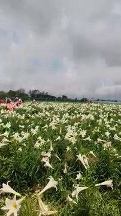
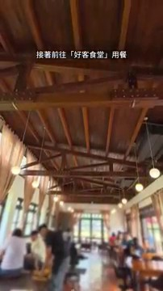
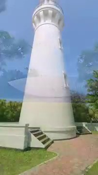

# 桃園觀音一日遊｜百合花海＋綠色隧道＋百年燈塔 #旅行 #景點 #賞花

## 影片基本資訊
- **資料編號**：`page_027`
- **頻道來源**：雲行
- **原始網址**：[https://youtube.com/shorts/uRHrog9kbvA](https://youtube.com/shorts/uRHrog9kbvA)
- **處理狀態**：success (youtube_vtt (.vtt))
- **擷取時間**：2026-11-05T14:54:08+08:00

## 代表性畫面截圖
### 畫面 [00:01] - 這次來到桃園市觀音區一日遊

### 畫面 [00:08] - 觀音區相關影片畫面

### 畫面 [00:12] - 接著前往「好客食堂」用餐

### 畫面 [00:16] - 最後到「白沙岬燈塔」參觀

## 字幕逐字稿內容
- `[00:00]` 我是雲
- `[00:01]` 這次來到桃園市觀音區一日遊
- `[00:05]` 先到「白千層鐵炮百合花園」賞花海
- `[00:08]` 再走進綠色隧道，漫步「白千層林道」
- `[00:11]` 接著前往「好客食堂」用餐
- `[00:13]` 並在「崙坪文化地景園區」散步
- `[00:16]` 最後到「白沙岬燈塔」參觀
- `[00:19]` 欲知詳情，快點連結
- `[00:21]` 若喜歡，按讚，訂閱

## 清洗後完整文章段落
我是雲

這次來到桃園市觀音區一日遊

先到「白千層鐵炮百合花園」賞花海

再走進綠色隧道，漫步「白千層林道」

接著前往「好客食堂」用餐

並在「崙坪文化地景園區」散步

最後到「白沙岬燈塔」參觀

欲知詳情，快點連結

若喜歡，按讚，訂閱
