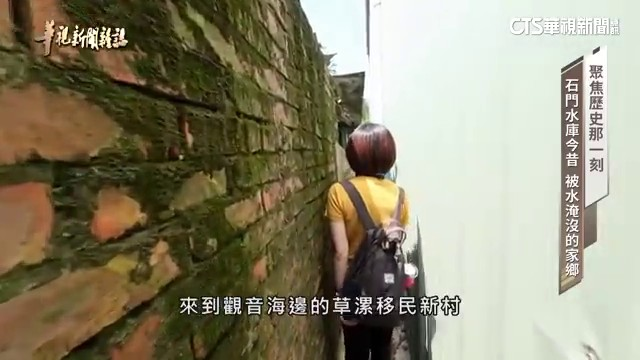
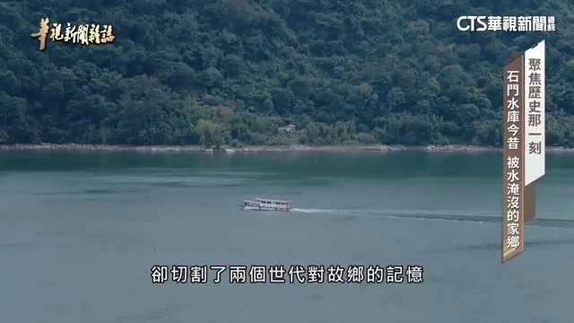
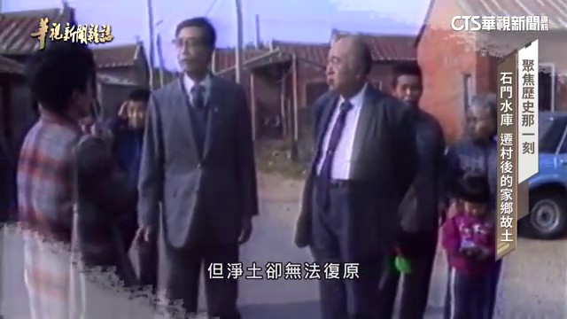

# 歷史那一刻 石門水庫遷村故事｜華視新聞雜誌｜精選

## 影片基本資訊
- **資料編號**：`page_030`
- **頻道來源**：華視新聞雜誌
- **原始網址**：[https://www.youtube.com/watch?v=AWP_v5I0zYA](https://www.youtube.com/watch?v=AWP_v5I0zYA)
- **處理狀態**：success (whisper (base))
- **擷取時間**：2026-11-05T15:06:19+08:00

## 代表性畫面截圖
### 畫面 [02:02] - 他們率先從桃園大氣的山邊

### 畫面 [04:45] - 對故鄉的記憶

### 畫面 [07:28] - 時間

### 畫面 [10:11] - 但鏡土卻無法復原

## 字幕逐字稿內容
- `[00:05]` 師妹水庫今天上午九點鐘開始學習
- `[00:08]` 不要的推力
- `[00:10]` 就是在美國四三十八十米的大案
- `[00:15]` 嘴部就要做了
- `[00:16]` 那以前的你關注就根本沒辦法
- `[00:23]` 這次的水庫之後
- `[00:24]` 次代每個人所想念的庫商都不一樣
- `[00:35]` 光復號新的水利設施不斷的新店
- `[00:39]` 增加灌蓋面積
- `[00:41]` 促進農業生產
- `[00:43]` 例如規模龐大的師妹水庫
- `[00:45]` 1964年
- `[00:46]` 師妹水庫完工
- `[00:48]` 偉大工廠的背後
- `[00:49]` 有278個家庭
- `[00:51]` 被迫搬遷的故事
- `[00:53]` 四名國四十七年搬過來的
- `[01:04]` 你沒有來就沒有了
- `[01:06]` 你也沒有錢也沒有
- `[01:08]` 勉強一定你要來的時候
- `[01:10]` 那時候沒有來
- `[01:11]` 你要退哪裡
- `[01:13]` 已經七十多歲的保留阿嬤
- `[01:15]` 前曾當時他只有十歲
- `[01:18]` 那時候都放在外面
- `[01:20]` 你不走那麼水都躲起來
- `[01:23]` 要拿東西沒辦法拿來
- `[01:27]` 來這些東西搬來
- `[01:28]` 自己放在外面
- `[01:29]` 這慢慢改方式
- `[01:30]` 早速來幫我們改
- `[01:32]` 那時候我們的木材
- `[01:34]` 什麼都搬搬過來
- `[01:36]` 奔住 奔蓋 奔苦了
- `[01:39]` 至今整田用的牧門
- `[01:41]` 這是他們警存對老家的記憶
- `[01:44]` 這個老人你看
- `[01:46]` 這個老人們
- `[01:49]` 這個那邊拆過來的你看
- `[01:53]` 第一批案置居民一共29戶
- `[01:56]` 保留阿嬤一家是其中之一
- `[01:59]` 他們率先從桃園大氣的山邊
- `[02:02]` 來到歡迎海邊的炒塌移民青春
- `[02:06]` 我們那裡是鑽大灣平第四年
- `[02:09]` 我們那裡才幾乎八乎我而已
- `[02:12]` 三乎賓過來
- `[02:14]` 來看一看就
- `[02:15]` 他有在我們來這裡看
- `[02:18]` 阿嬤要來就是
- `[02:19]` 五個人八溫弟
- `[02:21]` 六個人一家弟
- `[02:23]` 阿塌移民青春
- `[02:24]` 你抽你的房子再拿
- `[02:26]` 他的一號
- `[02:26]` 王王子是抽山
- `[02:28]` 有弟也是抽山
- `[02:29]` 對啊 都自己種流寧暗
- `[02:31]` 種的才有掌風
- `[02:34]` 有沒有
- `[02:34]` 沒有 那個都都是殺了
- `[02:37]` 六十多年過去
- `[02:38]` 他們對早年的生活記憶
- `[02:40]` 已經模糊
- `[02:41]` 現在圍繞村莊
- `[02:43]` 海偶能遮印的西蘇蘇林
- `[02:46]` 全都是移民
- `[02:47]` 親手主起的家園
- `[02:49]` 這個也是跟我們一起來的
- `[02:51]` 會有蓋這個給他看
- `[02:53]` 你才有九千塊
- `[02:55]` 還要蓋到這樣一點
- `[02:56]` 一定最起碼要蓋這個兩枕
- `[02:59]` 半千補助款不足
- `[03:01]` 蓋房子的錢從哪裡來
- `[03:04]` 凡事都得自己想辦法
- `[03:06]` 哪有公平就要蓋那個房子
- `[03:09]` 阿嬤阿森我會
- `[03:10]` 都沒有都靠自己的
- `[03:11]` 才弄出這個
- `[03:13]` 那個公公山都還被人抖殺
- `[03:15]` 阿嬤不起來
- `[03:20]` 會有二十多
- `[03:23]` 加上海邊的田地延分高
- `[03:26]` 中不出高經濟價值的作物
- `[03:28]` 收入有限
- `[03:30]` 維持生計都有困難
- `[03:33]` 半千當時阿嬤的年紀還很小
- `[03:36]` 千順的歷史
- `[03:37]` 我們只能從更年長的軍民描述
- `[03:40]` 來拼湊全貿
- `[03:42]` 半千那時候我們就是當年了
- `[03:46]` 報實提示
- `[03:48]` 年過八十的湯阿公
- `[03:50]` 在一九五八年千順當時
- `[03:52]` 沒有獲得土地補償
- `[03:54]` 加上老家的田地
- `[03:56]` 在水庫蓄水之後
- `[03:58]` 連同家屋已並淹沒
- `[04:00]` 在生活無意危機的情況之下
- `[04:03]` 一九六九年
- `[04:04]` 他們丟家半千
- `[04:06]` 到草塌以民心村
- `[04:09]` 我十六年生的時候
- `[04:11]` 我是這開會
- `[04:13]` 登記起來
- `[04:13]` 他說民國四十六年
- `[04:17]` 六月三十號
- `[04:18]` 他們就開會
- `[04:20]` 他就有所謂
- `[04:22]` 我們這個企業
- `[04:23]` 於是在開工
- `[04:25]` 國立六月三十號
- `[04:27]` 沒有開復可樂
- `[04:29]` 你就沒有建議配股地
- `[04:31]` 在湯家一名二代
- `[04:33]` 湯森林的代理下
- `[04:35]` 我們重回他在十門水庫的老家
- `[04:38]` 一趟大約五十公里的路程
- `[04:40]` 不長不短
- `[04:42]` 卻切割了兩個世代
- `[04:44]` 對故鄉的記憶
- `[04:47]` 這些年來
- `[04:48]` 在十門水庫的庫水旗
- `[04:50]` 湯森林都會帶著村中長輩
- `[04:52]` 重新踏上
- `[04:53]` 被外界稱為
- `[04:55]` 夢幻大草原的新甘平
- `[04:58]` 也是他們的老家
- `[04:59]` 日夜思念的故土
- `[05:02]` 像今天水位
- `[05:02]` 水庫水位兩百四十一名
- `[05:04]` 就看不到
- `[05:05]` 要到兩百三四名才辦法
- `[05:07]` 兩百三十二米的時候
- `[05:09]` 當然前面走半步
- `[05:10]` 它左邊的地是比較高
- `[05:12]` 就是越地越地越地
- `[05:15]` 到最後那個更低
- `[05:16]` 到兩百二十五名才看得到
- `[05:18]` 以前那個整台
- `[05:20]` 就是一個新甘平
- `[05:21]` 一個台階地形
- `[05:22]` 然後房子都靠在
- `[05:24]` 蓋的那個靠近三遙下面
- `[05:26]` 那前面就是一些農地
- `[05:28]` 後面可能還會一些茶園的主園
- `[05:32]` 1964年
- `[05:34]` 十門水庫完工之後
- `[05:35]` 上游的積水區範圍
- `[05:37]` 高達一千零二十四公斤
- `[05:40]` 所有標高兩百五十公尺
- `[05:42]` 以下的區域
- `[05:43]` 包含新舊甘平
- `[05:45]` 大西平
- `[05:46]` 阿姆平等等
- `[05:48]` 都成為水下世界
- `[05:50]` 總計影響兩千八百七十人
- `[05:54]` 根據十門水庫建設置的記錄
- `[05:56]` 整個沿墨區
- `[05:58]` 共有四百一十六戶
- `[06:00]` 但是扣除掉其他因素
- `[06:03]` 最後只剩下兩百七十八戶
- `[06:05]` 分成五批
- `[06:06]` 先後移往草塌新村
- `[06:08]` 樹林和下樹林新村
- `[06:10]` 大坦新村
- `[06:12]` 以及大輪圍
- `[06:14]` 大園鑽骨頭
- `[06:15]` 取搓杆
- `[06:16]` 還有八十二戶泰亞族
- `[06:18]` 經過邪商
- `[06:19]` 移往最靠近的大西中莊
- `[06:23]` 有四種不同的房屋形態
- `[06:26]` 然後他們所建設出來的
- `[06:27]` 順著基本上包括醫療
- `[06:29]` 緊張單位等等的
- `[06:31]` 其實都有配置
- `[06:33]` 那整個就是一個村落的一個形態
- `[06:39]` 水庫號大工程的開發
- `[06:41]` 大幅改變山串地貿
- `[06:44]` 成全經濟和安全的背後
- `[06:46]` 是來自居民離鄉的犧牲
- `[06:49]` 在桃園地區的部分
- `[06:51]` 因為它是一個所謂太地
- `[06:53]` 農民他們在跟蹤的時候
- `[06:55]` 其實是很缺水的
- `[06:56]` 其實真正的主要的推理
- `[06:58]` 就是在民國四、三年的時候
- `[07:00]` 發生一個答案
- `[07:01]` 他們在就地方的冠名
- `[07:04]` 新建之初
- `[07:07]` 石門水庫成為東亞第一大霸
- `[07:09]` 聚在啟用前一年面臨巨大考驗
- `[07:13]` 1963年9月
- `[07:15]` 長臺隔了禮來襲
- `[07:17]` 石門水庫水位機身
- `[07:19]` 啟動首次洩風
- `[07:21]` 台風發生在9月11號
- `[07:25]` 我們說石門水庫的9月11號
- `[07:27]` 時間
- `[07:28]` 那一次的話
- `[07:30]` 它其實很快的21個小時之內
- `[07:34]` 它就已經升了快三十公尺
- `[07:36]` 畢竟到八點
- `[07:37]` 當時水上來的時候
- `[07:38]` 它就只能把門打開
- `[07:40]` 因為它的水是持續在往上升的
- `[07:43]` 主持巴就是不能讓它移頂
- `[07:45]` 只要移頂這個主持巴
- `[07:46]` 就會往會比較
- `[07:48]` 石門水庫停過跪體危機
- `[07:50]` 卻意外引發下游中裝新春的水換
- `[07:54]` 這裡的軍民採鋼安頓
- `[07:56]` 就給二度掀起到大坦新春
- `[07:59]` 彷彿在石門水庫行艦之後
- `[08:01]` 移民們就此開啟
- `[08:03]` 世代流浪的所謂
- `[08:06]` 現在那個還在開發
- `[08:11]` 那個天都在西邊
- `[08:13]` 我記得老人家到一個石頭
- `[08:16]` 一個一個板子
- `[08:18]` 做那個天梗
- `[08:20]` 還沒中到道子
- `[08:22]` 台風就來了
- `[08:23]` 就沒有了
- `[08:24]` 我記得我爸爸
- `[08:26]` 把我小朋友
- `[08:29]` 還有過一個小河
- `[08:32]` 小河也沒有
- `[08:33]` 我把我拉來
- `[08:34]` 別著的我往往上爬
- `[08:36]` 那他們躲在那邊下去看
- `[08:38]` 就看到他們
- `[08:39]` 家裡幾乎都進到一半的
- `[08:41]` 就是石頭餐殘
- `[08:42]` 你殺
- `[08:43]` 激烈的這麼多事以後
- `[08:45]` 就像這服又安排說
- `[08:47]` 怎麼是
- `[08:48]` 為安排去選到冠嬰
- `[08:50]` 蘇秀軍
- `[08:52]` 漢表哥王振德
- `[08:53]` 去泰亞族卡拉射的後裔
- `[08:56]` 因為石門水庫的新艦
- `[08:58]` 含風災影響
- `[09:00]` 他們印象中的童年
- `[09:02]` 總是在老家夫星鄉
- `[09:04]` 和大坦青春
- `[09:05]` 反覆前一
- `[09:07]` 那邊沒辦法生活
- `[09:09]` 什麼都沒辦法種植
- `[09:12]` 我讀書就這樣
- `[09:13]` 一年幾
- `[09:14]` 二年幾
- `[09:15]` 三年幾
- `[09:16]` 是到最後生這邊
- `[09:18]` 地鼠大坦電廠
- `[09:22]` 含中有天然氣三階站的土地
- `[09:25]` 設置了鐵門族島
- `[09:27]` 這裡是蘇秀軍
- `[09:29]` 大坦青春的路口
- `[09:31]` 十多年來
- `[09:32]` 互相早已改變了
- `[09:34]` 它原酒的樣貌
- `[09:35]` 千疑的命運
- `[09:37]` 尚未告終
- `[09:38]` 1970年代
- `[09:39]` 桃園冰海開發工業區
- `[09:43]` 由於這家化工廠過去
- `[09:46]` 曾排放寒高量
- `[09:48]` 各廢水
- `[09:49]` 嚴重悟然了
- `[09:50]` 附近的濃田
- `[09:51]` 和附近的居民
- `[09:53]` 造成暴民成為哥哥民
- `[09:55]` 居民離換痛痛病
- `[09:57]` 我這一次高於爆炸
- `[09:59]` 他過不爆炸
- `[10:01]` 過不爆炸
- `[10:02]` 我們在烏洛
- `[10:04]` 裏面的窗戶都被震破
- `[10:06]` 當時這群卡拉射後帶
- `[10:09]` 雖然發起抗議
- `[10:10]` 但鏡土卻無法復原
- `[10:13]` 那時候還沒有隔污染的時候
- `[10:14]` 我們大家都真的沒洗衣服
- `[10:16]` 後來隔污染之後
- `[10:18]` 水就漲了
- `[10:20]` 真的要找一些自己的記憶
- `[10:24]` 找不到了
- `[10:26]` 1990年前後
- `[10:28]` 居民三度搬遷到大西
- `[10:30]` 平正一帶
- `[10:31]` 各自繞腳
- `[10:33]` 再難重拒
- `[10:34]` 之後
- `[10:35]` 為了設立工廠和大壇電廠
- `[10:37]` 觀音延海的大批
- `[10:39]` 移民新村土地
- `[10:40]` 再一次被徵收
- `[10:42]` 加香藥帽一系改變
- `[10:44]` 再也毀不到過去
- `[10:46]` 隔汁水塘的小路旁邊
- `[10:51]` 一整排的鐵皮屋
- `[10:53]` 隱身在大西
- `[10:54]` 這個小社區的角落
- `[10:56]` 這裏是部分
- `[10:57]` 卡拉射居民
- `[10:58]` 租地
- `[10:59]` 搭建而成的聚會所
- `[11:00]` 也是他們口中的
- `[11:02]` 下部落
- `[11:03]` 這是我們
- `[11:04]` 唯一現在唯一
- `[11:05]` 可以來聊天的地方
- `[11:06]` 如果是說
- `[11:07]` 故鄉的話
- `[11:08]` 我當然是大臺新村
- `[11:09]` 因為我的所有的記憶
- `[11:11]` 都在那邊
- `[11:12]` 雖然苦
- `[11:13]` 可是大家都會互相綁綁
- `[11:15]` 我們那種感覺
- `[11:16]` 現在感覺不到了
- `[11:19]` 移民新村人口
- `[11:20]` 逐年減少
- `[11:21]` 但人有居民
- `[11:22]` 盼望留住這片
- `[11:23]` 極富歷史意義的
- `[11:25]` 人文地集
- `[11:27]` 不管你去哪個移民新村
- `[11:28]` 都會經過這個
- `[11:29]` 成本這個台樓
- `[11:31]` 1962年設置的
- `[11:33]` 石門水庫
- `[11:34]` 移民新村台樓
- `[11:35]` 是時代的象徵
- `[11:37]` 而當年官方
- `[11:39]` 配置的草塌衛生式
- `[11:41]` 居民也積極爭取整修
- `[11:43]` 成為未來國化的空間
- `[11:45]` 我不是老闆的
- `[11:50]` 總共是去
- `[11:51]` 每次都去看蘇靈國的
- `[11:52]` 復興風而連結
- `[11:54]` 草塌衛生式
- `[11:55]` 弄好之後
- `[11:56]` 有一個亮點
- `[11:57]` 包括等了草塌沙丘
- `[11:59]` 就整個一條龍式的方式
- `[12:01]` 我就一個很明確的
- `[12:03]` 景觀地態
- `[12:05]` 對這群移民新村二代來說
- `[12:07]` 他們承載著
- `[12:08]` 上一輩監禁打拼的生活建議
- `[12:11]` 更盼望
- `[12:12]` 能夠傳承
- `[12:13]` 閒名便守之族的歷史
- `[12:15]` 每個人對自己出生的地方
- `[12:17]` 當然會有感情
- `[12:19]` 水庫就要做水
- `[12:20]` 做了那以前的人
- `[12:21]` 你不搬出去根本沒辦法
- `[12:24]` 面臨產業和自然環境的打擊
- `[12:27]` 他們不得不延續
- `[12:29]` 以在重建家園的命運
- `[12:31]` 建什麽水庫之後
- `[12:32]` 經歷的多少代
- `[12:33]` 那個是我的
- `[12:34]` 阿公也也在
- `[12:35]` 我爸爸
- `[12:36]` 在經過我
- `[12:37]` 經過我的孩子
- `[12:39]` 世代
- `[12:40]` 每個人所想念的故鄉
- `[12:42]` 都不一樣
- `[12:43]` 我們如果說
- `[12:44]` 還能夠在一起的話
- `[12:45]` 那是最好的
- `[13:05]` 最創產業一線生機
- `[13:07]` 移民後代們
- `[13:08]` 仍不放棄
- `[13:09]` 各自努力
- `[13:10]` 重建記憶中的故鄉

## 清洗後完整文章段落
師妹水庫今天上午九點鐘開始學習

不要的推力

就是在美國四三十八十米的大案

嘴部就要做了

那以前的你關注就根本沒辦法

這次的水庫之後

次代每個人所想念的庫商都不一樣

光復號新的水利設施不斷的新店

增加灌蓋面積

促進農業生產

例如規模龐大的師妹水庫

1964年

師妹水庫完工

偉大工廠的背後

有278個家庭

被迫搬遷的故事

四名國四十七年搬過來的

你沒有來就沒有了

你也沒有錢也沒有

勉強一定你要來的時候

那時候沒有來

你要退哪裡

已經七十多歲的保留阿嬤

前曾當時他只有十歲

那時候都放在外面

你不走那麼水都躲起來

要拿東西沒辦法拿來

來這些東西搬來

自己放在外面

這慢慢改方式

早速來幫我們改

那時候我們的木材

什麼都搬搬過來

奔住 奔蓋 奔苦了

至今整田用的牧門

這是他們警存對老家的記憶

這個老人你看

這個老人們

這個那邊拆過來的你看

第一批案置居民一共29戶

保留阿嬤一家是其中之一

他們率先從桃園大氣的山邊

來到歡迎海邊的炒塌移民青春

我們那裡是鑽大灣平第四年

我們那裡才幾乎八乎我而已

三乎賓過來

來看一看就

他有在我們來這裡看

阿嬤要來就是

五個人八溫弟

六個人一家弟

阿塌移民青春

你抽你的房子再拿

他的一號

王王子是抽山

有弟也是抽山

對啊 都自己種流寧暗

種的才有掌風

有沒有

沒有 那個都都是殺了

六十多年過去

他們對早年的生活記憶

已經模糊

現在圍繞村莊

海偶能遮印的西蘇蘇林

全都是移民

親手主起的家園

這個也是跟我們一起來的

會有蓋這個給他看

你才有九千塊

還要蓋到這樣一點

一定最起碼要蓋這個兩枕

半千補助款不足

蓋房子的錢從哪裡來

凡事都得自己想辦法

哪有公平就要蓋那個房子

阿嬤阿森我會

都沒有都靠自己的

才弄出這個

那個公公山都還被人抖殺

阿嬤不起來

會有二十多

加上海邊的田地延分高

中不出高經濟價值的作物

收入有限

維持生計都有困難

半千當時阿嬤的年紀還很小

千順的歷史

我們只能從更年長的軍民描述

來拼湊全貿

半千那時候我們就是當年了

報實提示

年過八十的湯阿公

在一九五八年千順當時

沒有獲得土地補償

加上老家的田地

在水庫蓄水之後

連同家屋已並淹沒

在生活無意危機的情況之下

一九六九年

他們丟家半千

到草塌以民心村

我十六年生的時候

我是這開會

登記起來

他說民國四十六年

六月三十號

他們就開會

他就有所謂

我們這個企業

於是在開工

國立六月三十號

沒有開復可樂

你就沒有建議配股地

在湯家一名二代

湯森林的代理下

我們重回他在十門水庫的老家

一趟大約五十公里的路程

不長不短

卻切割了兩個世代

對故鄉的記憶

這些年來

在十門水庫的庫水旗

湯森林都會帶著村中長輩

重新踏上

被外界稱為

夢幻大草原的新甘平

也是他們的老家

日夜思念的故土

像今天水位

水庫水位兩百四十一名

就看不到

要到兩百三四名才辦法

兩百三十二米的時候

當然前面走半步

它左邊的地是比較高

就是越地越地越地

到最後那個更低

到兩百二十五名才看得到

以前那個整台

就是一個新甘平

一個台階地形

然後房子都靠在

蓋的那個靠近三遙下面

那前面就是一些農地

後面可能還會一些茶園的主園

1964年

十門水庫完工之後

上游的積水區範圍

高達一千零二十四公斤

所有標高兩百五十公尺

以下的區域

包含新舊甘平

大西平

阿姆平等等

都成為水下世界

總計影響兩千八百七十人

根據十門水庫建設置的記錄

整個沿墨區

共有四百一十六戶

但是扣除掉其他因素

最後只剩下兩百七十八戶

分成五批

先後移往草塌新村

樹林和下樹林新村

大坦新村

以及大輪圍

大園鑽骨頭

取搓杆

還有八十二戶泰亞族

經過邪商

移往最靠近的大西中莊

有四種不同的房屋形態

然後他們所建設出來的

順著基本上包括醫療

緊張單位等等的

其實都有配置

那整個就是一個村落的一個形態

水庫號大工程的開發

大幅改變山串地貿

成全經濟和安全的背後

是來自居民離鄉的犧牲

在桃園地區的部分

因為它是一個所謂太地

農民他們在跟蹤的時候

其實是很缺水的

其實真正的主要的推理

就是在民國四、三年的時候

發生一個答案

他們在就地方的冠名

新建之初

石門水庫成為東亞第一大霸

聚在啟用前一年面臨巨大考驗

1963年9月

長臺隔了禮來襲

石門水庫水位機身

啟動首次洩風

台風發生在9月11號

我們說石門水庫的9月11號

時間

那一次的話

它其實很快的21個小時之內

它就已經升了快三十公尺

畢竟到八點

當時水上來的時候

它就只能把門打開

因為它的水是持續在往上升的

主持巴就是不能讓它移頂

只要移頂這個主持巴

就會往會比較

石門水庫停過跪體危機

卻意外引發下游中裝新春的水換

這裡的軍民採鋼安頓

就給二度掀起到大坦新春

彷彿在石門水庫行艦之後

移民們就此開啟

世代流浪的所謂

現在那個還在開發

那個天都在西邊

我記得老人家到一個石頭

一個一個板子

做那個天梗

還沒中到道子

台風就來了

就沒有了

我記得我爸爸

把我小朋友

還有過一個小河

小河也沒有

我把我拉來

別著的我往往上爬

那他們躲在那邊下去看

就看到他們

家裡幾乎都進到一半的

就是石頭餐殘

你殺

激烈的這麼多事以後

就像這服又安排說

怎麼是

為安排去選到冠嬰

蘇秀軍

漢表哥王振德

去泰亞族卡拉射的後裔

因為石門水庫的新艦

含風災影響

他們印象中的童年

總是在老家夫星鄉

和大坦青春

反覆前一

那邊沒辦法生活

什麼都沒辦法種植

我讀書就這樣

一年幾

二年幾

三年幾

是到最後生這邊

地鼠大坦電廠

含中有天然氣三階站的土地

設置了鐵門族島

這裡是蘇秀軍

大坦青春的路口

十多年來

互相早已改變了

它原酒的樣貌

千疑的命運

尚未告終

1970年代

桃園冰海開發工業區

由於這家化工廠過去

曾排放寒高量

各廢水

嚴重悟然了

附近的濃田

和附近的居民

造成暴民成為哥哥民

居民離換痛痛病

我這一次高於爆炸

他過不爆炸

過不爆炸

我們在烏洛

裏面的窗戶都被震破

當時這群卡拉射後帶

雖然發起抗議

但鏡土卻無法復原

那時候還沒有隔污染的時候

我們大家都真的沒洗衣服

後來隔污染之後

水就漲了

真的要找一些自己的記憶

找不到了

1990年前後

居民三度搬遷到大西

平正一帶

各自繞腳

再難重拒

之後

為了設立工廠和大壇電廠

觀音延海的大批

移民新村土地

再一次被徵收

加香藥帽一系改變

再也毀不到過去

隔汁水塘的小路旁邊

一整排的鐵皮屋

隱身在大西

這個小社區的角落

這裏是部分

卡拉射居民

租地

搭建而成的聚會所

也是他們口中的

下部落

這是我們

唯一現在唯一

可以來聊天的地方

如果是說

故鄉的話

我當然是大臺新村

因為我的所有的記憶

都在那邊

雖然苦

可是大家都會互相綁綁

我們那種感覺

現在感覺不到了

移民新村人口

逐年減少

但人有居民

盼望留住這片

極富歷史意義的

人文地集

不管你去哪個移民新村

都會經過這個

成本這個台樓

1962年設置的

石門水庫

移民新村台樓

是時代的象徵

而當年官方

配置的草塌衛生式

居民也積極爭取整修

成為未來國化的空間

我不是老闆的

總共是去

每次都去看蘇靈國的

復興風而連結

草塌衛生式

弄好之後

有一個亮點

包括等了草塌沙丘

就整個一條龍式的方式

我就一個很明確的

景觀地態

對這群移民新村二代來說

他們承載著

上一輩監禁打拼的生活建議

更盼望

能夠傳承

閒名便守之族的歷史

每個人對自己出生的地方

當然會有感情

水庫就要做水

做了那以前的人

你不搬出去根本沒辦法

面臨產業和自然環境的打擊

他們不得不延續

以在重建家園的命運

建什麽水庫之後

經歷的多少代

那個是我的

阿公也也在

我爸爸

在經過我

經過我的孩子

世代

每個人所想念的故鄉

都不一樣

我們如果說

還能夠在一起的話

那是最好的

最創產業一線生機

移民後代們

仍不放棄

各自努力

重建記憶中的故鄉
