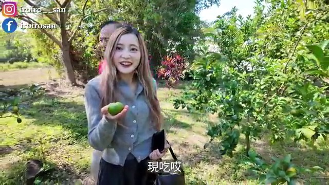

# 桃園觀音區探訪｜台版撒哈拉沙漠和百年燈塔藏在西海岸｜草漯沙丘・白沙岬燈塔・觀音飛機場【IROIRO】

## 影片基本資訊
- **資料編號**：`video_2hbu5n9VLZY`
- **頻道來源**：IROIRO
- **原始網址**：[https://youtu.be/2hbu5n9VLZY](https://youtu.be/2hbu5n9VLZY)
- **處理狀態**：success (youtube_vtt (.vtt))
- **擷取時間**：2026-11-05T14:34:49+08:00

## 代表性畫面截圖
### 畫面 [00:19] - 觀音地區其實說真的

### 畫面 [00:40] - 西海岸的觀音區

### 畫面 [00:45] - 觀世音菩薩以及蓮花呢

### 畫面 [00:48] - 這邊除了觀音寺以及蓮花池

## 字幕逐字稿內容
- `[00:00]` 正身門的上方也有TR磚
- `[00:02]` 代表這邊就是非常重要
- `[00:04]` 大家可以來找找林家古厝裡面
- `[00:06]` 究竟有幾處有TR磚
- `[00:09]` ここ
- `[00:12]` 這個有金橘還有金棗
- `[00:15]` 謝謝
- `[00:17]` 哇 謝謝
- `[00:18]` 一人一半
- `[00:18]` 現吃哎
- `[00:19]` 觀音地區其實說真的
- `[00:21]` 本來就是需要被推廣
- `[00:33]` 新鮮客人都看得到
- `[00:35]` 大家早安
- `[00:37]` 我是IROIRO
- `[00:38]` 今天我們來到了桃園
- `[00:40]` 西海岸的觀音區
- `[00:42]` 說到了觀音
- `[00:43]` 大家是不是第一個聯想到的就是
- `[00:45]` 觀世音菩薩以及蓮花呢
- `[00:48]` 沒有錯
- `[00:48]` 這邊除了觀音寺以及蓮花池
- `[00:51]` 我們也即將帶大家一起
- `[00:53]` 深入觀音區
- `[00:54]` 探訪探訪究竟還藏著什麼
- `[00:57]` 那在影片開始之前呢
- `[00:59]` 也別忘了我們的合作伙伴
- `[01:00]` Ana Luisa
- `[01:01]` 那今天一整天我配戴的飾品
- `[01:03]` 也是Ana Luisa的
- `[01:04]` 關於Ana Luisa的詳細介紹
- `[01:06]` 大家可以看上一集西門町的影片
- `[01:08]` 或是點選說明欄的連結
- `[01:10]` 前往他們的官網瞧瞧吧
- `[01:12]` GO
- `[01:15]` 怎麼覺得觀音隨時都會看到飛機
- `[01:19]` 觀音區位於桃園市西部沿海
- `[01:21]` 東鄰大園區與中壢區
- `[01:23]` 南接新屋西鄰台灣海峽
- `[01:26]` 舊稱石觀音
- `[01:28]` 源自於1860年
- `[01:30]` 有農民在小溪拾得一顆
- `[01:32]` 酷似觀音佛像的天然石頭
- `[01:34]` 因而供奉並成為地名由來
- `[01:37]` 日治時期1920年改制為觀音庄
- `[01:40]` 戰後改為觀音鄉
- `[01:42]` 2015年桃園升格直轄市後
- `[01:45]` 改為觀音區
- `[01:47]` 全區人口約7.6萬人
- `[01:49]` 以客家族群為主
- `[01:51]` 境內擁有北台灣最大的
- `[01:53]` 觀音工業區
- `[01:54]` 同時仍有近半人口從事農漁業
- `[01:58]` 是桃園最重要的農業區之一
- `[02:02]` 觀音更以蓮花之鄉聞名
- `[02:04]` 每年夏季舉辦的蓮花祭盛會
- `[02:07]` 與南部白河齊名
- `[02:09]` 有北觀音 南白河之美譽
- `[02:12]` 吸引各地遊客前來賞蓮
- `[02:15]` 並且桃園素有千塘之鄉的稱號
- `[02:18]` 境內分佈的埤塘及水圳
- `[02:20]` 數量密度之多也是世界罕見
- `[02:23]` 因此觀音區境內也有著不少埤塘
- `[02:26]` 成為當地獨具特色的水文地景之一
- `[02:30]` 再加上臨海與氣候因素
- `[02:32]` 孕育出壯闊的濱海和沙丘景觀
- `[02:35]` 這也使得觀音兼具了
- `[02:37]` 自然生態與人文底蘊
- `[02:44]` 在林家古厝的外牆上
- `[02:46]` 大家可以看到這一面
- `[02:47]` 非常漂亮的TR磚
- `[02:49]` TR磚是台灣煉瓦株式會社
- `[02:52]` 英文的縮寫
- `[02:53]` 代表著在日治時期
- `[02:55]` 最高品質的紅磚代表
- `[02:57]` 早期這種磚多用於
- `[02:58]` 公家機關的建築物上
- `[03:00]` 在民間有些人也會將TR磚
- `[03:02]` 砌於自己的建築物外側
- `[03:04]` 以彰顯個人或家族的財力雄厚
- `[03:07]` 那以後我們家要用IR磚嗎
- `[03:11]` 如果有的話大家全部砌起來
- `[03:13]` 以彰顯大家對我們頻道的
- `[03:15]` 支持與愛護
- `[03:28]` 有一股味道哎
- `[03:29]` 香香的嗎
- `[03:31]` 含笑花 謝謝
- `[03:36]` 所以如果要採含笑花
- `[03:37]` 是要採像這種盛開的嗎
- `[03:41]` 要有溫度它才會開
- `[03:43]` 要有溫度它才會香
- `[03:46]` 真的有一股香味
- `[03:50]` 就是很像有水果的香氣的味道
- `[03:53]` 感覺好像很好吃 謝謝您
- `[03:57]` 謝謝
- `[03:57]` 含苞待放
- `[04:00]` 謝謝您
- `[04:03]` 我們現在在林家古厝休閒農場
- `[04:06]` 林家古厝它是由紅磚所堆砌而成的
- `[04:09]` 閩式三合院
- `[04:11]` 至今已經有一百多年的歷史了
- `[04:13]` 依然保存得相當的完整
- `[04:15]` 那林家世代務農
- `[04:17]` 直到第五代才開始轉型
- `[04:19]` 將原有廣大的稻田改種荷花
- `[04:22]` 並且結合古厝
- `[04:23]` 成為觀音地區首座發展的
- `[04:26]` 觀光休閒農場
- `[04:27]` 那它的園區佔地也非常的廣
- `[04:29]` 除了外面的古厝
- `[04:31]` 像我們後面有大片的蓮花池
- `[04:33]` 還有餐飲部 果園或是焢窯區
- `[04:36]` 再加上旁邊是桃園機場
- `[04:38]` 每隔幾分鐘就會有飛機
- `[04:40]` 從頭上飛過哎
- `[04:41]` 整個感覺超級愜意的
- `[04:46]` 林家古厝休閒農場
- `[04:47]` 展現樸實鄉村風貌
- `[04:49]` 並設置多元休閒體驗區
- `[04:52]` 讓遊客感受歷史建築與
- `[04:54]` 自然景觀之美
- `[04:56]` 此外依四季規劃不同體驗
- `[04:59]` 夏天主打蓮花
- `[05:00]` 不僅可賞蓮
- `[05:02]` 還能選購蓮花相關產品
- `[05:04]` 秋冬則提供
- `[05:05]` 草莓 哈密瓜 葡萄等採果活動
- `[05:08]` 相當適合親子出遊
- `[05:10]` 朋友聚會及團體旅遊
- `[05:13]` 我們拍攝當天
- `[05:14]` 老闆特別向我們介紹
- `[05:16]` 園內果園和冬季草莓祭
- `[05:18]` 老闆說這裡的草莓園
- `[05:20]` 採AI智慧化管理
- `[05:22]` 是台灣目前規模最大的
- `[05:24]` 草莓園溫室大棚
- `[05:26]` 現場看真的是壯觀無比
- `[05:28]` 農場也會推出各式體驗活動
- `[05:31]` 感興趣的朋友
- `[05:32]` 務必到官網查詢查詢
- `[05:35]` 不會 我覺得已經很甜
- `[05:36]` 而且很多汁哎
- `[05:37]` 一咬下去那個
- `[05:38]` 它如果熟的話更甜
- `[05:41]` 一咬下去就是那個
- `[05:42]` 水果的汁爆出來
- `[05:44]` 在農場裡面有一間ㄚㄚ的家
- `[05:47]` 不過老闆說今天ㄚㄚ外出旅行了
- `[05:50]` 暫時不在家
- `[05:52]` 所以過來這邊想跟ㄚㄚ碰面
- `[05:54]` 還必須要碰碰你們的運氣
- `[05:56]` 高難度設施
- `[05:58]` 勿輕易挑戰
- `[05:59]` 無膽不要走
- `[06:01]` 這絕對不是我們頻道的風格
- `[06:03]` 偏要走給大家看
- `[06:04]` Let's go
- `[06:05]` 它這樣寫反而讓人想走
- `[06:07]` 激不得啊
- `[06:11]` 好像有點晃哎
- `[06:14]` 你小心 你小心
- `[06:15]` 小心 小心
- `[06:17]` 馬上就犁田了啦
- `[06:19]` 天啊
- `[06:20]` 難怪他說跌倒要自己負責
- `[06:22]` 回頭是岸 各位
- `[06:26]` 農場旁邊這條大崛溪
- `[06:28]` 以前其實是叫大窟
- `[06:30]` 據說是因為上游桃園台地
- `[06:32]` 中壢層面地勢陡峭
- `[06:34]` 那造成了長年的侵蝕作用
- `[06:36]` 形成大大小小的洞窟
- `[06:38]` 最後演變而來就叫它大崛溪
- `[06:40]` 然後可以看到溪水上面有那個
- `[06:42]` 一層一層一格一格的
- `[06:44]` 它說是魚梯
- `[06:45]` 那是因為魚喜歡在上游
- `[06:47]` 水溫比較低的地方產卵
- `[06:49]` 所以就設置這樣一階一階
- `[06:51]` 然後幫那個溪水的高低落差
- `[06:53]` 不要太大
- `[06:54]` 這樣魚就可以順利的迴游
- `[06:55]` 去做產卵
- `[06:56]` 同時也可以進行魚的登階機訓練
- `[07:08]` 逛完了來吃冰
- `[07:10]` 沒有錯
- `[07:11]` 它入園門票一百塊可以折抵餐費
- `[07:14]` 那我們就來換冰淇淋
- `[07:16]` 而且這個冰淇淋
- `[07:18]` 老闆他是使用義大利的機器
- `[07:20]` 完全天然沒有任何添加物
- `[07:23]` 吃起來非常的健康
- `[07:25]` 有蓮子也有草莓兩種口味
- `[07:30]` 是冰沙的口感
- `[07:32]` 很好吃很濃的草莓香
- `[07:35]` 我也迫不及待要趕快來吃吃看
- `[07:37]` 義大利機器做的冰淇淋
- `[07:39]` 純天然的
- `[07:41]` 就是它奶香中又有一點那種
- `[07:43]` 沙沙稠稠的那個蓮子的口感
- `[07:49]` 我怎麼覺得它的口感綿密到
- `[07:51]` 有一點像綠豆沙冰的感覺
- `[07:53]` 對 蓮子比較像綠豆沙
- `[07:55]` 但你吃吃看草莓
- `[07:56]` 草莓我覺得就是比較冰沙口感
- `[08:00]` 它草莓的味道好濃郁
- `[08:02]` 而且真的是草莓味
- `[08:04]` 不是那種化學的味道
- `[08:06]` 而且我有咬到
- `[08:07]` 很像草莓籽的那種口感
- `[08:10]` 對哎 一顆一顆的
- `[08:12]` 裡面確實有一顆一顆的
- `[08:14]` 草莓的鼻頭粉刺
- `[08:17]` 這是真材實料
- `[08:19]` 滿好的 這樣子只要一百塊
- `[08:22]` 又有這麼好吃的冰淇淋
- `[08:24]` 然後你還有這麼舒服的
- `[08:26]` 大園區可以逛
- `[08:27]` 滿值得的
- `[08:29]` 我覺得老闆把這邊打造得很舒服
- `[08:31]` 而且很乾淨
- `[08:32]` 對 每一區都維護得很用心
- `[08:35]` 因為有些人來農場不是會怕
- `[08:37]` 就是那種土味或是一些飼料味
- `[08:41]` 但農場這邊完全沒有
- `[08:42]` 沒有錯
- `[08:43]` 而且Eileen超級怕蚊子的
- `[08:45]` 今天Eileen完全沒有用到防蚊液
- `[08:48]` 目前我是Safe的
- `[08:50]` 對 真的是很棒的一個環境
- `[09:00]` 崙坪文化地景園區前身為
- `[09:03]` 國際電話株式會社
- `[09:05]` 觀音崙坪受信所
- `[09:07]` 怎麼不講完啊
- `[09:09]` 其它的現在還在勉強しています
- `[09:13]` 它是負責電信業務的
- `[09:15]` 它在1986年的時候
- `[09:17]` 設施轉至交通部電信研究所之後
- `[09:19]` 就逐漸荒廢
- `[09:21]` 後來是桃園市政府都發局
- `[09:23]` 把它重新整建
- `[09:24]` 那就保留了建築遺址
- `[09:25]` 還有原始的森林
- `[09:27]` 那也在2018年登錄了歷史建築
- `[09:29]` 在2019年的時候就正式對外
- `[09:32]` オープン しました
- `[09:36]` 園區內可見座落於
- `[09:37]` 茂密林間的地磁觀測站
- `[09:40]` 與受信所設施群
- `[09:42]` 猶如一座被遺忘的神秘古城
- `[09:44]` 成為熱門打卡點
- `[09:46]` 同時園區也結合客家工藝館
- `[09:49]` 館內展示了傳統客家工藝
- `[09:52]` 並規劃多元手作課程
- `[09:54]` 提供遊客親身體驗
- `[09:56]` 讓遊客在認識台灣電信
- `[09:58]` 發展歷史的同時
- `[10:00]` 也能體驗客家文化
- `[10:02]` 藝文活動與悠閒的自然氛圍
- `[10:07]` 老婆
- `[10:08]` 妳不覺得這邊
- `[10:09]` 很像什麼城堡的遺蹟嗎
- `[10:12]` 對啊 而且你看它的牆角
- `[10:14]` 現在我們是叫踢腳嘛
- `[10:16]` 對不對 對
- `[10:17]` 它上面還有特別設計過的感覺
- `[10:20]` 是洗石子嗎
- `[10:24]` 這座碩大的龜殼劇場
- `[10:26]` 以仿生龜殼造型木結構打造
- `[10:29]` 榮獲2021年國家卓越建築獎
- `[10:32]` 劇場以拱形曲線
- `[10:34]` 呈現開放又有秩序的空間感
- `[10:37]` 不定期舉辦活動
- `[10:38]` 展演市集與農特產展售
- `[10:41]` 兼具了建築美學與藝文功能
- `[10:45]` 遼闊的風神草原綠地適合散步
- `[10:48]` 野餐與親子遊憩
- `[10:49]` 不時可見飛機掠過天際
- `[10:52]` 草原四周保留了桃園國際
- `[10:55]` 雕塑創作展的地景藝術作品
- `[10:57]` 為自然景觀增添了不少藝術氣息
- `[11:01]` 剛剛遠看我覺得很像螺絲
- `[11:03]` 但近看怎麼比較像可樂果
- `[11:16]` 好客食堂提供道地的
- `[11:18]` 客家料理與茶點
- `[11:20]` 室內古樸雅致
- `[11:21]` 戶外則環繞著蓮花池
- `[11:24]` 營造悠閒的用餐氛圍
- `[11:33]` 全村的希望
- `[11:36]` 全村的希望的麵包來了
- `[11:45]` 全村的希望麵包工廠
- `[11:47]` 這名字會不會太趣味了 對啊
- `[11:49]` 據說老闆以前是在大陸那邊經商
- `[11:52]` 非常中意這個名字
- `[11:54]` 於是回國之後就繼續沿用
- `[11:56]` 全村的希望
- `[11:58]` 當作它們的招牌
- `[11:59]` 聽起來相當有魄力
- `[12:01]` 對啊 很有霸氣
- `[12:02]` 不過它外觀根本不知道是賣麵包的
- `[12:05]` 它就是
- `[12:06]` 它很妙哎
- `[12:07]` 它就是一棟別墅
- `[12:08]` 就很像是你鄰居家
- `[12:09]` 或是就是一棟別墅
- `[12:11]` 然後招牌也是小小的
- `[12:13]` 但生意很好
- `[12:14]` 它好像就是把一樓客廳變成就是
- `[12:16]` 麵包店然後座位區這樣
- `[12:18]` 對 它裡面空間無敵巨大
- `[12:21]` 我剛剛看它檯上每個麵包
- `[12:23]` 也都很大
- `[12:24]` 都是做巨型麵包哎
- `[12:26]` 大家去麵包店有沒有試吃
- `[12:28]` 你看它給的試吃麵包
- `[12:30]` 哇 也是試吃很佛心哎
- `[12:32]` 對啊 直接給你一整塊
- `[12:34]` 沒有在客氣哎
- `[12:35]` 然後這間店它們的麵包
- `[12:37]` 每天都是現烤的
- `[12:39]` 品項就是稍微有點不同
- `[12:40]` 然後也有在賣披薩
- `[12:42]` 或是咖啡飲料
- `[12:43]` 然後我覺得很棒的事就是
- `[12:45]` 如果在這邊吃麵包
- `[12:47]` 它會幫你切拿去烤哎
- `[12:50]` 現烤的喔
- `[12:52]` 對 而且我剛剛有嚇到
- `[12:54]` 它不是跟你用微波爐
- `[12:56]` 或什麼加熱小烤箱烤
- `[12:58]` 它是用披薩那個窯烤去烤的哎
- `[13:00]` 用窯烤幫各位加溫
- `[13:03]` 你看有沒有誠意
- `[13:04]` 怎麼感覺用窯烤箱就是特別厲害
- `[13:07]` 對 好像特別的香哎
- `[13:09]` 好期待
- `[13:10]` 整間店都是麵包的香氣
- `[13:12]` 不愧是全村的希望
- `[13:15]` 那你要成為YouTube界的希望嗎
- `[13:17]` 我 !?
- `[13:18]` 那這個就要靠各位目前的觀眾
- `[13:21]` 大家用力的幫我們
- `[13:22]` 按讚 訂閱 分享出去
- `[13:23]` 才有希望
- `[13:24]` 沒錯 沒錯
- `[13:25]` 第一道當然是要先試試看
- `[13:27]` 熱騰騰的手工披薩
- `[13:30]` 窯烤的好快就出爐囉
- `[13:33]` 對 窯烤的時間
- `[13:34]` 比我想像中的還要快
- `[13:36]` 對啊
- `[13:38]` 牽絲
- `[13:39]` 哇 感覺就很好吃哎
- `[13:42]` 這個 墨西哥牛肉口味
- `[13:45]` 開動
- `[13:45]` 披薩乾杯
- `[13:48]` 起司好厚 好幸福
- `[13:50]` 對 它的起司蠻厚的
- `[13:52]` 吃起來就是非常的帶勁
- `[13:54]` 而且剛烤好
- `[13:55]` 這底下的皮是軟的哎
- `[13:57]` 然後旁邊就是
- `[13:58]` 披薩這個邊邊也是軟的
- `[14:01]` 因為每次
- `[14:02]` 每次那種
- `[14:03]` 叫那種連鎖店的披薩
- `[14:05]` 邊邊我都不吃
- `[14:06]` 因為好硬喔
- `[14:08]` 怪不得平常跟老婆
- `[14:10]` 在吃披薩的時候
- `[14:11]` 我好像都沒吃到什麼料
- `[14:13]` 因為都在吃這個邊邊角角
- `[14:15]` 我吃中心他吃邊邊
- `[14:18]` 它邊邊真的是QQ的哎
- `[14:20]` QQ的不會乾柴
- `[14:23]` 我老婆在提醒我啦
- `[14:25]` 把邊邊給我
- `[14:27]` 沒關係啦
- `[14:28]` 這個邊邊是軟的我可以
- `[14:30]` 酒釀桂圓
- `[14:32]` 桂圓香很濃
- `[14:34]` 而且歐式麵包
- `[14:36]` 最怕的就是
- `[14:37]` 有些很乾會刮嘴巴
- `[14:39]` 我覺得這個還好哎 可以
- `[14:42]` 2024年才開業的店面
- `[14:44]` 短短一年多便成為觀音新亮點
- `[14:47]` 假日常常人潮不斷
- `[14:48]` 看來全村的希望
- `[14:50]` 真的是名副其實
- `[15:00]` 在全村的希望附近
- `[15:02]` 一樣位於福新路上的
- `[15:03]` 白千層綠色隧道
- `[15:05]` 全長大約2.8公里
- `[15:07]` 沿途種植了將近700棵的白千層樹
- `[15:11]` 高聳的樹梢交織成
- `[15:13]` 美麗的林蔭大道
- `[15:14]` 非常的壯觀
- `[15:15]` 這裡非常適合來這邊散步
- `[15:17]` 騎單車或是拍照
- `[15:19]` 白千層是因為它的樹皮
- `[15:22]` 會隨著新皮不斷生長脫落
- `[15:24]` 然後再一層一層
- `[15:25]` 包裹在它原本的樹幹上
- `[15:27]` 就形成它外觀很斑駁
- `[15:29]` 又獨特的現象
- `[15:30]` 所以又叫脫皮樹
- `[15:35]` 甜點的時間
- `[15:37]` 原來是甜點啊
- `[15:39]` 這間冰茶屋是觀音這邊
- `[15:41]` 在地的傳統飲料店
- `[15:43]` 我覺得在地傳統飲料店
- `[15:44]` 有幾個特色
- `[15:45]` 就是它的菜單種類超多
- `[15:47]` 琳瑯滿目
- `[15:48]` 每次都會看到
- `[15:49]` 不知道要點什麼
- `[15:50]` 就跟著招牌點就沒有問題了
- `[15:53]` 綠豆沙看是一定要點的
- `[15:55]` 然後刨冰和豆花也滿有名的
- `[15:57]` 只是
- `[15:57]` 胃實在太飽了
- `[15:59]` 點刨冰就好
- `[16:00]` 而且它這邊很特別的是
- `[16:01]` 它提供杯裝跟碗裝的選擇
- `[16:04]` 而且據說料多實在
- `[16:06]` 沒有錯
- `[16:07]` 期待期待
- `[16:08]` 黑糖的滋味
- `[16:10]` 哇 這個黑糖糖水
- `[16:12]` 它的黑糖香氣
- `[16:13]` 真的非常夠味
- `[16:14]` 好吃哎
- `[16:15]` 而且它一碗冰
- `[16:17]` 50塊
- `[16:17]` 四種配料
- `[16:23]` 老婆
- `[16:24]` 妳知道大樹土地公這邊
- `[16:25]` 以前曾經有一個很有趣的事情嗎
- `[16:28]` 什麼
- `[16:28]` 以前旁邊這邊的農地
- `[16:30]` 都有設稻草人在這邊
- `[16:33]` 只是當地居民反應
- `[16:35]` 晚上經過的時候
- `[16:36]` 會嚇一跳略顯熱鬧
- `[16:38]` 想說怎麼有人在這邊開派對
- `[16:40]` 所以現在這些稻草人都撤掉
- `[16:42]` 今天就沒看到了
- `[16:43]` 怎麼不會認為是土地公顯靈
- `[16:49]` 沒想到觀音也有龍貓巴士哎
- `[16:51]` 沒有錯 我們現在是在
- `[16:53]` 和美幼兒園旁的龍貓巴士站
- `[16:55]` 那這邊比較特別的是
- `[16:57]` 這一間幼兒園
- `[16:58]` 它的外牆以及這個龍貓巴士站
- `[17:00]` 都是幼兒園的全體教職人員
- `[17:02]` 他們採用海邊漂流的垃圾
- `[17:05]` 利用回收再利用的方式
- `[17:06]` 來製造而成的
- `[17:08]` 那原本是為了社區美化
- `[17:10]` 但因為太有特色
- `[17:11]` 就變成打卡景點
- `[17:13]` 但只是幼兒園裡面
- `[17:14]` 當然還是不對外開放
- `[17:16]` 所以拍照的話就只能在外面
- `[17:18]` 那大家拍照的時候也記得要留意
- `[17:19]` 不要打擾到人家
- `[17:24]` 這裡的作品使用海邊撿拾的
- `[17:27]` 海漂垃圾環保再利用
- `[17:29]` 以保麗龍做成大小龍貓
- `[17:31]` 浮球拿來彩繪
- `[17:32]` 工業區的舊棧板
- `[17:34]` 製作成露營區跟木架子等
- `[17:36]` 借景校園大樹做背景
- `[17:38]` 宛如走進宮崎駿動畫世界
- `[17:41]` 可愛又逼真
- `[17:42]` 公車站旁的幼兒園正門
- `[17:44]` 也充滿童趣
- `[17:45]` 像童話中的糖果屋
- `[17:47]` 還有卡通版歪腰郵筒
- `[17:49]` 以及多款可愛裝置藝術
- `[17:52]` 非常適合拍照打卡
- `[17:58]` 這邊蠻多農場的 對對
- `[18:00]` 其實因為觀音地區其實說真的
- `[18:02]` 本來就是需要被推廣
- `[18:03]` 北北基桃 但是
- `[18:05]` 也是屬於比較偏遠一點的地方
- `[18:08]` 因為那時候也是在想說
- `[18:09]` 國內好像也沒什麼飛機餐廳
- `[18:12]` 所以就朝飛機餐廳去做
- `[18:14]` 結果後來因為農地農用
- `[18:17]` 符合農地農用
- `[18:18]` 就做休閒農場
- `[18:19]` 瞭解瞭解
- `[18:20]` 所以這就是一個歷程
- `[18:23]` 很期待老闆這邊弄完的樣子
- `[18:26]` 超酷的
- `[18:40]` 現在來到的是在觀音中山路
- `[18:42]` 前身是長美休閒農場的觀音飛機場
- `[18:45]` 它就曾經是結合民航元素
- `[18:47]` 跟農場的休閒園區
- `[18:49]` 現在是在施工整修中
- `[18:51]` 所以是不對外開放
- `[18:53]` 只是我們今天來的時候
- `[18:53]` 剛好碰到老闆在現場
- `[18:55]` 所以他有同意我們進來拍攝
- `[18:57]` 大家知道嗎
- `[18:58]` 老闆也是水林人
- `[19:00]` 太巧了吧 謝謝老闆
- `[19:02]` 對啊 所以我們才有機會這麼近距離
- `[19:04]` 看到這麼巨大的飛機超震撼的
- `[19:07]` 真的 這個龐然大物
- `[19:08]` 老婆妳有在這種視角之下
- `[19:10]` 看過飛機嗎
- `[19:11]` 完全沒有
- `[19:12]` 平常這種視角應該只有
- `[19:14]` 飛機的技師才能夠看到吧
- `[19:16]` 很震撼
- `[19:17]` 而且大家看我身後這一台747
- `[19:19]` 以前我小時候跟我家人出國的夢想
- `[19:22]` 大家有沒有看到它的二樓
- `[19:24]` 那一排窗戶
- `[19:25]` 以前小時候的夢想
- `[19:26]` 就是希望能夠坐在二樓
- `[19:33]` 這邊有一台空中巴士A300在這邊
- `[19:36]` 這就是我們現在比較常搭到的機型
- `[19:38]` 而且我覺得這邊還有一個
- `[19:39]` 很酷的亮點
- `[19:41]` 就是天空中有時候也
- `[19:42]` 不時有飛機飛過
- `[19:43]` 機上加機
- `[19:59]` 廣大的場地內除了收藏退役的
- `[20:02]` 空中巴士A300及波音747
- `[20:05]` 還能看見機場常見的接駁車
- `[20:07]` 空橋以及遊艇等等
- `[20:09]` 不僅展現了老闆獨特且驚人的收藏
- `[20:13]` 也成為吸引航空迷與攝影愛好者的
- `[20:16]` 特殊打卡點
- `[20:17]` 這種地面與空中的雙重畫面享受
- `[20:20]` 真的很過癮
- `[20:21]` 期待未來整修完成後
- `[20:23]` 以全新面貌再次對外亮相
- `[20:35]` 現在我們來到了位於觀音工業區
- `[20:38]` 裡面的來來牛家莊
- `[20:41]` 這是一間外觀極為低調
- `[20:43]` 但是內部卻臥虎藏龍的牛肉麵店
- `[20:47]` 然後它的菜單非常的簡單
- `[20:49]` 就只有清燉牛肉麵 牛肉湯 蔥油拌麵
- `[20:53]` 就這三樣
- `[20:54]` 它的牛肉麵的牛肉竟然是牛肋條
- `[20:57]` 而且它整個牛肋條鋪滿整個碗
- `[21:01]` 看起來超好吃
- `[21:02]` 看起來食慾大增
- `[21:04]` 而且它的麵條居然是使用那種
- `[21:07]` 疑似刀削麵
- `[21:08]` 但又不是刀削麵的這種
- `[21:10]` 很像皮帶麵條的麵
- `[21:13]` 清燉的湯頭好好喝
- `[21:16]` 很好喝哎
- `[21:18]` 它的牛味好重
- `[21:19]` 而且湯頭喝起來滿鮮甜
- `[21:22]` 很清爽哎 好喝哎
- `[21:23]` 很舒服
- `[21:24]` 它這邊的湯頭只有清燉的湯沒有紅燒
- `[21:27]` 所以想吃辣的朋友
- `[21:28]` 就是可以自己去拿辣醬
- `[21:31]` 還有腐乳醬
- `[21:32]` 迫不及待 趕快吃肋條
- `[21:35]` 肋條乾杯
- `[21:37]` 乾杯 哇
- `[21:38]` 奢華的肋條乾杯
- `[21:40]` 先不論它的口感
- `[21:41]` 它的味道怎麼樣
- `[21:43]` 光它的體積吃起來就是一個爽快
- `[21:46]` 真的
- `[21:47]` 這就是大口吃肉就是這種感覺 對
- `[21:49]` 這是牛排麵嗎
- `[21:52]` 它的肉不是那種
- `[21:54]` 軟軟一吃就散開的
- `[21:56]` 但是它還是嫩
- `[21:57]` 然後又帶有一點口感
- `[21:59]` 很好吃 剛剛好
- `[22:00]` 好吃
- `[22:01]` 恰到好處
- `[22:02]` 還是要忍不住感嘆一下這個牛肋條
- `[22:05]` 哇 這個尺寸
- `[22:07]` 等一下 等一等
- `[22:10]` 妳牛肉靠近
- `[22:13]` 你要幫它量喔
- `[22:16]` 你們看這個牛肉多大
- `[22:18]` 幾公分啊
- `[22:19]` 幾公分啊我看不到
- `[22:21]` 10公分嗎還是9公分
- `[22:23]` 10公分
- `[22:25]` Very huge
- `[22:26]` 這好像是我第一次幫牛肉量
- `[22:28]` 對 我也是吃飯第一次吃到
- `[22:31]` 拿尺出來量
- `[22:32]` 那我來沾沾看辣的
- `[22:34]` 先沾一點點
- `[22:38]` 這哪叫沾
- `[22:39]` 我怕太辣
- `[22:40]` 沾了也不錯
- `[22:42]` 也不錯
- `[22:43]` 我覺得辣度是我可以接受的
- `[22:44]` 那我來示範一下
- `[22:46]` 我自己的加辣的方式
- `[22:48]` 嚇死人了
- `[22:50]` 這樣子沾起來鋪在上面
- `[22:52]` 你以為在做握壽司喔
- `[22:56]` 它不會辣啊
- `[22:57]` 就是一點點沒有到很辣
- `[22:59]` 但它吃起來好香喔
- `[23:01]` 對 是香氣不一樣
- `[23:02]` 它的香氣很重
- `[23:04]` 你在幹嘛不趕快吃
- `[23:06]` 你看 都掉下去了
- `[23:08]` 不知道大家有沒有人像我一樣
- `[23:12]` 以前從小啊
- `[23:13]` 只要在吃麵有這種滷蛋
- `[23:16]` 我們都會把蛋黃夾出來壓碎
- `[23:19]` 讓它跟湯融化在一起喝
- `[23:21]` 有沒有人這樣子吃過
- `[23:22]` 這是我老爹的獨傳秘方
- `[23:25]` 變換湯頭啊
- `[23:26]` 沒有錯 妳喝喝看
- `[23:28]` 還不錯 是蛋那個沙沙的
- `[23:31]` 對 有蛋香
- `[23:33]` 可是這樣弄覺得
- `[23:34]` 我們這樣有點奢侈有點浪費
- `[23:36]` 蛋就沒了
- `[23:37]` 俗稱為金沙湯
- `[23:39]` 對哎
- `[23:40]` 當初我老婆在規劃拍攝行程的時候
- `[23:44]` 坦白講我當初看到它的外觀想說
- `[23:47]` 為什麼要拍這間店
- `[23:48]` 現在終於知道它的厲害之處了
- `[23:50]` 是不是
- `[23:51]` 嗯 真的是好吃
- `[23:53]` 人不可貌相
- `[23:57]` 白沙岬燈塔27.7公尺
- `[24:01]` 富貴角燈塔14.3公尺
- `[24:04]` 鼻頭角燈塔12.3公尺
- `[24:07]` 三貂角燈塔16.5公尺
- `[24:10]` 鵝鑾鼻燈塔21.4公尺
- `[24:13]` 花嶼燈塔12.5公尺
- `[24:15]` 漁翁島燈塔11公尺
- `[24:17]` 在此宣佈恭喜白沙岬燈塔
- `[24:20]` 勝出
- `[24:20]` 恭喜老婆挑戰
- `[24:22]` 一日多塔成功
- `[24:35]` 位於桃園觀音海岸的白沙岬燈塔
- `[24:38]` 是於日治時期1898年開始興建
- `[24:41]` 至今已有百年歷史
- `[24:43]` 在台南國聖燈塔興建之前
- `[24:45]` 這裡曾經是台灣最西部的燈塔
- `[24:48]` 它在2001年入選為
- `[24:50]` 台灣歷史建築百景
- `[24:52]` 2002年公告為
- `[24:53]` 桃園縣第一座縣定古蹟
- `[24:55]` 2021年再升格為國定古蹟
- `[24:58]` 同時它也是台灣目前保存
- `[25:01]` 最完整的日治初期燈塔
- `[25:06]` 白沙岬燈塔原高約37公尺
- `[25:09]` 二戰後受損重建為27.7公尺
- `[25:13]` 雖然高度減低
- `[25:15]` 但潔白的塔身在海天之間
- `[25:17]` 依舊醒目耀眼
- `[25:19]` 當年燈具多從法國進口
- `[25:21]` 塔頂風向儀的東西南北方位
- `[25:24]` 更採用法文縮寫
- `[25:26]` Est Ouest Sud Nord代表
- `[25:27]` 塔基以石材打造
- `[25:29]` 塔身則是少見的雙層紅磚結構
- `[25:32]` 上段以大石堆砌成托架
- `[25:35]` 承載鑄鐵塔頂
- `[25:37]` 與多數以鑄鐵組裝的燈塔樣式不同
- `[25:40]` 歷經戰火與多次天災仍屹立不搖
- `[25:43]` 持續照亮台灣海峽
- `[25:48]` 園區內仍保存日治時期的日晷
- `[25:51]` 燈塔周邊也設有環形步道
- `[25:54]` 公園與涼亭
- `[25:55]` 也能順遊至觀音濱海遊憩區
- `[25:58]` 享受遼闊的海岸風光
- `[26:03]` 在停車場旁邊有兩棟
- `[26:05]` 白色的凸起建築物
- `[26:06]` 它是日治時期的防空洞
- `[26:08]` 由於白沙岬燈塔位居航運的要徑
- `[26:11]` 很容易成為轟炸的目標
- `[26:13]` 這個就成為燈塔守護者的避難所
- `[26:16]` 不過它跟燈塔有段距離
- `[26:19]` 這樣轟炸的時候來得及跑過來嗎
- `[26:21]` 不用擔心
- `[26:22]` 守護者他們登高望遠
- `[26:24]` 可以提早發現提早治療
- `[26:52]` 紅塘埤為清治時期
- `[26:54]` 墾拓先民所開墾的
- `[26:56]` 它也是觀音地區
- `[26:58]` 歷史最悠久的埤塘之一
- `[27:00]` 同時在大桃園地區
- `[27:02]` 它的蓄水量也是排名前三大
- `[27:05]` 桃園素有千塘之鄉的稱號
- `[27:07]` 所以境內埤塘的數量相當多
- `[27:09]` 但其實埤塘的水源比較不穩定
- `[27:12]` 它的灌溉效益有限
- `[27:13]` 所以隨著石門水庫
- `[27:15]` 跟桃園大圳建成之後
- `[27:16]` 許多埤塘就開始轉型
- `[27:18]` 像是紅塘埤它就興建了環塘步道
- `[27:21]` 變成民眾休憩散步的空間
- `[27:23]` 妳知道為什麼這邊會叫紅塘埤嗎
- `[27:25]` 為什麼
- `[27:26]` 妳看夕陽西下
- `[27:28]` 湖面上看起來像不像紅糖的顏色
- `[27:30]` 很漂亮
- `[27:32]` 比較像蛋黃酥的顏色
- `[27:35]` 桃園位處台地地形
- `[27:36]` 因古石門溪沖積形成
- `[27:39]` 古石門沖積扇
- `[27:40]` 後因淡水河溯源侵蝕
- `[27:43]` 發生台灣最大規模的河川劫奪
- `[27:46]` 奪走南崁溪中上游水源
- `[27:48]` 使台地上的溪流變成斷頭河
- `[27:51]` 加上地勢高降雨不易儲存
- `[27:54]` 紅壤透水性差
- `[27:55]` 地下水也不易取得
- `[27:57]` 早期居民便以開鑿埤塘來儲水灌溉
- `[28:01]` 逐漸形成桃園獨特的埤塘地景
- `[28:04]` 近年埤塘功能逐漸轉型
- `[28:06]` 逐漸成為景觀或農業利用
- `[28:09]` 這也讓這些老埤塘有了新生命
- `[28:19]` 風好大啊各位
- `[28:21]` 對啊 你看頭髮都被吹成這樣子了
- `[28:23]` 草漯沙丘它是全台第一個
- `[28:26]` 沙丘地質公園
- `[28:27]` 也有台版薩哈拉沙漠之名的美稱
- `[28:31]` 蔓延8.1公里長的沙丘帶
- `[28:34]` 構成了全台海岸線中最寬廣
- `[28:37]` 最完整的沙丘地景
- `[28:39]` 推薦大家可以像我們一樣
- `[28:41]` 在傍晚的時候前來
- `[28:42]` 這時候夕陽西下
- `[28:44]` 然後旁邊還有整排的風力發電
- `[28:47]` 搭配沙灘跟海岸
- `[28:48]` 非常的漂亮 很有氣氛感
- `[28:50]` 這邊的氣勢完全不輸鳥取沙丘
- `[28:53]` 沒錯
- `[28:54]` 另外這邊很特別的是你看
- `[28:57]` 我們只要站在比沙丘的位置
- `[28:59]` 再低一點的地方
- `[29:00]` 那個沙子就直接毫不客氣的
- `[29:02]` 往我們臉上一直砸
- `[29:03]` 真的
- `[29:04]` 都會覺得刺刺的 對啊
- `[29:09]` 沙丘是源於東北季風與南風吹拂下
- `[29:12]` 將飄沙推積至陸地而形成
- `[29:15]` 沙丘群北起大園區老街溪口
- `[29:18]` 南至觀音區大崛溪口
- `[29:20]` 歷經長時間堆積
- `[29:22]` 總面積約4平方公里
- `[29:24]` 沙丘高度最高可達15公尺
- `[29:27]` 呈現出壯闊又獨特的風貌
- `[29:30]` 也因此成為熱門攝影與觀光景點
- `[29:40]` 下坡回去的路好像有點陡
- `[29:42]` 沒有錯
- `[29:43]` 坡度越陡讓你越快回到家
- `[29:46]` 是要滾下去嗎
- `[29:54]` 在甘泉寺的後方有一幅
- `[29:56]` 寬11高18公尺的觀世音銅雕
- `[30:00]` 它也是全台唯一三層樓高的觀音壁雕
- `[30:04]` 也因為甘泉寺它是位於道路的中央
- `[30:07]` 它也象徵著化解道路直衝的煞氣
- `[30:12]` 甘泉寺前身為福龍寺
- `[30:14]` 起源於清乾隆年間大約1780年左右
- `[30:18]` 據傳早期有位農夫
- `[30:21]` 在溪邊拾獲一塊石頭
- `[30:23]` 外形長得跟觀世音菩薩很像
- `[30:26]` 因此將它原地供奉
- `[30:27]` 又尊稱為石觀音
- `[30:29]` 這也是我們影片開頭提到
- `[30:32]` 觀音區這個地名的由來
- `[30:34]` 那後來信眾發現
- `[30:35]` 這個石像所在地的泉水
- `[30:37]` 具有治療百病的功效
- `[30:39]` 於是建廟供奉
- `[30:40]` 後來就將這個泉水命名為甘泉井
- `[30:43]` 寺廟也改名為甘泉寺
- `[30:48]` 甘泉寺為三層樓宮殿式廟宇
- `[30:51]` 一樓主祀石觀音佛祖
- `[30:53]` 二樓供奉玉皇大帝
- `[30:55]` 三樓則供奉少見的道教無極大天尊
- `[30:59]` 等共18尊神像
- `[31:01]` 展現儒 釋 道三教並容的宗教特色
- `[31:06]` 甘泉寺每年有三大重要祭典
- `[31:09]` 分別是農曆2月19日的觀世音佛誕辰
- `[31:13]` 農曆4月22日的石觀音顯聖日
- `[31:16]` 及農曆7月17和18中元普渡祭典
- `[31:20]` 此外每年也會結合觀音佛誕
- `[31:23]` 舉辦石觀音文化節
- `[31:25]` 成為地方重要的宗教與文化活動
- `[31:30]` 寺廟內外的藝術裝置與文物也相當豐富
- `[31:34]` 廟門口的雄獅口含石珠
- `[31:36]` 雌獅腳逗小獅
- `[31:38]` 兼具裝飾與鎮煞作用
- `[31:42]` 四大天王常見於佛寺的護法神
- `[31:45]` 象徵風調雨順 國泰民安
- `[31:51]` 位於甘泉寺旁的自流井
- `[31:53]` 水質清澈 流量穩定
- `[31:56]` 據說能治百病
- `[31:57]` 廟方在觀音塑像的寶瓶中引入井水
- `[32:01]` 甘泉寺也貼心提供甘露瓶
- `[32:04]` 供信徒現場取水
- `[32:08]` 走 來去裝水
- `[32:15]` 下課十分鐘 喝水
- `[32:17]` 現在我們來裝我們的甘泉
- `[32:20]` 它這裡的甘泉
- `[32:22]` 它這邊的告示牌是寫說
- `[32:24]` 已經是過濾過的
- `[32:25]` 所以潔淨無慮
- `[32:27]` 但是建議大家煮沸之後再飲用
- `[32:30]` 不過我怎麼看到
- `[32:32]` 旁邊有個自助加水站
- `[32:33]` 什麼意思啊
- `[32:34]` 隨著時代科技的進步
- `[32:36]` 現在提供多樣化的選擇
- `[32:39]` 不過瓶子好大好像要裝一段時間
- `[32:42]` 順便訓練大家的臂力
- `[32:44]` 好像快要裝完了
- `[32:45]` 對 終於快要裝滿了
- `[32:47]` 這樣子這個姿勢
- `[32:49]` 很像在跟觀音求水
- `[32:51]` 求平安水回去給全家人喝平安的
- `[32:54]` 還要誠心祈求才有好水可以喝
- `[33:02]` 位於草漯沙丘附近的這間
- `[33:05]` 安可土雞城
- `[33:06]` 大家不要看它的外觀
- `[33:08]` 低調的跟民宅一樣
- `[33:09]` 內部生意可是好到不得了
- `[33:12]` 真的 高朋滿座
- `[33:13]` 而且它就是在大馬路旁
- `[33:15]` 然後它的外觀也沒有什麼明顯的招牌
- `[33:18]` 但一進來熱鬧得很
- `[33:20]` 另外比較特別的是這間店
- `[33:22]` 平常日只有賣午餐
- `[33:24]` 想要吃晚餐的朋友只有假日
- `[33:26]` 想過來的朋友強烈建議你們
- `[33:28]` 一定一定要訂位才會有位置
- `[33:31]` 不然會要等很久
- `[33:32]` 因為他們今天好像人手不足
- `[33:34]` 就是他們也有公告說
- `[33:35]` 建議善用電話預約
- `[33:37]` 訂位的同時如果想要吃白斬雞
- `[33:39]` 或剝皮辣椒雞
- `[33:40]` 就也可以在訂位的時候
- `[33:42]` 順便跟他們預定
- `[33:43]` 而且它的雞湯上來我嚇到哎
- `[33:45]` 好大鍋喔
- `[33:46]` 非常大一鍋直接給你整鍋的
- `[33:48]` 沒有再客氣
- `[33:49]` 但它們就只有半隻雞跟整隻雞的選擇
- `[33:52]` 那我們兩個就選一半的
- `[33:54]` 它上來的時候我嚇到
- `[33:55]` 想說怎麼喝得完
- `[33:57]` 沒有錯 不止我們嚇到
- `[33:59]` 相信各位也一定被我們嚇到
- `[34:01]` 什麼 你們只有兩個人嗎
- `[34:02]` 對 我們就是兩個人
- `[34:04]` 製作全部的影片
- `[34:05]` 對啊 然後除了雞湯很大鍋
- `[34:08]` 它的鹹酥雞
- `[34:09]` 我端起來一下
- `[34:10]` 它的鹹酥雞也是超大的
- `[34:12]` 這是一份喔
- `[34:13]` 它只有一份跟兩份的選擇
- `[34:15]` 我們是點一份
- `[34:16]` 這麼大盤
- `[34:17]` 這個感覺很像小時候
- `[34:19]` 我們在南部吃辦桌
- `[34:21]` 一次給你的份量就是滿滿滿
- `[34:23]` 沒有再客氣的
- `[34:25]` 對 然後這個鹹酥雞
- `[34:26]` 也是它們這邊的招牌料理
- `[34:28]` 我看人家說
- `[34:29]` 沒點就等於沒來吃過
- `[34:31]` 那我們今天一定要吃一吃啊
- `[34:33]` 它不僅整盤大
- `[34:35]` 每一塊切得也好大喔
- `[34:37]` 肉都很大
- `[34:38]` 外酥內嫩
- `[34:40]` 馬上來嚐一口
- `[34:42]` 它的炸皮很薄
- `[34:44]` 然後裡面的肉咬下去是有多汁的
- `[34:48]` 很多汁
- `[34:49]` 怪不得是沒有吃過就沒有來過
- `[34:51]` 安可土雞城
- `[34:53]` 真的是好吃
- `[34:54]` 糟糕了又變成
- `[34:55]` 我吃過最好吃的鹹酥雞
- `[34:58]` 它馬上升格為妳這輩子
- `[34:59]` 吃過最好吃的鹹酥雞嗎
- `[35:02]` 對
- `[35:02]` 不錯不錯
- `[35:03]` 那這樣這一趟來就值得
- `[35:05]` 真的
- `[35:06]` 來個韭菜花
- `[35:08]` 吃了炒韭菜整個味道又翻了一倍了
- `[35:11]` 那再來換換
- `[35:13]` 剝皮辣椒雞
- `[35:14]` 覺得剛剛在沙丘那邊
- `[35:17]` 被風吹得
- `[35:19]` 那個寒意已經不見了
- `[35:21]` 剝皮辣椒的那個辣就是
- `[35:23]` 涮一下就沒了沒什麼辣
- `[35:25]` 然後很舒服很清爽
- `[35:27]` 話說IROIRO以前是不吃剝皮辣椒的
- `[35:31]` 對
- `[35:31]` 以前看到剝皮辣椒
- `[35:33]` 我都很納悶奇怪
- `[35:35]` 辣椒加雞這個味道
- `[35:37]` 能吃嗎
- `[35:38]` 從來沒吃過
- `[35:39]` 但是認識我老婆之後
- `[35:41]` 她煮給我吃
- `[35:43]` 才發現原來剝皮辣椒雞湯
- `[35:45]` 這麼好吃
- `[35:46]` 人間極品的美味
- `[35:48]` 極品啊 錯過很多年啦
- `[35:51]` 它這邊給的不論是湯
- `[35:52]` 或者是炸這種雞
- `[35:54]` 雞肉給的都很扎實很大塊
- `[35:57]` 都是切大塊的
- `[35:58]` 好吃Q的
- `[36:00]` 既然是Q的那我爸媽應該很愛
- `[36:02]` 我覺得這間可以帶他們來吃
- `[36:04]` 然後份量又很大
- `[36:05]` 那我們今天觀音的影片
- `[36:06]` 到這邊也差不多啦
- `[36:08]` 老婆妳對於今天的行程
- `[36:10]` 哪一個印象最深刻呢
- `[36:12]` 其實我覺得今天行程都還不錯
- `[36:15]` 然後其實我覺得觀音這邊
- `[36:17]` 好像滿適合就是
- `[36:18]` 全家大小一起來玩
- `[36:20]` 因為這邊很多的休閒農場
- `[36:22]` 然後之後還有飛機可以看
- `[36:24]` 然後像吃的
- `[36:25]` 像是今天晚上這家份量很大
- `[36:27]` 很適合很多人一起來吃一起分食
- `[36:30]` 全家餐
- `[36:31]` 一日遊包套沒有問題
- `[36:33]` 希望大家也喜歡我們今天的影片
- `[36:35]` 也請大家多多幫我們
- `[36:37]` 按讚 訂閱 分享出去
- `[36:40]` 謝謝大家
- `[36:40]` 我們下集影片見
- `[36:42]` 掰掰
- `[36:46]` 好可惜喔
- `[36:47]` 就在我們裝完甘泉露之後呢
- `[36:49]` 本來我們有排定這一間
- `[36:50]` 茗潮精工茶房
- `[36:52]` 不過我們來的時間有點晚了
- `[36:54]` 已經打烊這次沒有喝到
- `[36:55]` 只能夠下次再訪啦
- `[36:58]` 殘念
- `[36:58]` 我又回到甘泉寺了
- `[37:00]` 由於我實在是太想喝這種
- `[37:02]` 地方上獨有的飲料
- `[37:04]` 再加上它的評分特別的高
- `[37:06]` 不想要讓我們觀音的影片
- `[37:08]` 留下遺憾
- `[37:09]` 它就在甘泉寺的旁邊
- `[37:10]` 走路大概三秒鐘就到了
- `[37:12]` 馬上去買起來吧
- `[37:22]` 新鮮客人都看得到
- `[37:25]` 沒想到IROIRO Eats
- `[37:27]` 也可以點到觀音奶茶
- `[37:28]` 這是必須要的啊
- `[37:30]` 哇 太驚喜了
- `[37:32]` 一回家下班就有奶茶可以喝
- `[37:34]` 這次買了他們的招牌
- `[37:36]` 仙草奶茶還有
- `[37:38]` 鮮芋頭奶茶
- `[37:40]` 而且它好酷喔
- `[37:42]` 它居然是用這樣畫的哎
- `[37:43]` 是有芋頭的喔
- `[37:45]` 沒有錯 它是新鮮芋頭
- `[37:47]` 哇 裡面好多料喔
- `[37:49]` 我覺得很好喝哎
- `[37:50]` 最主要是芋頭的香氣
- `[37:51]` 茶就是一點淡淡的
- `[37:53]` 所以讓你整個芋頭喝起來
- `[37:54]` 不會說太膩
- `[37:55]` 不錯 不錯
- `[37:56]` 不錯哎
- `[37:57]` 不愧是招牌啊
- `[37:58]` 而且這個喝完應該會很有飽足感
- `[38:01]` 換喝仙草的試試看
- `[38:02]` 也不錯 仙草清爽的感覺
- `[38:05]` 這兩杯是完全不同的風格
- `[38:06]` 一個是濃郁
- `[38:07]` 一個是清爽
- `[38:08]` 沒有錯 任君選擇

## 清洗後完整文章段落
正身門的上方也有TR磚

代表這邊就是非常重要

大家可以來找找林家古厝裡面

究竟有幾處有TR磚

ここ

這個有金橘還有金棗

謝謝

哇 謝謝

一人一半

現吃哎

觀音地區其實說真的

本來就是需要被推廣

新鮮客人都看得到

大家早安

我是IROIRO

今天我們來到了桃園

西海岸的觀音區

說到了觀音

大家是不是第一個聯想到的就是

觀世音菩薩以及蓮花呢

沒有錯

這邊除了觀音寺以及蓮花池

我們也即將帶大家一起

深入觀音區

探訪探訪究竟還藏著什麼

那在影片開始之前呢

也別忘了我們的合作伙伴

Ana Luisa

那今天一整天我配戴的飾品

也是Ana Luisa的

關於Ana Luisa的詳細介紹

大家可以看上一集西門町的影片

或是點選說明欄的連結

前往他們的官網瞧瞧吧

GO

怎麼覺得觀音隨時都會看到飛機

觀音區位於桃園市西部沿海

東鄰大園區與中壢區

南接新屋西鄰台灣海峽

舊稱石觀音

源自於1860年

有農民在小溪拾得一顆

酷似觀音佛像的天然石頭

因而供奉並成為地名由來

日治時期1920年改制為觀音庄

戰後改為觀音鄉

2015年桃園升格直轄市後

改為觀音區

全區人口約7.6萬人

以客家族群為主

境內擁有北台灣最大的

觀音工業區

同時仍有近半人口從事農漁業

是桃園最重要的農業區之一

觀音更以蓮花之鄉聞名

每年夏季舉辦的蓮花祭盛會

與南部白河齊名

有北觀音 南白河之美譽

吸引各地遊客前來賞蓮

並且桃園素有千塘之鄉的稱號

境內分佈的埤塘及水圳

數量密度之多也是世界罕見

因此觀音區境內也有著不少埤塘

成為當地獨具特色的水文地景之一

再加上臨海與氣候因素

孕育出壯闊的濱海和沙丘景觀

這也使得觀音兼具了

自然生態與人文底蘊

在林家古厝的外牆上

大家可以看到這一面

非常漂亮的TR磚

TR磚是台灣煉瓦株式會社

英文的縮寫

代表著在日治時期

最高品質的紅磚代表

早期這種磚多用於

公家機關的建築物上

在民間有些人也會將TR磚

砌於自己的建築物外側

以彰顯個人或家族的財力雄厚

那以後我們家要用IR磚嗎

如果有的話大家全部砌起來

以彰顯大家對我們頻道的

支持與愛護

有一股味道哎

香香的嗎

含笑花 謝謝

所以如果要採含笑花

是要採像這種盛開的嗎

要有溫度它才會開

要有溫度它才會香

真的有一股香味

就是很像有水果的香氣的味道

感覺好像很好吃 謝謝您

謝謝

含苞待放

謝謝您

我們現在在林家古厝休閒農場

林家古厝它是由紅磚所堆砌而成的

閩式三合院

至今已經有一百多年的歷史了

依然保存得相當的完整

那林家世代務農

直到第五代才開始轉型

將原有廣大的稻田改種荷花

並且結合古厝

成為觀音地區首座發展的

觀光休閒農場

那它的園區佔地也非常的廣

除了外面的古厝

像我們後面有大片的蓮花池

還有餐飲部 果園或是焢窯區

再加上旁邊是桃園機場

每隔幾分鐘就會有飛機

從頭上飛過哎

整個感覺超級愜意的

林家古厝休閒農場

展現樸實鄉村風貌

並設置多元休閒體驗區

讓遊客感受歷史建築與

自然景觀之美

此外依四季規劃不同體驗

夏天主打蓮花

不僅可賞蓮

還能選購蓮花相關產品

秋冬則提供

草莓 哈密瓜 葡萄等採果活動

相當適合親子出遊

朋友聚會及團體旅遊

我們拍攝當天

老闆特別向我們介紹

園內果園和冬季草莓祭

老闆說這裡的草莓園

採AI智慧化管理

是台灣目前規模最大的

草莓園溫室大棚

現場看真的是壯觀無比

農場也會推出各式體驗活動

感興趣的朋友

務必到官網查詢查詢

不會 我覺得已經很甜

而且很多汁哎

一咬下去那個

它如果熟的話更甜

一咬下去就是那個

水果的汁爆出來

在農場裡面有一間ㄚㄚ的家

不過老闆說今天ㄚㄚ外出旅行了

暫時不在家

所以過來這邊想跟ㄚㄚ碰面

還必須要碰碰你們的運氣

高難度設施

勿輕易挑戰

無膽不要走

這絕對不是我們頻道的風格

偏要走給大家看

Let's go

它這樣寫反而讓人想走

激不得啊

好像有點晃哎

你小心 你小心

小心 小心

馬上就犁田了啦

天啊

難怪他說跌倒要自己負責

回頭是岸 各位

農場旁邊這條大崛溪

以前其實是叫大窟

據說是因為上游桃園台地

中壢層面地勢陡峭

那造成了長年的侵蝕作用

形成大大小小的洞窟

最後演變而來就叫它大崛溪

然後可以看到溪水上面有那個

一層一層一格一格的

它說是魚梯

那是因為魚喜歡在上游

水溫比較低的地方產卵

所以就設置這樣一階一階

然後幫那個溪水的高低落差

不要太大

這樣魚就可以順利的迴游

去做產卵

同時也可以進行魚的登階機訓練

逛完了來吃冰

沒有錯

它入園門票一百塊可以折抵餐費

那我們就來換冰淇淋

而且這個冰淇淋

老闆他是使用義大利的機器

完全天然沒有任何添加物

吃起來非常的健康

有蓮子也有草莓兩種口味

是冰沙的口感

很好吃很濃的草莓香

我也迫不及待要趕快來吃吃看

義大利機器做的冰淇淋

純天然的

就是它奶香中又有一點那種

沙沙稠稠的那個蓮子的口感

我怎麼覺得它的口感綿密到

有一點像綠豆沙冰的感覺

對 蓮子比較像綠豆沙

但你吃吃看草莓

草莓我覺得就是比較冰沙口感

它草莓的味道好濃郁

而且真的是草莓味

不是那種化學的味道

而且我有咬到

很像草莓籽的那種口感

對哎 一顆一顆的

裡面確實有一顆一顆的

草莓的鼻頭粉刺

這是真材實料

滿好的 這樣子只要一百塊

又有這麼好吃的冰淇淋

然後你還有這麼舒服的

大園區可以逛

滿值得的

我覺得老闆把這邊打造得很舒服

而且很乾淨

對 每一區都維護得很用心

因為有些人來農場不是會怕

就是那種土味或是一些飼料味

但農場這邊完全沒有

沒有錯

而且Eileen超級怕蚊子的

今天Eileen完全沒有用到防蚊液

目前我是Safe的

對 真的是很棒的一個環境

崙坪文化地景園區前身為

國際電話株式會社

觀音崙坪受信所

怎麼不講完啊

其它的現在還在勉強しています

它是負責電信業務的

它在1986年的時候

設施轉至交通部電信研究所之後

就逐漸荒廢

後來是桃園市政府都發局

把它重新整建

那就保留了建築遺址

還有原始的森林

那也在2018年登錄了歷史建築

在2019年的時候就正式對外

オープン しました

園區內可見座落於

茂密林間的地磁觀測站

與受信所設施群

猶如一座被遺忘的神秘古城

成為熱門打卡點

同時園區也結合客家工藝館

館內展示了傳統客家工藝

並規劃多元手作課程

提供遊客親身體驗

讓遊客在認識台灣電信

發展歷史的同時

也能體驗客家文化

藝文活動與悠閒的自然氛圍

老婆

妳不覺得這邊

很像什麼城堡的遺蹟嗎

對啊 而且你看它的牆角

現在我們是叫踢腳嘛

對不對 對

它上面還有特別設計過的感覺

是洗石子嗎

這座碩大的龜殼劇場

以仿生龜殼造型木結構打造

榮獲2021年國家卓越建築獎

劇場以拱形曲線

呈現開放又有秩序的空間感

不定期舉辦活動

展演市集與農特產展售

兼具了建築美學與藝文功能

遼闊的風神草原綠地適合散步

野餐與親子遊憩

不時可見飛機掠過天際

草原四周保留了桃園國際

雕塑創作展的地景藝術作品

為自然景觀增添了不少藝術氣息

剛剛遠看我覺得很像螺絲

但近看怎麼比較像可樂果

好客食堂提供道地的

客家料理與茶點

室內古樸雅致

戶外則環繞著蓮花池

營造悠閒的用餐氛圍

全村的希望

全村的希望的麵包來了

全村的希望麵包工廠

這名字會不會太趣味了 對啊

據說老闆以前是在大陸那邊經商

非常中意這個名字

於是回國之後就繼續沿用

全村的希望

當作它們的招牌

聽起來相當有魄力

對啊 很有霸氣

不過它外觀根本不知道是賣麵包的

它就是

它很妙哎

它就是一棟別墅

就很像是你鄰居家

或是就是一棟別墅

然後招牌也是小小的

但生意很好

它好像就是把一樓客廳變成就是

麵包店然後座位區這樣

對 它裡面空間無敵巨大

我剛剛看它檯上每個麵包

也都很大

都是做巨型麵包哎

大家去麵包店有沒有試吃

你看它給的試吃麵包

哇 也是試吃很佛心哎

對啊 直接給你一整塊

沒有在客氣哎

然後這間店它們的麵包

每天都是現烤的

品項就是稍微有點不同

然後也有在賣披薩

或是咖啡飲料

然後我覺得很棒的事就是

如果在這邊吃麵包

它會幫你切拿去烤哎

現烤的喔

對 而且我剛剛有嚇到

它不是跟你用微波爐

或什麼加熱小烤箱烤

它是用披薩那個窯烤去烤的哎

用窯烤幫各位加溫

你看有沒有誠意

怎麼感覺用窯烤箱就是特別厲害

對 好像特別的香哎

好期待

整間店都是麵包的香氣

不愧是全村的希望

那你要成為YouTube界的希望嗎

我 !?

那這個就要靠各位目前的觀眾

大家用力的幫我們

按讚 訂閱 分享出去

才有希望

沒錯 沒錯

第一道當然是要先試試看

熱騰騰的手工披薩

窯烤的好快就出爐囉

對 窯烤的時間

比我想像中的還要快

對啊

牽絲

哇 感覺就很好吃哎

這個 墨西哥牛肉口味

開動

披薩乾杯

起司好厚 好幸福

對 它的起司蠻厚的

吃起來就是非常的帶勁

而且剛烤好

這底下的皮是軟的哎

然後旁邊就是

披薩這個邊邊也是軟的

因為每次

每次那種

叫那種連鎖店的披薩

邊邊我都不吃

因為好硬喔

怪不得平常跟老婆

在吃披薩的時候

我好像都沒吃到什麼料

因為都在吃這個邊邊角角

我吃中心他吃邊邊

它邊邊真的是QQ的哎

QQ的不會乾柴

我老婆在提醒我啦

把邊邊給我

沒關係啦

這個邊邊是軟的我可以

酒釀桂圓

桂圓香很濃

而且歐式麵包

最怕的就是

有些很乾會刮嘴巴

我覺得這個還好哎 可以

2024年才開業的店面

短短一年多便成為觀音新亮點

假日常常人潮不斷

看來全村的希望

真的是名副其實

在全村的希望附近

一樣位於福新路上的

白千層綠色隧道

全長大約2.8公里

沿途種植了將近700棵的白千層樹

高聳的樹梢交織成

美麗的林蔭大道

非常的壯觀

這裡非常適合來這邊散步

騎單車或是拍照

白千層是因為它的樹皮

會隨著新皮不斷生長脫落

然後再一層一層

包裹在它原本的樹幹上

就形成它外觀很斑駁

又獨特的現象

所以又叫脫皮樹

甜點的時間

原來是甜點啊

這間冰茶屋是觀音這邊

在地的傳統飲料店

我覺得在地傳統飲料店

有幾個特色

就是它的菜單種類超多

琳瑯滿目

每次都會看到

不知道要點什麼

就跟著招牌點就沒有問題了

綠豆沙看是一定要點的

然後刨冰和豆花也滿有名的

只是

胃實在太飽了

點刨冰就好

而且它這邊很特別的是

它提供杯裝跟碗裝的選擇

而且據說料多實在

沒有錯

期待期待

黑糖的滋味

哇 這個黑糖糖水

它的黑糖香氣

真的非常夠味

好吃哎

而且它一碗冰

50塊

四種配料

老婆

妳知道大樹土地公這邊

以前曾經有一個很有趣的事情嗎

什麼

以前旁邊這邊的農地

都有設稻草人在這邊

只是當地居民反應

晚上經過的時候

會嚇一跳略顯熱鬧

想說怎麼有人在這邊開派對

所以現在這些稻草人都撤掉

今天就沒看到了

怎麼不會認為是土地公顯靈

沒想到觀音也有龍貓巴士哎

沒有錯 我們現在是在

和美幼兒園旁的龍貓巴士站

那這邊比較特別的是

這一間幼兒園

它的外牆以及這個龍貓巴士站

都是幼兒園的全體教職人員

他們採用海邊漂流的垃圾

利用回收再利用的方式

來製造而成的

那原本是為了社區美化

但因為太有特色

就變成打卡景點

但只是幼兒園裡面

當然還是不對外開放

所以拍照的話就只能在外面

那大家拍照的時候也記得要留意

不要打擾到人家

這裡的作品使用海邊撿拾的

海漂垃圾環保再利用

以保麗龍做成大小龍貓

浮球拿來彩繪

工業區的舊棧板

製作成露營區跟木架子等

借景校園大樹做背景

宛如走進宮崎駿動畫世界

可愛又逼真

公車站旁的幼兒園正門

也充滿童趣

像童話中的糖果屋

還有卡通版歪腰郵筒

以及多款可愛裝置藝術

非常適合拍照打卡

這邊蠻多農場的 對對

其實因為觀音地區其實說真的

本來就是需要被推廣

北北基桃 但是

也是屬於比較偏遠一點的地方

因為那時候也是在想說

國內好像也沒什麼飛機餐廳

所以就朝飛機餐廳去做

結果後來因為農地農用

符合農地農用

就做休閒農場

瞭解瞭解

所以這就是一個歷程

很期待老闆這邊弄完的樣子

超酷的

現在來到的是在觀音中山路

前身是長美休閒農場的觀音飛機場

它就曾經是結合民航元素

跟農場的休閒園區

現在是在施工整修中

所以是不對外開放

只是我們今天來的時候

剛好碰到老闆在現場

所以他有同意我們進來拍攝

大家知道嗎

老闆也是水林人

太巧了吧 謝謝老闆

對啊 所以我們才有機會這麼近距離

看到這麼巨大的飛機超震撼的

真的 這個龐然大物

老婆妳有在這種視角之下

看過飛機嗎

完全沒有

平常這種視角應該只有

飛機的技師才能夠看到吧

很震撼

而且大家看我身後這一台747

以前我小時候跟我家人出國的夢想

大家有沒有看到它的二樓

那一排窗戶

以前小時候的夢想

就是希望能夠坐在二樓

這邊有一台空中巴士A300在這邊

這就是我們現在比較常搭到的機型

而且我覺得這邊還有一個

很酷的亮點

就是天空中有時候也

不時有飛機飛過

機上加機

廣大的場地內除了收藏退役的

空中巴士A300及波音747

還能看見機場常見的接駁車

空橋以及遊艇等等

不僅展現了老闆獨特且驚人的收藏

也成為吸引航空迷與攝影愛好者的

特殊打卡點

這種地面與空中的雙重畫面享受

真的很過癮

期待未來整修完成後

以全新面貌再次對外亮相

現在我們來到了位於觀音工業區

裡面的來來牛家莊

這是一間外觀極為低調

但是內部卻臥虎藏龍的牛肉麵店

然後它的菜單非常的簡單

就只有清燉牛肉麵 牛肉湯 蔥油拌麵

就這三樣

它的牛肉麵的牛肉竟然是牛肋條

而且它整個牛肋條鋪滿整個碗

看起來超好吃

看起來食慾大增

而且它的麵條居然是使用那種

疑似刀削麵

但又不是刀削麵的這種

很像皮帶麵條的麵

清燉的湯頭好好喝

很好喝哎

它的牛味好重

而且湯頭喝起來滿鮮甜

很清爽哎 好喝哎

很舒服

它這邊的湯頭只有清燉的湯沒有紅燒

所以想吃辣的朋友

就是可以自己去拿辣醬

還有腐乳醬

迫不及待 趕快吃肋條

肋條乾杯

乾杯 哇

奢華的肋條乾杯

先不論它的口感

它的味道怎麼樣

光它的體積吃起來就是一個爽快

真的

這就是大口吃肉就是這種感覺 對

這是牛排麵嗎

它的肉不是那種

軟軟一吃就散開的

但是它還是嫩

然後又帶有一點口感

很好吃 剛剛好

好吃

恰到好處

還是要忍不住感嘆一下這個牛肋條

哇 這個尺寸

等一下 等一等

妳牛肉靠近

你要幫它量喔

你們看這個牛肉多大

幾公分啊

幾公分啊我看不到

10公分嗎還是9公分

10公分

Very huge

這好像是我第一次幫牛肉量

對 我也是吃飯第一次吃到

拿尺出來量

那我來沾沾看辣的

先沾一點點

這哪叫沾

我怕太辣

沾了也不錯

也不錯

我覺得辣度是我可以接受的

那我來示範一下

我自己的加辣的方式

嚇死人了

這樣子沾起來鋪在上面

你以為在做握壽司喔

它不會辣啊

就是一點點沒有到很辣

但它吃起來好香喔

對 是香氣不一樣

它的香氣很重

你在幹嘛不趕快吃

你看 都掉下去了

不知道大家有沒有人像我一樣

以前從小啊

只要在吃麵有這種滷蛋

我們都會把蛋黃夾出來壓碎

讓它跟湯融化在一起喝

有沒有人這樣子吃過

這是我老爹的獨傳秘方

變換湯頭啊

沒有錯 妳喝喝看

還不錯 是蛋那個沙沙的

對 有蛋香

可是這樣弄覺得

我們這樣有點奢侈有點浪費

蛋就沒了

俗稱為金沙湯

對哎

當初我老婆在規劃拍攝行程的時候

坦白講我當初看到它的外觀想說

為什麼要拍這間店

現在終於知道它的厲害之處了

是不是

嗯 真的是好吃

人不可貌相

白沙岬燈塔27.7公尺

富貴角燈塔14.3公尺

鼻頭角燈塔12.3公尺

三貂角燈塔16.5公尺

鵝鑾鼻燈塔21.4公尺

花嶼燈塔12.5公尺

漁翁島燈塔11公尺

在此宣佈恭喜白沙岬燈塔

勝出

恭喜老婆挑戰

一日多塔成功

位於桃園觀音海岸的白沙岬燈塔

是於日治時期1898年開始興建

至今已有百年歷史

在台南國聖燈塔興建之前

這裡曾經是台灣最西部的燈塔

它在2001年入選為

台灣歷史建築百景

2002年公告為

桃園縣第一座縣定古蹟

2021年再升格為國定古蹟

同時它也是台灣目前保存

最完整的日治初期燈塔

白沙岬燈塔原高約37公尺

二戰後受損重建為27.7公尺

雖然高度減低

但潔白的塔身在海天之間

依舊醒目耀眼

當年燈具多從法國進口

塔頂風向儀的東西南北方位

更採用法文縮寫

Est Ouest Sud Nord代表

塔基以石材打造

塔身則是少見的雙層紅磚結構

上段以大石堆砌成托架

承載鑄鐵塔頂

與多數以鑄鐵組裝的燈塔樣式不同

歷經戰火與多次天災仍屹立不搖

持續照亮台灣海峽

園區內仍保存日治時期的日晷

燈塔周邊也設有環形步道

公園與涼亭

也能順遊至觀音濱海遊憩區

享受遼闊的海岸風光

在停車場旁邊有兩棟

白色的凸起建築物

它是日治時期的防空洞

由於白沙岬燈塔位居航運的要徑

很容易成為轟炸的目標

這個就成為燈塔守護者的避難所

不過它跟燈塔有段距離

這樣轟炸的時候來得及跑過來嗎

不用擔心

守護者他們登高望遠

可以提早發現提早治療

紅塘埤為清治時期

墾拓先民所開墾的

它也是觀音地區

歷史最悠久的埤塘之一

同時在大桃園地區

它的蓄水量也是排名前三大

桃園素有千塘之鄉的稱號

所以境內埤塘的數量相當多

但其實埤塘的水源比較不穩定

它的灌溉效益有限

所以隨著石門水庫

跟桃園大圳建成之後

許多埤塘就開始轉型

像是紅塘埤它就興建了環塘步道

變成民眾休憩散步的空間

妳知道為什麼這邊會叫紅塘埤嗎

為什麼

妳看夕陽西下

湖面上看起來像不像紅糖的顏色

很漂亮

比較像蛋黃酥的顏色

桃園位處台地地形

因古石門溪沖積形成

古石門沖積扇

後因淡水河溯源侵蝕

發生台灣最大規模的河川劫奪

奪走南崁溪中上游水源

使台地上的溪流變成斷頭河

加上地勢高降雨不易儲存

紅壤透水性差

地下水也不易取得

早期居民便以開鑿埤塘來儲水灌溉

逐漸形成桃園獨特的埤塘地景

近年埤塘功能逐漸轉型

逐漸成為景觀或農業利用

這也讓這些老埤塘有了新生命

風好大啊各位

對啊 你看頭髮都被吹成這樣子了

草漯沙丘它是全台第一個

沙丘地質公園

也有台版薩哈拉沙漠之名的美稱

蔓延8.1公里長的沙丘帶

構成了全台海岸線中最寬廣

最完整的沙丘地景

推薦大家可以像我們一樣

在傍晚的時候前來

這時候夕陽西下

然後旁邊還有整排的風力發電

搭配沙灘跟海岸

非常的漂亮 很有氣氛感

這邊的氣勢完全不輸鳥取沙丘

沒錯

另外這邊很特別的是你看

我們只要站在比沙丘的位置

再低一點的地方

那個沙子就直接毫不客氣的

往我們臉上一直砸

真的

都會覺得刺刺的 對啊

沙丘是源於東北季風與南風吹拂下

將飄沙推積至陸地而形成

沙丘群北起大園區老街溪口

南至觀音區大崛溪口

歷經長時間堆積

總面積約4平方公里

沙丘高度最高可達15公尺

呈現出壯闊又獨特的風貌

也因此成為熱門攝影與觀光景點

下坡回去的路好像有點陡

沒有錯

坡度越陡讓你越快回到家

是要滾下去嗎

在甘泉寺的後方有一幅

寬11高18公尺的觀世音銅雕

它也是全台唯一三層樓高的觀音壁雕

也因為甘泉寺它是位於道路的中央

它也象徵著化解道路直衝的煞氣

甘泉寺前身為福龍寺

起源於清乾隆年間大約1780年左右

據傳早期有位農夫

在溪邊拾獲一塊石頭

外形長得跟觀世音菩薩很像

因此將它原地供奉

又尊稱為石觀音

這也是我們影片開頭提到

觀音區這個地名的由來

那後來信眾發現

這個石像所在地的泉水

具有治療百病的功效

於是建廟供奉

後來就將這個泉水命名為甘泉井

寺廟也改名為甘泉寺

甘泉寺為三層樓宮殿式廟宇

一樓主祀石觀音佛祖

二樓供奉玉皇大帝

三樓則供奉少見的道教無極大天尊

等共18尊神像

展現儒 釋 道三教並容的宗教特色

甘泉寺每年有三大重要祭典

分別是農曆2月19日的觀世音佛誕辰

農曆4月22日的石觀音顯聖日

及農曆7月17和18中元普渡祭典

此外每年也會結合觀音佛誕

舉辦石觀音文化節

成為地方重要的宗教與文化活動

寺廟內外的藝術裝置與文物也相當豐富

廟門口的雄獅口含石珠

雌獅腳逗小獅

兼具裝飾與鎮煞作用

四大天王常見於佛寺的護法神

象徵風調雨順 國泰民安

位於甘泉寺旁的自流井

水質清澈 流量穩定

據說能治百病

廟方在觀音塑像的寶瓶中引入井水

甘泉寺也貼心提供甘露瓶

供信徒現場取水

走 來去裝水

下課十分鐘 喝水

現在我們來裝我們的甘泉

它這裡的甘泉

它這邊的告示牌是寫說

已經是過濾過的

所以潔淨無慮

但是建議大家煮沸之後再飲用

不過我怎麼看到

旁邊有個自助加水站

什麼意思啊

隨著時代科技的進步

現在提供多樣化的選擇

不過瓶子好大好像要裝一段時間

順便訓練大家的臂力

好像快要裝完了

對 終於快要裝滿了

這樣子這個姿勢

很像在跟觀音求水

求平安水回去給全家人喝平安的

還要誠心祈求才有好水可以喝

位於草漯沙丘附近的這間

安可土雞城

大家不要看它的外觀

低調的跟民宅一樣

內部生意可是好到不得了

真的 高朋滿座

而且它就是在大馬路旁

然後它的外觀也沒有什麼明顯的招牌

但一進來熱鬧得很

另外比較特別的是這間店

平常日只有賣午餐

想要吃晚餐的朋友只有假日

想過來的朋友強烈建議你們

一定一定要訂位才會有位置

不然會要等很久

因為他們今天好像人手不足

就是他們也有公告說

建議善用電話預約

訂位的同時如果想要吃白斬雞

或剝皮辣椒雞

就也可以在訂位的時候

順便跟他們預定

而且它的雞湯上來我嚇到哎

好大鍋喔

非常大一鍋直接給你整鍋的

沒有再客氣

但它們就只有半隻雞跟整隻雞的選擇

那我們兩個就選一半的

它上來的時候我嚇到

想說怎麼喝得完

沒有錯 不止我們嚇到

相信各位也一定被我們嚇到

什麼 你們只有兩個人嗎

對 我們就是兩個人

製作全部的影片

對啊 然後除了雞湯很大鍋

它的鹹酥雞

我端起來一下

它的鹹酥雞也是超大的

這是一份喔

它只有一份跟兩份的選擇

我們是點一份

這麼大盤

這個感覺很像小時候

我們在南部吃辦桌

一次給你的份量就是滿滿滿

沒有再客氣的

對 然後這個鹹酥雞

也是它們這邊的招牌料理

我看人家說

沒點就等於沒來吃過

那我們今天一定要吃一吃啊

它不僅整盤大

每一塊切得也好大喔

肉都很大

外酥內嫩

馬上來嚐一口

它的炸皮很薄

然後裡面的肉咬下去是有多汁的

很多汁

怪不得是沒有吃過就沒有來過

安可土雞城

真的是好吃

糟糕了又變成

我吃過最好吃的鹹酥雞

它馬上升格為妳這輩子

吃過最好吃的鹹酥雞嗎

對

不錯不錯

那這樣這一趟來就值得

真的

來個韭菜花

吃了炒韭菜整個味道又翻了一倍了

那再來換換

剝皮辣椒雞

覺得剛剛在沙丘那邊

被風吹得

那個寒意已經不見了

剝皮辣椒的那個辣就是

涮一下就沒了沒什麼辣

然後很舒服很清爽

話說IROIRO以前是不吃剝皮辣椒的

對

以前看到剝皮辣椒

我都很納悶奇怪

辣椒加雞這個味道

能吃嗎

從來沒吃過

但是認識我老婆之後

她煮給我吃

才發現原來剝皮辣椒雞湯

這麼好吃

人間極品的美味

極品啊 錯過很多年啦

它這邊給的不論是湯

或者是炸這種雞

雞肉給的都很扎實很大塊

都是切大塊的

好吃Q的

既然是Q的那我爸媽應該很愛

我覺得這間可以帶他們來吃

然後份量又很大

那我們今天觀音的影片

到這邊也差不多啦

老婆妳對於今天的行程

哪一個印象最深刻呢

其實我覺得今天行程都還不錯

然後其實我覺得觀音這邊

好像滿適合就是

全家大小一起來玩

因為這邊很多的休閒農場

然後之後還有飛機可以看

然後像吃的

像是今天晚上這家份量很大

很適合很多人一起來吃一起分食

全家餐

一日遊包套沒有問題

希望大家也喜歡我們今天的影片

也請大家多多幫我們

按讚 訂閱 分享出去

謝謝大家

我們下集影片見

掰掰

好可惜喔

就在我們裝完甘泉露之後呢

本來我們有排定這一間

茗潮精工茶房

不過我們來的時間有點晚了

已經打烊這次沒有喝到

只能夠下次再訪啦

殘念

我又回到甘泉寺了

由於我實在是太想喝這種

地方上獨有的飲料

再加上它的評分特別的高

不想要讓我們觀音的影片

留下遺憾

它就在甘泉寺的旁邊

走路大概三秒鐘就到了

馬上去買起來吧

新鮮客人都看得到

沒想到IROIRO Eats

也可以點到觀音奶茶

這是必須要的啊

哇 太驚喜了

一回家下班就有奶茶可以喝

這次買了他們的招牌

仙草奶茶還有

鮮芋頭奶茶

而且它好酷喔

它居然是用這樣畫的哎

是有芋頭的喔

沒有錯 它是新鮮芋頭

哇 裡面好多料喔

我覺得很好喝哎

最主要是芋頭的香氣

茶就是一點淡淡的

所以讓你整個芋頭喝起來

不會說太膩

不錯 不錯

不錯哎

不愧是招牌啊

而且這個喝完應該會很有飽足感

換喝仙草的試試看

也不錯 仙草清爽的感覺

這兩杯是完全不同的風格

一個是濃郁

一個是清爽

沒有錯 任君選擇
