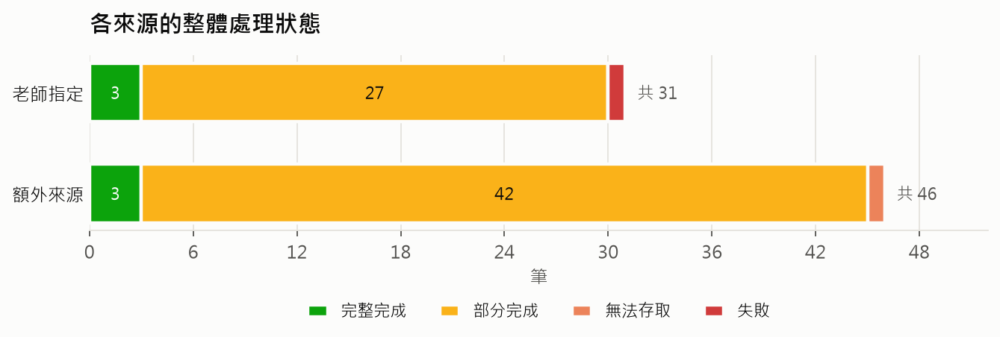
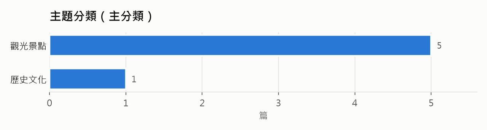
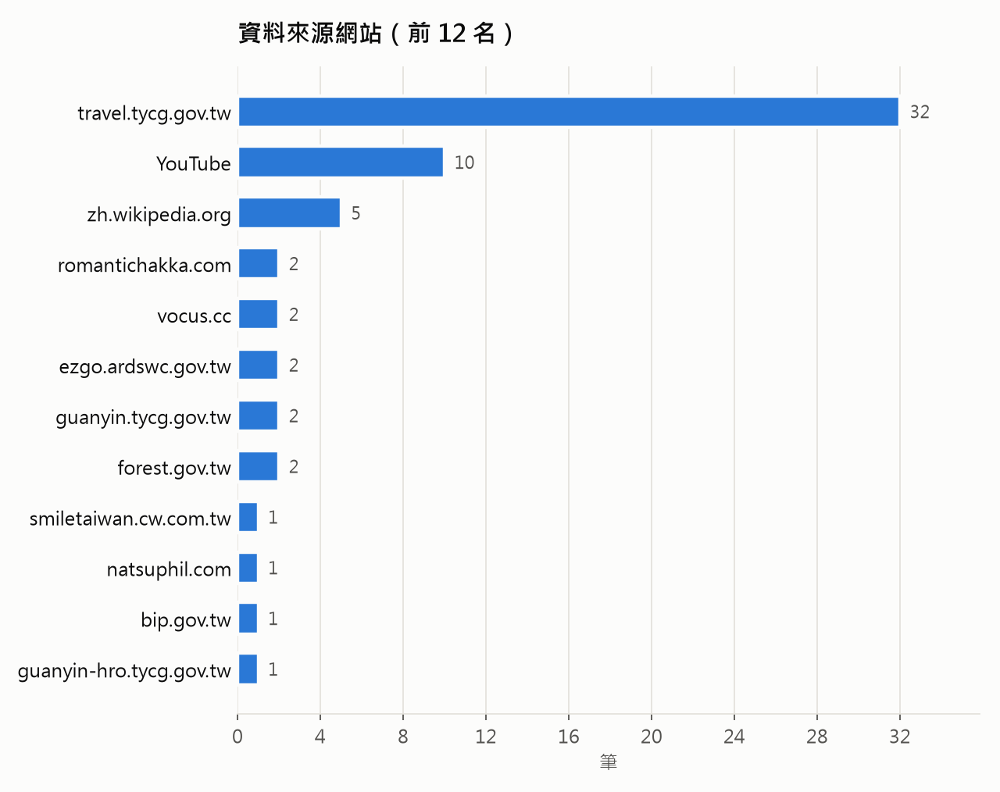
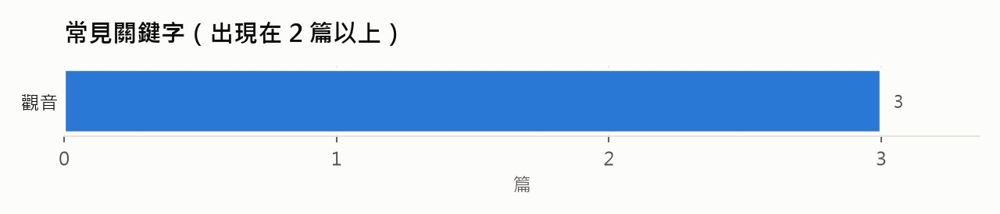

# 成果統計

> 由 `python -m crawler.statistics_report` 依 output/index.jsonl 自動產生。整體狀態分為：完整完成（取得＋可用內容）、部分完成（取得但內容不足）、無法存取、失敗、未處理。

## 重點數字

| 項目 | 數值 |
|---|---|
| 知識庫總筆數 | 77 |
| 老師指定網址 | 31 |
| 老師網址：取得成功率 | 97% |
| 老師網址：完整完成率（取得＋可用內容） | 10% |
| 網頁／影片 | 67／10 |
| 文章圖片／影片代表畫面 | 0／40 |
| 影片字幕段數 | 4,292 |
| 內容文字總量（字） | 32,171 |
| 來源查證筆數 | 6 |

## 各來源的處理狀態

| 來源 | 完整完成 | 部分完成 | 無法存取 | 失敗 | 未處理 | 合計 |
|---|---|---|---|---|---|---|
| 老師指定 | 3 | 27 | 0 | 1 | 0 | 31 |
| 額外來源 | 3 | 42 | 1 | 0 | 0 | 46 |

取得階段（crawl_status）：成功 75、失敗 1、無法存取 1

部分完成的原因：尚無清理後正文／字幕 66、內容品質不足 3

## 常見失敗原因

| 原因 | 筆數 |
|---|---|
| HTTP 404 | 1 |
| 無法確認 robots.txt（保守停止） | 1 |

## 主題分類

| 主題 | 篇數 |
|---|---|
| 觀光景點 | 5 |
| 歷史文化 | 1 |

## 資料來源網站

| 網站 | 筆數 |
|---|---|
| travel.tycg.gov.tw | 32 |
| YouTube | 10 |
| zh.wikipedia.org | 5 |
| romantichakka.com | 2 |
| vocus.cc | 2 |
| ezgo.ardswc.gov.tw | 2 |
| guanyin.tycg.gov.tw | 2 |
| forest.gov.tw | 2 |
| smiletaiwan.cw.com.tw | 1 |
| natsuphil.com | 1 |
| bip.gov.tw | 1 |
| guanyin-hro.tycg.gov.tw | 1 |

## 常見關鍵字

| 關鍵字 | 篇數 |
|---|---|
| 觀音 | 3 |
| 埤塘 | 1 |
| 甘泉寺 | 1 |
| 飛機 | 1 |
| 白沙岬燈塔 | 1 |
| 百合花 | 1 |
| 綠色 | 1 |
| 賞花 | 1 |
| 隧道 | 1 |
| 一日遊 | 1 |
| 石門水庫 | 1 |
| 移民新村 | 1 |
| 樹林 | 1 |
| 老家 | 1 |
| 居民 | 1 |

## 影片字幕來源

| 來源 | 影片數 |
|---|---|
| youtube_vtt | 4 |
| whisper | 5 |
| no_subtitles | 1 |

## 來源查證結果

| 判定 | 筆數 |
|---|---|
| 有衝突 | 4 |
| 已證實 | 1 |
| 資料不足 | 1 |

詳細內容見 [source_verification.md](source_verification.md)。
